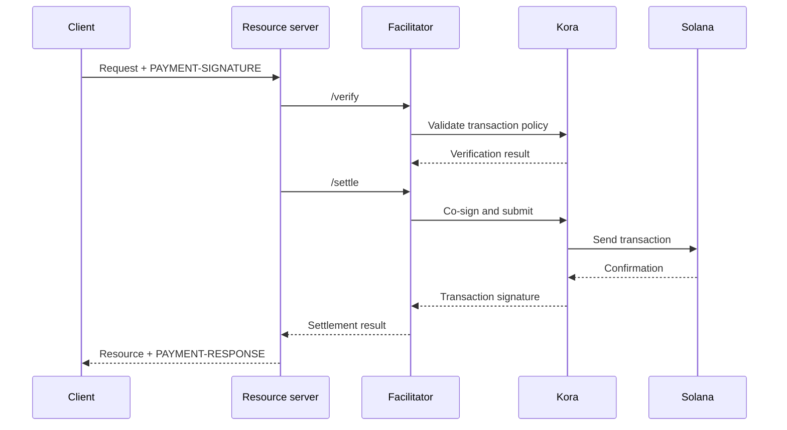

x402ファシリテーターは、1つ以上のリソースサーバーに代わって支払いの検証と決済を行います。これにより、すべてのアプリケーションプロセスにRPC、トランザクション送信、手数料支払者のロジックを組み込むことなく、APIでオンチェーン決済を受け付けられます。

ファシリテーターはアーキテクチャ上の役割であり、必ずしもサードパーティである必要はありません。マネージドサービスを利用することも、独立したファシリテーターを運用することも、リソースサーバー内で自己ファシリテーションを行うこともできます。

## ファシリテーターのインターフェース

x402 V2では、3つのHTTPオペレーションが定義されています。

| エンドポイント     | 目的                                                                       |
| ------------ | ----------------------------------------------------------------------------- |
| `/supported` | サポートされているプロトコルバージョン、スキーム、ネットワーク、拡張機能、署名者を一覧表示します |
| `/verify`    | 決済を行わずに、支払いペイロードがその要件を満たしているかを確認します         |
| `/settle`    | 支払いを送信または完了し、決済結果を返します            |

リソースサーバーは、起動時またはデプロイ時に`/supported`を確認する必要があります。選択したファシリテーターが、そのx402のバージョン、スキーム、Solanaネットワークの組み合わせを正確にサポートしていることを確認するまでは、その支払いオプションを提示しないでください。

```bash
curl https://facilitator.example/supported
```

## 履行前の検証

安全なリクエストの処理順序は次のとおりです。

1. プロトコルライブラリで`PAYMENT-SIGNATURE`ペイロードをパースします。
2. 最初に提示した`PaymentRequirements`と完全に一致することを確認します。
3. ローカルまたは`/verify`経由でペイロードを検証します。
4. 選択した支払いフローが履行後の決済を認めている場合にのみ、リソースの処理を実行します。
5. `/settle`を呼び出し、その結果を含めて`PAYMENT-RESPONSE`を返します。

履行の順序はスキームによって異なる場合があります。たとえば、認可型のフローでは、リソースの処理前に検証を行い、処理後に決済を行うことがあります。一方、別のスキームでは、履行前に決済を求める場合があります。すべての支払いで同じ順序になると想定せず、選択したスキームが定めるフローに従ってください。

<Callout type="warn" title="ファシリテーターのレスポンスは支払いの判断として扱う">
  ファシリテーターとの通信を認証し、すべてのレスポンスを検証し、厳格なタイムアウトを設定し、フェイルクローズドで動作させてください。ネットワークエラーや不正な形式のレスポンスは、支払いの証明にはなりません。
</Callout>

## デプロイモデルを選ぶ

| モデル                   | 適したケース                                                        | 主な責任                                                    |
| ----------------------- | --------------------------------------------------------------- | ---------------------------------------------------------------------- |
| マネージドファシリテーター     | 運用負荷を最小限に抑えたい場合                       | サポート対象ネットワーク、信頼モデル、可用性、データポリシーを確認する  |
| 専用のセルフホスト   | 複数のAPIで署名・決済インフラを共有する場合        | キー、RPC、ストレージ、スケーリング、アップグレードを安全に管理する                      |
| インプロセスのファシリテーション | 1つのサービスで完全な制御が必要で、チェーン関連コンポーネントを運用できる場合 | 決済処理のコードを分離し、リクエスト負荷による枯渇を防ぐ |

URLが`/supported`に応答するという理由だけで、ファシリテーターを選ばないでください。手数料支払者のキーをどう保護しているか、リプレイをどう防いでいるか、トランザクションをどう確認しているか、部分的な障害にどう対処しているか、インシデントをどう報告しているかを確認してください。

## Solanaの署名インフラとしてのKora

[Kora](/docs/tools/kora)は、トランザクションの検証と手数料スポンサーシップのポリシーを備えたSolana署名ノードです。x402ファシリテーターは、Koraを署名および送信のバックエンドとして利用できます。



Koraはx402を置き換えるものではありません。リソースサーバーとファシリテーターは、引き続きx402 V2のオブジェクトとエンドポイントを実装します。Koraは、Solanaトランザクションのポリシーを適用し、RPCインターフェースの背後にある手数料支払者の署名者を保護します。

メンテナンスされているデモと設定については、[Kora x402ガイド](/docs/tools/kora/guides/x402)をご覧ください。

## 本番環境チェックリスト

### キーとトランザクションポリシー

- ファシリテーターと手数料支払者のキーは、ハードウェアベースまたはリモートの署名バックエンドに保管します。
- System、Compute Budget、Token、Token-2022、Associated Tokenの各プログラムは、サポート対象のスキームで必要な場合にのみ許可リストに追加します。
- 署名の前に、想定外の書き込み可能アカウント、転送権限、受取人、ミント、instructions、コンピュート価格を拒否します。
- 支払いを受け取るアカウントは、運用用の手数料支払者アカウントと分離します。

### リプレイとべき等性

- 使用済みの支払い識別子とトランザクション署名を、共有された永続ストアに保存します。
- 検証と消費をアトミックに行い、2つのサーバーインスタンスが同じ認可を同時に受け付けないようにします。
- 副作用のあるリソース操作には、べき等性キーを必須にします。
- 正当な再試行に対しては、再度課金せず、元の結果を返します。

### 可用性と障害処理

- `/verify`、`/settle`、RPCへの送信、確認のそれぞれに、上限付きのタイムアウトを設定します。
- 拒否、期限切れ、保留中、確認済み、失敗の各決済状態を区別します。
- ブロックハッシュの期限切れ後は、支払者に新しいトランザクションの承認を求めずに、トランザクションを再構築したり再署名したりしないでください。
- 複数のRPCエンドポイントを使用し、ブロックハッシュの鮮度、確認のレイテンシ、手数料支払者の残高を監視します。

### オブザーバビリティ

リソース、チャレンジID、選択したスキームとネットワーク、金額、アセット、受取人、支払者アドレス、トランザクション署名、確認レベル、レイテンシ、最終ステータスを記録します。エンコードされた支払い認証情報、ベアラートークン、秘密鍵、署名者の生のレスポンスは、絶対にログに記録しないでください。

決済の失敗、リプレイの試行、ポリシーによる拒否、想定外のアセットや受取人、手数料支払者の残高枯渇、検証済みの支払いと履行されたリソースとの差異について、アラートを設定します。

## 関連リソース

- [x402ファシリテーター仕様](https://github.com/x402-foundation/x402/blob/main/specs/x402-specification-v2.md#7-facilitator-interface)
- [Solana上のx402](/docs/payments/agentic-payments/x402)
- [Koraオペレーターガイド](/docs/tools/kora/operators)
- [本番環境への準備](/docs/tools/transaction-landing#rpc-infrastructure)
