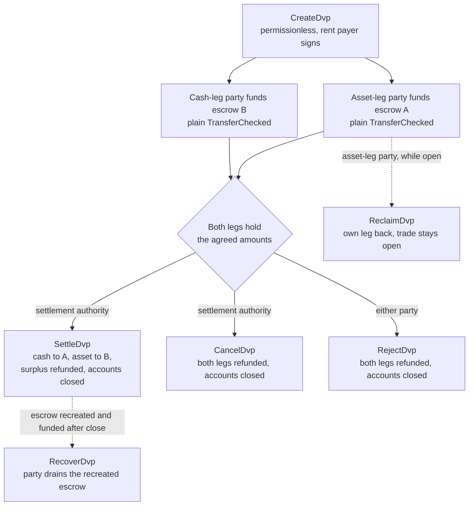
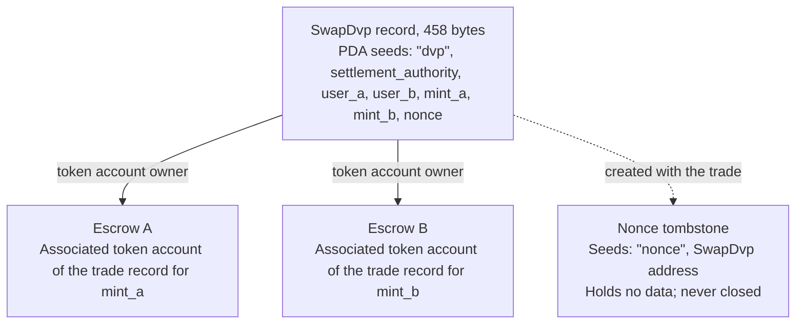

DvP 프로그램은 Solana에서 인도 대 대금 지급(DvP)을 처리하는 표준 프로그램으로,
Solana Foundation이 관리하며 Cantina의 감사를 받았습니다. 두 당사자가 거래에
합의하면 각자 일반 토큰 전송으로 자신의 레그를 에스크로 계정에 보내고, 결제
권한자가 하나의 트랜잭션으로 양쪽 레그를 결제하므로 두 레그가 모두 이동하거나
모두 이동하지 않습니다. 결제 권한자는 거래를 주선한 거래소나 에이전트처럼 거래에
지정된 제3의 주소입니다. 어느 당사자도 프로그램을 작성하거나 배포할 필요가 없으며,
표준 토큰 전송(`TransferChecked`)을 보낼 수 있는 지갑이나 수탁기관이라면 DvP 전용
연동 없이도 레그에 자금을 예치할 수 있습니다. 결제 전까지는 어느 당사자든 자신의
레그를 회수하거나 거래를 되돌릴 수 있습니다.

<Callout type="warn" title="조치하기 전에 기록을 확인하세요">

거래 기록 생성에는 별도의 권한이 필요하지 않으므로, 기록이 존재한다고 해서 합의가
이루어졌다는 증거가 되지는 않습니다. 각 당사자는 자금을 예치하기 전에, 결제
권한자는 결제하기 전에 저장된 조건을 직접 확인해야 합니다(
[검증](#verification-before-funding-and-settlement) 참고).

</Callout>

## 작동 방식

각 거래에는 프로그램 소유의 기록 하나와 레그별 에스크로 계정 두 개가 생성됩니다.
자산 레그 당사자(`user_a`)와 현금 레그 당사자(`user_b`)는 각자 해당 레그의 에스크로
계정으로 토큰을 전송하여 레그에 자금을 예치합니다. 결제 권한자는 결제를 수행할 수
있는 유일한 서명자입니다. 결제 시 각 레그의 합의된 금액이 상대방에게 전송되고,
초과분은 해당 레그를 소유한 당사자에게 반환되며, 기록과 두 에스크로 계정이
닫힙니다. 원자성은 Solana [트랜잭션](/docs/core/transactions)에서 비롯됩니다.
두 전송이 하나의 트랜잭션에 담겨 있으므로 둘 다 적용되거나 둘 다 적용되지 않습니다.

모든 환불, 회수, 초과분 반환은 당사자 본인의 associated token account로 전송됩니다.
`mint_a`는 `user_a`의 계정으로, `mint_b`는 `user_b`의 계정으로 전송됩니다.
수탁기관이나 트레저리 시스템이 자신의 계정에서 레그에 자금을 예치할 수는 있지만,
반환되는 자산은 수탁기관이 아니라 당사자의 계정으로 들어갑니다. 또한 모든 거래는
영구 마커 계정을 남깁니다([상태](#state) 참고).

## 가이드

단계별 페이지에서는 하나의 거래를 생성부터 결제까지 진행하며, 각 instruction마다
TypeScript와 Rust 예제를 제공합니다.

<Cards>
  <Card title="거래 생성" href="/docs/defi/dvp-program/create-a-trade">
    클라이언트를 설치하고 CreateDvp로 거래 조건을 기록합니다
  </Card>
  <Card title="레그에 자금 예치" href="/docs/defi/dvp-program/fund-the-legs">
    저장된 조건을 확인한 다음 일반 전송으로 각 레그에 자금을 예치합니다
  </Card>
  <Card title="거래 결제" href="/docs/defi/dvp-program/settle-the-trade">
    결제 권한자로서 하나의 트랜잭션으로 양쪽 레그를 결제합니다
  </Card>
  <Card title="거래 되돌리기" href="/docs/defi/dvp-program/unwind-a-trade">
    레그를 회수하고, 거래를 취소하거나 거부하며, 늦게 입금된 자금을 복구합니다
  </Card>
</Cards>

[devnet 데모](https://solana.com/delivery-vs-payment/demo)에서는 거래를 처음부터
끝까지 실행합니다. 거래를 생성하고, 표준 토큰 전송으로 두 에스크로에 자금을
예치한 다음, 하나의 트랜잭션으로 양쪽 레그를 결제합니다.

## 프로그램과 위임 중 선택하기

[위임을 사용한 DvP(Delivery vs Payment)](/docs/tokenization/dvp)는
프로그램 없이 동일한 교환을 결제합니다. 각 당사자가 자신의 포지션을 결제
에이전트에게 위임하면, 에이전트가 하나의 트랜잭션으로 양쪽 레그를 이동합니다.

- **프로그램 방식**은 위임이 필요 없으므로 token account당 위임자 한 명이라는
  제한이 적용되지 않으며, 결제 권한자가 수령 대상을 변경할 수 없습니다.
  다만 각 거래는 업그레이드 가능한 프로그램과 해당 업그레이드 권한에 의존합니다.
- **위임 패턴**은 프로그램 의존성이 없으며 Scaled UI Amount가 적용된 민트에서도
  작동합니다. 프로그램 방식은 해당 민트를 거부하므로 Mosaic의 `tokenized-security`
  템플릿으로 생성된 민트는 모두 사용할 수 없습니다(
  [민트 구성 제약 사항](#mint-configuration-constraints) 참고).

## 역할

이 프로그램은 대칭적으로 설계되어 있습니다. 인터페이스에서 두 당사자는 `mint_a`를
인도하는 `user_a`와 `mint_b`를 인도하는 `user_b`입니다. README와 생성된 클라이언트는
`mint_a`를 자산 레그, `mint_b`를 현금 레그라고 부르며 이 문서도 같은 관례를 따르지만,
프로그램은 현금 레그가 반드시 현금성 자산일 것을 요구하지 않습니다. 두 개의 자산이나
두 개의 스테이블코인도 같은 방식으로 결제됩니다.

| 역할                 | 대상                               | 서명                                              | 비고                                                                                                                                                                                                     |
| -------------------- | --------------------------------- | -------------------------------------------------- | --------------------------------------------------------------------------------------------------------------------------------------------------------------------------------------------------------- |
| 자산 레그 당사자      | `user_a`, `mint_a` 인도       | 본인의 예치 전송, Reclaim, Reject, Recover | keypair 지갑 또는 멀티시그 볼트와 같은 PDA 기반 스마트 월렛. SPL Token 멀티시그 계정이나 program account는 당사자가 될 수 없으며, 이 경우 Create가 `PartyNotSignerCapable`로 실패합니다                   |
| 현금 레그 당사자       | `user_b`, `mint_b` 인도       | 본인의 예치 전송, Reclaim, Reject, Recover | 요구 사항 동일                                                                                                                                                                                          |
| 결제 권한자 | 생성 시 지정된 제3의 주소 | Settle, Cancel                                     | 결제를 수행할 수 있는 유일한 서명자입니다. 수령 대상은 생성 시 고정되므로 변경할 수 없습니다. 결제 또는 취소 시 닫힌 계정의 rent를 수령합니다                                         |
| rent 납부자           | `CreateDvp`에 서명한 주체         | Create                                             | 기록, nonce 톰스톤, 두 에스크로의 rent(계정을 유지하기 위한 SOL 예치금)를 부담합니다. rent 수령자로 기록되지는 않으며, 닫힌 계정의 rent는 거래를 닫는 주체가 받습니다 |

## 프로그램 ID

```text
dvp34bdbcEm4f4FCUjGV4mDAkDshaQR4LkK8fdcsyZq
```

| 클러스터      | 프로그램                                       | 업그레이드 권한                              | 마지막 배포 slot |
| ------------ | --------------------------------------------- | ---------------------------------------------- | ------------------ |
| mainnet-beta | `dvp34bdbcEm4f4FCUjGV4mDAkDshaQR4LkK8fdcsyZq` | `DXtFpbPjcn2hxPnw79x1Pfoj35vXh5AsWBkS37YnXMVv` | 452,058,374        |
| devnet       | `dvp34bdbcEm4f4FCUjGV4mDAkDshaQR4LkK8fdcsyZq` | `5EX1zFeJWj4rGYZv432WnYw8CbaSUeTdxPx4r573UgYU` | 479,376,863        |

이 프로그램은 두 클러스터 모두에서 업그레이드할 수 있습니다. 위 수치는
2026년 10월 2일에 `solana program show`가 보고한 값이며, 최신 값은 같은 명령어를
실행하여 확인하세요. devnet 빌드는 단계별 페이지가 기준으로 삼은 커밋(
[설치](/docs/defi/dvp-program/create-a-trade#install) 참고)보다 오래되었지만,
instruction과 오류 집합은 동일합니다.

## 수명 주기



거래는 `CreateDvp`로 시작되어 Settle, Cancel, Reject 중 하나로 닫힐 때까지 열려
있습니다. 자금 예치를 위한 별도의 instruction은 없으며, 에스크로 계정이 합의된
금액 이상을 보유하면 해당 레그에 자금이 예치된 것으로 간주합니다. Reclaim은 레그별로
수행되며 거래를 열린 상태로 유지하므로, 한 레그에 문제가 있더라도 상대방이 거래
전체를 취소해야 하는 것은 아닙니다.

## 상태

각 거래에는 프로그램이 소유하는 458바이트의 `SwapDvp` 계정이 하나 있습니다. 이
계정의 주소는 결제 권한자, 두 당사자, 두 민트, nonce로부터 도출됩니다(시드:
`["dvp", settlement_authority, user_a, user_b, mint_a, mint_b, nonce]`). 금액과
시간은 계정 내부에 저장되며 주소에 영향을 주지 않으므로, 추측하지 말고 반드시
직접 읽어야 합니다. `["nonce", swap_dvp]`에 있는 작은 마커 계정인 nonce 톰스톤은
거래와 함께 생성되며 닫히지 않으므로, 당사자, 민트, 권한자, nonce의 각 조합은
한 번의 거래에만 사용할 수 있습니다.



| 필드                                  | 타입          | 의미                                                                                                 |
| -------------------------------------- | ------------- | ------------------------------------------------------------------------------------------------------- |
| `bump`                                 | `u8`          | PDA bump                                                                                                |
| `user_a`, `user_b`                     | `Pubkey`      | 두 당사자                                                                                         |
| `mint_a`, `mint_b`                     | `Pubkey`      | 자산 레그 민트와 현금 레그 민트                                                                        |
| `settlement_authority`                 | `Pubkey`      | 결제 또는 취소를 수행할 수 있는 유일한 서명자                                                               |
| `token_program_a`, `token_program_b`   | `Pubkey`      | 각 민트를 소유한 token program. 하나의 거래에서 SPL Token 레그와 Token-2022 레그를 혼용할 수 있습니다                    |
| `amount_a`, `amount_b`                 | `u64`         | 각 레그의 합의된 금액으로, 민트의 최소 단위(기본 단위)로 표시합니다                                 |
| `expiry_timestamp`                     | `i64`         | 이 네트워크 시간(온체인 시계) 이후에는 Settle이 거부됩니다. Reclaim, Cancel, Reject는 계속 사용할 수 있습니다 |
| `nonce`                                | `u64`         | 다른 시드가 동일한 거래를 구분합니다. 일회용입니다                                             |
| `ref_string`                           | `[u8; 64]`    | 클라이언트가 임의로 지정하는 참조 값으로, 0으로 패딩됩니다. 프로그램은 이 값을 읽지 않습니다                                     |
| `user_a_settlement_destination`        | `Pubkey`      | Settle 시 현금 레그를 수령합니다. 기본값은 `user_a`입니다                                                   |
| `user_b_settlement_destination`        | `Pubkey`      | Settle 시 자산 레그를 수령합니다. 기본값은 `user_b`입니다                                                  |
| `mint_a_authority`, `mint_b_authority` | `Pubkey`      | 생성 시점에 기록된 민트 권한자입니다. 둘 중 하나라도 변경되면 Settle이 실패합니다                           |
| `earliest_settlement_timestamp`        | `Option<i64>` | 설정된 경우 이 네트워크 시간 이전에는 Settle이 거부됩니다                                                     |

필드 목록은 [거래 생성](/docs/defi/dvp-program/create-a-trade#install)에
명시된 커밋 시점의 프로그램 IDL에서 가져왔습니다.

## Instruction

| Instruction  | 서명자               | 효과                                                                                                                                                              |
| ------------ | -------------------- | ------------------------------------------------------------------------------------------------------------------------------------------------------------------- |
| `CreateDvp`  | 모든 납부자            | `SwapDvp` 기록, nonce 톰스톤, 두 에스크로 계정을 생성합니다. 토큰은 이동하지 않습니다                                                                        |
| `ReclaimDvp` | `user_a` 또는 `user_b` | 서명자 본인의 레그를 에스크로에서 반환합니다. 거래는 열린 상태로 유지되며 해당 레그에 다시 자금을 예치할 수 있습니다                                                                      |
| `SettleDvp`  | 결제 권한자 | `amount_a`를 `user_b`의 수령 주소로, `amount_b`를 `user_a`의 수령 주소로 전송하고, 초과분은 해당 레그의 당사자에게 반환하며, 기록과 두 에스크로를 닫습니다 |
| `CancelDvp`  | 결제 권한자 | 에스크로 A에 있는 금액은 `user_a`에게, 에스크로 B에 있는 금액은 `user_b`에게 환불하고, 기록과 두 에스크로를 닫습니다                                                            |
| `RejectDvp`  | `user_a` 또는 `user_b` | Cancel과 동일한 효과이며, 당사자가 서명합니다                                                                                                                            |
| `RecoverDvp` | `user_a` 또는 `user_b` | 거래가 닫힌 후, 다시 생성된 에스크로의 잔액을 서명자 본인의 token account로 모두 옮기고 해당 에스크로를 닫습니다. Settle, Cancel, Reject 이후에 입금된 자금을 처리합니다  |

모든 환불은 에스크로에 누가 자금을 예치했는지와 관계없이, 해당 레그 민트에 대한
당사자 본인의 associated token account로 전송됩니다.

각 instruction의 계정과 인자는 해당 단계의 페이지에서 확인할 수 있습니다.

## 오류

| 코드 | 오류                            | 발생 시점                                                                                                   |
| ---- | -------------------------------- | ------------------------------------------------------------------------------------------------------ |
| 0    | `SignerNotParty`                 | Reclaim, Reject 또는 Recover에 `user_a`나 `user_b`가 아닌 주소가 서명한 경우                      |
| 1    | `DvpExpired`                     | `expiry_timestamp` 이후에 Settle을 실행한 경우                                                                        |
| 2    | `SettlementAuthorityMismatch`    | Settle 또는 Cancel에 결제 권한자가 아닌 주소가 서명한 경우                              |
| 3    | `SettlementTooEarly`             | `earliest_settlement_timestamp` 이전에 Settle을 실행한 경우                                                          |
| 4    | `LegNotFunded`                   | 에스크로 잔액이 합의된 금액보다 적은 상태에서 Settle을 실행한 경우                                               |
| 5    | `ExpiryNotInFuture`              | 만료 시간이 현재 네트워크 시간과 같거나 그 이전인 상태로 Create를 실행한 경우                                            |
| 6    | `EarliestAfterExpiry`            | 최소 결제 시간이 만료 시간보다 늦은 상태로 Create를 실행한 경우                                               |
| 7    | `SelfDvp`                        | `user_a`와 `user_b`가 같은 상태로 Create를 실행한 경우                                                                 |
| 8    | `SameMint`                       | `mint_a`와 `mint_b`가 같은 상태로 Create를 실행한 경우                                                                 |
| 9    | `ZeroAmount`                     | 어느 한쪽 레그의 금액이 0인 상태로 Create를 실행한 경우                                                                |
| 10   | `BlockedMintExtension`           | TransferFee, InterestBearing, ScaledUiAmount 또는 NonTransferable이 적용된 민트로 Create 또는 Settle을 실행한 경우 |
| 11   | `SettlementAuthorityIsParty`     | 결제 권한자가 당사자 중 한 명과 같은 상태로 Create를 실행한 경우                                                  |
| 12   | `SettlementAuthorityExecutable`  | 실행 가능한(executable) 계정을 결제 권한자로 지정하여 Create를 실행한 경우                                                         |
| 13   | `NonceAlreadyUsed`               | 이미 톰스톤이 있는 `(seeds, nonce)`를 재사용하여 Create를 실행한 경우                                         |
| 14   | `ExpiryTooFarInFuture`           | 만료 시간이 1년을 초과하는 미래로 설정된 상태에서 Create를 실행한 경우                                                         |
| 15   | `RefStringTooLong`               | 64바이트를 초과하는 참조 값으로 Create를 실행한 경우                                                           |
| 16   | `DvpStillOpen`                   | 거래가 아직 열려 있는 상태에서 Recover를 실행한 경우. 이때는 Reclaim을 사용하세요                                                     |
| 17   | `DvpNeverCreated`                | tombstone이 없는 시드로 Recover 실행                                                              |
| 18   | `EscrowPreloadedWithLamports`    | 네이티브가 아닌 에스크로가 rent 면제 최소 금액을 초과하는 lamports를 보유한 상태에서 Create 실행                           |
| 19   | `SettlementDestinationIsSwapDvp` | 결제 목적지를 거래 레코드와 동일하게 지정하여 Create 실행                                         |
| 20   | `SwapDvpPreloadedWithLamports`   | 레코드 주소가 rent 준비금을 초과하는 lamports를 보유한 상태에서 Create 실행                                   |
| 21   | `RecipientAtaMismatch`           | 수령인 또는 환불용 token account가 더 이상 예상된 지갑 및 mint에 속하지 않음                  |
| 22   | `PartyNotSignerCapable`          | 시스템 소유의 실행 불가능(non-executable) 계정이 아닌 당사자를 지정하여 Create 실행                                 |
| 23   | `MintAuthorityChanged`           | 레그의 mint authority가 생성 시점에 기록된 값과 다른 상태에서 Settle 실행                         |

## 이벤트와 인덱싱

이 프로그램은 온체인 이벤트를 발생시키지 않습니다. 인덱서나 정합성 대조 시스템은
`SwapDvp` 계정 상태와 두 에스크로의 토큰 잔액을 읽고, `ref_string`을 사용해
거래를 오프체인 주문과 연결합니다. 레코드는 결제 시점에 폐쇄되므로, 사후에
거래 조건이 필요한 시스템은 조건을 읽을 때 저장해 두거나, 해당 거래를 생성한
트랜잭션에서 재구성해야 합니다.

## 지원되는 토큰

하나의 거래에서 SPL Token 레그와 Token-2022 레그를 짝지을 수 있으며, 각 레그는
자체 token program을 가집니다. Wrapped SOL 레그도 지원됩니다.

| 레그의 mint에 적용된 Token-2022 extension                                                     | 프로그램 동작                                                  |
| ---------------------------------------------------------------------------------------- | ----------------------------------------------------------------- |
| TransferFee, InterestBearing, ScaledUiAmount, NonTransferable                            | Create 및 Settle에서 `BlockedMintExtension`과 함께 거부됨         |
| PermanentDelegate, Pausable, DefaultAccountState, freeze authority, MintCloseAuthority | 허용됨. 각 authority는 에스크로된 토큰에 대해 조치를 취할 수 있음           |
| ConfidentialTransfer                                                                     | 허용됨. 해당 레그의 금액은 공개됨                          |
| TransferHook                                                                             | 지원됨. 레그당 최대 32개의 추가 계정                        |
| 수령 또는 환불 계정의 MemoTransfer                                          | 허용됨. 프로그램이 전송 전에 필요한 메모를 발행함 |

전송 수수료가 있으면 수령 측이 합의된 금액보다 적게 받게 됩니다.
Interest Bearing과 Scaled UI Amount는 원시 금액(raw amount)을 바꾸지 않지만,
거래 생성 시점과 결제 시점 사이에 이율이나 배수가 변경될 수 있어 합의된 금액이
표시되는 방식이 달라집니다. NonTransferable은 두 레그를 모두 묶어 버립니다.

허용되는 authority는 거래가 유지되는 동안(아래 참조) 에스크로된 토큰을 이동하거나
동결하거나 중단시킬 수 있습니다. 에스크로는 기밀 전송을 수신하도록 구성할 수 없으므로,
기밀 레그에서 에스크로된 금액과 결제된 금액은 공개됩니다.

hook이 설정된 mint의 경우, 클라이언트가 hook의 추가 계정을 확인하여 Settle, Cancel,
Reject, Reclaim, Recover에 덧붙입니다. 레그당 32개 제한에는 hook 프로그램과 해당
검증 계정이 포함됩니다. hook authority가 hook의 계정 목록을 이 제한을 넘겨 확장하면,
authority가 되돌릴 때까지 Reclaim, Cancel, Reject, Recover를 포함한 해당 레그의
모든 전송이 실패합니다. 두 레그 모두 hook이 있는 경우에는 레그당 제한보다 먼저
트랜잭션 계정 한도에 도달할 수 있습니다.

수령 또는 환불 계정이 메모를 요구하는 경우, 프로그램은 전송 전에 Memo 프로그램을
호출합니다. 이것이 에스크로에서 토큰을 이동하는 모든 instruction이 `memo_program`
계정을 받는 이유입니다.

### Mint 구성 제약 사항

**Scaled UI Amount.** Solana Foundation의 발행 툴킷인
[Mosaic](https://github.com/solana-foundation/mosaic)의 `tokenized-security` 템플릿은 항상 Scaled UI Amount를
추가하므로, 이 프로그램은 해당 템플릿으로 생성된 mint를 레그로 받아들이지 않습니다.
이 프로그램용 mint는 해당 extension 없이 생성할 수 있습니다
([Token Extensions](/docs/tokens/extensions) 참조).
[위임을 사용하는 DvP](/docs/tokenization/dvp)는 위임된 권한을 통해 결제하며 이 검사를 적용하지 않습니다.

**기본 동결 상태 mint.** 각 거래의 에스크로는 해당 거래를 위해 새로 만들어진
Program Derived Address가 소유하는 associated token account입니다. Default Account
State가 frozen으로 설정된 mint에서는 에스크로가 동결된 상태로 생성되며, 동결이
해제될 때까지 에스크로로의 입금 전송은 실패합니다. [Token ACL](/docs/tokenization/token-acl) 하에서는
발행자 또는 그 전송 대행자(transfer agent)가 입금 전에 해당 거래의 에스크로를
승인해야 합니다. 방법은 두 가지입니다. 거래 레코드의 주소(에스크로의 소유자)를
허용 목록에 추가하여, mint의 Token ACL 구성이 permissionless thaw를 활성화한 경우
누구나 에스크로의 동결을 해제할 수 있게 하거나, freeze authority가 직접 동결을
해제하는 것입니다. 동결된 에스크로는 해당 레그의 Settle, Reclaim, Cancel, Reject,
Recover도 차단하므로, freeze authority(hook이 설정된 mint의 경우 hook authority
포함)는 거래가 유지되는 동안 신뢰해야 하는 당사자입니다. 동결된 에스크로 경로는
여기에서 설명만 하며 devnet 스니펫에서는 실행하지 않습니다.

## 제한 사항

- 매칭, 가격 발견, 오더북이 없습니다. 당사자들이 원장 밖에서 조건에 합의하고, 그중
  한 명이 이를 기록합니다.
- 넷팅(netting)이 없으며 양자 간 거래만 가능합니다. 하나의 레코드는 두 당사자 간의 하나의 거래입니다.
- 부분 체결이 없습니다. Settle은 각 레그에 대해 합의된 금액을 정확히 이동하고,
  남은 금액은 해당 레그의 당사자에게 반환합니다.
- 원장 외부 레그가 없습니다. 두 레그 모두 Solana의 token account이며, 기존 결제망의
  현금 레그는 별도로 결제되고 대조됩니다.
- 자격 확인, 허용 목록, KYC가 없습니다. 보유자 자격은 mint 자체의 제어 기능이
  적용합니다.
- 자동 결제가 없습니다. 결제 authority가 서명해야 합니다.
- 이벤트가 없으며, 트랜잭션 수수료와 rent 외에 프로토콜 수수료도 없습니다.

이 프로그램은 두 당사자 간의 원금 리스크를 제거합니다. 양쪽이 모두 이동하지 않는 한
어느 레그도 이동하지 않습니다. 다만 어느 토큰에 대한 발행자 신용 리스크나 상환
リスク, mint의 freeze, pause, permanent delegate authority가 에스크로된 토큰에 조치를 취할
수 있는 가능성([지원되는 토큰](#supported-tokens) 참조), 그리고 결제 authority가 서명할 수 있는
상태여야 한다는 의존성은 제거하지 못합니다.

## 입금 및 결제 전 검증

`CreateDvp`는 permissionless입니다. 수수료 납부자(payer)만 서명하며, 당사자와 결제
authority는 서명하지 않습니다. 따라서 누구나 임의의 당사자와 조건을 지정한 레코드를
생성할 수 있습니다. 입금 전과 결제 전에 다시 한 번 `SwapDvp` 계정을 읽고 다음을
확인하세요.

1. 계정이 DvP 프로그램 소유이며 크기가 정확히 458바이트입니다. 프로그램이 소유하지
   않은 계정은 실제 레코드처럼 디코딩되는 바이트로 채워질 수 있습니다.
2. `user_a`, `user_b`, `mint_a`, `mint_b`, `settlement_authority`가 합의된 거래와
   일치합니다.
3. `amount_a`, `amount_b`, `expiry_timestamp`, `earliest_settlement_timestamp`가
   합의된 조건과 일치합니다.
4. 두 결제 목적지가 모두 합의된 주소입니다. 위조된 레코드는 대금을 다른 곳으로
   돌릴 수 있습니다.

[레그 입금하기](/docs/defi/dvp-program/fund-the-legs#verify-the-terms)에서는 생성된 클라이언트의
검사형 리더(checked reader)를 안내하고 코드로 검증하는 방법을 보여줍니다.

Settle 트랜잭션이 [`finalized`](/docs/rpc#configuring-state-commitment)에 도달하면 거래가
결제된 것으로 간주하세요. 이는 네트워크 커밋먼트 수준이며, 법적 목적의 결제 완결성
(settlement finality)을 함께 의미하는지는 당사자 간 합의와 적용되는 법제에 따라 달라집니다.

## 버전 관리

`SwapDvp` 계정에는 버전 필드가 없습니다. 레이아웃은 458바이트(`SwapDvp::LEN`)로
고정되어 있으며, 검사형 리더는 다른 길이의 계정을 거부합니다. IDL에는 자체 버전이
있으며, 2026년 10월 2일 기준 `0.1.0`입니다.

이 프로그램은 두 클러스터 모두에서 업그레이드가 가능합니다([Program ID](#program-id) 참조).
거래 레코드는 결제, 취소 또는 거절되기 전까지만 존재하므로, 업그레이드가 진행 중인
거래를 어떻게 처리하는지는 리포지토리를 확인하고, 배포된 빌드의 IDL로 클라이언트를
다시 생성하세요.

## 리포지토리 및 감사

소스, IDL, 생성된 클라이언트, 테스트는 MIT 라이선스로
[`solana-foundation/dvp`](https://github.com/solana-foundation/dvp)에 있습니다. 이 프로그램은 `no_std`
Pinocchio 프로그램이며, 클라이언트는 Codama로 IDL에서 생성됩니다. 취약점 신고는
`SECURITY.md`에 따라 리포지토리의 보안 권고(security advisory) 링크를 통해 접수합니다.

이 프로그램은 [Cantina](https://cantina.xyz/portfolio/fe870bb4-d96d-4902-8aec-9dfcfa2d6a79)의 감사를 받았습니다.

## 관련 문서

- [위임을 이용한 Delivery vs Payment(DvP)](/docs/tokenization/dvp): 프로그램 없이
  사용하는 위임 패턴
- [Token ACL](/docs/tokenization/token-acl): 접근이 제한된 mint가 에스크로 계정과
  상호작용하는 방식
