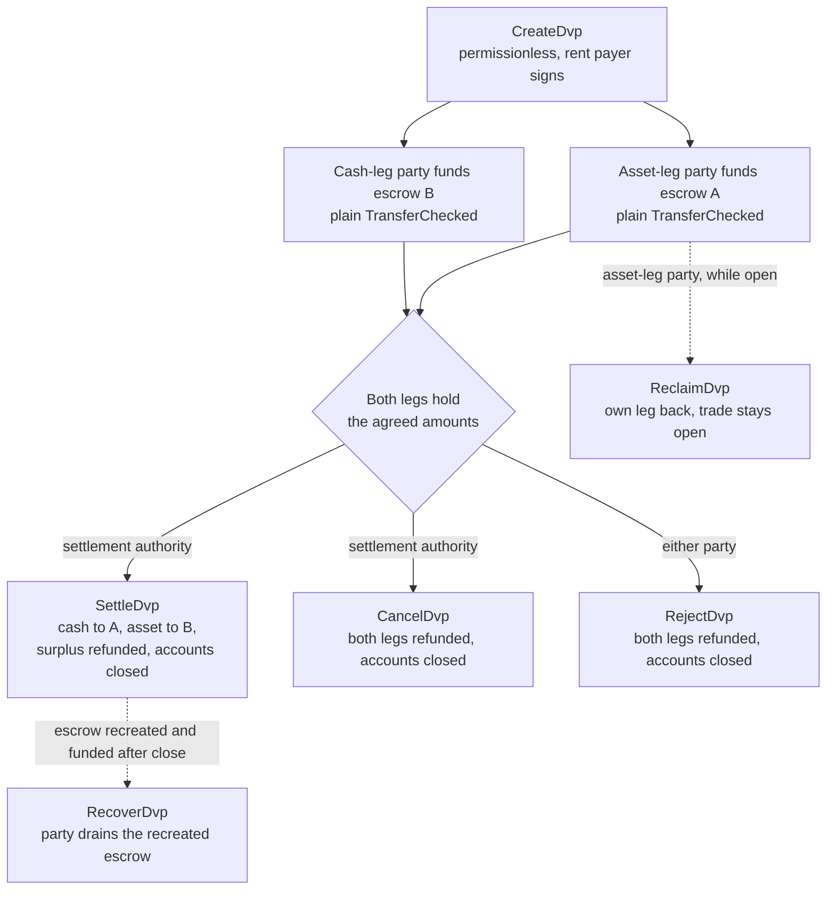
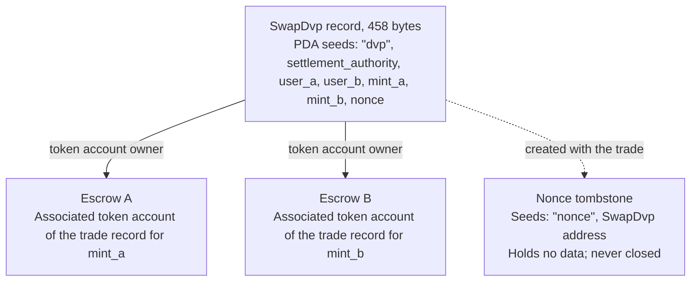

DvP 프로그램은 Solana에서 Delivery versus Payment(대금 동시 결제)를 처리하는 표준 프로그램으로,
Solana Foundation이 관리하며 Cantina의 감사를 받았습니다. 두 당사자가
거래에 합의하면 각자 일반 토큰 전송으로 자신의 레그를 에스크로 계정에 보내고,
정산 권한자가 한 트랜잭션으로 양쪽 레그를 정산하므로
두 레그가 모두 이동하거나 둘 다 이동하지 않습니다. 정산 권한자는 거래에 지정된
제3의 주소로, 거래를 주선한 거래소나 에이전트 등이 해당합니다. 어느 당사자도
프로그램을 작성하거나 배포할 필요가 없으며, 표준 토큰 전송(`TransferChecked`)을
보낼 수 있는 지갑이나 수탁기관이라면 DvP 전용 연동 없이 레그에 자금을 넣을 수 있습니다.
정산 전에는 어느 쪽 당사자든 자신의 레그를 회수하거나 거래를 해제할 수 있습니다.

<Callout type="warn" title="실행하기 전에 기록을 확인하세요">

거래 기록 생성에는 별도 권한이 필요 없으므로 기록이 존재한다고 해서
합의가 이루어졌다는 증거는 아닙니다. 각 당사자는 자금을 넣기 전에,
정산 권한자는 정산하기 전에 저장된 조건을 읽어야 합니다(
[검증](#verification-before-funding-and-settlement) 참고).

</Callout>

## 작동 방식

각 거래에는 프로그램 소유 기록 하나와 레그별 에스크로 계정 두 개가 생성됩니다.
자산 레그 당사자(`user_a`)와 현금 레그 당사자(`user_b`)는 각각 해당 레그의
에스크로 계정으로 토큰을 전송해 레그에 자금을 넣습니다. 정산 권한자는
정산할 수 있는 유일한 서명자입니다. 정산 시 각 레그의 합의된 금액이
상대방에게 전송되고, 초과분은 해당 레그를 소유한 당사자에게 반환되며,
기록과 두 에스크로가 모두 닫힙니다. 원자성은 Solana
[트랜잭션](/docs/core/transactions)에서 비롯됩니다. 두 전송이 하나의 트랜잭션에 포함되므로
둘 다 적용되거나 둘 다 적용되지 않습니다.

모든 환불, 회수, 초과분 반환은 당사자 본인의 associated
token account로 전송됩니다. `user_a`는 `mint_a`용 계정으로, `user_b`는 `mint_b`용 계정으로 반환됩니다.
수탁기관이나 트레저리 시스템이 자체 계정에서 레그에 자금을 넣을 수는 있지만,
반환되는 모든 금액은 수탁기관이 아니라 당사자의 계정으로 들어갑니다. 또한 각 거래는
영구적인 마커 계정을 남깁니다([State](#state) 참고).

## 가이드

단계별 페이지에서는 하나의 거래를 생성부터 정산까지 진행하며,
각 instruction마다 TypeScript와 Rust 예제를 제공합니다.

<Cards>
  <Card title="거래 생성" href="/docs/defi/dvp-program/create-a-trade">
    클라이언트를 설치하고 CreateDvp로 거래 조건을 기록합니다
  </Card>
  <Card title="레그에 자금 입금" href="/docs/defi/dvp-program/fund-the-legs">
    저장된 조건을 확인한 다음, 일반 전송으로 각 레그에 자금을 넣습니다
  </Card>
  <Card title="거래 정산" href="/docs/defi/dvp-program/settle-the-trade">
    정산 권한자로서 한 트랜잭션으로 양쪽 레그를 정산합니다
  </Card>
  <Card title="거래 해제" href="/docs/defi/dvp-program/unwind-a-trade">
    레그를 회수하고, 거래를 취소 또는 거부하며, 늦게 입금된 자금을 복구합니다
  </Card>
</Cards>

[devnet 데모](https://solana.com/delivery-vs-payment/demo)에서는 거래 전 과정을
실행합니다. 거래를 생성하고, 표준 토큰 전송으로 두 에스크로에 자금을 넣은 뒤,
한 트랜잭션으로 양쪽 레그를 정산합니다.

## 프로그램과 위임 방식 중 선택하기

[위임을 이용한 Delivery vs Payment (DvP)](/docs/tokenization/dvp)는
프로그램 없이 동일한 교환을 처리합니다. 각 당사자가 자신의 포지션을
정산 에이전트에게 위임하면, 에이전트가 한 트랜잭션으로 양쪽 레그를 이동합니다.

- **프로그램 방식**은 위임이 필요 없으므로 token account당 위임자 한 명으로
  제한되는 규칙이 적용되지 않으며, 정산 권한자가 수령 대상을 바꿀 수 없습니다.
  다만 각 거래는 업그레이드 가능한 프로그램과 그 업그레이드 권한에 의존합니다.
- **위임 방식**은 프로그램 의존성이 없으며 Scaled UI Amount가 적용된
  mint에서도 작동합니다. 프로그램 방식은 이러한 mint를 거부하므로, Mosaic의
  `tokenized-security` 템플릿으로 생성된 mint는 모두 사용할 수 없습니다(
  [mint 구성 제약 사항](#mint-configuration-constraints) 참고).

## 역할

이 프로그램은 대칭적입니다. 인터페이스에서 두 당사자는 `mint_a`를 전달하는 `user_a`와
`mint_b`를 전달하는 `user_b`입니다. README와 생성된 클라이언트에서는 `mint_a`를 자산 레그,
`mint_b`를 현금 레그라고 부르며 이 페이지들도 같은 관례를 따르지만,
프로그램이 현금 레그가 반드시 현금성 상품일 것을 요구하지는 않습니다.
자산 두 개나 스테이블코인 두 개도 같은 방식으로 정산됩니다.

| 역할                 | 주체                               | 서명                                              | 참고                                                                                                                                                                                                     |
| -------------------- | --------------------------------- | -------------------------------------------------- | --------------------------------------------------------------------------------------------------------------------------------------------------------------------------------------------------------- |
| 자산 레그 당사자      | `user_a`, `mint_a` 전달       | 자신의 입금 전송, Reclaim, Reject, Recover | keypair 지갑 또는 멀티시그 볼트 같은 PDA 기반 스마트 월렛. SPL Token 멀티시그 계정이나 program account는 당사자가 될 수 없으며, Create가 `PartyNotSignerCapable` 오류로 실패합니다                   |
| 현금 레그 당사자       | `user_b`, `mint_b` 전달       | 자신의 입금 전송, Reclaim, Reject, Recover | 동일한 요구 사항                                                                                                                                                                                          |
| 정산 권한자 | 생성 시 지정되는 제3의 주소 | Settle, Cancel                                     | 정산할 수 있는 유일한 서명자입니다. 수령 대상은 생성 시 고정되므로 변경할 수 없습니다. 정산 또는 취소 시 닫힌 계정의 rent를 받습니다                                         |
| rent 납부자           | `CreateDvp`에 서명한 주체         | Create                                             | 기록, nonce tombstone, 두 에스크로의 rent(계정을 유지하기 위한 SOL 예치금)를 부담합니다. rent 수령인으로 기록되지는 않으며, 닫힌 계정의 rent는 거래를 닫는 주체에게 돌아갑니다 |

## 프로그램 ID

```text
dvp34bdbcEm4f4FCUjGV4mDAkDshaQR4LkK8fdcsyZq
```

| 클러스터      | 프로그램                                       | 업그레이드 권한                              | 마지막 배포 slot |
| ------------ | --------------------------------------------- | ---------------------------------------------- | ------------------ |
| mainnet-beta | `dvp34bdbcEm4f4FCUjGV4mDAkDshaQR4LkK8fdcsyZq` | `DXtFpbPjcn2hxPnw79x1Pfoj35vXh5AsWBkS37YnXMVv` | 452,058,374        |
| devnet       | `dvp34bdbcEm4f4FCUjGV4mDAkDshaQR4LkK8fdcsyZq` | `5EX1zFeJWj4rGYZv432WnYw8CbaSUeTdxPx4r573UgYU` | 479,376,863        |

이 프로그램은 두 클러스터 모두에서 업그레이드할 수 있습니다. 위 수치는
2026년 10월 2일에 `solana program show`가 보고한 값이며, 최신 값은 같은 명령을 실행해 확인하세요.
devnet 빌드는 단계별 페이지가 기준으로 삼은 커밋([설치](/docs/defi/dvp-program/create-a-trade#install) 참고)보다
이전 버전이지만, instruction과 오류 세트는 동일합니다.

## 수명 주기



거래는 `CreateDvp`부터 Settle, Cancel, Reject 중 하나가 거래를 닫을 때까지
열려 있습니다. 자금 입금에는 별도의 instruction이 없으며, 에스크로 계정이
합의된 금액 이상을 보유하면 해당 레그에 자금이 입금된 것으로 봅니다. Reclaim은 레그별로 처리되며
거래를 열린 상태로 유지하므로, 한쪽 레그에 문제가 생겨도 상대방이
거래 전체를 취소해야 하는 것은 아닙니다.

## 상태

각 거래에는 프로그램이 소유하는 458바이트의 `SwapDvp` 계정이 하나 있습니다. 이 계정의
주소는 정산 권한자, 두 당사자, 두 mint, 그리고 nonce에서 파생됩니다(시드는
`["dvp", settlement_authority, user_a, user_b, mint_a, mint_b, nonce]`).
금액과 시간은 계정 내부에 저장되며 주소에 영향을 주지 않으므로,
추정하지 말고 반드시 읽어서 확인해야 합니다. `["nonce", swap_dvp]`에 있는 작은 마커 계정인
nonce tombstone은 거래와 함께 생성되어 닫히지 않으므로, 당사자·mint·권한자·nonce의
각 조합은 한 번의 거래에만 사용할 수 있습니다.



| 필드                                  | 타입          | 의미                                                                                                 |
| -------------------------------------- | ------------- | ------------------------------------------------------------------------------------------------------- |
| `bump`                                 | `u8`          | PDA bump                                                                                                |
| `user_a`, `user_b`                     | `Pubkey`      | 두 당사자                                                                                         |
| `mint_a`, `mint_b`                     | `Pubkey`      | 자산 레그 mint와 현금 레그 mint                                                                        |
| `settlement_authority`                 | `Pubkey`      | 정산 또는 취소할 수 있는 유일한 서명자                                                               |
| `token_program_a`, `token_program_b`   | `Pubkey`      | 각 mint를 소유하는 token program. 하나의 거래에서 SPL Token 레그와 Token-2022 레그를 혼합할 수 있습니다                    |
| `amount_a`, `amount_b`                 | `u64`         | 각 레그의 합의된 금액으로, mint의 최소 단위(base unit)로 표시됩니다                                 |
| `expiry_timestamp`                     | `i64`         | 이 네트워크 시간(온체인 시계) 이후에는 Settle이 거부됩니다. Reclaim, Cancel, Reject는 계속 사용할 수 있습니다 |
| `nonce`                                | `u64`         | 다른 시드가 같은 거래를 구분합니다. 일회용입니다                                             |
| `ref_string`                           | `[u8; 64]`    | 불투명한 클라이언트 참조 값으로 0으로 채워지며, 프로그램은 이 값을 읽지 않습니다                                     |
| `user_a_settlement_destination`        | `Pubkey`      | Settle 시 현금 레그를 수령하며, 기본값은 `user_a`입니다                                                   |
| `user_b_settlement_destination`        | `Pubkey`      | Settle 시 자산 레그를 수령하며, 기본값은 `user_b`입니다                                                  |
| `mint_a_authority`, `mint_b_authority` | `Pubkey`      | 생성 시점에 기록된 mint 권한자. 둘 중 하나라도 변경되면 Settle이 실패합니다                           |
| `earliest_settlement_timestamp`        | `Option<i64>` | 설정된 경우, 이 네트워크 시간 이전에는 Settle이 거부됩니다                                                     |

필드 목록은 [거래 생성](/docs/defi/dvp-program/create-a-trade#install)에 명시된 커밋 시점의
프로그램 IDL에서 가져왔습니다.

## Instruction

| Instruction  | 서명자               | 효과                                                                                                                                                              |
| ------------ | -------------------- | ------------------------------------------------------------------------------------------------------------------------------------------------------------------- |
| `CreateDvp`  | 모든 납부자            | `SwapDvp` 기록, nonce tombstone, 두 에스크로 계정을 생성합니다. 토큰은 이동하지 않습니다                                                                        |
| `ReclaimDvp` | `user_a` 또는 `user_b` | 서명자 본인의 레그를 에스크로에서 돌려받습니다. 거래는 열린 상태로 유지되며 해당 레그에 다시 자금을 넣을 수 있습니다                                                                      |
| `SettleDvp`  | 정산 권한자 | `amount_a`를 `user_b`의 수령 주소로, `amount_b`를 `user_a`의 수령 주소로 전송하고, 초과분은 해당 레그의 당사자에게 반환하며, 기록과 두 에스크로를 닫습니다 |
| `CancelDvp`  | 정산 권한자 | 에스크로 A에 있는 금액은 `user_a`에게, 에스크로 B에 있는 금액은 `user_b`에게 환불하고, 기록과 두 에스크로를 닫습니다                                                            |
| `RejectDvp`  | `user_a` 또는 `user_b` | Cancel과 같은 효과이며, 당사자가 서명합니다                                                                                                                            |
| `RecoverDvp` | `user_a` 또는 `user_b` | 거래가 닫힌 후, 다시 생성된 에스크로의 자금을 서명자 본인의 token account로 모두 옮기고 에스크로를 닫습니다. Settle, Cancel, Reject 이후에 들어온 입금을 처리합니다  |

모든 환불은 에스크로에 자금을 넣은 주체와 관계없이, 해당 레그 mint에 대한
당사자 본인의 associated token account로 전송됩니다.

각 instruction의 계정과 인자는 해당 단계의 페이지에서 확인할 수 있습니다.

## 오류

| 코드 | 오류                            | 발생 시점                                                                                                   |
| ---- | -------------------------------- | ------------------------------------------------------------------------------------------------------ |
| 0    | `SignerNotParty`                 | `user_a` 또는 `user_b`가 아닌 주소가 Reclaim, Reject 또는 Recover에 서명한 경우                      |
| 1    | `DvpExpired`                     | `expiry_timestamp` 이후에 Settle한 경우                                                                        |
| 2    | `SettlementAuthorityMismatch`    | 정산 권한자가 아닌 주소가 Settle 또는 Cancel에 서명한 경우                              |
| 3    | `SettlementTooEarly`             | `earliest_settlement_timestamp` 이전에 Settle한 경우                                                          |
| 4    | `LegNotFunded`                   | 에스크로의 보유량이 합의된 금액보다 적은 상태에서 Settle한 경우                                               |
| 5    | `ExpiryNotInFuture`              | 현재 네트워크 시간과 같거나 그 이전인 만료 시간으로 Create한 경우                                            |
| 6    | `EarliestAfterExpiry`            | 만료 시간보다 늦은 최초 정산 시간으로 Create한 경우                                               |
| 7    | `SelfDvp`                        | `user_a`와 `user_b`가 같은 값으로 Create한 경우                                                                 |
| 8    | `SameMint`                       | `mint_a`와 `mint_b`가 같은 값으로 Create한 경우                                                                 |
| 9    | `ZeroAmount`                     | 어느 한쪽 레그의 금액이 0인 상태로 Create한 경우                                                                |
| 10   | `BlockedMintExtension`           | TransferFee, InterestBearing, ScaledUiAmount 또는 NonTransferable이 적용된 mint로 Create 또는 Settle한 경우 |
| 11   | `SettlementAuthorityIsParty`     | 정산 권한자가 당사자 중 한 명과 같은 값으로 Create한 경우                                                  |
| 12   | `SettlementAuthorityExecutable`  | 실행 가능한(executable) 정산 권한자로 Create한 경우                                                         |
| 13   | `NonceAlreadyUsed`               | 이미 tombstone이 있는 `(seeds, nonce)`를 재사용하여 Create한 경우                                         |
| 14   | `ExpiryTooFarInFuture`           | 만료 시간이 1년을 초과하는 미래로 설정하여 Create한 경우                                                         |
| 15   | `RefStringTooLong`               | 64바이트보다 긴 참조 값으로 Create한 경우                                                           |
| 16   | `DvpStillOpen`                   | 거래가 아직 열려 있는 상태에서 Recover한 경우. Reclaim을 사용하세요                                                     |
| 17   | `DvpNeverCreated`                | tombstone이 없는 시드로 Recover 실행                                                              |
| 18   | `EscrowPreloadedWithLamports`    | 비네이티브 에스크로가 rent 면제 최소 금액을 초과하는 lamports를 보유한 상태에서 Create 실행                           |
| 19   | `SettlementDestinationIsSwapDvp` | 정산 대상 주소가 거래 레코드와 같은 상태로 Create 실행                                         |
| 20   | `SwapDvpPreloadedWithLamports`   | 레코드 주소가 rent 예치금을 초과하는 lamports를 보유한 상태에서 Create 실행                                   |
| 21   | `RecipientAtaMismatch`           | 수취인 또는 환불 token account가 더 이상 예상된 지갑 및 민트에 속하지 않음                  |
| 22   | `PartyNotSignerCapable`          | 시스템 소유의 실행 불가능한 계정이 아닌 당사자로 Create 실행                                 |
| 23   | `MintAuthorityChanged`           | 레그의 민트 권한이 생성 시점에 기록된 값과 다른 상태에서 Settle 실행                         |

## 이벤트 및 인덱싱

프로그램은 온체인 이벤트를 발생시키지 않습니다. 인덱서나 대사 시스템은
`SwapDvp` 계정 상태와 두 에스크로의 토큰 잔액을 읽고, `ref_string`을
사용해 거래를 오프체인 주문과 연결합니다. 레코드는 정산 시점에 닫히므로,
사후에 거래 조건이 필요한 시스템은 조건을 읽을 때 저장해 두거나, 해당
거래를 생성한 트랜잭션에서 재구성해야 합니다.

## 지원되는 토큰

거래는 SPL Token 레그와 Token-2022 레그를 짝지을 수 있으며, 각 레그는
자체 token program을 가집니다. Wrapped SOL 레그도 지원됩니다.

| 레그 민트의 Token-2022 익스텐션                                                     | 프로그램 동작                                                  |
| ---------------------------------------------------------------------------------------- | ----------------------------------------------------------------- |
| TransferFee, InterestBearing, ScaledUiAmount, NonTransferable                            | Create와 Settle에서 `BlockedMintExtension`으로 거부됨         |
| PermanentDelegate, Pausable, DefaultAccountState, 동결 권한, MintCloseAuthority | 허용됨. 각 권한이 에스크로된 토큰에 대해 작업을 수행할 수 있음           |
| ConfidentialTransfer                                                                     | 허용됨. 해당 레그의 금액은 공개됨                          |
| TransferHook                                                                             | 지원됨. 레그당 최대 32개의 추가 계정                        |
| 대상 또는 환불 계정의 MemoTransfer                                          | 허용됨. 프로그램이 전송 전에 필요한 메모를 발행함 |

전송 수수료가 있으면 수취 측이 합의된 금액보다 적게 받게 됩니다.
Interest Bearing과 Scaled UI Amount는 원시 금액을 변경하지 않지만, 거래
생성과 정산 사이에 이율이나 승수가 바뀔 수 있으며, 이 경우 합의된 금액이
표시되는 방식이 달라집니다. NonTransferable은 두 레그를 모두 묶어 버립니다.

허용되는 권한은 거래가 유지되는 동안(아래 참조) 에스크로된 토큰을 이동,
동결 또는 중지할 수 있습니다. 에스크로는 기밀 전송을 수신하도록 구성할 수
없으므로, 기밀 레그에서 에스크로된 금액과 정산된 금액은 공개됩니다.

훅이 설정된 민트의 경우, 클라이언트가 훅의 추가 계정을 확인하여 Settle,
Cancel, Reject, Reclaim, Recover에 덧붙입니다. 레그당 32개 한도에는 훅
프로그램과 해당 검증 계정이 포함됩니다. 훅 권한이 훅의 계정 목록을 이
한도 이상으로 늘리면, 해당 권한이 이를 되돌리기 전까지 Reclaim, Cancel,
Reject, Recover를 포함해 그 레그의 모든 전송이 실패합니다. 두 레그 모두
훅이 있는 경우에는 레그당 한도보다 트랜잭션 계정 한도가 먼저 적용될 수
있습니다.

대상 또는 환불 계정이 메모를 요구하는 경우, 프로그램은 전송 전에 Memo
프로그램을 호출합니다. 그래서 에스크로에서 토큰을 이동시키는 모든
instruction이 `memo_program` 계정을 받습니다.

### 민트 구성 제약

**Scaled UI Amount.** Solana Foundation의 발행 툴킷인
[Mosaic](https://github.com/solana-foundation/mosaic)의 `tokenized-security` 템플릿은 항상 Scaled UI Amount를
추가하므로, 프로그램은 해당 템플릿으로 생성된 민트를 레그로 받지 않습니다.
이 프로그램용 민트는 해당 익스텐션 없이 생성할 수 있습니다(
[Token Extensions](/docs/tokens/extensions) 참조).
[위임을 사용한 DvP](/docs/tokenization/dvp)는 위임된 권한을 통해 정산되며 이 검사를
적용하지 않습니다.

**기본 동결 민트.** 각 거래의 에스크로는 해당 거래마다 새로 생성되는
program-derived address가 소유하는 associated token account입니다. Default
Account State가 frozen으로 설정된 민트에서는 에스크로가 동결 상태로
생성되며, 동결이 해제되기 전까지 에스크로로의 입금 전송이 실패합니다.
[Token ACL](/docs/tokenization/token-acl)에서는 발행자 또는 전송 대행자가 입금 전에 해당 거래의
에스크로를 승인해야 한다는 뜻입니다. 방법은 두 가지입니다. 거래 레코드의
주소(에스크로의 소유자)를 허용 목록에 추가하여, 민트의 Token ACL 구성에서
permissionless thaw가 활성화된 경우 누구나 에스크로의 동결을 해제할 수
있게 하거나, 동결 권한이 직접 해제하는 것입니다. 동결된 에스크로는 해당
레그의 Settle, Reclaim, Cancel, Reject, Recover도 막으므로, 동결 권한(훅이
있는 민트에서는 훅 권한도)은 거래가 유지되는 동안 신뢰해야 하는
당사자입니다. 동결된 에스크로 경로는 여기서 설명하며, devnet 스니펫에서는
실행하지 않습니다.

## 제한 사항

- 매칭, 가격 탐색, 오더북이 없습니다. 당사자들이 원장 밖에서 조건에 합의하고,
  그중 한 명이 이를 기록합니다.
- 넷팅이 없으며 양자 간 거래만 지원합니다. 하나의 레코드는 두 당사자 간의 한
  건의 거래입니다.
- 부분 체결이 없습니다. Settle은 각 레그에 대해 합의된 금액을 정확히 이동하고,
  남은 금액은 해당 레그의 당사자에게 반환합니다.
- 원장 밖의 레그가 없습니다. 두 레그 모두 Solana의 token account이며, 기존
  결제망을 이용한 현금 레그는 별도로 정산한 뒤 대사합니다.
- 적격성 검사, 허용 목록, KYC가 없습니다. 보유자 적격성은 민트 자체의 제어
  기능으로 강제합니다.
- 자동 정산이 없습니다. 정산 권한이 서명해야 합니다.
- 이벤트가 없으며, 트랜잭션 수수료와 rent 외의 프로토콜 수수료도 없습니다.

프로그램은 두 당사자 간의 원금 리스크를 제거합니다. 양쪽 레그가 모두
이동하지 않으면 어느 쪽도 이동하지 않습니다. 그러나 어느 토큰에 대한
발행자 신용 리스크나 상환 리스크, 민트의 동결·중지·영구 위임 권한이
에스크로된 토큰에 작업을 수행할 수 있는 가능성([지원되는 토큰](#supported-tokens)
참조), 그리고 정산 권한이 서명할 수 있는 상태여야 한다는 의존성은
제거하지 못합니다.

## 입금 및 정산 전 검증

`CreateDvp`는 권한 제한이 없습니다. 서명하는 쪽은 payer뿐이며, 당사자와
정산 권한은 서명하지 않습니다. 따라서 누구나 임의의 당사자와 임의의 조건을
지정한 레코드를 만들 수 있습니다. 입금 전과 정산 전에 다시 한 번
`SwapDvp` 계정을 읽고 다음을 확인하세요.

1. 계정이 DvP 프로그램 소유이며 크기가 정확히 458바이트입니다. 프로그램이
   소유하지 않은 계정은 실제 레코드처럼 디코딩되는 바이트로 채워질 수
   있습니다.
2. `user_a`, `user_b`, `mint_a`, `mint_b`, `settlement_authority`가 합의된
   거래와 일치합니다.
3. `amount_a`, `amount_b`, `expiry_timestamp`,
   `earliest_settlement_timestamp`가 합의된 조건과 일치합니다.
4. 두 정산 대상 주소가 모두 합의된 주소입니다. 위조된 레코드는 정산 대금을
   다른 곳으로 돌릴 수 있습니다.

[레그 입금하기](/docs/defi/dvp-program/fund-the-legs#verify-the-terms)에서 생성된 클라이언트의 검사형 리더를 나열하고,
코드로 검사하는 방법을 보여줍니다.

Settle 트랜잭션이 [`finalized`](/docs/rpc#configuring-state-commitment)에 도달하면 거래가 정산된 것으로
간주하세요. 이는 네트워크 커밋 수준을 뜻하며, 법적 목적의 정산 완결성까지
의미하는지는 당사자 간 합의와 적용되는 법제에 따라 달라집니다.

## 버전 관리

`SwapDvp` 계정에는 버전 필드가 없습니다. 레이아웃은 458바이트
(`SwapDvp::LEN`)로 고정되어 있으며, 검사형 리더는 다른 길이의 계정을
거부합니다. IDL은 자체 버전을 가지며, 2026년 10월 2일 기준 `0.1.0`입니다.

프로그램은 두 클러스터 모두에서 업그레이드할 수 있습니다([Program ID](#program-id)
참조). 거래 레코드는 정산, 취소 또는 거부되기 전까지만 존재하므로,
업그레이드가 진행 중인 거래를 어떻게 처리하는지는 리포지토리에서 확인하고,
클라이언트는 배포된 빌드의 IDL로 다시 생성하세요.

## 리포지토리 및 감사

소스, IDL, 생성된 클라이언트, 테스트는 MIT 라이선스로
[`solana-foundation/dvp`](https://github.com/solana-foundation/dvp)에 있습니다. 프로그램은 `no_std`
Pinocchio 프로그램이며, 클라이언트는 Codama로 IDL에서 생성됩니다. 취약점
보고는 `SECURITY.md`에 따라 리포지토리의 보안 권고 링크를 통해 접수합니다.

이 프로그램은 [Cantina](https://cantina.xyz/portfolio/fe870bb4-d96d-4902-8aec-9dfcfa2d6a79)의 감사를 받았습니다.

## 관련 문서

- [위임을 사용한 Delivery vs Payment (DvP)](/docs/tokenization/dvp): 프로그램 없이
  사용하는 위임 패턴
- [Token ACL](/docs/tokenization/token-acl): 접근이 제한된 민트가 에스크로 계정과 상호작용하는
  방식
