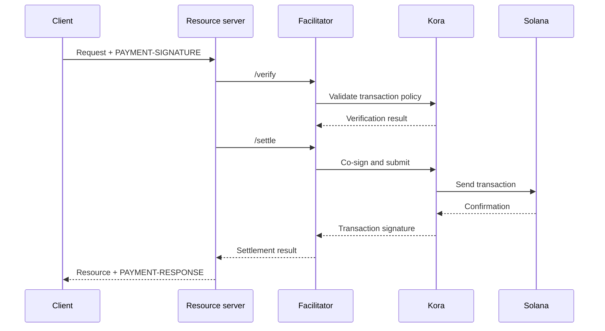

x402 퍼실리테이터는 하나 이상의 리소스 서버를 대신해 결제 검증과 정산을
수행합니다. 이를 통해 모든 애플리케이션 프로세스에 RPC, 트랜잭션 제출,
수수료 지불자 로직을 넣지 않고도 API가 온체인 결제를 받을 수 있습니다.

퍼실리테이터는 아키텍처상의 역할일 뿐, 반드시 제3자여야 하는 것은 아닙니다.
관리형 서비스를 사용하거나, 별도의 퍼실리테이터를 직접 운영하거나,
리소스 서버 내부에서 자체적으로 퍼실리테이션을 수행할 수 있습니다.

## 퍼실리테이터 인터페이스

x402 V2는 세 가지 HTTP 작업을 정의합니다:

| 엔드포인트     | 용도                                                                       |
| ------------ | ----------------------------------------------------------------------------- |
| `/supported` | 지원되는 프로토콜 버전, 스킴, 네트워크, 확장, 서명자를 나열합니다 |
| `/verify`    | 결제를 정산하지 않고, 결제 페이로드가 요구 사항에 부합하는지 확인합니다         |
| `/settle`    | 결제를 제출하거나 완료하고 정산 결과를 반환합니다            |

리소스 서버는 시작 또는 배포 시점에 `/supported`를 확인해야 합니다. 선택한
퍼실리테이터가 해당 x402 버전, 스킴, Solana 네트워크에 대한 지원을 정확히
확인하기 전까지는 결제 옵션을 노출하지 마세요.

```bash
curl https://facilitator.example/supported
```

## 이행 전 검증

안전한 요청 처리 순서는 다음과 같습니다:

1. 프로토콜 라이브러리로 `PAYMENT-SIGNATURE` 페이로드를 파싱합니다.
2. 처음에 제시했던 `PaymentRequirements`와 정확히 일치하는지 확인합니다.
3. 로컬에서 또는 `/verify`를 통해 페이로드를 검증합니다.
4. 선택한 결제 흐름이 이행 후 정산을 허용하는 경우에만
   리소스 작업을 수행합니다.
5. `/settle`을 호출하고 결과와 함께 `PAYMENT-RESPONSE`를 반환합니다.

스킴마다 이행 순서가 다를 수 있습니다. 예를 들어 승인(authorization) 방식의
흐름은 리소스 작업 전에 검증하고 작업 후에 정산할 수 있는 반면, 다른 스킴은
이행 전에 정산을 요구할 수 있습니다. 모든 결제에 하나의 순서를 가정하지 말고,
선택한 스킴이 선언한 흐름을 따르세요.

<Callout type="warn" title="퍼실리테이터 응답을 결제 판단으로 취급하세요">
  퍼실리테이터 트래픽을 인증하고, 모든 응답을 검증하며, 엄격한 타임아웃을
  사용하고, 실패 시 안전하게 차단(fail closed)하세요. 네트워크 오류나 형식이
  잘못된 응답은 결제가 이루어졌다는 증거가 아닙니다.
</Callout>

## 배포 모델 선택

| 모델                   | 사용 시기                                                        | 주요 책임                                                    |
| ----------------------- | --------------------------------------------------------------- | ---------------------------------------------------------------------- |
| 관리형 퍼실리테이터     | 운영 범위를 최소화하고 싶을 때                       | 지원 네트워크, 신뢰 모델, 가용성, 데이터 정책을 검토  |
| 전용 자체 호스팅   | 여러 API가 서명 및 정산 인프라를 공유할 때        | 키, RPC, 스토리지, 확장, 업그레이드를 안전하게 관리                      |
| 인프로세스 퍼실리테이션 | 하나의 서비스가 완전한 제어권이 필요하고 체인 구성 요소를 직접 운영할 수 있을 때 | 결제 코드를 격리하고 요청 부하로 인해 리소스가 고갈되지 않도록 방지 |

URL이 `/supported`에 응답한다는 이유만으로 퍼실리테이터를 선택하지 마세요.
수수료 지불자 키를 어떻게 보호하는지, 리플레이를 어떻게 방지하는지, 트랜잭션을
어떻게 확인하는지, 부분 실패를 어떻게 처리하는지, 장애를 어떻게 보고하는지
검토하세요.

## Solana 서명 인프라로서의 Kora

[Kora](/docs/tools/kora)는 트랜잭션 검증 및 수수료 후원 정책을 갖춘 Solana 서명자
노드입니다. x402 퍼실리테이터는 Kora를 서명 및 제출 백엔드로 사용할 수
있습니다:



Kora는 x402를 대체하지 않습니다. 리소스 서버와 퍼실리테이터는 여전히 x402 V2의
객체와 엔드포인트를 구현해야 하며, Kora는 Solana 트랜잭션 정책을 적용하고 RPC
인터페이스 뒤에서 수수료 지불자 서명자를 보호합니다.

유지 관리되는 데모와 구성은 [Kora x402 가이드](/docs/tools/kora/guides/x402)를
참고하세요.

## 프로덕션 체크리스트

### 키와 트랜잭션 정책

- 퍼실리테이터 키와 수수료 지불자 키는 하드웨어 기반 또는 원격 서명
  백엔드에 저장하세요.
- System, Compute Budget, Token, Token-2022, Associated Token 프로그램은
  지원하는 스킴에 필요한 경우에만 허용 목록에 추가하세요.
- 서명하기 전에 예상치 못한 쓰기 가능 계정, 전송 권한, 수신자, 민트,
  인스트럭션, 컴퓨트 가격을 거부하세요.
- 결제 수신 계정은 운영용 수수료 지불자 계정과 분리하세요.

### 리플레이와 멱등성

- 사용된 결제 식별자와 트랜잭션 서명을 공유되는 영구 저장소에
  보관하세요.
- 두 서버 인스턴스가 동일한 승인을 동시에 수락할 수 없도록 검증과 소비를
  원자적으로 처리하세요.
- 부수 효과가 있는 리소스 작업에는 멱등성 키를 요구하세요.
- 정당한 재시도에는 다시 청구하지 말고 원래의 결과를 반환하세요.

### 가용성과 장애 처리

- `/verify`, `/settle`, RPC 제출, 확인에 대해 제한된 타임아웃을
  설정하세요.
- 거부됨, 만료됨, 대기 중, 확인됨, 실패한 정산을 구분하세요.
- 블록해시가 만료된 후에는 결제자에게 새 트랜잭션 승인을 요청하지 않고
  트랜잭션을 다시 구성하거나 재서명하지 마세요.
- 두 개 이상의 RPC 엔드포인트를 사용하고, 블록해시 신선도, 확인 지연 시간,
  수수료 지불자 잔액을 모니터링하세요.

### 관측성

리소스, 챌린지 ID, 선택된 스킴과 네트워크, 금액, 자산, 수신자, 결제자 주소,
트랜잭션 서명, 확인 수준, 지연 시간, 최종 상태를 기록하세요. 인코딩된 결제
자격 증명, 베어러 토큰, 개인 키, 원시 서명자 응답은 절대 로그에 남기지 마세요.

정산 실패, 리플레이 시도, 정책 거부, 예상치 못한 자산 또는 수신자, 수수료
지불자 잔액 고갈, 검증된 결제와 이행된 리소스 간의 불일치에 대해 알림을
설정하세요.

## 관련 리소스

- [x402 퍼실리테이터 사양](https://github.com/x402-foundation/x402/blob/main/specs/x402-specification-v2.md#7-facilitator-interface)
- [Solana의 x402](/docs/payments/agentic-payments/x402)
- [Kora 운영자 가이드](/docs/tools/kora/operators)
- [프로덕션 준비 상태](/docs/tools/transaction-landing#rpc-infrastructure)
