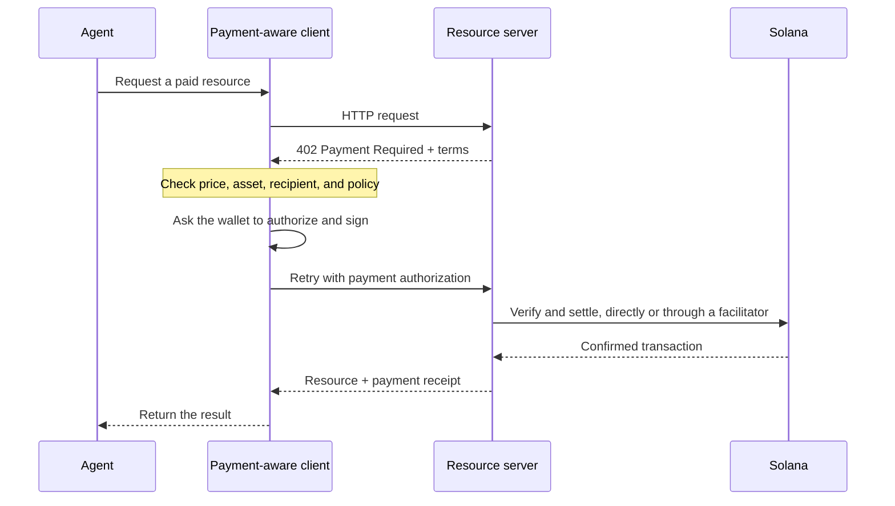

Met agentic-betalingen kan software in dezelfde HTTP-workflow een prijs ontdekken, een betaling autoriseren en een resource ontvangen. Een agent kan betalen voor een dataquery, modelinferentie of tool-aanroep zonder eerst een factureringsaccount aan te maken of een API-sleutel te kopiëren.

<Cards>
  <Card title="MPP" href="/docs/payments/agentic-payments/mpp">
    Gebruik HTTP-authenticatie voor eenmalige betalingen en gemeten betaalsessies.
  </Card>
  <Card title="x402" href="/docs/payments/agentic-payments/x402">
    Voeg x402 V2-betalingsvereisten, handtekeningen en afwikkeling toe aan een HTTP-resource.
  </Card>
</Cards>

## De gemeenschappelijke betaalflow

MPP en x402 gebruiken verschillende headers en datamodellen, maar hun basis-HTTP-flow is vergelijkbaar:

## MPP en x402

Beide protocollen kunnen stablecoinbetalingen op Solana afwikkelen. Kies op basis van het betaalmodel en de interoperabiliteit die je service nodig heeft, en niet alleen op basis van de gedeelde statuscode `402`.

|                         | MPP                                                               | x402                                                                     |
| ----------------------- | ----------------------------------------------------------------- | ------------------------------------------------------------------------ |
| Challenge               | `WWW-Authenticate: Payment`                                       | `PAYMENT-REQUIRED`                                                       |
| Autorisatie door de client    | `Authorization: Payment`                                          | `PAYMENT-SIGNATURE`                                                      |
| Ontvangstbewijs                 | `Payment-Receipt`                                                 | `PAYMENT-RESPONSE`                                                       |
| Solana-betaalmodellen   | Eenmalige `charge`-intents en `session`-intents met limiet en meting           | Schema's zoals `exact` en `upto`; ondersteuning verschilt per netwerk en client |
| Afwikkelingsarchitectuur | Servervalidatie, of een optionele relay of gateway                | Resourceserver met lokale verificatie of een facilitator                 |
| Goed startpunt     | API's die HTTP-authenticatiesemantiek of herhaalde metering nodig hebben | Resources met betaling per verzoek en bestaande x402-clients                      |

MPP staat voor **Machine Payments Protocol**. Verwar het niet met het **Model Context Protocol (MCP)**. MCP stelt tools en resources beschikbaar aan agents; MPP of x402 kan betaling vereisen wanneer een agent een van die tools aanroept.

<Callout type="info">
  Een service kan meer dan één protocol aanbieden. De client kiest een betaaloptie die hij ondersteunt en gebruikt vervolgens de bijbehorende challenge-, autorisatie- en receipt-headers voor de hele uitwisseling.
</Callout>
