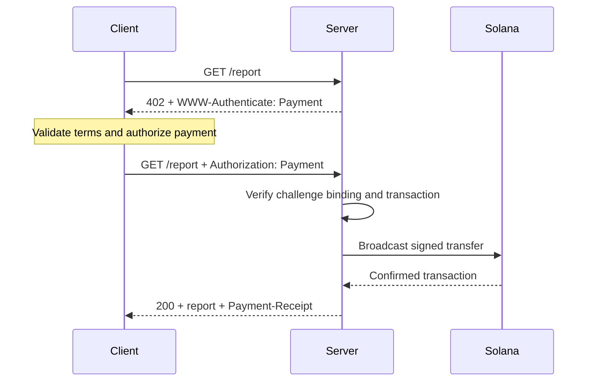
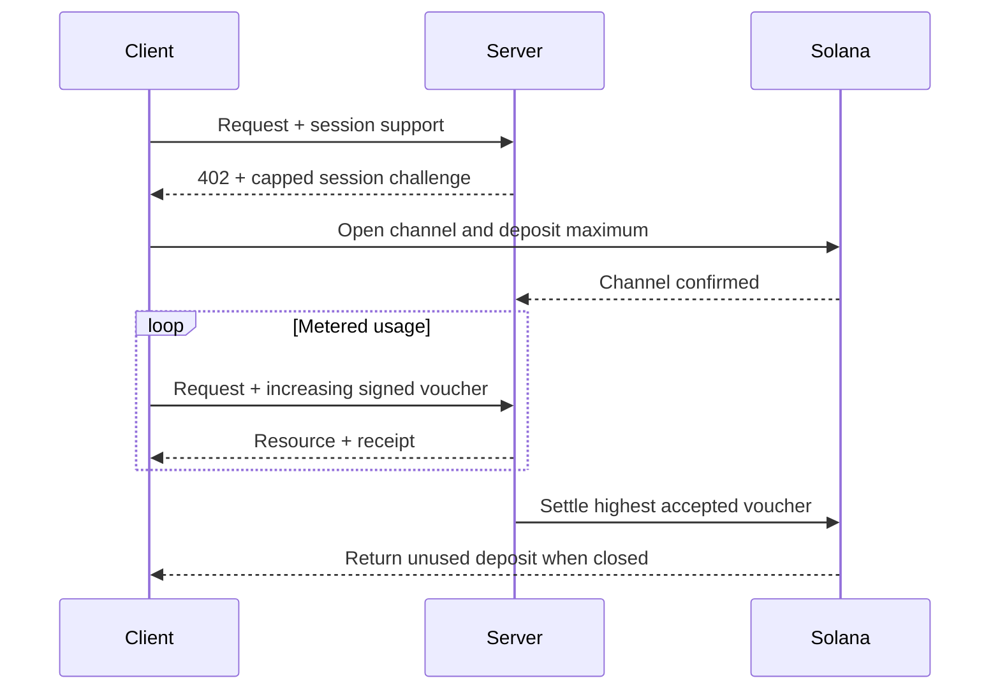

Het [Machine Payments Protocol (MPP)](https://mpp.dev/) past de semantiek van HTTP-authenticatie
toe op betalingen. Een server stuurt een challenge terug voor een onbetaald verzoek, een
client antwoordt met een betalingscredential, en de server geeft een ontvangstbewijs terug
zodra hij de betaling heeft geaccepteerd.

MPP scheidt drie aspecten:

- Een **intent** beschrijft de commerciële interactie, zoals een eenmalige
  `charge` of een gemeterde `session`.
- Een **betaalmethode** beschrijft hoe waarde wordt verplaatst. De Solana-methode
  ondersteunt native SOL en SPL-tokens voor charges.
- Een HTTP-**transport** draagt challenges, credentials, ontvangstbewijzen en fouten.

MPP wordt gepubliceerd als een reeks Internet-Drafts. Beschouw de
[actuele specificaties](https://paymentauth.org/) als de bron van waarheid en
verwacht dat details nog veranderen zolang de drafts in ontwikkeling zijn.

## HTTP-uitwisseling

MPP gebruikt standaard HTTP-authenticatievelden in plaats van protocolspecifieke
betalingsheaders:

| Bericht                 | HTTP-representatie                                         |
| ----------------------- | ----------------------------------------------------------- |
| Betalingschallenge       | `402 Payment Required` met `WWW-Authenticate: Payment ...` |
| Betalingscredential      | Opnieuw verzonden verzoek met `Authorization: Payment ...`           |
| Succesvol ontvangstbewijs      | Resourcerespons met `Payment-Receipt: ...`               |
| Ongeldige betalingsgegevens | Problem Details-body met `application/problem+json`       |



Een challenge bevat een door de server gegenereerde ID, realm, methode, intent, gecodeerd
betalingsverzoek en vervaltijd. De credential herhaalt de challenge en voegt het
methodespecifieke betalingsbewijs toe. De server moet beide onderdelen verifiëren; een geldige
overdracht die bij een andere challenge hoort, mag de resource niet ontgrendelen.

## Eenmalige Solana-charges

De Solana-`charge`-intent ondersteunt twee soorten credentials:

- **Pull mode** gebruikt een ondertekende transactie. De client ondertekent de overdracht en
  stuurt de transactie naar de server. De server verifieert, voegt optioneel een
  handtekening van de fee payer toe, verzendt de transactie naar het netwerk, bevestigt en geeft de transactiehandtekening
  terug in zijn ontvangstbewijs.
- **Push mode** gebruikt een transactiehandtekening. De client verzendt eerst naar het netwerk en
  stuurt daarna de bevestigde handtekening naar de server. De server haalt de transactie op en verifieert
  die voordat hij de resource teruggeeft.

Pull mode maakt door de server gesponsorde transactiekosten en retry-logica aan serverzijde mogelijk.
Push mode is handig wanneer een wallet vereist dat de client zijn eigen
transactie indient, maar kan geen gebruikmaken van sponsoring van de kosten door de server.

Voor de normatieve velden en verificatieregels, zie de
[Solana charge-specificatie](https://paymentauth.org/draft-solana-charge-00.html).

## Een MPP-charge toevoegen aan een Express-API

De Solana Pay Kit biedt een actuele TypeScript-integratie voor MPP en x402.
Installeer deze samen met Express:

```bash
pnpm add @solana/pay-kit @solana/kit@^6.9.0 express
pnpm add --save-dev @types/express tsx
```

Dit minimale voorbeeld gebruikt de gehoste Surfpool-sandbox en de openbare
demo-ontvanger van het pakket. Het is alleen bedoeld voor lokale ontwikkeling:

```ts filename=server.ts
import express from "express";
import { createPayKit, usd } from "@solana/pay-kit";

const pay = await createPayKit({
  accept: ["mpp"],
  rpcUrl: "https://402.surfnet.dev:8899"
});

const app = express();

app.get("/report", pay.express(usd("0.01")), (_req, res) => {
  res.json({ report: "Paid report" });
});

app.listen(4567, () => {
  console.log("Paid API listening on http://127.0.0.1:4567");
});
```

Voer het uit en vergelijk een onbetaald verzoek met een verzoek dat rekening houdt met betalingen:

```bash
pnpm tsx server.ts
curl -i http://127.0.0.1:4567/report
pay --sandbox curl http://127.0.0.1:4567/report
```

De route handler wordt pas uitgevoerd nadat de middleware de betaling heeft geaccepteerd.

<Callout type="warn" title="Vervang in productie elke sandbox-standaardwaarde">
  Configureer een expliciet netwerk, merchant-ontvanger, dedicated RPC, stabiel
  challenge-binding secret, productie-ondertekenaar en duurzame replay-store. Stuur echte
  betalingen nooit naar de demo-ondertekenaar van een pakket.
</Callout>

## Gemeterde sessies

Gebruik een Solana MPP-`session` wanneer een client veel kleine, samenhangende betalingen gaat doen.
Een sessie opent een onchain betalingskanaal met een maximale storting en gebruikt vervolgens
cumulatieve ondertekende vouchers naarmate het gebruik toeneemt. De server kan vouchers
offchain verifiëren en het hoogste geaccepteerde bedrag later afwikkelen.

Dit is nuttig voor inferentie die per token wordt gemeterd, downloads die per byte worden gemeterd, live data
en herhaalde toolaanroepen. Het is niet hetzelfde als het verzenden van een afzonderlijke onchain
betaling voor elke gebeurtenis.



Noem een sessie een **sessiebetaling**, **betalingskanaal** of **begrensde herhaalde
autorisatie**. Spreek alleen van een gestreamde betaling wanneer de dienst en het betalingscontract
daadwerkelijk een stroom van gebruik meten.

## Verificatie in productie

Voor elke Solana-charge moet de server minimaal verifiëren dat:

- De challenge authentiek is, niet verlopen, gebonden aan dit verzoek en bedoeld voor
  deze realm.
- De transactie het verwachte netwerk, de verwachte asset of mint, ontvanger, het verwachte bedrag
  en het verwachte token program gebruikt.
- Eventuele instructies voor fee payers of associated token account expliciet
  zijn toegestaan en de ondertekenaar van de server niet kunnen leegtrekken.
- De transactie is geslaagd op het vereiste commitment-niveau.
- De transactiehandtekening nog niet eerder is gebruikt.
- De replay-controle en de consume-bewerking atomair zijn over alle serverinstanties.

Bewaar voor sessies ook de kanaalstatus, het geaccepteerde cumulatieve bedrag en de
settlement watermark in een gedeelde store. Documenteer hoe clients ongebruikte
tegoeden terugkrijgen als de server niet beschikbaar raakt.

## Gerelateerde bronnen

- [MPP-specificaties](https://paymentauth.org/)
- [MPP-protocoldocumentatie](https://mpp.dev/protocol)
- [Solana Pay Kit](https://github.com/solana-foundation/pay-kit)
- [Overzicht van agentische betalingen](/docs/payments/agentic-payments)
- [Productiegereedheid](/docs/tools/security#verify-addresses)
