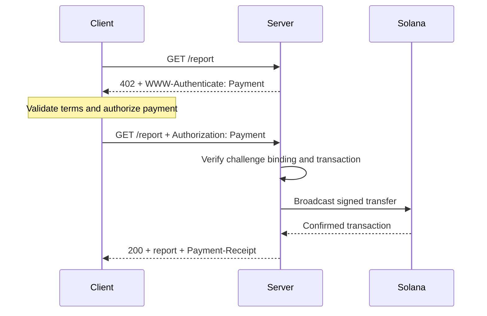
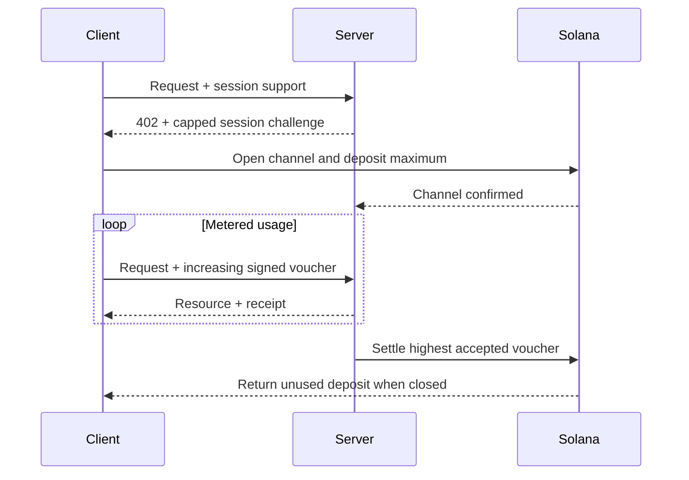

Het [Machine Payments Protocol (MPP)](https://mpp.dev/) past de semantiek van HTTP-authenticatie toe op betalingen. Een server beantwoordt een onbetaald verzoek met een challenge, een client stuurt een betaal-credential terug en de server geeft een receipt terug nadat hij
de betaling heeft geaccepteerd.

MPP scheidt drie aspecten:

- Een **intent** beschrijft de commerciële interactie, zoals een eenmalige
  `charge` of een afgemeten `session`.
- Een **betaalmethode** beschrijft hoe waarde wordt verplaatst. De Solana-methode ondersteunt
  native SOL en SPL-tokens voor charges.
- Een HTTP-**transport** draagt challenges, credentials, receipts en fouten.

MPP wordt gepubliceerd als een reeks Internet-Drafts. Beschouw de
[actuele specificaties](https://paymentauth.org/) als de bron van waarheid en
verwacht dat details nog veranderen zolang de drafts in ontwikkeling zijn.

## HTTP-uitwisseling

MPP gebruikt standaard HTTP-authenticatievelden in plaats van protocolspecifieke
betaalheaders:

| Bericht                 | HTTP-representatie                                         |
| ----------------------- | ----------------------------------------------------------- |
| Betaalchallenge       | `402 Payment Required` met `WWW-Authenticate: Payment ...` |
| Betaal-credential      | Opnieuw verzonden verzoek met `Authorization: Payment ...`           |
| Succesvolle receipt      | Respons van de resource met `Payment-Receipt: ...`               |
| Ongeldige betaalgegevens | Problem Details-body met `application/problem+json`       |



Een challenge bevat een door de server gegenereerde ID, realm, methode, intent, gecodeerd
betaalverzoek en een vervaltijd. De credential herhaalt de challenge en voegt het
methodespecifieke betaalbewijs toe. De server moet beide onderdelen verifiëren; een geldige
overdracht die bij een andere challenge hoort, mag de resource niet ontgrendelen.

## Eenmalige Solana-charges

De Solana-`charge`-intent ondersteunt twee soorten credentials:

- **Pull-modus** gebruikt een ondertekende transactie. De client ondertekent de overdracht en
  stuurt de transactie naar de server. De server verifieert, voegt optioneel een
  fee-payer-handtekening toe, verstuurt de transactie naar het netwerk, bevestigt en geeft de transactiehandtekening
  terug in zijn receipt.
- **Push-modus** gebruikt een transactiehandtekening. De client verstuurt eerst de transactie naar het netwerk en
  stuurt daarna de bevestigde handtekening naar de server. De server haalt de transactie op en verifieert
  deze voordat hij de resource teruggeeft.

Pull-modus maakt door de server gesponsorde transactiekosten en retrylogica aan de serverzijde mogelijk.
Push-modus is handig wanneer een wallet vereist dat de client zijn eigen
transactie indient, maar kan geen gebruikmaken van sponsoring van de kosten door de server.

Zie de [Solana charge-specificatie](https://paymentauth.org/draft-solana-charge-00.html) voor de normatieve velden en
verificatieregels.

## Een MPP-charge toevoegen aan een Express-API

De Solana Pay Kit biedt een actuele TypeScript-integratie voor MPP en x402.
Installeer de kit samen met Express:

```bash
pnpm add @solana/pay-kit @solana/kit@^6.9.0 express
pnpm add --save-dev @types/express tsx
```

Dit minimale voorbeeld gebruikt de gehoste Surfpool-sandbox en de openbare
demo-ontvanger van het pakket. Het is alleen bedoeld voor lokale ontwikkeling:

```ts filename=server.ts
import express from "express";
import { createPayKit, usd } from "@solana/pay-kit";

const pay = await createPayKit({
  accept: ["mpp"],
  rpcUrl: "https://402.surfnet.dev:8899"
});

const app = express();

app.get("/report", pay.express(usd("0.01")), (_req, res) => {
  res.json({ report: "Paid report" });
});

app.listen(4567, () => {
  console.log("Paid API listening on http://127.0.0.1:4567");
});
```

Voer het uit en vergelijk een onbetaald verzoek met een verzoek dat een betaling bevat:

```bash
pnpm tsx server.ts
curl -i http://127.0.0.1:4567/report
pay --sandbox curl http://127.0.0.1:4567/report
```

De route handler wordt pas uitgevoerd nadat de middleware de betaling heeft geaccepteerd.

<Callout type="warn" title="Vervang in productie alle sandbox-standaardwaarden">
  Configureer een expliciet netwerk, een ontvanger van de merchant, een dedicated RPC, een stabiel
  geheim voor challenge-binding, een productie-signer en een duurzame replay-opslag. Stuur echte betalingen nooit
  naar de demo-signer van een pakket.
</Callout>

## Afgemeten sessies

Gebruik een Solana MPP-`session` wanneer een client veel kleine, samenhangende betalingen gaat doen.
Een sessie opent een onchain betaalkanaal met een maximale storting en gebruikt vervolgens
cumulatieve ondertekende vouchers naarmate het gebruik toeneemt. De server kan vouchers
offchain verifiëren en later het hoogste geaccepteerde bedrag afwikkelen.

Dit is nuttig voor inferentie die per token wordt afgemeten, downloads die per byte worden afgemeten, live data
en herhaalde toolaanroepen. Het is niet hetzelfde als het versturen van een aparte onchain
betaling voor elke gebeurtenis.



Noem een sessie een **sessiebetaling**, **betaalkanaal** of **gemaximeerde herhaalde
autorisatie**. Noem het alleen een streamingbetaling wanneer de dienst en het betaalcontract
daadwerkelijk een stroom aan gebruik afmeten.

## Verificatie in productie

Voor elke Solana-charge moet de server minimaal het volgende verifiëren:

- De challenge is authentiek, niet verlopen, gebonden aan dit verzoek en bedoeld voor
  deze realm.
- De transactie gebruikt het verwachte netwerk, asset of mint, de verwachte ontvanger, het verwachte bedrag
  en het verwachte token program.
- Eventuele instructies voor de fee-payer of associated token account zijn expliciet
  toegestaan en kunnen de server-signer niet leegtrekken.
- De transactie is geslaagd op het vereiste commitment-niveau.
- De transactiehandtekening is nog niet eerder gebruikt.
- De replay-controle en de consume-bewerking zijn atomair over alle serverinstanties heen.

Sla voor sessies ook de kanaalstatus, het geaccepteerde cumulatieve bedrag en de
watermark van de afwikkeling op in een gedeelde opslag. Documenteer hoe clients ongebruikte
tegoeden terugkrijgen als de server niet beschikbaar raakt.

## Gerelateerde bronnen

- [MPP-specificaties](https://paymentauth.org/)
- [MPP-protocoldocumentatie](https://mpp.dev/protocol)
- [Solana Pay Kit](https://github.com/solana-foundation/pay-kit)
- [Overzicht van agentic payments](/docs/payments/agentic-payments)
- [Gereedheid voor productie](/docs/tools/security#verify-addresses)
