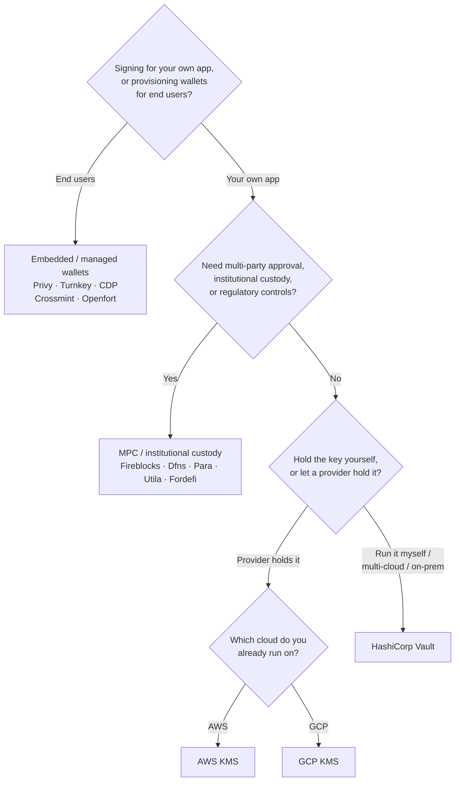

Keychain biedt één `SolanaSigner`-basisinterface voor elke backend, waardoor de
keuze voor de meeste backends operationeel is en niet architecturaal: u kunt
deze later wijzigen via de configuratie. De uitzondering is de transactievorm.
Crossmint en Fordefi native auto mode ondertekenen en broadcasten server-side,
en Fordefi native manual mode herschrijft de transactie voordat deze wordt
ondertekend, dus overstappen naar of van een van deze backends verandert hoe u
de signer aanroept. Begin daarom **vanuit uw vereisten, niet vanuit een
product.** Twee vragen bepalen het meeste: _waar bevindt de privésleutel zich,
en wie mag een handtekening ermee autoriseren?_

Elke backend behalve Ledger is beschikbaar in alle vier de talen (Rust,
TypeScript, Python en Go). Ledger is alleen voor Rust, achter de opt-in-feature
`ledger`.

Er bestaat geen enkele beste backend. Elke backend past beter bij een bepaalde
set beperkingen: de cloud waarop u al draait, of u sleutelinfrastructuur zelf
wilt beheren, en welke beheers- en goedkeuringscontroles u verplicht moet
hebben. De onderstaande flow koppelt die beperkingen aan een backend.

<Callout type="info">
  Deze gids behandelt backend-ondertekening (server-side). Als uw eindgebruikers
  hun eigen transacties in een browser ondertekenen, gebruik dan in plaats
  daarvan een wallet via de Wallet Standard. Zie [Ondertekenen in
  productie](/docs/core/transactions/signing-in-production).
</Callout>

## Beslissingsstroom

<Callout type="info">
  Lokale ontwikkeling en tests hebben hier niets van nodig: gebruik de
  **Memory**-backend voor prototyping en schakel daarna via de configuratie over
  naar een van de productiebackends hierboven.
</Callout>

## De vragen doorlopen

<Steps>

<Step>

### Ondertekent u voor uw eigen applicatie of voor uw eindgebruikers?

Als u wallets inricht die **eindgebruikers** zelf bezitten en gebruiken
(consumenten-apps, onboardingflows), gebruik dan een backend voor **embedded /
beheerde wallets**: Privy, Turnkey, CDP, Crossmint of Openfort. Deze beheren
per-gebruikerwallets en authenticatie namens u.

Als u ondertekent als **uw eigen applicatie** (een fee payer, een treasury,
backend-automatisering), ga dan hieronder verder.

</Step>

<Step>

### Heeft u goedkeuring door meerdere partijen, institutioneel beheer of regelgevende controles nodig?

Als handtekeningen een goedkeuringsbeleid, bestedingslimiet of
compliance-workflow moeten doorlopen voordat ze worden gemaakt, of als u een
gereguleerde bewaarder nodig heeft die de sleutels beheert, gebruik dan een
backend voor **MPC / institutioneel beheer**: Fireblocks, Dfns, Para, Utila of
Fordefi. Deze splitsen of bewaren de sleutel en ondertekenen mee volgens uw
beleid.

Als u alleen een sleutel nodig heeft die op verzoek ondertekent, ga dan
hieronder verder.

</Step>

<Step>

### Wilt u de sleutel zelf beheren, of door een provider laten beheren?

Als een cloudprovider de sleutel moet bewaren in hardwarematige infrastructuur
en uw IAM-beleid bepaalt wie mag ondertekenen, gebruik dan de KMS van die cloud:

- **Draait op AWS** → AWS KMS
- **Draait op GCP** → GCP KMS

Als u de sleutelinfrastructuur zelf wilt beheren, of als u multi-cloud of
on-prem werkt, gebruik dan **HashiCorp Vault**. U draait en auditeert het zelf;
de sleutel blijft binnen de Transit-engine en ondertekent op verzoek.

</Step>

</Steps>

## Bewaarmodellen

De backends vallen uiteen in zes bewaarmodellen. De flow hierboven brengt u bij
een van deze modellen.

- **Zelfbeheer (in-process)**: uw applicatie bewaart de ruwe privésleutel.
  Handig voor ontwikkeling, maar ongeschikt voor productie. Backend:
  **Memory**.
- **Zelfbeheer (hardwarewallet)**: de sleutel verlaat het Ledger-apparaat nooit,
  en een persoon bevestigt elke handtekening op het scherm. Geschikt voor
  interactieve operator-ondertekening, niet voor onbewaakte services. Alleen
  Rust, opt-in en niet gedekt door de audit. Backend: **Ledger**.
- **Zelfgehoste sleutelbeheer**: u beheert de sleutelinfrastructuur zelf; de
  sleutel blijft erbinnen en ondertekent op verzoek. Backend: **HashiCorp
  Vault**.
- **Cloud KMS / HSM**: een cloudprovider slaat de sleutel op in hardwarematige
  infrastructuur; de sleutel verlaat de service nooit en uw IAM-beleid bepaalt
  wie mag ondertekenen. Backends: **AWS KMS**, **GCP KMS**.
- **MPC en institutioneel beheer**: de sleutel wordt gesplitst of bewaard bij een
  provider, die meeondertekent volgens uw beleid (goedkeuringen, limieten).
  Backends: **Fireblocks**, **Dfns**, **Para**, **Utila**, **Fordefi**.
- **Embedded en beheerde wallets**: een provider beheert wallets namens u, vaak
  om eindgebruikers te onboarden. Backends: **Privy**, **Turnkey**, **CDP**,
  **Crossmint**, **Openfort**.

## Backend vergelijking

| Backend         | Bewaarmodel                  | Het beste voor                                     | Opmerkingen                                                                                                              |
| --------------- | ------------------------------ | -------------------------------------------- | ------------------------------------------------------------------------------------------------------------------ |
| Memory          | Zelfbeheer (in-process)      | Lokale ontwikkeling, tests, CI                 | Ruwe sleutel in het proces; niet gebruiken in productie                                                                       |
| Ledger          | Zelfbeheer (hardwarewallet) | Interactieve operator-ondertekening vanuit Rust-tools | Alleen Rust, opt-in `ledger`-feature, niet geaudit; elke handtekening wordt op het apparaat bevestigd                                 |
| HashiCorp Vault | Zelfgehoste sleutelbeheer     | Teams die hun eigen sleutelinfrastructuur beheren   | Transit engine; u beheert en auditeert het zelf                                                                           |
| AWS KMS         | Cloud KMS / HSM                | Backends die op AWS draaien                      | Sleutel verlaat KMS nooit; IAM beheert ondertekening                                                                         |
| GCP KMS         | Cloud KMS / HSM                | Backends die op GCP draaien                      | Sleutel verlaat KMS nooit; IAM beheert ondertekening                                                                         |
| Fireblocks      | MPC / institutioneel beheer    | Treasuries, exchanges, gereguleerd beheer     | Beleidsmotor en goedkeuringsworkflows                                                                               |
| Dfns            | MPC-walletinfrastructuur      | Programmatische wallets met beleidscontroles    | Ed25519-ondertekening                                                                                                    |
| Para            | MPC-wallets                    | Apps die MPC-ondersteunde wallets willen            | API-sleutel + wallet-ID                                                                                                |
| Utila           | MPC-beheer + co-ondertekenaar        | Bestaande door Utila beheerde Solana-wallets        | `signMessage` niet ondersteund; u verstuurt de tx zelf                                                                    |
| Fordefi         | MPC / institutioneel beheer    | Institutionele bewaring met beleidscontroles   | Black box: u verzendt. Native auto: Fordefi herschrijft en verzendt. Native manual: Fordefi herschrijft, u verzendt het resultaat |
| Privy           | Ingebedde wallets               | Consumenten-apps die gebruikers onboarden    | Door app beheerde ingebedde wallets                                                                                       |
| Turnkey         | Niet-custodiale sleutelbeheer   | Programmatisch, door beleid beheerd ondertekenen           | Niet-custodiale sleutelbeheer                                                                                       |
| CDP             | Beheerde wallet (Coinbase)      | Apps op het Coinbase Developer Platform      | `signMessage` accepteert alleen UTF-8-payloads                                                                          |
| Crossmint       | Beheerde wallets                | Marktplaatsen en beheerde-wallet-apps         | Alleen verzenden: broadcast server-side, kan herschrijven voor gassponsoring; `signMessage` wordt niet ondersteund                   |
| Openfort        | Ingebedde backend-wallets       | Server-side wallets                          | In TEE opgeslagen sleutels                                                                                                    |

## Capabilityvorm

Naast beheer heeft elke backend één transactievorm, en die bepaalt hoe u de
signer aanroept:

- **Ondertekenen**: de provider ondertekent de bytes die u hebt opgebouwd en u
  broadcast ze. De meeste backends, waaronder Ledger en Fordefi black box mode.
- **Herschrijven en ondertekenen**: de provider herschrijft de transactie en
  ondertekent deze vervolgens zonder te broadcasten. Ga verder vanaf de
  transactie die wordt teruggegeven. Fordefi native manual mode.
- **Ondertekenen en broadcasten**: de provider ondertekent en broadcast
  server-side, dus een fout betekent niet dat er niets is aangekomen. Crossmint
  en Fordefi native auto mode.

De tabel met signer-capabilities in de README van elke taal vermeldt de vorm
van elke backend; het
[beveiligingsmodel](https://github.com/solana-foundation/solana-keychain/blob/main/docs/SECURITY_MODEL.md)
legt uit wat elke vorm garandeert.

## Zakelijke scenario's

Een enkele applicatie heeft vaak meer dan één hiervan tegelijk nodig. Omdat de
interface gedeeld is, kunt u per rol een andere backend draaien zonder de
aanroepen te wijzigen, zolang de backends dezelfde transactievorm delen.

- **Treasurybeheer** — scheid een operationele "hot" ondertekenaar van een
  "cold" treasury-ondertekenaar. Ondersteun de treasury met MPC-bewaring of een
  cloud-HSM en vereist goedkeuringsbeleid voorafgaand aan hoogwaardige
  handtekeningen.
- **Goedkeuringsworkflows** — MPC- en bewaarbackends (bijv. Fireblocks) vereisen
  meervoudige goedkeuring voordat een handtekening wordt gegenereerd.
- **Compliance en audit** — cloud-KMS (AWS/GCP) en Vault genereren
  auditlogboeken van ondertekeningen; institutionele bewaarders voegen
  beleidshandhaving en rapportage toe.
- **Gereguleerde omgevingen** — bewaar sleutelmateriaal in een HSM, KMS of
  institutionele bewaarder zodat ruwe sleutels uw applicatie nooit bereiken.

Zie
[Best practices voor productie](/docs/tools/keychain/production-best-practices)
voor het veilig beheren van deze backends.

<Cards>
  <Card title="Rust-handleiding" href="/docs/tools/keychain/getting-started/rust">
    Configureer elke backend in Rust.
  </Card>
  <Card
    title="TypeScript-handleiding"
    href="/docs/tools/keychain/getting-started/typescript"
  >
    Configureer elke backend in TypeScript.
  </Card>
</Cards>
