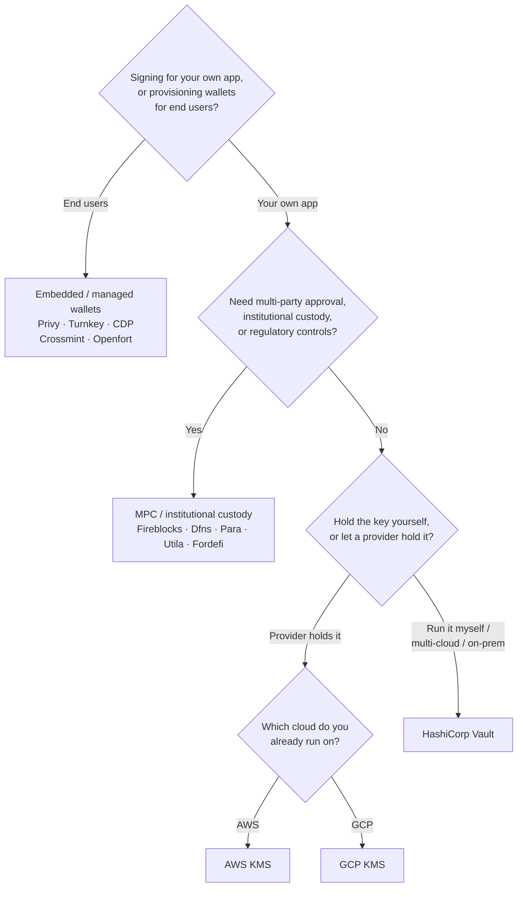

Keychain biedt voor elke backend één basisinterface, `SolanaSigner`, dus voor
de meeste backends is de keuze operationeel en niet architecturaal: je kunt de
backend later wijzigen via configuratie. De uitzondering is de vorm van de transactie. Crossmint
en Fordefi native auto mode ondertekenen en verzenden server-side, en Fordefi native
manual mode herschrijft de transactie voordat deze wordt ondertekend. Overstappen naar of weg van een
van deze backends verandert dus hoe je de signer aanroept. Daarom geldt: **begin bij je
eisen, niet bij een product.** Twee vragen bepalen het meeste: _waar
bevindt de private key zich, en wie mag een handtekening ermee autoriseren?_

Elke backend behalve Ledger is beschikbaar in alle vier de talen (Rust, TypeScript,
Python en Go). Ledger is alleen beschikbaar in Rust, achter de opt-in-feature `ledger`.

Er is geen enkele beste backend. Elke backend past beter bij een bepaalde set
aan randvoorwaarden: de cloud waarop je al draait, of je zelf key-
infrastructuur wilt beheren, en welke custody- en goedkeuringscontroles je verplicht moet hebben.
Het onderstaande stroomschema koppelt die randvoorwaarden aan een backend.

<Callout type="info">
  Deze gids behandelt backend-ondertekening (server-side). Als je eindgebruikers
  hun eigen transacties in een browser ondertekenen, gebruik dan een wallet via de Wallet Standard.
  Zie [Signing in
  Production](/docs/core/transactions/signing-in-production).
</Callout>

## Beslissingsstroom

<Callout type="info">
  Voor lokale ontwikkeling en tests is niets hiervan nodig: gebruik de **Memory**-backend
  voor prototyping en stap daarna via
  configuratie over op een van de bovenstaande productiebackends.
</Callout>

## De vragen doorlopen

<Steps>

<Step>

### Onderteken je voor je eigen applicatie of voor je eindgebruikers?

Als je wallets inricht die eigendom zijn van **eindgebruikers** en door hen worden gebruikt (consumentenapps,
onboardingflows), gebruik dan een **embedded / managed wallet**-backend: Privy, Turnkey,
CDP, Crossmint of Openfort. Deze beheren per gebruiker wallets en authenticatie namens
jou.

Als je ondertekent als **je eigen applicatie** (een fee payer, een treasury, backend-
automatisering), ga dan hieronder verder.

</Step>

<Step>

### Heb je multi-party-goedkeuring, institutionele custody of regelgevende controles nodig?

Als handtekeningen eerst een goedkeuringsbeleid, bestedingslimiet of compliance-
workflow moeten doorlopen voordat ze worden gezet, of als je een gereguleerde custodian nodig hebt die de
keys beheert, gebruik dan een **MPC / institutionele custody**-backend: Fireblocks, Dfns, Para,
Utila of Fordefi. Deze splitsen de key of nemen deze in bewaring en ondertekenen mee volgens jouw
beleid.

Als je alleen een key nodig hebt die op verzoek ondertekent, ga dan hieronder verder.

</Step>

<Step>

### Wil je de key zelf beheren of door een provider laten beheren?

Als een cloudprovider de key moet bewaren in hardwarematig beveiligde infrastructuur en
jouw IAM-beleid bepaalt wie mag ondertekenen, gebruik dan de KMS van die cloud:

- **Draai je op AWS** → AWS KMS
- **Draai je op GCP** → GCP KMS

Als je de key-infrastructuur zelf wilt beheren, of je multi-cloud of
on-prem werkt, gebruik dan **HashiCorp Vault**. Jij beheert en auditeert het; de key blijft binnen de
Transit-engine en ondertekent op verzoek.

</Step>

</Steps>

## Bewaarmodellen

De backends vallen uiteen in zes custodymodellen. De stroom hierboven leidt je naar een
van deze modellen.

- **Self-custody (in-process)**: je applicatie bewaart de ruwe private key.
  Handig voor ontwikkeling, maar ongeschikt voor productie. Backend:
  **Memory**.
- **Self-custody (hardware wallet)**: de key verlaat het Ledger-apparaat nooit en
  een persoon bevestigt elke handtekening op het scherm. Geschikt voor interactieve
  ondertekening door operators, niet voor onbeheerde services. Alleen Rust, opt-in en niet gedekt
  door de audit. Backend: **Ledger**.
- **Zelfgehost key management**: je beheert zelf de key-infrastructuur; de key
  blijft daarbinnen en ondertekent op verzoek. Backend: **HashiCorp Vault**.
- **Cloud KMS / HSM**: een cloudprovider bewaart de key in hardwarematig beveiligde
  infrastructuur; de key verlaat de service nooit en jouw IAM-beleid bepaalt
  wie mag ondertekenen. Backends: **AWS KMS**, **GCP KMS**.
- **MPC en institutionele custody**: de key wordt gesplitst of in bewaring gegeven bij een
  provider, die meeondertekent volgens jouw beleid (goedkeuringen, limieten).
  Backends: **Fireblocks**, **Dfns**, **Para**, **Utila**, **Fordefi**.
- **Embedded en managed wallets**: een provider beheert wallets namens jou,
  vaak om eindgebruikers te onboarden. Backends: **Privy**, **Turnkey**, **CDP**,
  **Crossmint**, **Openfort**.

## Backend vergelijking

| Backend         | Bewaarmodel                  | Het beste voor                                     | Opmerkingen                                                                                                              |
| --------------- | ------------------------------ | -------------------------------------------- | ------------------------------------------------------------------------------------------------------------------ |
| Memory          | Zelfbeheer (in-process)      | Lokale ontwikkeling, tests, CI                 | Ruwe key in het proces; niet gebruiken in productie                                                                       |
| Ledger          | Self-custody (hardware wallet) | Interactieve ondertekening door operators vanuit Rust-tools | Alleen Rust, opt-in-feature `ledger`, niet geaudit; elke handtekening wordt op het apparaat bevestigd                                 |
| HashiCorp Vault | Zelfgehoste sleutelbeheer     | Teams die hun eigen sleutelinfrastructuur beheren   | Transit engine; u beheert en auditeert het zelf                                                                           |
| AWS KMS         | Cloud KMS / HSM                | Backends die op AWS draaien                      | Sleutel verlaat KMS nooit; IAM beheert ondertekening                                                                         |
| GCP KMS         | Cloud KMS / HSM                | Backends die op GCP draaien                      | Sleutel verlaat KMS nooit; IAM beheert ondertekening                                                                         |
| Fireblocks      | MPC / institutioneel beheer    | Treasuries, exchanges, gereguleerd beheer     | Beleidsmotor en goedkeuringsworkflows                                                                               |
| Dfns            | MPC-walletinfrastructuur      | Programmatische wallets met beleidscontroles    | Ed25519-ondertekening                                                                                                    |
| Para            | MPC-wallets                    | Apps die MPC-ondersteunde wallets willen            | API-sleutel + wallet-ID                                                                                                |
| Utila           | MPC-beheer + co-ondertekenaar        | Bestaande door Utila beheerde Solana-wallets        | `signMessage` niet ondersteund; u verstuurt de tx zelf                                                                    |
| Fordefi         | MPC / institutioneel beheer    | Institutionele bewaring met beleidscontroles   | Black box: jij verzendt. Native auto: Fordefi herschrijft en verzendt. Native manual: Fordefi herschrijft, jij verzendt het resultaat |
| Privy           | Ingebedde wallets               | Consumenten-apps die gebruikers onboarden    | Door app beheerde ingebedde wallets                                                                                       |
| Turnkey         | Niet-custodiale sleutelbeheer   | Programmatisch, door beleid beheerd ondertekenen           | Niet-custodiale sleutelbeheer                                                                                       |
| CDP             | Beheerde wallet (Coinbase)      | Apps op het Coinbase Developer Platform      | `signMessage` accepteert alleen UTF-8-payloads                                                                          |
| Crossmint       | Beheerde wallets                | Marktplaatsen en beheerde-wallet-apps         | Alleen verzenden: verzendt server-side, kan herschrijven voor gassponsoring; `signMessage` wordt niet ondersteund                   |
| Openfort        | Ingebedde backend-wallets       | Server-side wallets                          | In TEE opgeslagen sleutels                                                                                                    |

## Capabilityvorm

Naast custody heeft elke backend één transactievorm, en die bepaalt hoe je de
signer aanroept:

- **Sign**: de provider ondertekent de bytes die je hebt opgebouwd en jij verzendt ze. De meeste
  backends, waaronder Ledger en Fordefi black box mode.
- **Rewrite and sign**: de provider herschrijft de transactie en ondertekent deze
  vervolgens zonder te verzenden. Ga verder met de transactie die wordt teruggegeven. Fordefi native
  manual mode.
- **Sign and broadcast**: de provider ondertekent en verzendt server-side, dus een
  fout betekent niet dat er niets is aangekomen. Crossmint en Fordefi native auto mode.

De signer-capabilitytabel in de README van elke taal toont de vorm van elke
backend; het
[beveiligingsmodel](https://github.com/solana-foundation/solana-keychain/blob/main/docs/SECURITY_MODEL.md)
legt uit wat elke vorm garandeert.

## Zakelijke scenario's

Een enkele applicatie heeft vaak meer dan één hiervan tegelijk nodig. Omdat de
interface gedeeld is, kun je per rol een andere backend draaien zonder de
aanroeplocaties te wijzigen, zolang de backends dezelfde capabilityvorm delen.

- **Treasurybeheer** — scheid een operationele "hot" ondertekenaar van een
  "cold" treasury-ondertekenaar. Ondersteun de treasury met MPC-bewaring of een
  cloud-HSM en vereist goedkeuringsbeleid voorafgaand aan hoogwaardige
  handtekeningen.
- **Goedkeuringsworkflows** — MPC- en bewaarbackends (bijv. Fireblocks) vereisen
  meervoudige goedkeuring voordat een handtekening wordt gegenereerd.
- **Compliance en audit** — cloud-KMS (AWS/GCP) en Vault genereren
  auditlogboeken van ondertekeningen; institutionele bewaarders voegen
  beleidshandhaving en rapportage toe.
- **Gereguleerde omgevingen** — bewaar sleutelmateriaal in een HSM, KMS of
  institutionele bewaarder zodat ruwe sleutels uw applicatie nooit bereiken.

Zie
[Best practices voor productie](/docs/tools/keychain/production-best-practices)
voor het veilig beheren van deze backends.

<Cards>
  <Card title="Rust-handleiding" href="/docs/tools/keychain/getting-started/rust">
    Configureer elke backend in Rust.
  </Card>
  <Card
    title="TypeScript-handleiding"
    href="/docs/tools/keychain/getting-started/typescript"
  >
    Configureer elke backend in TypeScript.
  </Card>
</Cards>
