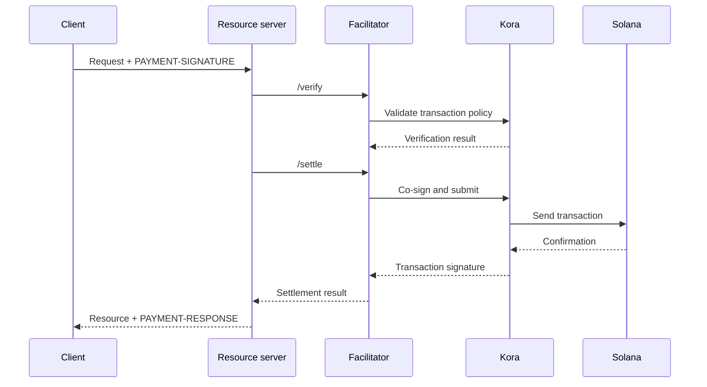

Een x402-facilitator verifieert en wikkelt betalingen af voor een of meer
resourceservers. Hierdoor kan een API onchain betalingen accepteren zonder dat
RPC-, transactie-indienings- en fee-payer-logica in elk applicatieproces hoeft te zitten.

Een facilitator is een architectuurrol, geen verplichte externe partij. Je kunt
een beheerde dienst gebruiken, een aparte facilitator draaien of zelf faciliteren
binnen je resourceserver.

## Facilitator-interface

x402 V2 definieert drie HTTP-operaties:

| Endpoint     | Doel                                                                       |
| ------------ | ----------------------------------------------------------------------------- |
| `/supported` | Geeft een overzicht van ondersteunde protocolversies, schema's, netwerken, extensies en signers |
| `/verify`    | Controleert een betalingspayload aan de hand van de vereisten, zonder deze af te wikkelen         |
| `/settle`    | Dient de betaling in of rondt deze af en retourneert het afwikkelingsresultaat            |

Je resourceserver moet `/supported` controleren tijdens het opstarten of de deployment.
Bied pas een betalingsoptie aan wanneer de gekozen facilitator bevestigt dat
de exacte x402-versie, het schema en het Solana-netwerk worden ondersteund.

```bash
curl https://facilitator.example/supported
```

## Verificatie vóór levering

De veilige volgorde van verzoeken is:

1. Parseer de `PAYMENT-SIGNATURE`-payload met een protocolbibliotheek.
2. Koppel deze aan de exacte `PaymentRequirements` die oorspronkelijk zijn aangeboden.
3. Verifieer de payload lokaal of via `/verify`.
4. Voer de resource-operatie alleen uit als de gekozen betalingsflow afwikkeling
   na levering toestaat.
5. Roep `/settle` aan en retourneer `PAYMENT-RESPONSE` met het resultaat.

Verschillende schema's kunnen een verschillende volgorde van levering definiëren. Een
autorisatieflow kan bijvoorbeeld vóór de resource-operatie verifiëren en daarna afwikkelen,
terwijl een ander schema afwikkeling vóór levering kan vereisen. Volg de flow die
door het gekozen schema is gedefinieerd, in plaats van voor elke betaling uit te gaan
van dezelfde volgorde.

<Callout type="warn" title="Behandel facilitator-antwoorden als betalingsbeslissingen">
  Authenticeer facilitator-verkeer, valideer elk antwoord, gebruik strikte
  timeouts en kies bij twijfel voor weigeren (fail closed). Een netwerkfout of een ongeldig antwoord is geen bewijs
  van betaling.
</Callout>

## Kies een deploymentmodel

| Model                   | Gebruik wanneer                                                        | Belangrijkste verantwoordelijkheid                                                    |
| ----------------------- | --------------------------------------------------------------- | ---------------------------------------------------------------------- |
| Beheerde facilitator     | Je het kleinst mogelijke operationele oppervlak wilt                       | Controleer ondersteunde netwerken, vertrouwensmodel, beschikbaarheid en databeleid  |
| Toegewijd, zelf gehost   | Meerdere API's dezelfde signing- en afwikkelinfrastructuur delen        | Beveilig sleutels, RPC's, opslag, schaling en upgrades                      |
| In-process facilitatie | Eén service volledige controle nodig heeft en chaincomponenten kan beheren | Houd betalingscode geïsoleerd en voorkom dat de belasting door verzoeken deze uitput |

Kies een facilitator niet alleen omdat de URL reageert op `/supported`.
Beoordeel hoe deze fee-payer-sleutels beschermt, replay voorkomt, transacties bevestigt,
omgaat met gedeeltelijke storingen en incidenten meldt.

## Kora als Solana-signinginfrastructuur

[Kora](/docs/tools/kora) is een Solana-signernode met beleid voor transactievalidatie en
fee-sponsoring. Een x402-facilitator kan Kora gebruiken als backend voor signing en
indiening:



Kora vervangt x402 niet. De resourceserver en de facilitator implementeren nog steeds
de x402 V2-objecten en -endpoints; Kora handhaaft het Solana-transactiebeleid en
beschermt de fee-payer-signer achter de RPC-interface.

Volg de [Kora x402-gids](/docs/tools/kora/guides/x402) voor de onderhouden
demo en configuratie.

## Checklist voor productie

### Sleutels en transactiebeleid

- Bewaar facilitator- en fee-payer-sleutels in een hardwarematige of externe signing-
  backend.
- Zet alleen de programma's System, Compute Budget, Token, Token-2022 en Associated Token Program op de allowlist,
  en alleen voor zover het ondersteunde schema dat vereist.
- Weiger onverwachte beschrijfbare accounts, transfer authorities, ontvangers, mints,
  instructies en compute-prijzen voordat je ondertekent.
- Houd accounts die betalingen ontvangen gescheiden van operationele fee-payer-accounts.

### Replay en idempotentie

- Sla gebruikte betalingsidentificatoren en transactiehandtekeningen op in een gedeelde,
  duurzame opslag.
- Maak verificatie en consumptie atomair, zodat twee serverinstanties niet dezelfde
  autorisatie gelijktijdig kunnen accepteren.
- Vereis een idempotentiesleutel voor resource-operaties met bijwerkingen.
- Retourneer het oorspronkelijke resultaat bij een legitieme nieuwe poging in plaats van opnieuw af te schrijven.

### Beschikbaarheid en foutafhandeling

- Stel begrensde timeouts in voor `/verify`, `/settle`, RPC-indiening en
  bevestiging.
- Maak onderscheid tussen geweigerde, verlopen, openstaande, bevestigde en mislukte afwikkelingen.
- Bouw een transactie na het verlopen van de blockhash niet opnieuw op en onderteken deze niet opnieuw zonder de betaler
  te vragen de nieuwe transactie te autoriseren.
- Gebruik meer dan één RPC-endpoint en monitor de versheid van de blockhash, de latentie van bevestiging
  en het saldo van de fee-payer.

### Observability

Registreer de resource, de challenge-ID, het gekozen schema en netwerk, het bedrag, de asset,
de ontvanger, het adres van de betaler, de transactiehandtekening, het bevestigingsniveau, de latentie
en de eindstatus. Log nooit gecodeerde betalingsgegevens, bearer tokens, private
keys of onbewerkte signer-antwoorden.

Stel alerts in voor mislukte afwikkelingen, replay-pogingen, beleidsweigeringen, onverwachte
assets of ontvangers, uitputting van de fee-payer en verschillen tussen geverifieerde
betalingen en geleverde resources.

## Gerelateerde bronnen

- [x402-facilitatorspecificatie](https://github.com/x402-foundation/x402/blob/main/specs/x402-specification-v2.md#7-facilitator-interface)
- [x402 op Solana](/docs/payments/agentic-payments/x402)
- [Kora-gids voor operators](/docs/tools/kora/operators)
- [Gereedheid voor productie](/docs/tools/transaction-landing#rpc-infrastructure)
