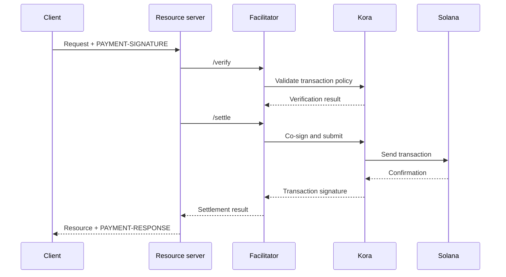

Een x402-facilitator verzorgt de verificatie en afwikkeling van betalingen voor een of meer
resourceservers. Zo kan een API onchain-betalingen accepteren zonder dat RPC-,
transactie-indienings- en fee-payer-logica in elk applicatieproces hoeft te zitten.

Een facilitator is een architectuurrol, geen verplichte externe partij. Je kunt
een beheerde dienst gebruiken, een aparte facilitator beheren of zelf faciliteren binnen
jouw resourceserver.

## Facilitator-interface

x402 V2 definieert drie HTTP-operaties:

| Endpoint     | Doel                                                                       |
| ------------ | ----------------------------------------------------------------------------- |
| `/supported` | Geeft een overzicht van ondersteunde protocolversies, schema's, netwerken, extensies en ondertekenaars |
| `/verify`    | Controleert een betalingspayload aan de hand van de vereisten, zonder deze af te wikkelen         |
| `/settle`    | Dient de betaling in of rondt deze af en retourneert het afwikkelingsresultaat            |

Je resourceserver moet `/supported` controleren tijdens het opstarten of de deployment. Maak
geen betaalmogelijkheid zichtbaar totdat de gekozen facilitator bevestigt dat deze
de exacte x402-versie, het exacte schema en het exacte Solana-netwerk ondersteunt.

```bash
curl https://facilitator.example/supported
```

## Verificatie vóór levering

De veilige volgorde van verzoeken is:

1. Parseer de `PAYMENT-SIGNATURE`-payload met een protocolbibliotheek.
2. Koppel deze aan de exacte `PaymentRequirements` die oorspronkelijk zijn aangeboden.
3. Verifieer de payload lokaal of via `/verify`.
4. Voer de resourceoperatie pas uit als de gekozen betalingsflow afwikkeling
   na levering toestaat.
5. Roep `/settle` aan en retourneer `PAYMENT-RESPONSE` met het resultaat.

Verschillende schema's kunnen een verschillende volgorde van levering definiëren. Een
autorisatieflow kan bijvoorbeeld vóór de resourceoperatie verifiëren en daarna afwikkelen,
terwijl een ander schema afwikkeling vóór levering kan vereisen. Volg de flow
die door het gekozen schema is gedefinieerd, in plaats van voor elke
betaling dezelfde volgorde aan te nemen.

<Callout type="warn" title="Behandel facilitator-responses als betalingsbeslissingen">
  Authenticeer facilitatorverkeer, valideer elke response, gebruik strikte
  timeouts en faal veilig (fail closed). Een netwerkfout of een ongeldig opgebouwde response is geen bewijs
  van betaling.
</Callout>

## Kies een deploymentmodel

| Model                   | Gebruik wanneer                                                        | Belangrijkste verantwoordelijkheid                                                    |
| ----------------------- | --------------------------------------------------------------- | ---------------------------------------------------------------------- |
| Beheerde facilitator     | Je het kleinst mogelijke operationele oppervlak wilt                       | Controleer ondersteunde netwerken, vertrouwensmodel, beschikbaarheid en databeleid  |
| Dedicated self-hosted   | Meerdere API's ondertekenings- en afwikkelingsinfrastructuur delen        | Beveilig sleutels, RPC's, opslag, schaling en upgrades                      |
| In-process facilitatie | Eén service volledige controle nodig heeft en chaincomponenten kan beheren | Houd betalingscode geïsoleerd en voorkom dat de requestbelasting deze uitput |

Kies een facilitator niet alleen omdat de URL reageert op `/supported`.
Controleer hoe deze fee-payer-sleutels beschermt, replay voorkomt, transacties bevestigt,
omgaat met gedeeltelijke storingen en incidenten meldt.

## Kora als Solana-ondertekeningsinfrastructuur

[Kora](/docs/tools/kora) is een Solana-signernode met beleid voor transactievalidatie en
fee-sponsoring. Een x402-facilitator kan Kora gebruiken als backend voor ondertekening en
indiening:



Kora vervangt x402 niet. De resourceserver en de facilitator implementeren nog steeds
de x402 V2-objecten en -endpoints; Kora handhaaft het Solana-transactiebeleid en
beschermt de fee-payer-signer achter de RPC-interface.

Volg de [Kora x402-gids](/docs/tools/kora/guides/x402) voor de onderhouden
demo en configuratie.

## Productiechecklist

### Sleutels en transactiebeleid

- Bewaar facilitator- en fee-payer-sleutels in een hardwarematige of externe ondertekenings-
  backend.
- Zet de programma's System, Compute Budget, Token, Token-2022 en Associated Token
  alleen op de allowlist voor zover het ondersteunde schema dit vereist.
- Weiger onverwachte beschrijfbare accounts, transferautoriteiten, ontvangers, mints,
  instructies en compute-prijzen vóór het ondertekenen.
- Houd accounts voor het ontvangen van betalingen gescheiden van operationele fee-payer-accounts.

### Replay en idempotentie

- Sla gebruikte betalings-ID's en transactiehandtekeningen op in een gedeelde,
  duurzame opslag.
- Maak verificatie en consumptie atomair, zodat twee serverinstanties niet tegelijkertijd dezelfde
  autorisatie kunnen accepteren.
- Vereis een idempotentiesleutel voor resourceoperaties met neveneffecten.
- Retourneer het oorspronkelijke resultaat bij een legitieme nieuwe poging in plaats van opnieuw af te rekenen.

### Beschikbaarheid en foutafhandeling

- Stel begrensde timeouts in voor `/verify`, `/settle`, RPC-indiening en
  bevestiging.
- Maak onderscheid tussen afgewezen, verlopen, in behandeling zijnde, bevestigde en mislukte afwikkelingen.
- Bouw een transactie na het verlopen van de blockhash niet opnieuw op en onderteken deze niet opnieuw zonder
  de betaler te vragen de nieuwe transactie te autoriseren.
- Gebruik meer dan één RPC-endpoint en monitor de versheid van de blockhash, de bevestigings-
  latentie en het saldo van de fee-payer.

### Observeerbaarheid

Registreer de resource, de challenge-ID, het gekozen schema en netwerk, het bedrag, de asset,
de ontvanger, het adres van de betaler, de transactiehandtekening, het bevestigingsniveau, de latentie
en de eindstatus. Log nooit gecodeerde betalingsgegevens, bearer-tokens, private
keys of onbewerkte signer-responses.

Stel alerts in voor mislukte afwikkelingen, replaypogingen, beleidsweigeringen, onverwachte
assets of ontvangers, uitputting van de fee-payer en verschillen tussen geverifieerde
betalingen en geleverde resources.

## Gerelateerde bronnen

- [x402-facilitatorspecificatie](https://github.com/x402-foundation/x402/blob/main/specs/x402-specification-v2.md#7-facilitator-interface)
- [x402 op Solana](/docs/payments/agentic-payments/x402)
- [Kora-beheerdersgids](/docs/tools/kora/operators)
- [Productiegereedheid](/docs/tools/transaction-landing#rpc-infrastructure)
