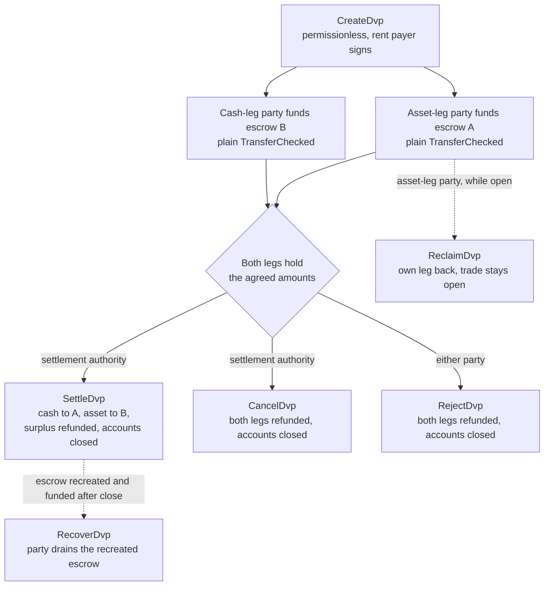
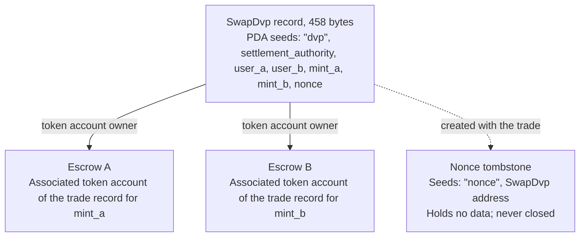

Program DvP to standardowy program do rozliczeń typu dostawa za płatnością (delivery versus payment) na Solanie,
utrzymywany przez Fundację Solana i audytowany przez Cantina. Dwie strony uzgadniają
wymianę, każda wysyła swoją nogę na konto escrow zwykłym transferem
tokenów, a podmiot rozliczający rozlicza obie nogi w jednej transakcji, więc
albo obie się przemieszczają, albo żadna. Podmiot rozliczający to trzeci adres
wskazany w wymianie, na przykład platforma lub agent, który ją zorganizował. Żadna ze stron
nie pisze ani nie wdraża programu, a portfel lub powiernik, który potrafi wysłać standardowy
transfer tokenów (`TransferChecked`), może zasilić nogę bez integracji specyficznej dla DvP. Do czasu rozliczenia każda ze stron może odebrać własną nogę lub wycofać
wymianę.

<Callout type="warn" title="Sprawdź rekord, zanim na nim zadziałasz">

Tworzenie rekordu wymiany nie wymaga uprawnień, więc rekord nie jest dowodem
zgody. Każda ze stron odczytuje zapisane warunki przed zasileniem nogi, a podmiot rozliczający
przed rozliczeniem (zob.
[weryfikacja](#verification-before-funding-and-settlement)).

</Callout>

## Jak to działa

Każda wymiana otrzymuje rekord należący do programu i dwa konta escrow, po jednym na nogę. Strona
nogi aktywa (`user_a`) i strona nogi gotówkowej (`user_b`) zasilają nogę,
przesyłając tokeny na konto escrow danej nogi. Podmiot rozliczający
jest jedynym podpisującym, który może dokonać rozliczenia. Rozliczenie przesyła uzgodnioną
kwotę każdej nogi na drugą stronę, zwraca ewentualną nadwyżkę stronie, do której należy
noga, oraz zamyka rekord i oba konta escrow. Atomowość wynika z [transakcji](/docs/core/transactions) Solany: oba transfery są w jednej transakcji,
więc albo oba zostają wykonane, albo żaden.

Każdy zwrot, odbiór i zwrot nadwyżki trafia na własne associated
token account strony: konto `user_a` dla `mint_a`, konto `user_b` dla `mint_b`. Powiernik
lub system skarbu może zasilić nogę z własnego konta, ale wszystko, co zostanie zwrócone,
trafia na konto strony, a nie z powrotem do powiernika. Każda wymiana
pozostawia także trwałe konto-znacznik (zob. [Stan](#state)).

## Przewodniki

Strony kroków prowadzą jedną wymianę od utworzenia do rozliczenia, z przykładami w TypeScript i
Rust dla każdej instrukcji.

<Cards>
  <Card title="Utwórz wymianę" href="/docs/defi/dvp-program/create-a-trade">
    Zainstaluj klientów i zapisz warunki wymiany za pomocą CreateDvp
  </Card>
  <Card title="Zasil nogi" href="/docs/defi/dvp-program/fund-the-legs">
    Zweryfikuj zapisane warunki, a następnie zasil każdą nogę zwykłym transferem
  </Card>
  <Card title="Rozlicz wymianę" href="/docs/defi/dvp-program/settle-the-trade">
    Rozlicz obie nogi w jednej transakcji jako podmiot rozliczający
  </Card>
  <Card title="Wycofaj wymianę" href="/docs/defi/dvp-program/unwind-a-trade">
    Odbierz nogę, anuluj lub odrzuć wymianę i odzyskaj spóźnione wpłaty
  </Card>
</Cards>

[Demo na devnecie](https://solana.com/delivery-vs-payment/demo) przeprowadza wymianę od początku do
końca: tworzy wymianę, zasila oba konta escrow standardowymi transferami tokenów i
rozlicza obie nogi w jednej transakcji.

## Wybór między programem a delegowaniem

[Dostawa za płatnością (DvP) z użyciem delegowania](/docs/tokenization/dvp) rozlicza
tę samą wymianę bez programu: każda strona deleguje swoją pozycję
agentowi rozliczeniowemu, który przenosi obie nogi w jednej transakcji.

- **Program** nie wymaga delegowania, więc limit jednego delegata na token
  account nie ma zastosowania, a podmiot rozliczający nie może przekierować wpływów.
  Każda wymiana zależy od aktualizowalnego programu i jego upgrade authority.
- **Wzorzec delegowania** nie ma zależności od programu i działa z mintami, które
  mają Scaled UI Amount. Program odrzuca takie minty, co wyklucza każdy
  mint utworzony z szablonu `tokenized-security` Mosaic (zob.
  [ograniczenia konfiguracji mintu](#mint-configuration-constraints)).

## Role

Program jest symetryczny. W jego interfejsie obie strony to `user_a`, który
dostarcza `mint_a`, oraz `user_b`, który dostarcza `mint_b`. README i
wygenerowani klienci nazywają `mint_a` nogą aktywa, a `mint_b` nogą gotówkową, i te strony
stosują tę konwencję, ale nic w programie nie wymaga, aby noga gotówkowa
była instrumentem gotówkowym. Dwa aktywa lub dwa stablecoiny rozlicza się w ten sam
sposób.

| Rola                 | Kto                               | Podpisuje                                              | Uwagi                                                                                                                                                                                                     |
| -------------------- | --------------------------------- | -------------------------------------------------- | --------------------------------------------------------------------------------------------------------------------------------------------------------------------------------------------------------- |
| Strona nogi aktywa      | `user_a`, dostarcza `mint_a`       | Własny transfer zasilający; Reclaim, Reject, Recover | Portfel keypair lub inteligentny portfel oparty na PDA, taki jak skarbiec multisig. Konto multisig SPL Token ani program account nie może być stroną: Create kończy się błędem `PartyNotSignerCapable`                   |
| Strona nogi gotówkowej       | `user_b`, dostarcza `mint_b`       | Własny transfer zasilający; Reclaim, Reject, Recover | To samo wymaganie                                                                                                                                                                                          |
| Podmiot rozliczający | Trzeci adres wskazany przy tworzeniu | Settle, Cancel                                     | Jedyny podpisujący, który może dokonać rozliczenia. Nie może przekierować wpływów, które są ustalone przy tworzeniu. Otrzymuje rent z zamkniętych kont, gdy rozlicza lub anuluje                                         |
| Płatnik rent           | Ten, kto podpisuje `CreateDvp`         | Create                                             | Finansuje rent (depozyt SOL utrzymujący konto otwarte) dla rekordu, tombstone nonce'a i obu kont escrow. Nie jest zapisywany jako odbiorca rent: rent z zamkniętych kont trafia do tego, kto zamyka wymianę |

## Identyfikator programu

```text
dvp34bdbcEm4f4FCUjGV4mDAkDshaQR4LkK8fdcsyZq
```

| Klaster      | Program                                       | Upgrade authority                              | Ostatni wdrożony slot |
| ------------ | --------------------------------------------- | ---------------------------------------------- | ------------------ |
| mainnet-beta | `dvp34bdbcEm4f4FCUjGV4mDAkDshaQR4LkK8fdcsyZq` | `DXtFpbPjcn2hxPnw79x1Pfoj35vXh5AsWBkS37YnXMVv` | 452,058,374        |
| devnet       | `dvp34bdbcEm4f4FCUjGV4mDAkDshaQR4LkK8fdcsyZq` | `5EX1zFeJWj4rGYZv432WnYw8CbaSUeTdxPx4r573UgYU` | 479,376,863        |

Program jest aktualizowalny na obu klastrach. Powyższe wartości pochodzą z wyniku
`solana program show` z 2 października 2026 r.; uruchom to samo polecenie, aby poznać
aktualne wartości. Kompilacja na devnecie jest starsza niż commit, względem którego napisano strony kroków
(zob. [Instalacja](/docs/defi/dvp-program/create-a-trade#install)),
z tym samym zestawem instrukcji i błędów.

## Cykl życia



Wymiana jest otwarta od `CreateDvp` do momentu, aż zamknie ją jedna z instrukcji: Settle, Cancel lub Reject.
Zasilenie nie ma własnej instrukcji: noga jest zasilona, gdy jej konto escrow
zawiera co najmniej uzgodnioną kwotę. Reclaim działa osobno dla każdej nogi i pozostawia
wymianę otwartą, więc problem z jedną nogą nie zmusza drugiej strony do anulowania
całej wymiany.

## Stan

Każda wymiana ma jedno konto `SwapDvp` o rozmiarze 458 bajtów, należące do programu. Jego
adres jest wyprowadzany z podmiotu rozliczającego, obu stron, obu
mintów i nonce (seedy
`["dvp", settlement_authority, user_a, user_b, mint_a, mint_b, nonce]`). Kwoty
i czasy są zapisane wewnątrz konta i nie wpływają na adres,
dlatego trzeba je odczytywać, a nie wnioskować. Małe konto-znacznik,
tombstone nonce'a pod `["nonce", swap_dvp]`, jest tworzone razem z wymianą i
nigdy nie jest zamykane, więc każda kombinacja stron, mintów, podmiotu rozliczającego i nonce może
posłużyć tylko do jednej wymiany.



| Pole                                  | Typ          | Znaczenie                                                                                                 |
| -------------------------------------- | ------------- | ------------------------------------------------------------------------------------------------------- |
| `bump`                                 | `u8`          | PDA bump                                                                                                |
| `user_a`, `user_b`                     | `Pubkey`      | Dwie strony                                                                                         |
| `mint_a`, `mint_b`                     | `Pubkey`      | Minty nogi aktywa i nogi gotówkowej                                                                        |
| `settlement_authority`                 | `Pubkey`      | Jedyny podpisujący, który może rozliczyć lub anulować                                                               |
| `token_program_a`, `token_program_b`   | `Pubkey`      | Token program będący właścicielem każdego mintu; wymiana może łączyć nogi SPL Token i Token-2022                    |
| `amount_a`, `amount_b`                 | `u64`         | Uzgodniona kwota każdej nogi w najmniejszej jednostce mintu (jednostki bazowe)                                 |
| `expiry_timestamp`                     | `i64`         | Po tym czasie sieci (zegar on-chain) Settle jest odrzucane. Reclaim, Cancel i Reject nadal działają |
| `nonce`                                | `u64`         | Rozróżnia wymiany, które mają takie same pozostałe seedy. Jednorazowy                                             |
| `ref_string`                           | `[u8; 64]`    | Nieprzejrzyste odwołanie klienta, dopełnione zerami; program nigdy go nie odczytuje                                     |
| `user_a_settlement_destination`        | `Pubkey`      | Otrzymuje nogę gotówkową przy Settle; domyślnie `user_a`                                                   |
| `user_b_settlement_destination`        | `Pubkey`      | Otrzymuje nogę aktywa przy Settle; domyślnie `user_b`                                                  |
| `mint_a_authority`, `mint_b_authority` | `Pubkey`      | Mint authority zapisane przy tworzeniu; Settle kończy się błędem, jeśli któreś z nich uległo zmianie                           |
| `earliest_settlement_timestamp`        | `Option<i64>` | Jeśli ustawione, Settle jest odrzucane przed tym czasem sieci                                                     |

Lista pól pochodzi z IDL programu w commicie wskazanym w sekcji
[Utwórz wymianę](/docs/defi/dvp-program/create-a-trade#install).

## Instrukcje

| Instrukcja  | Podpisujący               | Efekt                                                                                                                                                              |
| ------------ | -------------------- | ------------------------------------------------------------------------------------------------------------------------------------------------------------------- |
| `CreateDvp`  | Dowolny płatnik            | Tworzy rekord `SwapDvp`, jego tombstone nonce'a i oba konta escrow. Nie przenosi żadnych tokenów                                                                        |
| `ReclaimDvp` | `user_a` lub `user_b` | Zwraca z escrow nogę samego podpisującego. Wymiana pozostaje otwarta, a noga może zostać zasilona ponownie                                                                      |
| `SettleDvp`  | Podmiot rozliczający | Przesyła `amount_a` na adres docelowy `user_b` i `amount_b` na adres docelowy `user_a`, zwraca ewentualną nadwyżkę stronie nogi, zamyka rekord i oba konta escrow |
| `CancelDvp`  | Podmiot rozliczający | Zwraca to, co zawiera escrow A, do `user_a`, a escrow B do `user_b`, zamyka rekord i oba konta escrow                                                            |
| `RejectDvp`  | `user_a` lub `user_b` | Ten sam efekt co Cancel, podpisany przez stronę                                                                                                                            |
| `RecoverDvp` | `user_a` lub `user_b` | Po zamknięciu wymiany: opróżnia ponownie utworzony escrow na własne token account podpisującego i go zamyka. Obejmuje wpłatę, która dotarła po Settle, Cancel lub Reject  |

Każdy zwrot trafia na własne associated token account strony dla mintu danej nogi,
niezależnie od tego, kto zasilił escrow.

Konta i argumenty każdej instrukcji znajdują się na stronie danego kroku.

## Błędy

| Kod | Błąd                            | Kiedy                                                                                                   |
| ---- | -------------------------------- | ------------------------------------------------------------------------------------------------------ |
| 0    | `SignerNotParty`                 | Reclaim, Reject lub Recover podpisane przez adres, który nie jest `user_a` ani `user_b`                      |
| 1    | `DvpExpired`                     | Settle po `expiry_timestamp`                                                                        |
| 2    | `SettlementAuthorityMismatch`    | Settle lub Cancel podpisane przez adres inny niż podmiot rozliczający                              |
| 3    | `SettlementTooEarly`             | Settle przed `earliest_settlement_timestamp`                                                          |
| 4    | `LegNotFunded`                   | Settle, gdy escrow zawiera mniej niż uzgodnioną kwotę                                               |
| 5    | `ExpiryNotInFuture`              | Create z terminem wygaśnięcia równym bieżącemu czasowi sieci lub wcześniejszym                                            |
| 6    | `EarliestAfterExpiry`            | Create z najwcześniejszym czasem rozliczenia po terminie wygaśnięcia                                               |
| 7    | `SelfDvp`                        | Create z `user_a` równym `user_b`                                                                 |
| 8    | `SameMint`                       | Create z `mint_a` równym `mint_b`                                                                 |
| 9    | `ZeroAmount`                     | Create z zerową kwotą na którejkolwiek nodze                                                                |
| 10   | `BlockedMintExtension`           | Create lub Settle z mintem z rozszerzeniem TransferFee, InterestBearing, ScaledUiAmount lub NonTransferable |
| 11   | `SettlementAuthorityIsParty`     | Create z podmiotem rozliczającym równym jednej ze stron                                                  |
| 12   | `SettlementAuthorityExecutable`  | Create z wykonywalnym podmiotem rozliczającym                                                         |
| 13   | `NonceAlreadyUsed`               | Create ponownie używające `(seeds, nonce)`, które ma już tombstone                                         |
| 14   | `ExpiryTooFarInFuture`           | Create z terminem wygaśnięcia odległym o więcej niż rok                                                         |
| 15   | `RefStringTooLong`               | Create z odwołaniem dłuższym niż 64 bajty                                                           |
| 16   | `DvpStillOpen`                   | Recover, gdy wymiana jest nadal otwarta; użyj Reclaim                                                     |
| 17   | `DvpNeverCreated`                | Recover z seedami, dla których nie ma tombstone                                                              |
| 18   | `EscrowPreloadedWithLamports`    | Create, gdy nienatywny escrow przechowuje lamports powyżej minimum rent-exempt                           |
| 19   | `SettlementDestinationIsSwapDvp` | Create z adresem docelowym rozliczenia równym rekordowi wymiany                                         |
| 20   | `SwapDvpPreloadedWithLamports`   | Create, gdy adres rekordu przechowuje lamports powyżej rezerwy rent                                   |
| 21   | `RecipientAtaMismatch`           | token account odbiorcy lub zwrotu nie należy już do oczekiwanego portfela i mintu                  |
| 22   | `PartyNotSignerCapable`          | Create ze stroną, która nie jest niewykonywalnym kontem należącym do systemu                                 |
| 23   | `MintAuthorityChanged`           | Settle, gdy mint authority nogi różni się od wartości zapisanej przy tworzeniu                         |

## Zdarzenia i indeksowanie

Program nie emituje żadnych zdarzeń onchain. Indekser lub system uzgodnień odczytuje
stan konta `SwapDvp` oraz salda tokenów obu escrow i używa
`ref_string`, aby powiązać wymianę z jej zleceniem off-chain. Ponieważ rekord
jest zamykany przy rozliczeniu, system potrzebujący warunków po fakcie zapisuje
je w momencie odczytu lub odtwarza z transakcji, która utworzyła
wymianę.

## Obsługiwane tokeny

Wymiana może łączyć nogę SPL Token z nogą Token-2022; każda noga ma
własny token program. Obsługiwane są nogi z wrapped SOL.

| Rozszerzenie Token-2022 na mincie danej nogi                                                     | Zachowanie programu                                                  |
| ---------------------------------------------------------------------------------------- | ----------------------------------------------------------------- |
| TransferFee, InterestBearing, ScaledUiAmount, NonTransferable                            | Odrzucane przy Create i Settle z błędem `BlockedMintExtension`         |
| PermanentDelegate, Pausable, DefaultAccountState, freeze authority, MintCloseAuthority | Akceptowane; każde authority może działać na tokenach w escrow           |
| ConfidentialTransfer                                                                     | Akceptowane; kwoty na tej nodze są publiczne                          |
| TransferHook                                                                             | Obsługiwane, do 32 dodatkowych kont na nogę                        |
| MemoTransfer na koncie docelowym lub zwrotnym                                          | Akceptowane; program emituje wymagane memo przed transferem |

Opłata transferowa sprawiłaby, że strona otrzymująca dostałaby mniej niż uzgodniona kwota.
Interest Bearing i Scaled UI Amount nie zmieniają kwot surowych, ale ich stopa
lub mnożnik mogą się zmienić między utworzeniem a rozliczeniem wymiany, co zmienia
sposób wyświetlania uzgodnionych kwot. NonTransferable zablokowałoby obie nogi.

Akceptowane authority mogą przenosić, zamrażać lub wstrzymywać tokeny w escrow
przez cały czas trwania wymiany (zob. niżej). Escrow nie może zostać skonfigurowane do odbioru
poufnych transferów, więc kwoty w escrow i kwoty rozliczone na nodze poufnej
są publiczne.

Dla mintu z hookiem klient ustala dodatkowe konta hooka i dołącza
je do Settle, Cancel, Reject, Reclaim i Recover. Limit 32 na nogę
obejmuje program hooka i jego konto walidacyjne. Jeśli hook authority
powiększy listę kont hooka ponad ten limit, każdy transfer na tej nodze
zakończy się niepowodzeniem, w tym Reclaim, Cancel, Reject i Recover, dopóki authority
nie cofnie tej zmiany. Limit kont w transakcji może zadziałać wcześniej niż limit na nogę,
gdy obie nogi mają hooki.

Gdy konto docelowe lub zwrotne wymaga memo, program wywołuje program Memo
przed transferem, dlatego każda instrukcja przenosząca tokeny
z escrow przyjmuje konto `memo_program`.

### Ograniczenia konfiguracji mintu

**Scaled UI Amount.** Szablon `tokenized-security` w
[Mosaic](https://github.com/solana-foundation/mosaic), zestawie narzędzi do emisji od Solana Foundation,
zawsze dodaje Scaled UI Amount, więc program nie akceptuje
mintu utworzonego z tego szablonu jako nogi. Mint przeznaczony dla tego programu można
utworzyć bez tego rozszerzenia (zob.
[Token Extensions](/docs/tokens/extensions));
[DvP z użyciem delegacji](/docs/tokenization/dvp) rozlicza się przez delegowane
uprawnienia i nie stosuje tej kontroli.

**Minty zamrożone domyślnie.** Escrow każdej wymiany to associated token account
należące do program-derived address, które jest nowe dla danej wymiany. W mincie z
Default Account State ustawionym na frozen escrow jest tworzone jako zamrożone, a transfer
finansujący do niego kończy się niepowodzeniem, dopóki nie zostanie odmrożone. W ramach
[Token ACL](/docs/tokenization/token-acl) oznacza to, że emitent lub jego agent transferowy dopuszcza escrow wymiany przed sfinansowaniem: albo dodając adres
rekordu wymiany (właściciela escrow) do allowlisty, tak aby każdy mógł odmrozić
escrow, gdy konfiguracja Token ACL mintu włącza permissionless thaw, albo
przez bezpośrednie odmrożenie go przez freeze authority. Zamrożone escrow blokuje też
Settle, Reclaim, Cancel, Reject i Recover na tej nodze, więc freeze
authority, a w mincie z hookiem hook authority, jest zaufaną stroną przez cały czas trwania
wymiany. Ścieżka zamrożonego escrow jest opisana tutaj i nie jest uwzględniona
w fragmentach kodu na devnecie.

## Ograniczenia

- Brak dopasowywania zleceń, ustalania cen ani księgi zleceń. Strony uzgadniają warunki poza
  łańcuchem, a jedna z nich je zapisuje.
- Brak kompensowania (netting) i tylko rozliczenia dwustronne: jeden rekord to jedna wymiana między dwiema stronami.
- Brak częściowych realizacji. Settle przenosi dokładnie uzgodnioną kwotę każdej nogi i
  zwraca ewentualną nadwyżkę stronie danej nogi.
- Brak nogi poza łańcuchem. Obie nogi to token account na Solanie; noga gotówkowa w istniejących
  systemach rozliczana jest osobno i uzgadniana.
- Brak weryfikacji uprawnień, allowlisty ani KYC. Kwalifikowalność posiadaczy egzekwują
  własne mechanizmy kontrolne mintu.
- Brak automatycznego rozliczenia. Settlement authority musi podpisać.
- Brak zdarzeń i brak opłaty protokołowej poza opłatami transakcyjnymi i rent.

Program eliminuje ryzyko kapitałowe między obiema stronami: żadna noga nie jest przenoszona,
jeśli nie zostaną przeniesione obie. Nie eliminuje ryzyka kredytowego emitenta ani ryzyka wykupu żadnego z
tokenów, możliwości działania freeze, pause lub permanent delegate authority mintu
na tokenach w escrow (zob. [obsługiwane tokeny](#supported-tokens)) ani
zależności od tego, czy settlement authority będzie dostępne do podpisania.

## Weryfikacja przed sfinansowaniem i rozliczeniem

`CreateDvp` nie wymaga uprawnień (permissionless): podpisuje tylko płatnik, a strony i
settlement authority nie. Każdy może więc utworzyć rekord wskazujący dowolne
strony i dowolne warunki. Przed sfinansowaniem, a także ponownie przed rozliczeniem, odczytaj
konto `SwapDvp` i potwierdź:

1. Konto należy do programu DvP i ma dokładnie 458 bajtów. Konto,
   które nie należy do programu, można wypełnić bajtami dekodującymi się jak
   prawdziwy rekord.
2. `user_a`, `user_b`, `mint_a`, `mint_b` i `settlement_authority` zgadzają się z
   uzgodnioną wymianą.
3. `amount_a`, `amount_b`, `expiry_timestamp` i
   `earliest_settlement_timestamp` zgadzają się z uzgodnionymi warunkami.
4. Oba adresy docelowe rozliczenia to uzgodnione adresy. Sfałszowany rekord może
   przekierować środki.

[Finansowanie nóg](/docs/defi/dvp-program/fund-the-legs#verify-the-terms) wymienia
sprawdzane czytniki wygenerowanych klientów i pokazuje kontrolę w kodzie.

Uznaj wymianę za rozliczoną, gdy transakcja Settle osiągnie
[`finalized`](/docs/rpc#configuring-state-commitment). To poziom commitment
sieci; to, czy oznacza on również ostateczność rozliczenia w sensie prawnym,
zależy od umów stron i obowiązujących reżimów prawnych.

## Wersjonowanie

Konto `SwapDvp` nie ma pola wersji. Jego układ jest stały i wynosi 458 bajtów
(`SwapDvp::LEN`), a sprawdzane czytniki odrzucają konto o jakiejkolwiek innej długości.
IDL ma własną wersję: `0.1.0` według stanu na 2 października 2026.

Program jest aktualizowalny na obu klastrach (zob. [Program ID](#program-id)). Rekord
wymiany istnieje tylko do czasu jej rozliczenia, anulowania lub odrzucenia, więc sprawdź
w repozytorium, jak aktualizacja traktuje otwarte wymiany, i wygeneruj klientów ponownie
z IDL wdrożonego builda.

## Repozytorium i audyt

Kod źródłowy, IDL, wygenerowani klienci i testy znajdują się w
[`solana-foundation/dvp`](https://github.com/solana-foundation/dvp) na licencji
MIT. Program jest programem `no_std` Pinocchio; klienci są
generowani z IDL za pomocą Codama. Zgłoszenia podatności należy przesyłać przez link do
security advisory repozytorium, zgodnie z jego `SECURITY.md`.

Program został zaudytowany przez
[Cantina](https://cantina.xyz/portfolio/fe870bb4-d96d-4902-8aec-9dfcfa2d6a79).

## Powiązane

- [Delivery vs Payment (DvP) z użyciem delegacji](/docs/tokenization/dvp): wzorzec
  delegacji bez programu
- [Token ACL](/docs/tokenization/token-acl): jak mint z kontrolą dostępu współdziała z kontami
  escrow
