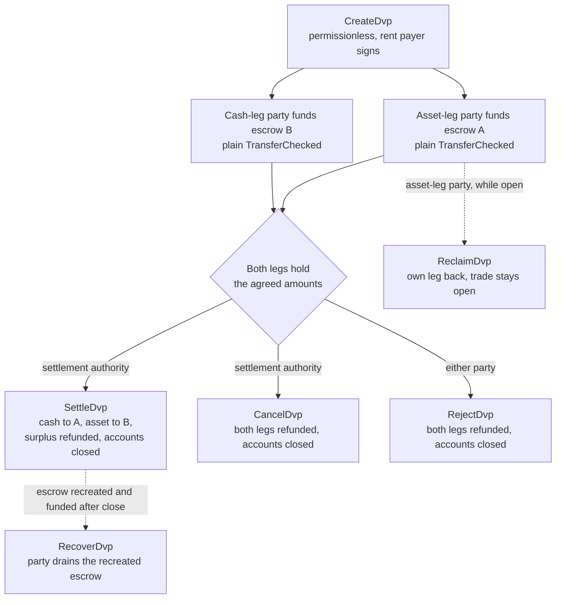
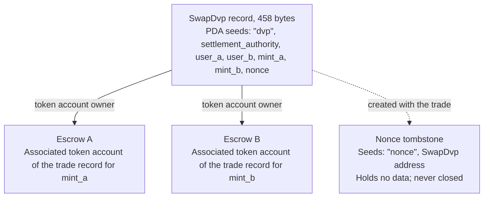

Program DvP to standardowy program do rozliczeń typu dostawa za płatność (delivery versus payment) w Solana,
utrzymywany przez Solana Foundation i audytowany przez Cantina. Dwie strony uzgadniają
wymianę, każda wysyła swoją nogę na konto escrow zwykłym transferem tokenów,
a podmiot rozliczający rozlicza obie nogi w jednej transakcji, więc
albo przechodzą obie, albo żadna. Podmiot rozliczający to trzeci adres
wskazany w wymianie, na przykład platforma lub agent, który ją zorganizował. Żadna ze stron
nie pisze ani nie wdraża programu, a portfel lub custodian, który potrafi wysłać standardowy
transfer tokenów (`TransferChecked`), może sfinansować nogę bez żadnej integracji
specyficznej dla DvP. Do czasu rozliczenia każda ze stron może odebrać własną nogę lub wycofać
wymianę.

<Callout type="warn" title="Sprawdź rekord, zanim na jego podstawie podejmiesz działanie">

Utworzenie rekordu wymiany nie wymaga uprawnień, więc sam rekord nie jest dowodem
porozumienia. Każda ze stron odczytuje zapisane warunki, zanim sfinansuje nogę, a podmiot rozliczający
robi to, zanim dokona rozliczenia (zob.
[weryfikacja](#verification-before-funding-and-settlement)).

</Callout>

## Jak to działa

Każda wymiana otrzymuje rekord należący do programu i dwa konta escrow, po jednym na nogę. Strona
nogi aktywa (`user_a`) i strona nogi gotówkowej (`user_b`) finansują swoje nogi,
przelewając tokeny na konto escrow danej nogi. Podmiot rozliczający
to jedyny podpisujący, który może dokonać rozliczenia. Rozliczenie przesyła uzgodnioną
kwotę każdej nogi na drugą stronę, zwraca ewentualną nadwyżkę stronie, do której należy
dana noga, i zamyka rekord oraz oba konta escrow. Atomowość wynika z [transakcji](/docs/core/transactions) Solana:
obie operacje transferu są w jednej transakcji,
więc albo obie zostaną wykonane, albo żadna.

Każdy zwrot, odzyskanie środków i zwrot nadwyżki trafia do własnego associated
token account strony: konta `user_a` dla `mint_a` i konta `user_b` dla `mint_b`. Custodian
lub system skarbowy może sfinansować nogę ze swojego konta, ale wszystko, co zostanie
zwrócone, trafia na konto strony, a nie z powrotem do custodiana. Każda wymiana
pozostawia też trwałe konto-znacznik (zob. [Stan](#state)).

## Przewodniki

Strony z kolejnymi krokami prowadzą jedną wymianę od utworzenia do rozliczenia, z kodem w TypeScript i
Rust dla każdej instrukcji.

<Cards>
  <Card title="Utwórz wymianę" href="/docs/defi/dvp-program/create-a-trade">
    Zainstaluj klienty i zapisz warunki wymiany za pomocą CreateDvp
  </Card>
  <Card title="Sfinansuj nogi" href="/docs/defi/dvp-program/fund-the-legs">
    Zweryfikuj zapisane warunki, a następnie sfinansuj każdą nogę zwykłym transferem
  </Card>
  <Card title="Rozlicz wymianę" href="/docs/defi/dvp-program/settle-the-trade">
    Rozlicz obie nogi w jednej transakcji jako podmiot rozliczający
  </Card>
  <Card title="Wycofaj wymianę" href="/docs/defi/dvp-program/unwind-a-trade">
    Odbierz nogę, anuluj lub odrzuć wymianę i odzyskaj spóźnione wpłaty
  </Card>
</Cards>

[Demo na devnecie](https://solana.com/delivery-vs-payment/demo) pokazuje wymianę od początku
do końca: tworzy wymianę, finansuje oba konta escrow standardowymi transferami tokenów i
rozlicza obie nogi w jednej transakcji.

## Wybór między programem a delegowaniem

[Delivery vs Payment (DvP) z użyciem delegowania](/docs/tokenization/dvp) rozlicza
tę samą wymianę bez programu: każda strona deleguje swoją pozycję agentowi
rozliczającemu, który przesyła obie nogi w jednej transakcji.

- **Program** nie wymaga delegowania, więc limit jednego delegata na token
  account nie ma zastosowania, a podmiot rozliczający nie może przekierować środków.
  Każda wymiana zależy od programu z możliwością aktualizacji i jego upgrade authority.
- **Wzorzec delegowania** nie ma zależności od programu i działa z mintami, które
  mają Scaled UI Amount. Program odrzuca takie minty, co wyklucza każdy
  mint utworzony z szablonu `tokenized-security` z Mosaic (zob.
  [ograniczenia konfiguracji mintów](#mint-configuration-constraints)).

## Role

Program jest symetryczny. W jego interfejsie dwie strony to `user_a`, który
dostarcza `mint_a`, oraz `user_b`, który dostarcza `mint_b`. README i
wygenerowane klienty nazywają `mint_a` nogą aktywa, a `mint_b` nogą gotówkową,
i te strony stosują tę konwencję, ale nic w programie nie wymaga, aby noga
gotówkowa była instrumentem gotówkowym. Dwa aktywa lub dwa stablecoiny rozlicza się
w ten sam sposób.

| Rola                 | Kto                               | Podpisuje                                              | Uwagi                                                                                                                                                                                                     |
| -------------------- | --------------------------------- | -------------------------------------------------- | --------------------------------------------------------------------------------------------------------------------------------------------------------------------------------------------------------- |
| Strona nogi aktywa      | `user_a`, dostarcza `mint_a`       | Własny transfer finansujący; Reclaim, Reject, Recover | Portfel keypair lub portfel smart oparty na PDA, taki jak skarbiec multisig. Konto SPL Token multisig ani program account nie może być stroną: Create kończy się błędem `PartyNotSignerCapable`                   |
| Strona nogi gotówkowej       | `user_b`, dostarcza `mint_b`       | Własny transfer finansujący; Reclaim, Reject, Recover | To samo wymaganie                                                                                                                                                                                          |
| Podmiot rozliczający | Trzeci adres wskazany przy tworzeniu | Settle, Cancel                                     | Jedyny podpisujący, który może dokonać rozliczenia. Nie może przekierować środków, które są ustalone przy tworzeniu. Otrzymuje rent z zamykanych kont, gdy rozlicza lub anuluje                                         |
| Płatnik rent           | Ten, kto podpisuje `CreateDvp`         | Create                                             | Pokrywa rent (depozyt w SOL utrzymujący konto otwarte) za rekord, nonce tombstone oraz oba konta escrow. Nie jest zapisywany jako odbiorca rent: rent z zamykanych kont trafia do tego, kto zamyka wymianę |

## Identyfikator programu

```text
dvp34bdbcEm4f4FCUjGV4mDAkDshaQR4LkK8fdcsyZq
```

| Klaster      | Program                                       | Upgrade authority                              | Slot ostatniego wdrożenia |
| ------------ | --------------------------------------------- | ---------------------------------------------- | ------------------ |
| mainnet-beta | `dvp34bdbcEm4f4FCUjGV4mDAkDshaQR4LkK8fdcsyZq` | `DXtFpbPjcn2hxPnw79x1Pfoj35vXh5AsWBkS37YnXMVv` | 452,058,374        |
| devnet       | `dvp34bdbcEm4f4FCUjGV4mDAkDshaQR4LkK8fdcsyZq` | `5EX1zFeJWj4rGYZv432WnYw8CbaSUeTdxPx4r573UgYU` | 479,376,863        |

Program można aktualizować na obu klastrach. Powyższe wartości to to, co
`solana program show` zwróciło 2 października 2026; uruchom to samo polecenie, aby
sprawdzić aktualne dane. Build na devnecie jest starszy niż commit, względem którego
pisane są kolejne strony (zob. [Instalacja](/docs/defi/dvp-program/create-a-trade#install)),
ale ma ten sam zestaw instrukcji i błędów.

## Cykl życia



Wymiana jest otwarta od `CreateDvp`, dopóki jedna z instrukcji Settle, Cancel lub Reject jej nie zamknie.
Finansowanie nie ma własnej instrukcji: noga jest sfinansowana, gdy jej konto
escrow zawiera co najmniej uzgodnioną kwotę. Reclaim działa dla każdej nogi osobno i pozostawia
wymianę otwartą, więc problem z jedną nogą nie zmusza drugiej strony do anulowania
całej wymiany.

## Stan

Każda wymiana ma jedno konto `SwapDvp` o rozmiarze 458 bajtów, należące do programu. Jego
adres jest wyprowadzany z podmiotu rozliczającego, obu stron, obu
mintów i nonce (seedy
`["dvp", settlement_authority, user_a, user_b, mint_a, mint_b, nonce]`). Kwoty
i czasy są przechowywane wewnątrz konta i nie wpływają na adres,
dlatego trzeba je odczytać, a nie zakładać. Małe konto-znacznik,
nonce tombstone pod adresem `["nonce", swap_dvp]`, jest tworzone razem z wymianą i
nigdy nie jest zamykane, więc każda kombinacja stron, mintów, podmiotu rozliczającego i nonce może
być użyta tylko do jednej wymiany.



| Pole                                  | Typ          | Znaczenie                                                                                                 |
| -------------------------------------- | ------------- | ------------------------------------------------------------------------------------------------------- |
| `bump`                                 | `u8`          | Bump PDA                                                                                                |
| `user_a`, `user_b`                     | `Pubkey`      | Dwie strony                                                                                         |
| `mint_a`, `mint_b`                     | `Pubkey`      | Minty nogi aktywa i nogi gotówkowej                                                                        |
| `settlement_authority`                 | `Pubkey`      | Jedyny podpisujący, który może dokonać rozliczenia lub anulować                                                               |
| `token_program_a`, `token_program_b`   | `Pubkey`      | Token program, do którego należy każdy mint; wymiana może łączyć nogi SPL Token i Token-2022                    |
| `amount_a`, `amount_b`                 | `u64`         | Uzgodniona kwota każdej nogi, w najmniejszej jednostce mintu (jednostki bazowe)                                 |
| `expiry_timestamp`                     | `i64`         | Po tym czasie sieci (zegar onchain) Settle jest odrzucane. Reclaim, Cancel i Reject nadal działają |
| `nonce`                                | `u64`         | Rozróżnia wymiany o tych samych pozostałych seedach. Jednorazowy                                             |
| `ref_string`                           | `[u8; 64]`    | Nieprzezroczysty identyfikator klienta, dopełniony zerami; program nigdy go nie odczytuje                                     |
| `user_a_settlement_destination`        | `Pubkey`      | Odbiera nogę gotówkową przy Settle; domyślnie `user_a`                                                   |
| `user_b_settlement_destination`        | `Pubkey`      | Odbiera nogę aktywa przy Settle; domyślnie `user_b`                                                  |
| `mint_a_authority`, `mint_b_authority` | `Pubkey`      | Mint authority zapisane przy tworzeniu; Settle kończy się błędem, jeśli któreś z nich się zmieniło                           |
| `earliest_settlement_timestamp`        | `Option<i64>` | Jeśli ustawione, Settle jest odrzucane przed tym czasem sieci                                                     |

Lista pól pochodzi z IDL programu w commicie wskazanym w sekcji
[Utwórz wymianę](/docs/defi/dvp-program/create-a-trade#install).

## Instrukcje

| Instrukcja  | Podpisujący               | Efekt                                                                                                                                                              |
| ------------ | -------------------- | ------------------------------------------------------------------------------------------------------------------------------------------------------------------- |
| `CreateDvp`  | Dowolny płatnik            | Tworzy rekord `SwapDvp`, jego nonce tombstone i oba konta escrow. Nie przenosi żadnych tokenów                                                                        |
| `ReclaimDvp` | `user_a` lub `user_b` | Zwraca z escrow własną nogę podpisującego. Wymiana pozostaje otwarta, a noga może zostać sfinansowana ponownie                                                                      |
| `SettleDvp`  | Podmiot rozliczający | Przesyła `amount_a` na adres docelowy `user_b`, a `amount_b` na adres docelowy `user_a`, zwraca ewentualną nadwyżkę stronie danej nogi, zamyka rekord i oba konta escrow |
| `CancelDvp`  | Podmiot rozliczający | Zwraca wszystko, co zawiera escrow A, do `user_a`, a escrow B do `user_b`, zamyka rekord i oba konta escrow                                                            |
| `RejectDvp`  | `user_a` lub `user_b` | Ten sam efekt co Cancel, podpisany przez stronę                                                                                                                            |
| `RecoverDvp` | `user_a` lub `user_b` | Po zamknięciu wymiany: opróżnia ponownie utworzone konto escrow na własne token account podpisującego i zamyka je. Obejmuje wpłatę, która dotarła po Settle, Cancel lub Reject  |

Każdy zwrot trafia do własnego associated token account strony dla mintu danej
nogi, niezależnie od tego, kto sfinansował escrow.

Konta i argumenty każdej instrukcji opisano na stronie odpowiedniego kroku.

## Błędy

| Kod | Błąd                            | Kiedy                                                                                                   |
| ---- | -------------------------------- | ------------------------------------------------------------------------------------------------------ |
| 0    | `SignerNotParty`                 | Reclaim, Reject lub Recover podpisane przez adres, który nie jest `user_a` ani `user_b`                      |
| 1    | `DvpExpired`                     | Settle po `expiry_timestamp`                                                                        |
| 2    | `SettlementAuthorityMismatch`    | Settle lub Cancel podpisane przez adres inny niż podmiot rozliczający                              |
| 3    | `SettlementTooEarly`             | Settle przed `earliest_settlement_timestamp`                                                          |
| 4    | `LegNotFunded`                   | Settle, gdy escrow zawiera mniej niż uzgodniona kwota                                               |
| 5    | `ExpiryNotInFuture`              | Create z terminem wygaśnięcia równym bieżącemu czasowi sieci lub wcześniejszym                                            |
| 6    | `EarliestAfterExpiry`            | Create z najwcześniejszym czasem rozliczenia po terminie wygaśnięcia                                               |
| 7    | `SelfDvp`                        | Create, gdy `user_a` jest równy `user_b`                                                                 |
| 8    | `SameMint`                       | Create, gdy `mint_a` jest równy `mint_b`                                                                 |
| 9    | `ZeroAmount`                     | Create z zerową kwotą na którejkolwiek nodze                                                                |
| 10   | `BlockedMintExtension`           | Create lub Settle z mintem z rozszerzeniem TransferFee, InterestBearing, ScaledUiAmount lub NonTransferable |
| 11   | `SettlementAuthorityIsParty`     | Create, gdy podmiot rozliczający jest równy jednej ze stron                                                  |
| 12   | `SettlementAuthorityExecutable`  | Create z wykonywalnym podmiotem rozliczającym                                                         |
| 13   | `NonceAlreadyUsed`               | Create ponownie używające `(seeds, nonce)`, które ma już tombstone                                         |
| 14   | `ExpiryTooFarInFuture`           | Create z terminem wygaśnięcia odległym o więcej niż rok                                                         |
| 15   | `RefStringTooLong`               | Create z referencją dłuższą niż 64 bajty                                                           |
| 16   | `DvpStillOpen`                   | Recover, gdy wymiana jest nadal otwarta; użyj Reclaim                                                     |
| 17   | `DvpNeverCreated`                | Recover z seedami, które nie mają tombstone                                                              |
| 18   | `EscrowPreloadedWithLamports`    | Create, gdy escrow inny niż natywny przechowuje lamports powyżej minimum zwalniającego z rent                           |
| 19   | `SettlementDestinationIsSwapDvp` | Create z miejscem docelowym rozliczenia równym rekordowi wymiany                                         |
| 20   | `SwapDvpPreloadedWithLamports`   | Create, gdy adres rekordu przechowuje lamports powyżej rezerwy na rent                                   |
| 21   | `RecipientAtaMismatch`           | Odbiorca lub token account zwrotu nie należy już do oczekiwanego portfela i mint                  |
| 22   | `PartyNotSignerCapable`          | Create ze stroną, która nie jest kontem należącym do systemu i niewykonywalnym                                 |
| 23   | `MintAuthorityChanged`           | Settle, gdy mint authority nogi różni się od wartości zapisanej przy tworzeniu                         |

## Zdarzenia i indeksowanie

Program nie emituje żadnych zdarzeń onchain. Indekser lub system uzgadniający odczytuje
stan konta `SwapDvp` oraz salda tokenów obu escrow i używa
`ref_string`, aby powiązać wymianę z odpowiadającym jej zleceniem off-chain. Ponieważ rekord
jest zamykany przy rozliczeniu, system, który potrzebuje warunków po fakcie, zapisuje
je w chwili ich odczytu albo odtwarza z transakcji, która utworzyła
wymianę.

## Obsługiwane tokeny

Wymiana może łączyć nogę SPL Token z nogą Token-2022; każda noga ma
własny token program. Nogi Wrapped SOL są obsługiwane.

| Rozszerzenie Token-2022 w mint danej nogi                                                     | Zachowanie programu                                                  |
| ---------------------------------------------------------------------------------------- | ----------------------------------------------------------------- |
| TransferFee, InterestBearing, ScaledUiAmount, NonTransferable                            | Odrzucane przy Create i Settle z błędem `BlockedMintExtension`         |
| PermanentDelegate, Pausable, DefaultAccountState, freeze authority, MintCloseAuthority | Akceptowane; każde z tych authority może działać na tokenach w escrow           |
| ConfidentialTransfer                                                                     | Akceptowane; kwoty na tej nodze są publiczne                          |
| TransferHook                                                                             | Obsługiwane, do 32 dodatkowych kont na nogę                        |
| MemoTransfer na koncie docelowym lub koncie zwrotu                                          | Akceptowane; program emituje wymagane memo przed transferem |

Opłata transferowa pozostawiłaby stronę odbierającą z kwotą niższą od uzgodnionej.
Interest Bearing i Scaled UI Amount nie zmieniają kwot surowych, ale ich stopa
lub mnożnik mogą się zmienić między utworzeniem a rozliczeniem wymiany, co zmienia
sposób wyświetlania uzgodnionych kwot. NonTransferable zablokowałoby obie nogi.

Akceptowane authority mogą przenosić, zamrażać lub wstrzymywać tokeny w escrow przez cały
czas trwania wymiany (patrz niżej). Escrow nie może zostać skonfigurowany do odbierania
poufnych transferów, więc kwoty w escrow i rozliczone na nodze
confidential są publiczne.

W przypadku mint z hookiem klient ustala dodatkowe konta hooka i dołącza
je do instrukcji Settle, Cancel, Reject, Reclaim i Recover. Limit 32 na nogę
obejmuje program hooka i jego konto walidacyjne. Jeśli hook authority
zwiększy listę kont hooka ponad ten limit, każdy transfer na tej nodze
zakończy się niepowodzeniem, w tym Reclaim, Cancel, Reject i Recover, dopóki authority
nie cofnie zmiany. Limit kont w transakcji może zadziałać wcześniej niż limit na nogę, gdy
obie nogi mają hooki.

Gdy konto docelowe lub konto zwrotu wymaga memo, program wywołuje program Memo
przed transferem, dlatego każda instrukcja, która przenosi tokeny
z escrow, przyjmuje konto `memo_program`.

### Ograniczenia konfiguracji mint

**Scaled UI Amount.** Szablon `tokenized-security` w
[Mosaic](https://github.com/solana-foundation/mosaic), zestawie narzędzi do emisji od Solana Foundation,
zawsze dodaje Scaled UI Amount, więc program nie akceptuje
mint utworzonego z tego szablonu jako nogi. Mint przeznaczony dla tego programu można
utworzyć bez tego rozszerzenia (zobacz
[Token Extensions](/docs/tokens/extensions));
[DvP z użyciem delegowania](/docs/tokenization/dvp) rozlicza się przez delegowane
uprawnienia i nie stosuje tej kontroli.

**Mint domyślnie zamrożone.** Escrow każdej wymiany to associated token account
należące do program-derived address, który jest nowy dla danej wymiany. W przypadku mint z
Default Account State ustawionym na frozen escrow jest tworzony jako zamrożony, a transfer
finansujący na to konto kończy się błędem, dopóki nie zostanie odmrożone. W ramach
[Token ACL](/docs/tokenization/token-acl) oznacza to, że emitent lub jego agent transferowy
dopuszcza escrow wymiany przed sfinansowaniem: albo dodając adres rekordu wymiany
(właściciela escrow) do allowlisty, tak aby każdy mógł odmrozić
escrow, jeśli konfiguracja Token ACL dla mint włącza odmrażanie bez uprawnień, albo
przez bezpośrednie odmrożenie przez freeze authority. Zamrożone escrow blokuje też
Settle, Reclaim, Cancel, Reject i Recover na tej nodze, więc freeze
authority, a w przypadku mint z hookiem hook authority, jest zaufaną stroną przez cały czas
trwania wymiany. Ścieżka zamrożonego escrow jest opisana tutaj i nie jest wykorzystywana
w fragmentach kodu dla devnetu.

## Ograniczenia

- Brak dopasowywania zleceń, ustalania cen i arkusza zleceń. Strony uzgadniają warunki poza
  księgą, a jedna z nich je rejestruje.
- Brak kompensowania (nettingu) i tylko wymiany dwustronne: jeden rekord to jedna wymiana między dwiema stronami.
- Brak częściowych realizacji. Settle przenosi dokładnie uzgodnioną kwotę każdej nogi
  i zwraca ewentualną nadwyżkę stronie danej nogi.
- Brak nogi poza księgą. Obie nogi to token accounts w Solanie; noga gotówkowa w
  istniejących systemach rozliczana jest oddzielnie i uzgadniana.
- Brak kontroli uprawnień, allowlisty ani KYC. Uprawnienie posiadaczy egzekwują
  mechanizmy kontrolne samego mint.
- Brak automatycznego rozliczenia. Settlement authority musi podpisać.
- Brak zdarzeń i brak opłaty protokołowej poza opłatami transakcyjnymi i rent.

Program eliminuje ryzyko kapitałowe między dwiema stronami: żadna noga nie jest przenoszona,
chyba że obie są. Nie eliminuje ryzyka kredytowego emitenta ani ryzyka wykupu żadnego
z tokenów, możliwości działania freeze, pause lub permanent delegate authority danego mint
na tokenach w escrow (zobacz [obsługiwane tokeny](#supported-tokens)), ani
zależności od dostępności settlement authority do podpisania.

## Weryfikacja przed sfinansowaniem i rozliczeniem

`CreateDvp` nie wymaga uprawnień: podpisuje tylko płatnik, a strony i
settlement authority nie. Każdy może więc utworzyć rekord wskazujący dowolne
strony i dowolne warunki. Przed sfinansowaniem oraz ponownie przed rozliczeniem odczytaj
konto `SwapDvp` i potwierdź, że:

1. Konto należy do programu DvP i ma dokładnie 458 bajtów. Konto,
   które nie należy do programu, może zostać wypełnione bajtami dekodującymi się jak
   prawdziwy rekord.
2. `user_a`, `user_b`, `mint_a`, `mint_b` i `settlement_authority` odpowiadają
   uzgodnionej wymianie.
3. `amount_a`, `amount_b`, `expiry_timestamp` i
   `earliest_settlement_timestamp` odpowiadają uzgodnionym warunkom.
4. Oba miejsca docelowe rozliczenia to uzgodnione adresy. Sfałszowany rekord może
   przekierować środki.

[Finansowanie nóg](/docs/defi/dvp-program/fund-the-legs#verify-the-terms) wymienia
wygenerowane klienty z funkcjami odczytu z weryfikacją i pokazuje sprawdzenie w kodzie.

Uznaj wymianę za rozliczoną, gdy transakcja Settle osiągnie
[`finalized`](/docs/rpc#configuring-state-commitment). Jest to poziom
potwierdzenia sieciowego; to, czy oznacza on także ostateczność rozliczenia w sensie prawnym,
zależy od umów stron i obowiązujących regulacji.

## Wersjonowanie

Konto `SwapDvp` nie zawiera pola wersji. Jego układ jest stały i wynosi 458 bajtów
(`SwapDvp::LEN`), a funkcje odczytu z weryfikacją odrzucają konto o jakiejkolwiek innej długości.
IDL ma własną wersję: `0.1.0` na dzień 2 października 2026.

Program można aktualizować w obu klastrach (zobacz [Program ID](#program-id)). Rekord
wymiany istnieje tylko do momentu rozliczenia, anulowania lub odrzucenia, więc sprawdź
w repozytorium, jak aktualizacja traktuje otwarte wymiany, i wygeneruj klienty ponownie
z IDL wdrożonej wersji.

## Repozytorium i audyt

Kod źródłowy, IDL, wygenerowane klienty i testy znajdują się w
[`solana-foundation/dvp`](https://github.com/solana-foundation/dvp) na licencji
MIT. Program jest programem Pinocchio `no_std`; klienty są
generowane z IDL za pomocą Codama. Zgłoszenia podatności należy przesyłać przez
link do security advisory repozytorium, zgodnie z `SECURITY.md`.

Program został zaudytowany przez
[Cantina](https://cantina.xyz/portfolio/fe870bb4-d96d-4902-8aec-9dfcfa2d6a79).

## Powiązane

- [Delivery vs Payment (DvP) z użyciem delegowania](/docs/tokenization/dvp): wzorzec
  delegowania bez programu
- [Token ACL](/docs/tokenization/token-acl): jak mint z kontrolą dostępu współdziała z
  kontami escrow
