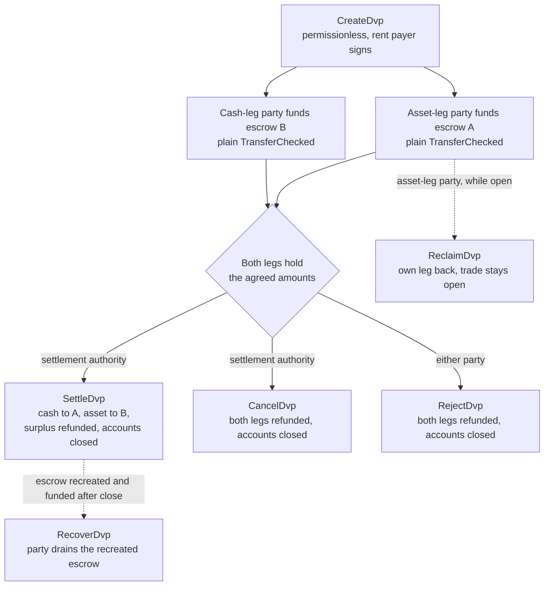
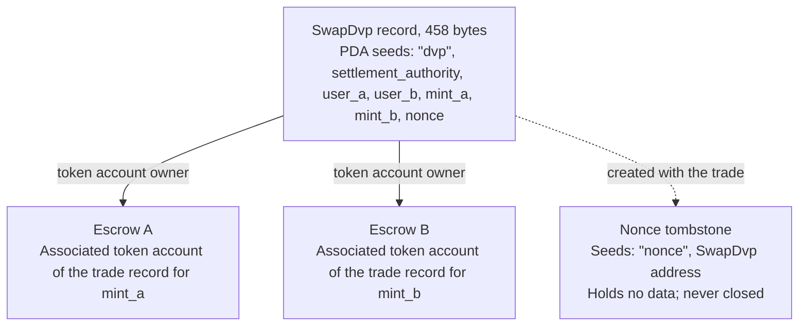

Program DvP to standardowy program do rozliczeń typu dostawa za płatność (delivery versus payment) w Solanie,
utrzymywany przez Solana Foundation i zaudytowany przez Cantina. Dwie strony uzgadniają
wymianę, każda wysyła swoją nogę na konto escrow zwykłym transferem
tokenów, a podmiot rozliczający rozlicza obie nogi w jednej transakcji, więc
albo przechodzą obie, albo żadna. Podmiot rozliczający to trzeci adres
wskazany w wymianie, na przykład platforma lub agent, który ją zorganizował. Żadna ze stron
nie pisze ani nie wdraża programu, a portfel lub powiernik, który potrafi wysłać standardowy
transfer tokenów (`TransferChecked`), może zasilić nogę bez żadnej integracji specyficznej dla DvP.
Do czasu rozliczenia każda ze stron może odebrać własną nogę lub cofnąć
wymianę.

<Callout type="warn" title="Zapoznaj się z rekordem, zanim podejmiesz działanie">

Tworzenie rekordu wymiany nie wymaga uprawnień, więc rekord nie jest dowodem
uzgodnienia. Każda ze stron czyta zapisane warunki, zanim zasili nogę, a podmiot
rozliczający – zanim dokona rozliczenia (zobacz
[weryfikacja](#verification-before-funding-and-settlement)).

</Callout>

## Jak to działa

Każda wymiana otrzymuje rekord należący do programu oraz dwa konta escrow, po jednym na nogę. Strona
nogi aktywa (`user_a`) i strona nogi gotówkowej (`user_b`) zasilają swoje nogi,
przesyłając tokeny na konto escrow danej nogi. Podmiot rozliczający
jest jedynym podpisującym, który może dokonać rozliczenia. Rozliczenie przesyła uzgodnioną
kwotę każdej nogi na drugą stronę, zwraca ewentualną nadwyżkę stronie, do której należy
dana noga, i zamyka rekord oraz oba konta escrow. Atomowość wynika z [transakcji](/docs/core/transactions)
Solany: oba transfery są w jednej transakcji,
więc albo oba zostaną wykonane, albo żaden.

Każdy zwrot, odebranie i zwrot nadwyżki trafia na własne associated
token account strony: konto `user_a` dla `mint_a`, konto `user_b` dla `mint_b`. Powiernik
lub system skarbowy może zasilić nogę z własnego konta, ale wszystko, co
zostanie zwrócone, trafia na konto strony, a nie z powrotem do powiernika. Każda wymiana
zostawia też trwałe konto znacznika (zobacz [Stan](#state)).

## Przewodniki

Strony z krokami prowadzą jedną wymianę od utworzenia do rozliczenia, z kodem w TypeScript i
Rust dla każdej instrukcji.

<Cards>
  <Card title="Utwórz wymianę" href="/docs/defi/dvp-program/create-a-trade">
    Zainstaluj klientów i zapisz warunki wymiany za pomocą CreateDvp
  </Card>
  <Card title="Zasil nogi" href="/docs/defi/dvp-program/fund-the-legs">
    Zweryfikuj zapisane warunki, a następnie zasil każdą nogę zwykłym transferem
  </Card>
  <Card title="Rozlicz wymianę" href="/docs/defi/dvp-program/settle-the-trade">
    Rozlicz obie nogi w jednej transakcji jako podmiot rozliczający
  </Card>
  <Card title="Cofnij wymianę" href="/docs/defi/dvp-program/unwind-a-trade">
    Odbierz nogę, anuluj lub odrzuć wymianę oraz odzyskaj spóźnione depozyty
  </Card>
</Cards>

[Demo na devnecie](https://solana.com/delivery-vs-payment/demo) przeprowadza wymianę
od początku do końca: tworzy wymianę, zasila oba konta escrow standardowymi transferami tokenów i
rozlicza obie nogi w jednej transakcji.

## Wybór między programem a delegowaniem

[Dostawa za płatność (DvP) z użyciem delegowania](/docs/tokenization/dvp) rozlicza
tę samą wymianę bez programu: każda ze stron deleguje swoją pozycję do
agenta rozliczającego, który przenosi obie nogi w jednej transakcji.

- **Program** nie wymaga delegowania, więc limit jednego delegata na token
  account nie ma zastosowania, a podmiot rozliczający nie może przekierować wpływów.
  Każda wymiana zależy od aktualizowalnego programu i jego upgrade authority.
- **Wzorzec delegowania** nie ma zależności od programu i działa z mintami, które
  mają Scaled UI Amount. Program odrzuca takie minty, co wyklucza każdy
  mint utworzony z szablonu `tokenized-security` z Mosaic (zobacz
  [ograniczenia konfiguracji mintu](#mint-configuration-constraints)).

## Role

Program jest symetryczny. W jego interfejsie obie strony to `user_a`, który
dostarcza `mint_a`, oraz `user_b`, który dostarcza `mint_b`. README i
wygenerowani klienci nazywają `mint_a` nogą aktywa, a `mint_b` nogą gotówkową,
i te strony stosują tę konwencję, ale nic w programie nie wymaga, aby noga gotówkowa
była instrumentem gotówkowym. Dwa aktywa lub dwa stablecoiny rozlicza się w ten sam
sposób.

| Rola                 | Kto                               | Podpisuje                                              | Uwagi                                                                                                                                                                                                     |
| -------------------- | --------------------------------- | -------------------------------------------------- | --------------------------------------------------------------------------------------------------------------------------------------------------------------------------------------------------------- |
| Strona nogi aktywa      | `user_a`, dostarcza `mint_a`       | Własny transfer zasilający; Reclaim, Reject, Recover | Portfel keypair lub inteligentny portfel oparty na PDA, taki jak skarbiec multisig. Konto multisig SPL Token ani program account nie może być stroną: Create kończy się błędem `PartyNotSignerCapable`                   |
| Strona nogi gotówkowej       | `user_b`, dostarcza `mint_b`       | Własny transfer zasilający; Reclaim, Reject, Recover | To samo wymaganie                                                                                                                                                                                          |
| Podmiot rozliczający | Trzeci adres wskazany przy tworzeniu | Settle, Cancel                                     | Jedyny podpisujący, który może dokonać rozliczenia. Nie może przekierować wpływów, które są ustalone przy tworzeniu. Otrzymuje rent z zamkniętych kont, gdy dokonuje rozliczenia lub anulowania                                         |
| Płatnik rent           | Ten, kto podpisuje `CreateDvp`         | Create                                             | Finansuje rent (depozyt w SOL, który utrzymuje konto otwarte) dla rekordu, nonce tombstone i obu kont escrow. Nie jest zapisywany jako odbiorca rent: rent z zamkniętych kont trafia do tego, kto zamyka wymianę |

## ID programu

```text
dvp34bdbcEm4f4FCUjGV4mDAkDshaQR4LkK8fdcsyZq
```

| Klaster      | Program                                       | Upgrade authority                              | Ostatni wdrożony slot |
| ------------ | --------------------------------------------- | ---------------------------------------------- | ------------------ |
| mainnet-beta | `dvp34bdbcEm4f4FCUjGV4mDAkDshaQR4LkK8fdcsyZq` | `DXtFpbPjcn2hxPnw79x1Pfoj35vXh5AsWBkS37YnXMVv` | 452,058,374        |
| devnet       | `dvp34bdbcEm4f4FCUjGV4mDAkDshaQR4LkK8fdcsyZq` | `5EX1zFeJWj4rGYZv432WnYw8CbaSUeTdxPx4r573UgYU` | 479,376,863        |

Program jest aktualizowalny na obu klastrach. Powyższe wartości to to, co
zwróciło `solana program show` dnia 2 października 2026; uruchom to samo polecenie, aby
uzyskać aktualne wartości. Wersja na devnecie jest starsza niż commit, względem którego
napisano strony z krokami (zobacz [Instalacja](/docs/defi/dvp-program/create-a-trade#install)),
z tym samym zestawem instrukcji i błędów.

## Cykl życia



Wymiana jest otwarta od `CreateDvp` do momentu, gdy zamknie ją Settle, Cancel lub Reject.
Zasilanie nie ma własnej instrukcji: noga jest zasilona, gdy jej konto escrow
zawiera co najmniej uzgodnioną kwotę. Reclaim działa dla pojedynczej nogi i pozostawia
wymianę otwartą, więc problem z jedną nogą nie zmusza drugiej strony do anulowania
całej wymiany.

## Stan

Każda wymiana ma jedno konto `SwapDvp` o rozmiarze 458 bajtów, należące do programu. Jego
adres jest wyprowadzany z podmiotu rozliczającego, obu stron, obu
mintów i nonce (seedy
`["dvp", settlement_authority, user_a, user_b, mint_a, mint_b, nonce]`). Kwoty
i czasy są zapisane wewnątrz konta i nie wpływają na adres,
dlatego trzeba je odczytywać, a nie wnioskować. Małe konto znacznika,
nonce tombstone pod adresem `["nonce", swap_dvp]`, jest tworzone wraz z wymianą i
nigdy nie jest zamykane, więc każda kombinacja stron, mintów, podmiotu rozliczającego i nonce może
zostać użyta tylko do jednej wymiany.



| Pole                                  | Typ          | Znaczenie                                                                                                 |
| -------------------------------------- | ------------- | ------------------------------------------------------------------------------------------------------- |
| `bump`                                 | `u8`          | Bump PDA                                                                                                |
| `user_a`, `user_b`                     | `Pubkey`      | Obie strony                                                                                         |
| `mint_a`, `mint_b`                     | `Pubkey`      | Minty nogi aktywa i nogi gotówkowej                                                                        |
| `settlement_authority`                 | `Pubkey`      | Jedyny podpisujący, który może dokonać rozliczenia lub anulowania                                                               |
| `token_program_a`, `token_program_b`   | `Pubkey`      | Token Program będący właścicielem każdego mintu; wymiana może łączyć nogi SPL Token i Token-2022                    |
| `amount_a`, `amount_b`                 | `u64`         | Uzgodniona kwota każdej nogi, w najmniejszej jednostce mintu (jednostki bazowe)                                 |
| `expiry_timestamp`                     | `i64`         | Po tym czasie sieci (zegar on-chain) Settle jest odrzucane. Reclaim, Cancel i Reject nadal działają |
| `nonce`                                | `u64`         | Rozróżnia wymiany, które mają pozostałe seedy wspólne. Jednorazowy                                             |
| `ref_string`                           | `[u8; 64]`    | Nieprzezroczysty identyfikator klienta, dopełniony zerami; program nigdy go nie odczytuje                                     |
| `user_a_settlement_destination`        | `Pubkey`      | Odbiera nogę gotówkową przy Settle; domyślnie `user_a`                                                   |
| `user_b_settlement_destination`        | `Pubkey`      | Odbiera nogę aktywa przy Settle; domyślnie `user_b`                                                  |
| `mint_a_authority`, `mint_b_authority` | `Pubkey`      | Mint authority zapisane przy tworzeniu; Settle kończy się błędem, jeśli któreś się zmieniło                           |
| `earliest_settlement_timestamp`        | `Option<i64>` | Jeśli ustawione, Settle jest odrzucane przed tym czasem sieci                                                     |

Lista pól pochodzi z IDL programu w commicie wskazanym w
[Utwórz wymianę](/docs/defi/dvp-program/create-a-trade#install).

## Instrukcje

| Instrukcja  | Podpisujący               | Efekt                                                                                                                                                              |
| ------------ | -------------------- | ------------------------------------------------------------------------------------------------------------------------------------------------------------------- |
| `CreateDvp`  | Dowolny płatnik            | Tworzy rekord `SwapDvp`, jego nonce tombstone i oba konta escrow. Nie przenosi tokenów                                                                        |
| `ReclaimDvp` | `user_a` lub `user_b` | Zwraca z escrow nogę należącą do podpisującego. Wymiana pozostaje otwarta, a noga może zostać zasilona ponownie                                                                      |
| `SettleDvp`  | Podmiot rozliczający | Przesyła `amount_a` do miejsca docelowego `user_b` i `amount_b` do miejsca docelowego `user_a`, zwraca ewentualną nadwyżkę stronie nogi, zamyka rekord i oba konta escrow |
| `CancelDvp`  | Podmiot rozliczający | Zwraca wszystko, co zawiera escrow A, do `user_a`, a escrow B do `user_b`, zamyka rekord i oba konta escrow                                                            |
| `RejectDvp`  | `user_a` lub `user_b` | Ten sam efekt co Cancel, podpisany przez stronę                                                                                                                            |
| `RecoverDvp` | `user_a` lub `user_b` | Po zamknięciu wymiany: opróżnia odtworzone escrow na własne token account podpisującego i je zamyka. Obejmuje depozyt, który dotarł po Settle, Cancel lub Reject  |

Każdy zwrot trafia na własne associated token account strony dla mintu danej
nogi, niezależnie od tego, kto zasilił escrow.

Konta i argumenty każdej instrukcji znajdują się na stronie danego kroku.

## Błędy

| Kod | Błąd                            | Kiedy                                                                                                   |
| ---- | -------------------------------- | ------------------------------------------------------------------------------------------------------ |
| 0    | `SignerNotParty`                 | Reclaim, Reject lub Recover podpisane przez adres, który nie jest `user_a` ani `user_b`                      |
| 1    | `DvpExpired`                     | Settle po `expiry_timestamp`                                                                        |
| 2    | `SettlementAuthorityMismatch`    | Settle lub Cancel podpisane przez adres inny niż podmiot rozliczający                              |
| 3    | `SettlementTooEarly`             | Settle przed `earliest_settlement_timestamp`                                                          |
| 4    | `LegNotFunded`                   | Settle, gdy escrow zawiera mniej niż uzgodnioną kwotę                                               |
| 5    | `ExpiryNotInFuture`              | Create z terminem wygaśnięcia równym lub wcześniejszym niż bieżący czas sieci                                            |
| 6    | `EarliestAfterExpiry`            | Create z najwcześniejszym czasem rozliczenia po terminie wygaśnięcia                                               |
| 7    | `SelfDvp`                        | Create, gdy `user_a` jest równy `user_b`                                                                 |
| 8    | `SameMint`                       | Create, gdy `mint_a` jest równy `mint_b`                                                                 |
| 9    | `ZeroAmount`                     | Create z zerową kwotą na którejkolwiek nodze                                                                |
| 10   | `BlockedMintExtension`           | Create lub Settle z mintem z rozszerzeniem TransferFee, InterestBearing, ScaledUiAmount lub NonTransferable |
| 11   | `SettlementAuthorityIsParty`     | Create, gdy podmiot rozliczający jest równy jednej ze stron                                                  |
| 12   | `SettlementAuthorityExecutable`  | Create z wykonywalnym podmiotem rozliczającym                                                         |
| 13   | `NonceAlreadyUsed`               | Create ponownie używające `(seeds, nonce)`, które ma już tombstone                                         |
| 14   | `ExpiryTooFarInFuture`           | Create z terminem wygaśnięcia odległym o ponad rok                                                         |
| 15   | `RefStringTooLong`               | Create z referencją dłuższą niż 64 bajty                                                           |
| 16   | `DvpStillOpen`                   | Recover, gdy wymiana jest nadal otwarta; użyj Reclaim                                                     |
| 17   | `DvpNeverCreated`                | Recover z seedami, dla których nie istnieje tombstone                                                              |
| 18   | `EscrowPreloadedWithLamports`    | Create, gdy escrow inny niż natywny przechowuje lamports powyżej minimum zwalniającego z rent                           |
| 19   | `SettlementDestinationIsSwapDvp` | Create z celem rozliczenia równym rekordowi wymiany                                         |
| 20   | `SwapDvpPreloadedWithLamports`   | Create, gdy adres rekordu przechowuje lamports powyżej swojej rezerwy rent                                   |
| 21   | `RecipientAtaMismatch`           | Token account odbiorcy lub zwrotu nie należy już do oczekiwanego portfela i mint                  |
| 22   | `PartyNotSignerCapable`          | Create ze stroną, która nie jest kontem należącym do systemu i niewykonywalnym                                 |
| 23   | `MintAuthorityChanged`           | Settle, gdy mint authority nogi różni się od wartości zapisanej przy tworzeniu                         |

## Zdarzenia i indeksowanie

Program nie emituje żadnych zdarzeń onchain. Indeksator lub system uzgadniania odczytuje
stan konta `SwapDvp` oraz salda tokenów obu escrow i używa
`ref_string`, aby powiązać wymianę z jej zleceniem off-chain. Ponieważ rekord
jest zamykany przy rozliczeniu, system, który potrzebuje warunków po fakcie, zapisuje
je w momencie odczytu lub odtwarza z transakcji, która utworzyła
wymianę.

## Obsługiwane tokeny

Wymiana może łączyć nogę SPL Token z nogą Token-2022; każda noga ma
własny token program. Obsługiwane są nogi Wrapped SOL.

| Rozszerzenie Token-2022 na mint nogi                                                     | Zachowanie programu                                                  |
| ---------------------------------------------------------------------------------------- | ----------------------------------------------------------------- |
| TransferFee, InterestBearing, ScaledUiAmount, NonTransferable                            | Odrzucane przy Create i Settle z błędem `BlockedMintExtension`         |
| PermanentDelegate, Pausable, DefaultAccountState, freeze authority, MintCloseAuthority | Akceptowane; każda authority może działać na tokenach w escrow           |
| ConfidentialTransfer                                                                     | Akceptowane; kwoty na tej nodze są publiczne                          |
| TransferHook                                                                             | Obsługiwane, do 32 dodatkowych kont na nogę                        |
| MemoTransfer na koncie docelowym lub koncie zwrotu                                          | Akceptowane; program emituje wymagane memo przed transferem |

Opłata transferowa sprawiłaby, że strona odbierająca otrzymałaby mniej niż uzgodniona kwota.
Interest Bearing i Scaled UI Amount nie zmieniają kwot surowych, ale ich stopa
lub mnożnik mogą się zmienić między utworzeniem a rozliczeniem wymiany, co zmienia
sposób wyświetlania uzgodnionych kwot. NonTransferable unieruchomiłby obie nogi.

Akceptowane authority mogą przenosić, zamrażać lub wstrzymywać tokeny w escrow przez cały
czas trwania wymiany (zob. poniżej). Escrow nie może zostać skonfigurowany do odbierania
transferów poufnych, więc kwoty w escrow i rozliczone na nodze poufnej
są publiczne.

W przypadku mint z hookiem klient rozwiązuje dodatkowe konta hooka i dołącza
je do Settle, Cancel, Reject, Reclaim i Recover. Limit 32 na nogę
obejmuje program hooka i jego konto walidacyjne. Jeśli hook authority
powiększy listę kont hooka ponad ten limit, każdy transfer na tej nodze
zakończy się niepowodzeniem, w tym Reclaim, Cancel, Reject i Recover, dopóki authority tego nie
cofnie. Limit kont w transakcji może zadziałać wcześniej niż limit na nogę, gdy
obie nogi mają hooki.

Gdy konto docelowe lub konto zwrotu wymaga memo, program wywołuje program Memo
przed transferem, dlatego każda instrukcja przenosząca tokeny
z escrow przyjmuje konto `memo_program`.

### Ograniczenia konfiguracji mint

**Scaled UI Amount.** Szablon `tokenized-security` w
[Mosaic](https://github.com/solana-foundation/mosaic), zestawie narzędzi Solana Foundation do
emisji, zawsze dodaje Scaled UI Amount, więc program nie akceptuje
mint utworzonego z tego szablonu jako nogi. Mint przeznaczony dla tego programu można
utworzyć bez tego rozszerzenia (zob.
[Token Extensions](/docs/tokens/extensions));
[DvP z użyciem delegowania](/docs/tokenization/dvp) rozlicza się przez delegowaną
authority i nie stosuje tej kontroli.

**Mint domyślnie zamrożone.** Escrow każdej wymiany to associated token account
należące do program-derived address, który jest nowy dla danej wymiany. W mint z
Default Account State ustawionym na frozen escrow jest tworzony jako zamrożony, a transfer
zasilający go kończy się niepowodzeniem, dopóki nie zostanie odmrożony. W ramach
[Token ACL](/docs/tokenization/token-acl) oznacza to, że emitent lub jego agent transferowy dopuszcza escrow wymiany
przed zasileniem: albo przez dodanie adresu rekordu wymiany (właściciela escrow) do allowlisty, tak aby każdy mógł odmrozić
escrow, jeśli konfiguracja Token ACL mint włącza odmrażanie bez uprawnień, albo przez
odmrożenie go bezpośrednio przez freeze authority. Zamrożony escrow blokuje też
Settle, Reclaim, Cancel, Reject i Recover na tej nodze, więc freeze
authority, a w przypadku mint z hookiem hook authority, jest zaufaną stroną przez cały czas trwania
wymiany. Ścieżka zamrożonego escrow jest opisana tutaj i nie jest wykorzystana
w fragmentach kodu na devnet.

## Limity

- Brak dopasowywania zleceń, odkrywania cen ani księgi zleceń. Strony uzgadniają warunki poza
  ledgerem, a jedna z nich je zapisuje.
- Brak nettingu, tylko rozliczenia dwustronne: jeden rekord to jedna wymiana między dwiema stronami.
- Brak częściowych realizacji. Settle przenosi dokładnie uzgodnioną kwotę każdej nogi i
  zwraca ewentualną nadwyżkę stronie danej nogi.
- Brak nogi poza ledgerem. Obie nogi to token accounts w Solanie; noga gotówkowa na
  istniejących torach rozlicza się osobno i jest uzgadniana.
- Brak weryfikacji uprawnień, allowlisty ani KYC. Uprawnienia posiadaczy egzekwują własne
  mechanizmy kontroli mint.
- Brak automatycznego rozliczenia. Settlement authority musi podpisać.
- Brak zdarzeń i brak opłaty protokołu poza opłatami transakcyjnymi i rent.

Program eliminuje ryzyko kapitałowe między dwiema stronami: żadna noga się nie przesuwa,
jeśli nie przesuną się obie. Nie eliminuje ryzyka kredytowego emitenta ani ryzyka wykupu żadnego z
tokenów, możliwości działania freeze, pause lub permanent delegate authority mint
na tokenach w escrow (zob. [obsługiwane tokeny](#supported-tokens)) ani
zależności od tego, czy settlement authority będzie dostępna, by podpisać.

## Weryfikacja przed zasileniem i rozliczeniem

`CreateDvp` nie wymaga uprawnień: podpisuje tylko płatnik, a strony i
settlement authority nie. Każdy może więc utworzyć rekord wskazujący dowolne
strony i dowolne warunki. Przed zasileniem oraz ponownie przed rozliczeniem odczytaj konto
`SwapDvp` i potwierdź, że:

1. Konto należy do programu DvP i ma dokładnie 458 bajtów. Konto,
   które nie należy do programu, można wypełnić bajtami dekodującymi się jak
   prawdziwy rekord.
2. `user_a`, `user_b`, `mint_a`, `mint_b` i `settlement_authority` odpowiadają
   uzgodnionej wymianie.
3. `amount_a`, `amount_b`, `expiry_timestamp` i
   `earliest_settlement_timestamp` odpowiadają uzgodnionym warunkom.
4. Oba cele rozliczenia są uzgodnionymi adresami. Sfałszowany rekord może
   przekierować środki.

[Zasilenie nóg](/docs/defi/dvp-program/fund-the-legs#verify-the-terms) wymienia
weryfikujące czytniki wygenerowanych klientów i pokazuje tę kontrolę w kodzie.

Uznaj wymianę za rozliczoną, gdy transakcja Settle osiągnie
[`finalized`](/docs/rpc#configuring-state-commitment). To poziom commitment sieci; to, czy oznacza
to także ostateczność rozliczenia w sensie prawnym,
zależy od umów stron i obowiązujących reżimów prawnych.

## Wersjonowanie

Konto `SwapDvp` nie ma pola wersji. Jego układ jest stały i wynosi 458 bajtów
(`SwapDvp::LEN`), a weryfikujące czytniki odrzucają konto o jakiejkolwiek innej długości.
IDL ma własną wersję, `0.1.0` według stanu na 2 października 2026.

Program można aktualizować w obu klastrach (zob. [Program ID](#program-id)). Rekord
wymiany istnieje tylko do momentu jej rozliczenia, anulowania lub odrzucenia, dlatego sprawdź
w repozytorium, jak aktualizacja traktuje otwarte wymiany, i wygeneruj klientów ponownie
z IDL wdrożonej wersji.

## Repozytorium i audyt

Kod źródłowy, IDL, wygenerowani klienci i testy znajdują się w
[`solana-foundation/dvp`](https://github.com/solana-foundation/dvp) na licencji
MIT. Program jest programem `no_std` Pinocchio; klienci są
generowani z IDL za pomocą Codama. Zgłoszenia podatności przesyła się przez link do
security advisory repozytorium, zgodnie z jego `SECURITY.md`.

Program został zaudytowany przez
[Cantina](https://cantina.xyz/portfolio/fe870bb4-d96d-4902-8aec-9dfcfa2d6a79).

## Powiązane

- [Delivery vs Payment (DvP) z użyciem delegowania](/docs/tokenization/dvp): wzorzec
  delegowania bez programu
- [Token ACL](/docs/tokenization/token-acl): jak mint z kontrolą dostępu współpracuje z
  kontami escrow
