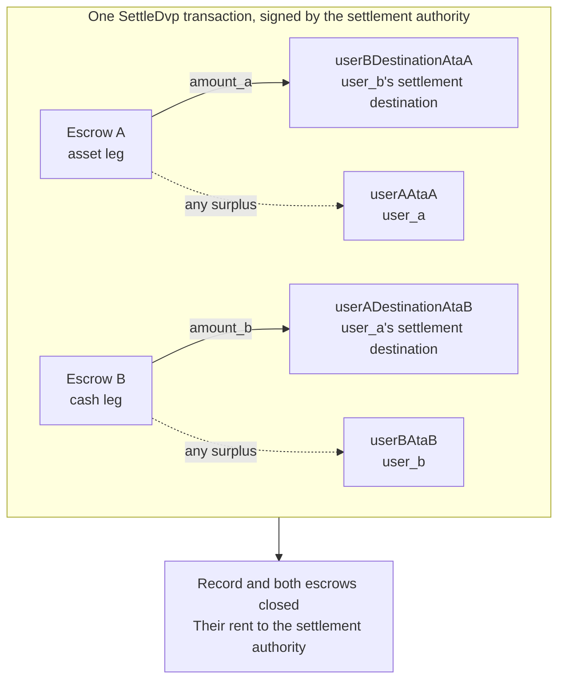

`SettleDvp` jest podpisywana przez podmiot rozliczający wskazany w rekordzie transakcji. W
jednej transakcji przenosi `amount_a` z nogi aktywa na adres docelowy
strony nogi gotówkowej oraz `amount_b` z nogi gotówkowej na adres docelowy strony nogi aktywa,
zwraca ewentualną nadwyżkę z każdego rachunku escrow stronie danej nogi oraz zamyka rekord
i oba rachunki escrow. Jeśli którykolwiek z tych transferów nie może zostać zrealizowany, instrukcja
kończy się błędem i nic nie zostaje przeniesione.

Ta strona jest kontynuacją części [tworzenie transakcji](/docs/defi/dvp-program/create-a-trade)
oraz [zasilanie nóg](/docs/defi/dvp-program/fund-the-legs); klient, podpisujący,
`trade` oraz konta typu token account stron są przenoszone dalej.

## Ponowna weryfikacja przed podpisaniem

Podmiot rozliczający podpisuje transakcję przenoszącą obie nogi, dlatego
przed podpisaniem wykonuje ten sam odczyt co każda ze stron: właściciel, rozmiar, strony,
mints, kwoty, termin ważności i oba adresy docelowe (zob.
[zasilanie nóg](/docs/defi/dvp-program/fund-the-legs#verify-the-terms)). Sam
program podczas rozliczenia ponownie sprawdza, czy każdy mint nadal należy do token
program zapisanego przy tworzeniu, nie ma zablokowanego rozszerzenia i ma tego samego
mint authority co w chwili utworzenia transakcji, więc mint odtworzony z zablokowanym
rozszerzeniem, innym token program lub innym mint authority nie może zostać
rozliczony.

## Utworzenie kont odbiorców

Instrukcja Settle zapisuje dane w czterech kontach typu token account, których program nie tworzy:

| Konto                | Otrzymuje                     | Właściciel                           |
| ---------------------- | ---------------------------- | ------------------------------- |
| `userADestinationAtaB` | Noga gotówkowa (`amount_b`)    | `user_a_settlement_destination` |
| `userBDestinationAtaA` | Noga aktywa (`amount_a`)   | `user_b_settlement_destination` |
| `userAAtaA`            | Ewentualna nadwyżka z nogi aktywa | `user_a`                        |
| `userBAtaB`            | Ewentualna nadwyżka z nogi gotówkowej  | `user_b`                        |

Konta na nadwyżki są używane tylko wtedy, gdy rachunek escrow zawiera więcej niż uzgodniona
kwota, ale każdy, kto posiada dany mint, może wytworzyć nadwyżkę, wysyłając kilka jednostek
bazowych na rachunek escrow. Jeśli konto zwrotne nie istnieje, cała instrukcja Settle
kończy się błędem, dlatego utwórz wszystkie cztery idempotentnie w tej samej transakcji.

<Tabs items={["TypeScript", "Rust"]}>
  <Tab value="TypeScript">
    ```ts
    import {
      findAssociatedTokenPda,
      getCreateAssociatedTokenIdempotentInstruction,
    } from "@solana-program/token-2022";

    const destinationA = t.userASettlementDestination; // defaults to userA
    const destinationB = t.userBSettlementDestination; // defaults to userB

    const [userADestinationAtaB] = await findAssociatedTokenPda({
      mint: mintB,
      owner: destinationA,
      tokenProgram: tokenProgramB,
    });
    const [userBDestinationAtaA] = await findAssociatedTokenPda({
      mint: mintA,
      owner: destinationB,
      tokenProgram: tokenProgramA,
    });
    // userAAtaA and userBAtaB are from fund the legs.

    const createRecipientAccounts = [
      { ata: userADestinationAtaB, owner: destinationA, mint: mintB, tokenProgram: tokenProgramB },
      { ata: userBDestinationAtaA, owner: destinationB, mint: mintA, tokenProgram: tokenProgramA },
      { ata: userAAtaA, owner: userA, mint: mintA, tokenProgram: tokenProgramA },
      { ata: userBAtaB, owner: userB, mint: mintB, tokenProgram: tokenProgramB },
    ].map(({ ata, owner, mint, tokenProgram }) =>
      getCreateAssociatedTokenIdempotentInstruction({
        payer: authoritySigner,
        ata,
        owner,
        mint,
        tokenProgram,
      }),
    );
    ```

  </Tab>

  <Tab value="Rust">
    ```rust
    use spl_associated_token_account_client::address::get_associated_token_address_with_program_id;
    use spl_associated_token_account_client::instruction::create_associated_token_account_idempotent;

    let authority: Pubkey = pubkey!("SETTLEMENT_AUTHORITY_ADDRESS_HERE");
    let destination_a = trade.user_a_settlement_destination; // defaults to user_a
    let destination_b = trade.user_b_settlement_destination; // defaults to user_b

    let user_a_destination_ata_b =
        get_associated_token_address_with_program_id(&destination_a, &mint_b, &token_program_b);
    let user_b_destination_ata_a =
        get_associated_token_address_with_program_id(&destination_b, &mint_a, &token_program_a);
    let user_a_ata_a = get_associated_token_address_with_program_id(&user_a, &mint_a, &token_program_a);
    let user_b_ata_b = get_associated_token_address_with_program_id(&user_b, &mint_b, &token_program_b);

    let create_recipient_accounts = [
        create_associated_token_account_idempotent(&authority, &destination_a, &mint_b, &token_program_b),
        create_associated_token_account_idempotent(&authority, &destination_b, &mint_a, &token_program_a),
        create_associated_token_account_idempotent(&authority, &user_a, &mint_a, &token_program_a),
        create_associated_token_account_idempotent(&authority, &user_b, &mint_b, &token_program_b),
    ];
    ```

  </Tab>
</Tabs>

## Rozliczenie (Settle)

`legAExtrasCount` informuje program, ile spośród kont dołączonych po
stałej liście należy do transfer hooka transferu nogi aktywa; pozostałe należą do nogi
gotówkowej. W przypadku mintów bez transfer hooków przekaż zero i niczego nie dołączaj. Konto memo
program account jest wymagane przez instrukcję i używane tylko dla adresów docelowych,
które wymagają memo.

<Tabs items={["TypeScript", "Rust"]}>
  <Tab value="TypeScript">
    ```ts
    import { MEMO_PROGRAM_ADDRESS } from "@solana-program/memo";
    import { getSettleDvpInstruction } from "./dvp";

    const settleInstruction = getSettleDvpInstruction({
      settlementAuthority: authoritySigner,
      swapDvp,
      mintA,
      mintB,
      dvpAtaA: escrowA,
      dvpAtaB: escrowB,
      userADestinationAtaB,
      userBDestinationAtaA,
      userAAtaA,
      userBAtaB,
      tokenProgramA,
      tokenProgramB,
      memoProgram: MEMO_PROGRAM_ADDRESS,
      legAExtrasCount: 0,
    });

    const { context: settleContext } = await client.sendTransaction([
      ...createRecipientAccounts,
      settleInstruction,
    ]);
    const settleSignature = settleContext.signature;
    console.log("Submitted:", settleSignature);

    // sendTransaction returns at the client's commitment (confirmed by default).
    // Wait for finalized before recording the trade as settled.
    let finalized = false;
    for (let attempt = 0; attempt < 30 && !finalized; attempt++) {
      const {
        value: [status],
      } = await client.rpc.getSignatureStatuses([settleSignature]).send();
      if (status?.err) {
        throw new Error("Settle transaction failed");
      }
      finalized = status?.confirmationStatus === "finalized";
      if (!finalized) {
        await new Promise((resolve) => setTimeout(resolve, 2_000));
      }
    }
    if (!finalized) {
      // A closed record means it settled; an open one is safe to settle again.
      throw new Error("Settle not finalized after 60s; read the trade record");
    }
    console.log("Settled:", settleSignature);
    ```

  </Tab>

  <Tab value="Rust">
    ```rust
    use dvp_swap_program_client::instructions::SettleDvpBuilder;

    const MEMO_PROGRAM_ID: Pubkey = pubkey!("MemoSq4gqABAXKb96qnH8TysNcWxMyWCqXgDLGmfcHr");

    let settle_ix = SettleDvpBuilder::new()
        .settlement_authority(authority)
        .swap_dvp(swap_dvp)
        .mint_a(mint_a)
        .mint_b(mint_b)
        .dvp_ata_a(escrow_a)
        .dvp_ata_b(escrow_b)
        .user_a_destination_ata_b(user_a_destination_ata_b)
        .user_b_destination_ata_a(user_b_destination_ata_a)
        .user_a_ata_a(user_a_ata_a)
        .user_b_ata_b(user_b_ata_b)
        .token_program_a(token_program_a)
        .token_program_b(token_program_b)
        .memo_program(MEMO_PROGRAM_ID)
        .leg_a_extras_count(0)
        .instruction();
    ```

  </Tab>
</Tabs>



### Transfer hooks

Wygenerowany IDL zawiera tylko stałe konta, więc wygenerowane buildery
nie znają kont hooków. Rozwiąż dodatkowe account metas każdego mintu z hookiem
w taki sam sposób, jak przy bezpośrednim transferze tego tokena, a następnie dołącz je do
instrukcji: najpierw konta nogi aktywa, potem nogi gotówkowej, przy czym
`legAExtrasCount` ustaw na liczbę kont z pierwszej grupy. W TypeScript rozwiń
rozwiązane metas w tablicy `accounts` instrukcji; w Ruście użyj
`add_remaining_accounts` w builderze. Limit wynosi 32 konta na nogę,
włącznie z programem hooka i kontem walidacji; limit kont w transakcji
może zadziałać wcześniej, gdy obie nogi mają hooki. Program usuwa flagę podpisującego
z każdego przekazywanego konta, więc hook nie może uzyskać podpisu podmiotu
rozliczającego tą drogą.

## Zapisanie wyniku

Uznaj transakcję za rozliczoną, gdy transakcja rozliczenia osiągnie status `finalized`.
Rekord i oba rachunki escrow po rozliczeniu przestają istnieć, więc system, który potrzebuje
warunków później, zapisuje je z odczytu sprzed rozliczenia lub z transakcji tworzącej.
Rent z zamkniętych kont trafił do podmiotu rozliczającego.

## Błędy Settle

`LegNotFunded` oznacza, że rachunek escrow zawiera mniej niż uzgodniona kwota; `DvpExpired`
i `SettlementTooEarly` oznaczają, że okno czasowe zostało przegapione; `MintAuthorityChanged`
i `BlockedMintExtension` oznaczają, że mint zmienił się po utworzeniu;
`RecipientAtaMismatch` oznacza, że konto typu token account adresu docelowego lub zwrotu nie istnieje albo
nie należy już do oczekiwanego właściciela i mintu, zwykle dlatego, że pominięto powyższy
krok tworzenia kont. W każdym przypadku nic nie zostało przeniesione, a
strony mogą wycofać transakcję, z zastrzeżeniem uprawnień mintu (zob.
[cofnięcie transakcji](/docs/defi/dvp-program/unwind-a-trade)).

## Następne kroki

- [Cofnięcie transakcji](/docs/defi/dvp-program/unwind-a-trade): odzyskiwanie zasilonych
  nóg, gdy transakcja nie zostaje rozliczona
