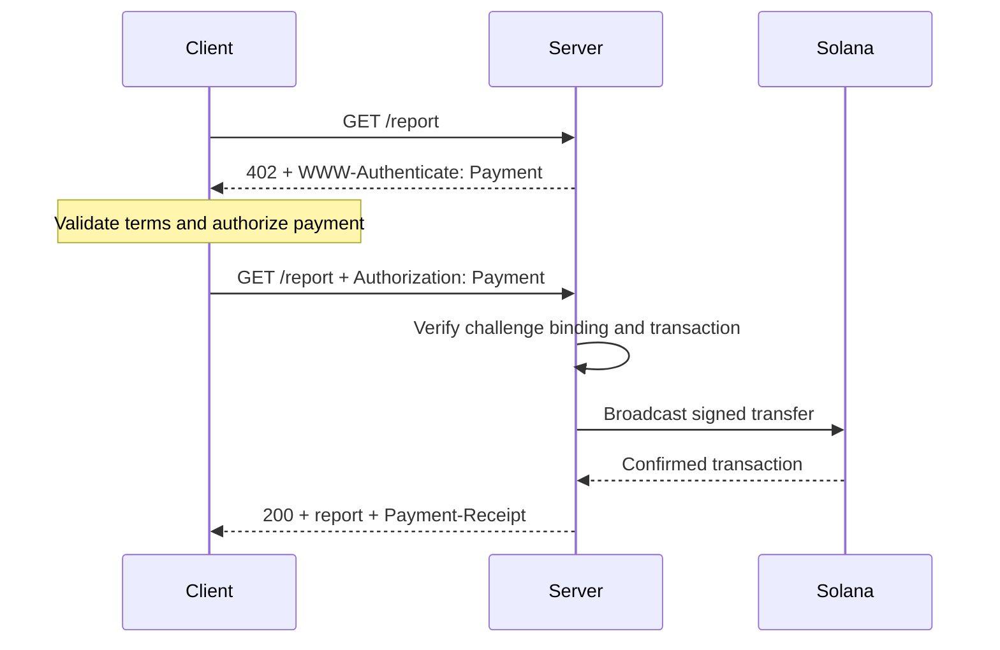
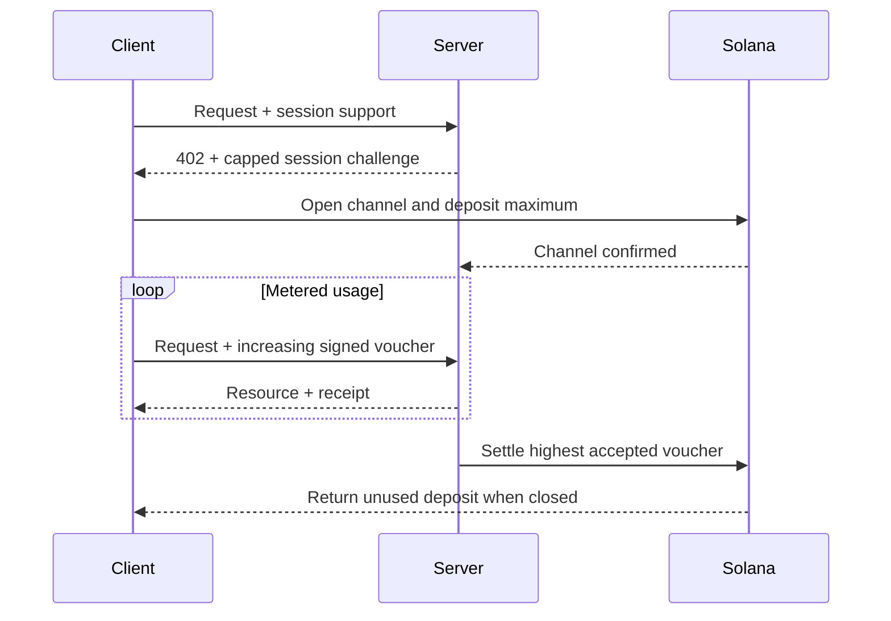

[Machine Payments Protocol (MPP)](https://mpp.dev/) stosuje semantykę uwierzytelniania HTTP do płatności. Serwer wysyła wyzwanie w odpowiedzi na nieopłacone żądanie, klient zwraca poświadczenie płatności, a serwer po zaakceptowaniu płatności zwraca potwierdzenie.

MPP rozdziela trzy kwestie:

- **Intencja** (intent) opisuje interakcję handlową, na przykład jednorazową opłatę (`charge`) lub rozliczaną według zużycia sesję (`session`).
- **Metoda płatności** opisuje sposób przepływu wartości. Metoda dla Solany obsługuje w przypadku opłat natywny token SOL oraz tokeny SPL.
- **Transport** HTTP przenosi wyzwania, poświadczenia, potwierdzenia i błędy.

MPP jest publikowany jako zestaw dokumentów Internet-Draft. Traktuj [aktualne specyfikacje](https://paymentauth.org/) jako źródło prawdy i miej na uwadze, że szczegóły mogą się zmieniać, dopóki prace nad dokumentami trwają.

## Wymiana HTTP

MPP wykorzystuje standardowe pola uwierzytelniania HTTP zamiast nagłówków płatności specyficznych dla protokołu:

| Komunikat                 | Reprezentacja HTTP                                         |
| ----------------------- | ----------------------------------------------------------- |
| Wyzwanie płatności       | `402 Payment Required` z `WWW-Authenticate: Payment ...` |
| Poświadczenie płatności      | Ponowione żądanie z `Authorization: Payment ...`           |
| Potwierdzenie powodzenia      | Odpowiedź z zasobem zawierająca `Payment-Receipt: ...`               |
| Nieprawidłowe dane płatności | Treść Problem Details w formacie `application/problem+json`       |



Wyzwanie zawiera wygenerowany przez serwer identyfikator, realm, metodę, intencję, zakodowane żądanie płatności oraz termin ważności. Poświadczenie powiela wyzwanie i dodaje dowód płatności właściwy dla danej metody. Serwer musi zweryfikować obie części; prawidłowy przelew należący do innego wyzwania nie może odblokować zasobu.

## Jednorazowe opłaty na Solanie

Intencja `charge` na Solanie obsługuje dwa typy poświadczeń:

- **Tryb pull** wykorzystuje podpisaną transakcję. Klient podpisuje transfer i wysyła transakcję do serwera. Serwer weryfikuje ją, opcjonalnie dodaje podpis płatnika opłat (fee payer), rozgłasza transakcję, potwierdza ją i zwraca sygnaturę transakcji w potwierdzeniu.
- **Tryb push** wykorzystuje sygnaturę transakcji. Klient najpierw rozgłasza transakcję, a następnie wysyła potwierdzoną sygnaturę do serwera. Serwer pobiera transakcję i weryfikuje ją przed zwróceniem zasobu.

Tryb pull umożliwia sponsorowanie opłat transakcyjnych przez serwer oraz logikę ponawiania prób po stronie serwera. Tryb push jest przydatny, gdy portfel wymaga, aby klient samodzielnie przesłał swoją transakcję, ale nie pozwala na sponsorowanie opłat przez serwer.

Normatywne pola i reguły weryfikacji znajdziesz w [specyfikacji opłat (charge) dla Solany](https://paymentauth.org/draft-solana-charge-00.html).

## Dodawanie opłaty MPP do API Express

Solana Pay Kit zapewnia aktualną integrację TypeScript dla MPP i x402. Zainstaluj go razem z Express:

```bash
pnpm add @solana/pay-kit @solana/kit@^6.9.0 express
pnpm add --save-dev @types/express tsx
```

Ten najprostszy przykład korzysta z hostowanego środowiska testowego Surfpool oraz publicznego odbiorcy demonstracyjnego z pakietu. Służy wyłącznie do lokalnego programowania:

```ts filename=server.ts
import express from "express";
import { createPayKit, usd } from "@solana/pay-kit";

const pay = await createPayKit({
  accept: ["mpp"],
  rpcUrl: "https://402.surfnet.dev:8899"
});

const app = express();

app.get("/report", pay.express(usd("0.01")), (_req, res) => {
  res.json({ report: "Paid report" });
});

app.listen(4567, () => {
  console.log("Paid API listening on http://127.0.0.1:4567");
});
```

Uruchom go i porównaj nieopłacone żądanie z żądaniem uwzględniającym płatność:

```bash
pnpm tsx server.ts
curl -i http://127.0.0.1:4567/report
pay --sandbox curl http://127.0.0.1:4567/report
```

Handler trasy jest uruchamiany dopiero po zaakceptowaniu płatności przez middleware.

<Callout type="warn" title="W środowisku produkcyjnym zastąp wszystkie domyślne ustawienia sandboxa">
  Skonfiguruj jawnie sieć, odbiorcę (sprzedawcę), dedykowany RPC, stabilny sekret powiązania wyzwań, produkcyjnego podpisującego oraz trwały magazyn do ochrony przed powtórzeniami (replay). Nigdy nie kieruj prawdziwych płatności do demonstracyjnego podpisującego z pakietu.
</Callout>

## Sesje rozliczane według zużycia

Używaj sesji (`session`) MPP na Solanie, gdy klient będzie dokonywać wielu drobnych, powiązanych płatności. Sesja otwiera kanał płatności onchain z maksymalnym depozytem, a następnie w miarę wzrostu zużycia wykorzystuje kumulatywne podpisane vouchery. Serwer może weryfikować vouchery offchain i później rozliczyć najwyższą zaakceptowaną kwotę.

Takie rozwiązanie sprawdza się w przypadku inferencji rozliczanej za tokeny, pobierania danych rozliczanego za bajty, danych na żywo i wielokrotnych wywołań narzędzi. Nie jest to to samo, co wysyłanie osobnej płatności onchain dla każdego zdarzenia.



Sesję nazywaj **płatnością sesyjną**, **kanałem płatności** lub **limitowaną, powtarzalną autoryzacją**. Określenia „płatność strumieniowa” używaj tylko wtedy, gdy usługa i umowa płatnicza faktycznie rozliczają strumień zużycia.

## Weryfikacja produkcyjna

Przy każdej opłacie na Solanie serwer musi zweryfikować co najmniej:

- Wyzwanie jest autentyczne, nie wygasło, jest powiązane z tym żądaniem i przeznaczone dla tego realmu.
- Transakcja korzysta z oczekiwanej sieci, aktywa lub mint, odbiorcy, kwoty i Token Program.
- Wszelkie instrukcje płatnika opłat lub associated token account są jawnie dozwolone i nie mogą opróżnić konta podpisującego serwera.
- Transakcja zakończyła się powodzeniem na wymaganym poziomie commitment.
- Sygnatura transakcji nie została jeszcze wykorzystana.
- Sprawdzenie powtórzenia i operacja zużycia są atomowe we wszystkich instancjach serwera.

W przypadku sesji zapisuj również stan kanału, zaakceptowaną kwotę kumulatywną oraz znacznik rozliczenia (settlement watermark) we współdzielonym magazynie. Opisz w dokumentacji, w jaki sposób klienci odzyskują niewykorzystane środki, jeśli serwer stanie się niedostępny.

## Powiązane zasoby

- [Specyfikacje MPP](https://paymentauth.org/)
- [Dokumentacja protokołu MPP](https://mpp.dev/protocol)
- [Solana Pay Kit](https://github.com/solana-foundation/pay-kit)
- [Przegląd płatności agentowych](/docs/payments/agentic-payments)
- [Gotowość produkcyjna](/docs/tools/security#verify-addresses)
