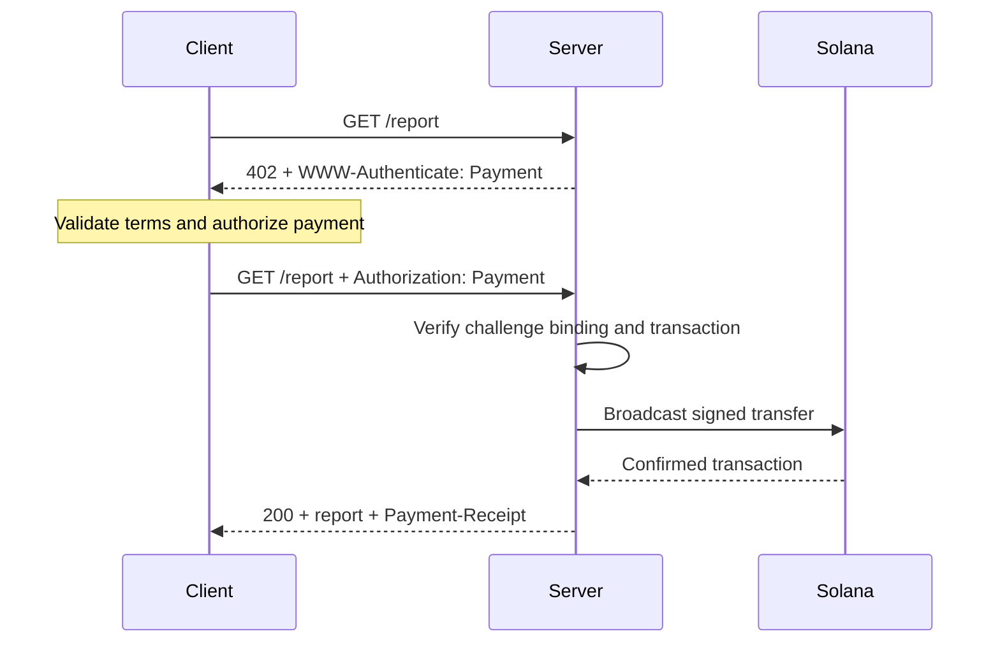
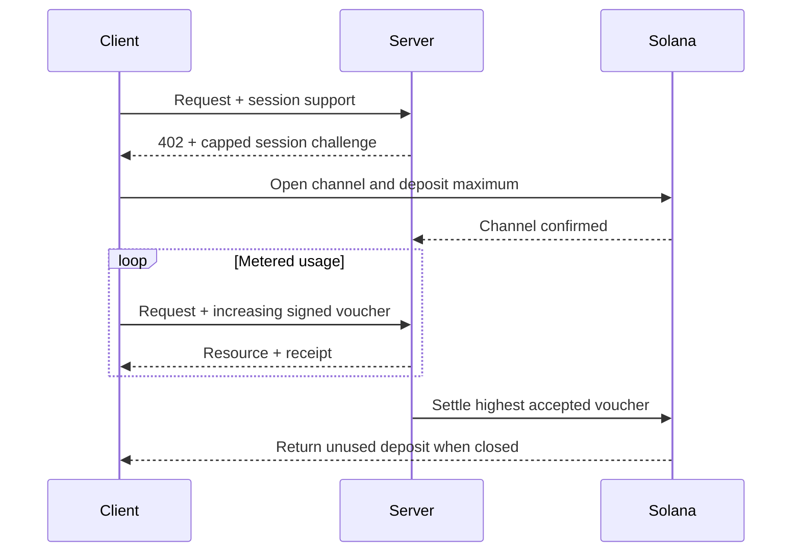

[Machine Payments Protocol (MPP)](https://mpp.dev/) stosuje semantykę uwierzytelniania
HTTP do płatności. Serwer wysyła wyzwanie w odpowiedzi na nieopłacone żądanie,
klient zwraca poświadczenie płatności, a serwer po zaakceptowaniu płatności
zwraca pokwitowanie.

MPP rozdziela trzy kwestie:

- **Intencja** (intent) opisuje interakcję handlową, na przykład jednorazową
  opłatę (`charge`) lub rozliczaną według zużycia sesję (`session`).
- **Metoda płatności** opisuje sposób przepływu wartości. Metoda dla Solany
  obsługuje w przypadku opłat natywny token SOL oraz tokeny SPL.
- **Transport** HTTP przenosi wyzwania, poświadczenia, pokwitowania i błędy.

MPP jest publikowany jako zestaw dokumentów Internet-Draft. Traktuj
[aktualne specyfikacje](https://paymentauth.org/) jako źródło prawdy i miej na uwadze, że
szczegóły mogą się zmieniać, dopóki prace nad szkicami trwają.

## Wymiana HTTP

MPP korzysta ze standardowych pól uwierzytelniania HTTP zamiast specyficznych
dla protokołu nagłówków płatności:

| Komunikat                 | Reprezentacja HTTP                                         |
| ----------------------- | ----------------------------------------------------------- |
| Wyzwanie płatnicze       | `402 Payment Required` z `WWW-Authenticate: Payment ...` |
| Poświadczenie płatności      | Ponowione żądanie z `Authorization: Payment ...`           |
| Pokwitowanie udanej płatności      | Odpowiedź z zasobem zawierająca `Payment-Receipt: ...`               |
| Nieprawidłowe dane płatności | Treść Problem Details w formacie `application/problem+json`       |



Wyzwanie zawiera identyfikator wygenerowany przez serwer, realm, metodę,
intencję, zakodowane żądanie płatności oraz termin ważności. Poświadczenie
powtarza wyzwanie i dodaje dowód płatności właściwy dla danej metody. Serwer
musi zweryfikować oba elementy; prawidłowy przelew należący do innego wyzwania
nie może odblokować zasobu.

## Jednorazowe opłaty w sieci Solana

Intencja `charge` dla Solany obsługuje dwa typy poświadczeń:

- **Tryb pull** wykorzystuje podpisaną transakcję. Klient podpisuje przelew i
  wysyła transakcję do serwera. Serwer weryfikuje ją, opcjonalnie dodaje podpis
  płatnika opłat (fee payer), rozgłasza transakcję, potwierdza ją i zwraca
  sygnaturę transakcji w pokwitowaniu.
- **Tryb push** wykorzystuje sygnaturę transakcji. Klient najpierw rozgłasza
  transakcję, a następnie wysyła potwierdzoną sygnaturę do serwera. Serwer
  pobiera i weryfikuje transakcję przed zwróceniem zasobu.

Tryb pull umożliwia sponsorowanie opłat transakcyjnych przez serwer oraz
logikę ponawiania po stronie serwera. Tryb push jest przydatny, gdy portfel
wymaga, aby klient samodzielnie przesłał własną transakcję, ale nie można w nim
skorzystać ze sponsorowania opłat przez serwer.

Normatywne pola i reguły weryfikacji znajdziesz w
[specyfikacji opłat (charge) dla Solany](https://paymentauth.org/draft-solana-charge-00.html).

## Dodawanie opłaty MPP do API Express

Solana Pay Kit zapewnia aktualną integrację TypeScript dla MPP i x402.
Zainstaluj go razem z Express:

```bash
pnpm add @solana/pay-kit @solana/kit@^6.9.0 express
pnpm add --save-dev @types/express tsx
```

Ten najprostszy przykład korzysta z hostowanego środowiska testowego Surfpool
oraz publicznego odbiorcy demonstracyjnego z pakietu. Służy wyłącznie do
lokalnego programowania:

```ts filename=server.ts
import express from "express";
import { createPayKit, usd } from "@solana/pay-kit";

const pay = await createPayKit({
  accept: ["mpp"],
  rpcUrl: "https://402.surfnet.dev:8899"
});

const app = express();

app.get("/report", pay.express(usd("0.01")), (_req, res) => {
  res.json({ report: "Paid report" });
});

app.listen(4567, () => {
  console.log("Paid API listening on http://127.0.0.1:4567");
});
```

Uruchom go i porównaj nieopłacone żądanie z żądaniem uwzględniającym płatność:

```bash
pnpm tsx server.ts
curl -i http://127.0.0.1:4567/report
pay --sandbox curl http://127.0.0.1:4567/report
```

Handler trasy uruchamia się dopiero po zaakceptowaniu płatności przez
middleware.

<Callout type="warn" title="Zastąp wszystkie domyślne ustawienia środowiska testowego w produkcji">
  Skonfiguruj jawnie sieć, odbiorcę po stronie sprzedawcy, dedykowany RPC,
  stabilny sekret powiązania wyzwań, produkcyjny podpisujący oraz trwały magazyn
  zapobiegający powtórzeniom (replay). Nigdy nie kieruj prawdziwych płatności do
  demonstracyjnego podpisującego z pakietu.
</Callout>

## Sesje rozliczane według zużycia

Użyj sesji (`session`) MPP dla Solany, gdy klient wykona wiele drobnych,
powiązanych ze sobą płatności. Sesja otwiera kanał płatności onchain z
maksymalnym depozytem, a następnie wraz ze wzrostem zużycia korzysta ze
skumulowanych podpisanych voucherów. Serwer może weryfikować vouchery offchain
i rozliczyć najwyższą zaakceptowaną kwotę później.

Jest to przydatne w przypadku inferencji rozliczanej według tokenów, pobierania
danych rozliczanego według bajtów, danych na żywo i powtarzanych wywołań
narzędzi. Nie jest to to samo, co wysyłanie osobnej płatności onchain dla
każdego zdarzenia.



Nazywaj sesję **płatnością sesyjną**, **kanałem płatności** lub **ograniczoną
autoryzacją wielokrotną**. Określenia „płatność strumieniowa” używaj tylko
wtedy, gdy usługa i umowa płatnicza faktycznie rozliczają strumień zużycia.

## Weryfikacja produkcyjna

Dla każdej opłaty w sieci Solana serwer musi zweryfikować co najmniej:

- Wyzwanie jest autentyczne, nie wygasło, jest powiązane z tym żądaniem i
  przeznaczone dla tego realmu.
- Transakcja używa oczekiwanej sieci, aktywa lub mint, odbiorcy, kwoty oraz
  token program.
- Wszelkie instrukcje płatnika opłat lub associated token account są jawnie
  dozwolone i nie mogą opróżnić konta podpisującego serwera.
- Transakcja zakończyła się powodzeniem na wymaganym poziomie commitment.
- Sygnatura transakcji nie została jeszcze zużyta.
- Sprawdzenie powtórzenia (replay) i operacja zużycia są atomowe na wszystkich
  instancjach serwera.

W przypadku sesji zapisuj również stan kanału, zaakceptowaną kwotę skumulowaną
oraz znacznik rozliczenia (settlement watermark) we współdzielonym magazynie.
Opisz w dokumentacji, jak klienci odzyskują niewykorzystane środki, jeśli serwer
stanie się niedostępny.

## Powiązane zasoby

- [Specyfikacje MPP](https://paymentauth.org/)
- [Dokumentacja protokołu MPP](https://mpp.dev/protocol)
- [Solana Pay Kit](https://github.com/solana-foundation/pay-kit)
- [Przegląd płatności agentowych](/docs/payments/agentic-payments)
- [Gotowość produkcyjna](/docs/tools/security#verify-addresses)
