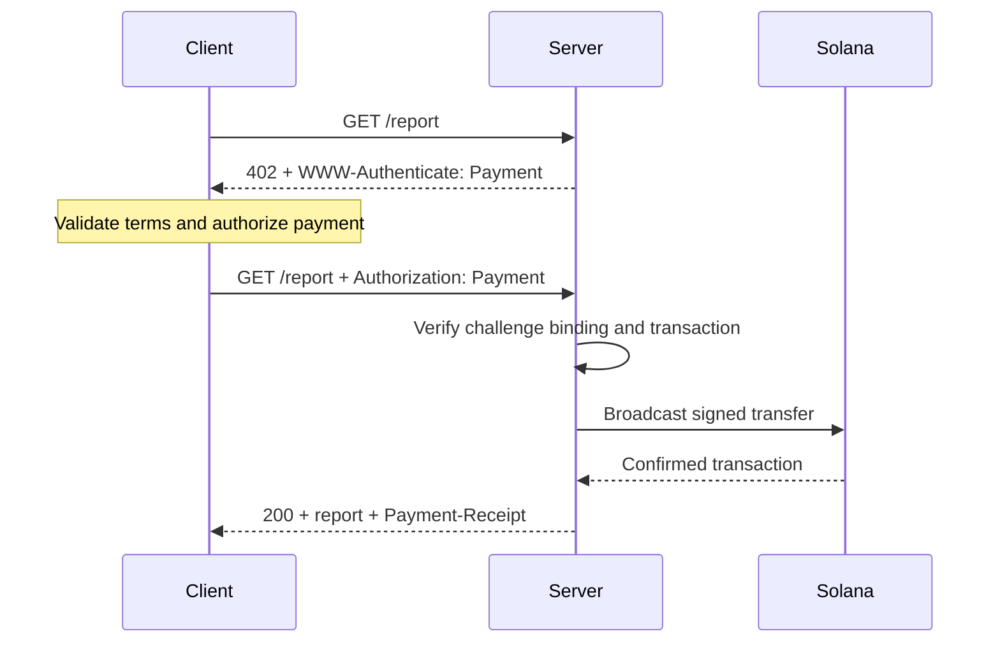
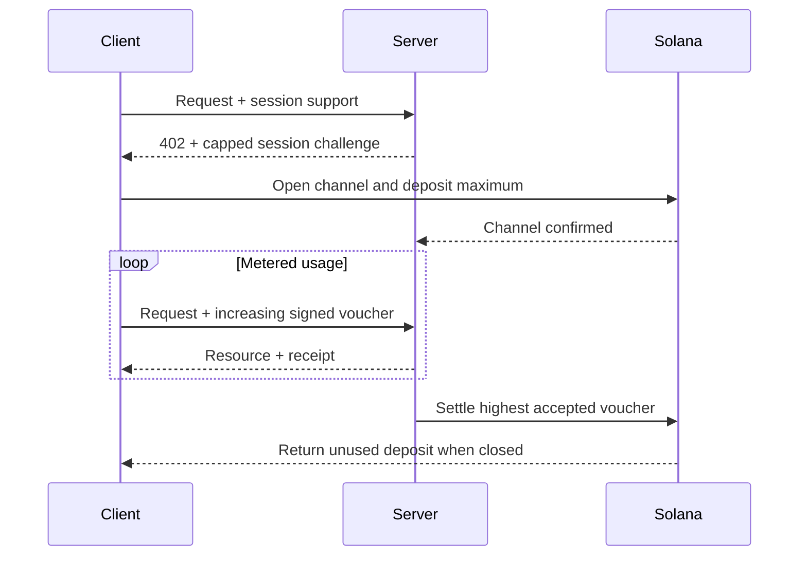

[Machine Payments Protocol (MPP)](https://mpp.dev/) stosuje semantykę uwierzytelniania HTTP do płatności. Serwer wysyła wyzwanie w odpowiedzi na nieopłacone żądanie, klient zwraca poświadczenie płatności, a serwer po
zaakceptowaniu płatności zwraca potwierdzenie.

MPP rozdziela trzy kwestie:

- **Intencja** (intent) opisuje interakcję handlową, na przykład jednorazową
  opłatę (`charge`) lub rozliczaną według zużycia sesję (`session`).
- **Metoda płatności** opisuje sposób przepływu wartości. Metoda dla Solany obsługuje
  w przypadku opłat natywny token SOL oraz tokeny SPL.
- **Transport** HTTP przenosi wyzwania, poświadczenia, potwierdzenia i błędy.

MPP jest publikowany jako zestaw dokumentów Internet-Draft. Traktuj
[aktualne specyfikacje](https://paymentauth.org/) jako źródło prawdy i
spodziewaj się zmian w szczegółach, dopóki prace nad wersjami roboczymi trwają.

## Wymiana HTTP

MPP używa standardowych pól uwierzytelniania HTTP zamiast specyficznych dla protokołu
nagłówków płatności:

| Komunikat                 | Reprezentacja HTTP                                         |
| ----------------------- | ----------------------------------------------------------- |
| Wyzwanie płatności       | `402 Payment Required` z `WWW-Authenticate: Payment ...` |
| Poświadczenie płatności      | Ponowione żądanie z `Authorization: Payment ...`           |
| Potwierdzenie powodzenia      | Odpowiedź z zasobem z `Payment-Receipt: ...`               |
| Nieprawidłowe dane płatności | Treść Problem Details z użyciem `application/problem+json`       |



Wyzwanie zawiera wygenerowany przez serwer identyfikator, realm, metodę, intencję, zakodowane
żądanie płatności oraz termin ważności. Poświadczenie powtarza wyzwanie i dodaje
dowód płatności właściwy dla danej metody. Serwer musi zweryfikować oba elementy; prawidłowy
przelew należący do innego wyzwania nie może odblokować zasobu.

## Jednorazowe opłaty w Solanie

Intencja `charge` w Solanie obsługuje dwa typy poświadczeń:

- **Tryb pull** używa podpisanej transakcji. Klient podpisuje przelew i
  wysyła transakcję do serwera. Serwer ją weryfikuje, opcjonalnie dodaje podpis
  płatnika opłat (fee payer), rozgłasza transakcję, potwierdza ją i zwraca jej sygnaturę
  w potwierdzeniu.
- **Tryb push** używa sygnatury transakcji. Klient najpierw rozgłasza transakcję, a następnie
  wysyła potwierdzoną sygnaturę do serwera. Serwer pobiera i weryfikuje
  transakcję, zanim zwróci zasób.

Tryb pull umożliwia sponsorowanie opłat transakcyjnych przez serwer oraz logikę ponawiania po stronie serwera.
Tryb push jest przydatny, gdy portfel wymaga, aby klient samodzielnie przesłał
transakcję, ale nie można w nim skorzystać ze sponsorowania opłat przez serwer.

Normatywne pola i reguły weryfikacji znajdziesz w
[specyfikacji opłaty Solana charge](https://paymentauth.org/draft-solana-charge-00.html).

## Dodawanie opłaty MPP do API Express

Solana Pay Kit udostępnia aktualną integrację TypeScript dla MPP i x402.
Zainstaluj go razem z Express:

```bash
pnpm add @solana/pay-kit @solana/kit@^6.9.0 express
pnpm add --save-dev @types/express tsx
```

Ten najprostszy przykład korzysta z hostowanego środowiska testowego Surfpool oraz publicznego
odbiorcy demonstracyjnego z pakietu. Służy wyłącznie do programowania lokalnego:

```ts filename=server.ts
import express from "express";
import { createPayKit, usd } from "@solana/pay-kit";

const pay = await createPayKit({
  accept: ["mpp"],
  rpcUrl: "https://402.surfnet.dev:8899"
});

const app = express();

app.get("/report", pay.express(usd("0.01")), (_req, res) => {
  res.json({ report: "Paid report" });
});

app.listen(4567, () => {
  console.log("Paid API listening on http://127.0.0.1:4567");
});
```

Uruchom go i porównaj nieopłacone żądanie z żądaniem obsługującym płatność:

```bash
pnpm tsx server.ts
curl -i http://127.0.0.1:4567/report
pay --sandbox curl http://127.0.0.1:4567/report
```

Procedura obsługi trasy jest uruchamiana dopiero po zaakceptowaniu płatności przez middleware.

<Callout type="warn" title="Zastąp wszystkie domyślne ustawienia sandboxa w środowisku produkcyjnym">
  Skonfiguruj jawnie sieć, odbiorcę (sprzedawcę), dedykowany RPC, stały
  sekret wiążący wyzwania, produkcyjny podmiot podpisujący oraz trwały magazyn do ochrony przed ponownym użyciem (replay). Nigdy nie
  kieruj prawdziwych płatności do demonstracyjnego podmiotu podpisującego z pakietu.
</Callout>

## Sesje rozliczane według zużycia

Użyj sesji (`session`) MPP w Solanie, gdy klient będzie wykonywać wiele małych, powiązanych płatności.
Sesja otwiera kanał płatności onchain z maksymalnym depozytem, a następnie wykorzystuje
narastająco podpisywane vouchery w miarę wzrostu zużycia. Serwer może weryfikować vouchery
offchain i rozliczyć najwyższą zaakceptowaną kwotę później.

Jest to przydatne w przypadku inferencji rozliczanej za tokeny, pobierania rozliczanego za bajty, danych na żywo
oraz powtarzalnych wywołań narzędzi. To nie to samo, co wysyłanie osobnej płatności onchain
dla każdego zdarzenia.



Nazywaj sesję **płatnością sesyjną**, **kanałem płatności** lub **ograniczoną powtarzalną
autoryzacją**. Określenia „płatność strumieniowa” używaj tylko wtedy, gdy usługa i umowa płatnicza
faktycznie rozliczają strumień zużycia.

## Weryfikacja w środowisku produkcyjnym

Przy każdej opłacie w Solanie serwer musi zweryfikować co najmniej:

- Wyzwanie jest autentyczne, nieprzeterminowane, powiązane z tym żądaniem i przeznaczone dla
  tego realmu.
- Transakcja używa oczekiwanej sieci, aktywa lub mint, odbiorcy, kwoty
  oraz programu tokenów (token program).
- Wszelkie instrukcje płatnika opłat lub associated token account są jawnie
  dozwolone i nie mogą wyczerpać środków podmiotu podpisującego serwera.
- Transakcja zakończyła się powodzeniem na wymaganym poziomie commitment.
- Sygnatura transakcji nie została jeszcze wykorzystana.
- Sprawdzenie ponownego użycia i operacja jego zużycia są atomowe we wszystkich instancjach serwera.

W przypadku sesji zapisuj również stan kanału, zaakceptowaną kwotę narastającą oraz
znacznik rozliczenia (settlement watermark) we współdzielonym magazynie. Opisz w dokumentacji, w jaki sposób klienci odzyskują niewykorzystane
środki, jeśli serwer stanie się niedostępny.

## Powiązane zasoby

- [Specyfikacje MPP](https://paymentauth.org/)
- [Dokumentacja protokołu MPP](https://mpp.dev/protocol)
- [Solana Pay Kit](https://github.com/solana-foundation/pay-kit)
- [Przegląd płatności agentowych](/docs/payments/agentic-payments)
- [Gotowość produkcyjna](/docs/tools/production-readiness)
