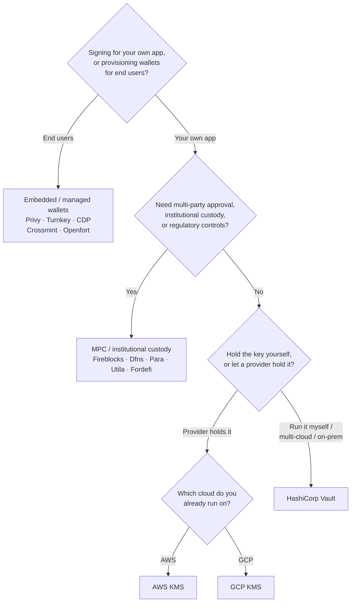

Keychain udostępnia jeden bazowy interfejs `SolanaSigner` dla każdego backendu, więc w
przypadku większości backendów wybór ma charakter operacyjny, a nie architektoniczny: możesz go zmienić
później poprzez konfigurację. Wyjątkiem jest kształt transakcji. Crossmint
oraz tryb native auto Fordefi podpisują i rozgłaszają transakcje po stronie serwera, a tryb native
manual Fordefi przepisuje transakcję przed jej podpisaniem, więc przejście na jeden
z nich lub z niego zmienia sposób wywoływania signera. Dlatego **zacznij od swoich
wymagań, a nie od produktu.** Dwa pytania decydują o większości: _gdzie przechowywany
jest klucz prywatny i kto jest uprawniony do autoryzacji podpisu za jego pomocą?_

Każdy backend poza Ledgerem jest dostępny we wszystkich czterech językach (Rust, TypeScript,
Python i Go). Ledger jest dostępny tylko w Rust, za opcjonalną funkcją `ledger`.

Nie istnieje jeden najlepszy backend. Każdy z nich lepiej pasuje do określonego zestawu
ograniczeń: chmury, na której już działasz, tego, czy chcesz samodzielnie obsługiwać infrastrukturę kluczy,
oraz tego, jakie mechanizmy custody i zatwierdzania są wymagane.
Poniższy schemat przypisuje te ograniczenia do backendu.

<Callout type="info">
  Ten przewodnik dotyczy podpisywania po stronie backendu (serwera). Gdy użytkownicy końcowi podpisują
  własne transakcje w przeglądarce, użyj portfela za pośrednictwem Wallet Standard.
  Zobacz [Podpisywanie w środowisku
  produkcyjnym](/docs/core/transactions/signing-in-production).
</Callout>

## Schemat decyzyjny

<Callout type="info">
  Lokalne środowisko programistyczne i testy nie wymagają niczego z tego: użyj backendu **Memory**
  do prototypowania, a następnie przełącz się na jeden z powyższych backendów produkcyjnych poprzez
  konfigurację.
</Callout>

## Analiza pytań

<Steps>

<Step>

### Podpisujesz dla własnej aplikacji czy dla swoich użytkowników końcowych?

Jeśli udostępniasz portfele, których właścicielami i operatorami są **użytkownicy końcowi** (aplikacje konsumenckie,
przepływy wdrożeniowe), użyj backendu **portfela wbudowanego / zarządzanego**: Privy, Turnkey,
CDP, Crossmint lub Openfort. Zarządzają one portfelami poszczególnych użytkowników i uwierzytelnianiem w
Twoim imieniu.

Jeśli podpisujesz jako **własna aplikacja** (płatnik opłat, skarbiec, automatyzacja backendu),
przejdź dalej.

</Step>

<Step>

### Czy potrzebujesz zatwierdzania wielostronnego, instytucjonalnej opieki lub kontroli regulacyjnych?

Jeśli podpisy muszą przejść politykę zatwierdzania, limit wydatków lub proces zgodności,
zanim zostaną wygenerowane, albo potrzebujesz regulowanego powiernika przechowującego
klucze, użyj backendu **MPC / instytucjonalna opieka**: Fireblocks, Dfns, Para,
Utila lub Fordefi. Dzielą one klucz lub przechowują go i współpodpisują zgodnie z Twoją
polityką.

Jeśli potrzebujesz tylko klucza, który podpisuje na żądanie, przejdź dalej.

</Step>

<Step>

### Chcesz samodzielnie przechowywać klucz, czy powierzyć to dostawcy?

Jeśli dostawca chmury ma przechowywać klucz w infrastrukturze opartej na sprzęcie, a
Twoja polityka IAM kontroluje, kto może podpisywać, użyj KMS tej chmury:

- **Działasz na AWS** → AWS KMS
- **Działasz na GCP** → GCP KMS

Jeśli chcesz samodzielnie obsługiwać infrastrukturę kluczy albo działasz w wielu chmurach lub
onprem, użyj **HashiCorp Vault**. Sam go uruchamiasz i audytujesz; klucz pozostaje wewnątrz
silnika Transit i podpisuje na żądanie.

</Step>

</Steps>

## Modele przechowywania kluczy

Backendy dzielą się na sześć modeli opieki nad kluczami. Powyższy schemat prowadzi Cię do jednego
z nich.

- **Samodzielna opieka (w procesie)**: Twoja aplikacja przechowuje surowy klucz prywatny.
  Wygodne w trakcie rozwoju, ale nieodpowiednie do produkcji. Backend:
  **Memory**.
- **Samodzielna opieka (portfel sprzętowy)**: klucz nigdy nie opuszcza urządzenia Ledger, a
  człowiek potwierdza każdy podpis na jego ekranie. Odpowiednie do interaktywnego
  podpisywania przez operatora, nie do usług działających bez nadzoru. Tylko Rust, opcjonalne i nieobjęte
  audytem. Backend: **Ledger**.
- **Samodzielnie hostowane zarządzanie kluczami**: samodzielnie obsługujesz infrastrukturę kluczy; klucz
  pozostaje wewnątrz niej i podpisuje na żądanie. Backend: **HashiCorp Vault**.
- **Chmurowy KMS / HSM**: dostawca chmury przechowuje klucz w infrastrukturze opartej na sprzęcie;
  klucz nigdy nie opuszcza usługi, a Twoja polityka IAM kontroluje,
  kto może podpisywać. Backendy: **AWS KMS**, **GCP KMS**.
- **MPC i instytucjonalna opieka**: klucz jest podzielony lub przechowywany przez
  dostawcę, który współpodpisuje zgodnie z Twoją polityką (zatwierdzenia, limity).
  Backendy: **Fireblocks**, **Dfns**, **Para**, **Utila**, **Fordefi**.
- **Wbudowane i zarządzane portfele**: dostawca zarządza portfelami w Twoim imieniu,
  często w celu wprowadzenia użytkowników końcowych. Backendy: **Privy**, **Turnkey**, **CDP**,
  **Crossmint**, **Openfort**.

## Porównanie backendów

| Backend         | Model przechowywania kluczy                  | Najlepszy dla                                     | Uwagi                                                                                                              |
| --------------- | ------------------------------ | -------------------------------------------- | ------------------------------------------------------------------------------------------------------------------ |
| Memory          | Samodzielna opieka (w procesie)      | Lokalne środowisko deweloperskie, testy, CI                 | Surowy klucz w procesie; nie używaj w produkcji                                                                       |
| Ledger          | Samodzielna opieka (portfel sprzętowy) | Interaktywne podpisywanie przez operatora z narzędzi Rust | Tylko Rust, opcjonalna funkcja `ledger`, bez audytu; każdy podpis potwierdzany na urządzeniu                                 |
| HashiCorp Vault | Samodzielnie hostowane zarządzanie kluczami     | Zespoły posiadające własną infrastrukturę kluczy   | Silnik Transit; samodzielna obsługa i audyt                                                                           |
| AWS KMS         | Chmurowy KMS / HSM                | Backendy działające na AWS                      | Klucz nigdy nie opuszcza KMS; IAM kontroluje podpisywanie                                                                         |
| GCP KMS         | Chmurowy KMS / HSM                | Backendy działające na GCP                      | Klucz nigdy nie opuszcza KMS; IAM kontroluje podpisywanie                                                                         |
| Fireblocks      | MPC / instytucjonalna opieka    | Skarbce, giełdy, regulowana opieka nad aktywami     | Silnik reguł i przepływy zatwierdzania                                                                               |
| Dfns            | Infrastruktura portfeli MPC      | Programowe portfele z kontrolą reguł    | Podpisywanie Ed25519                                                                                                    |
| Para            | Portfele MPC                    | Aplikacje wymagające portfeli opartych na MPC            | Klucz API + ID portfela                                                                                                |
| Utila           | Opieka MPC + współpodpisujący        | Istniejące portfele Solana zarządzane przez Utila        | `signMessage` nieobsługiwane; transakcja rozgłaszana samodzielnie                                                                    |
| Fordefi         | MPC / instytucjonalna opieka    | Instytucjonalna opieka nad kluczami z kontrolą polityk   | Black box: ty wysyłasz. Native auto: Fordefi przepisuje i wysyła. Native manual: Fordefi przepisuje, a ty wysyłasz wynik |
| Privy           | Wbudowane portfele               | Aplikacje konsumenckie wprowadzające użytkowników do portfeli    | Wbudowane portfele zarządzane przez aplikację                                                                                       |
| Turnkey         | Niedepozytatywne zarządzanie kluczami   | Programowe, zabezpieczone regułami podpisywanie           | Niedepozytatywne zarządzanie kluczami                                                                                       |
| CDP             | Zarządzany portfel (Coinbase)      | Aplikacje na platformie Coinbase Developer Platform      | `signMessage` akceptuje wyłącznie payloady UTF-8                                                                          |
| Crossmint       | Zarządzane portfele                | Platformy handlowe i aplikacje z zarządzanymi portfelami         | Tylko wysyłanie: rozgłasza po stronie serwera, może przepisać transakcję na potrzeby sponsorowania gazu; `signMessage` nieobsługiwane                   |
| Openfort        | Wbudowane portfele backendowe       | Portfele po stronie serwera                          | Klucze przechowywane w TEE                                                                                                    |

## Kształt możliwości

Poza modelem opieki każdy backend ma jeden kształt transakcji, który decyduje o tym, jak
wywołujesz signera:

- **Podpisanie**: dostawca podpisuje zbudowane przez Ciebie bajty, a Ty je rozgłaszasz. Większość
  backendów, w tym Ledger i tryb black box Fordefi.
- **Przepisanie i podpisanie**: dostawca przepisuje transakcję, a następnie podpisuje ją
  bez rozgłaszania. Kontynuujesz od zwróconej transakcji. Tryb native
  manual Fordefi.
- **Podpisanie i rozgłoszenie**: dostawca podpisuje i rozgłasza po stronie serwera, więc
  błąd nie oznacza, że nic nie zostało zapisane w sieci. Crossmint i tryb native auto Fordefi.

Tabela możliwości signerów w README każdego języka wymienia kształt każdego
backendu; [model bezpieczeństwa](https://github.com/solana-foundation/solana-keychain/blob/main/docs/SECURITY_MODEL.md)
wyjaśnia, co gwarantuje każdy z kształtów.

## Scenariusze dla przedsiębiorstw

Pojedyncza aplikacja często potrzebuje kilku z nich jednocześnie. Ponieważ
interfejs jest wspólny, możesz uruchomić inny backend dla każdej roli bez zmiany
miejsc wywołań, o ile backendy mają ten sam kształt możliwości.

- **Operacje skarbcowe** — oddziel operacyjny podpisujący "hot" od "cold"
  podpisującego skarbcowego. Zabezpiecz skarbiec za pomocą przechowywania MPC
  lub sprzętowego modułu HSM w chmurze i wymagaj polityk zatwierdzania przed
  podpisami wysokiej wartości.
- **Przepływy zatwierdzania** — backendy MPC i custody (np. Fireblocks)
  wymuszają wielostronne zatwierdzenie przed wygenerowaniem podpisu.
- **Zgodność i audyt** — chmurowe KMS (AWS/GCP) i Vault emitują dzienniki audytu
  podpisywania; instytucjonalni depozytariusze dodają egzekwowanie polityk i
  raportowanie.
- **Środowiska regulowane** — przechowuj materiał kluczowy w HSM, KMS lub
  instytucjonalnym depozycie, aby surowe klucze nigdy nie dotykały twojej
  aplikacji.

Zobacz
[Najlepsze praktyki produkcyjne](/docs/tools/keychain/production-best-practices)
dotyczące bezpiecznego obsługiwania tych backendów.

<Cards>
  <Card title="Przewodnik Rust" href="/docs/tools/keychain/getting-started/rust">
    Skonfiguruj każdy backend w Rust.
  </Card>
  <Card
    title="Przewodnik TypeScript"
    href="/docs/tools/keychain/getting-started/typescript"
  >
    Skonfiguruj każdy backend w TypeScript.
  </Card>
</Cards>
