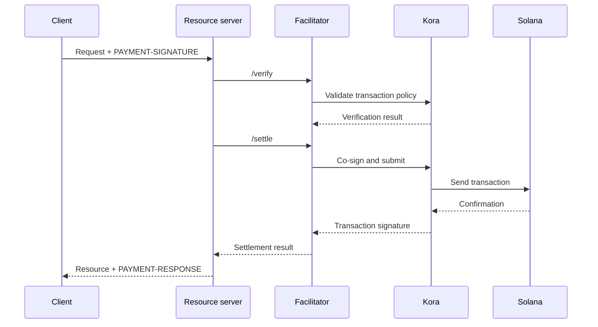

Facilitator x402 weryfikuje i rozlicza płatności dla jednego lub kilku serwerów
zasobów. Dzięki niemu API może przyjmować płatności onchain bez umieszczania
w każdym procesie aplikacji logiki RPC, wysyłania transakcji i płatnika opłat.

Facilitator to rola architektoniczna, a nie obowiązkowy podmiot trzeci. Możesz
skorzystać z usługi zarządzanej, uruchomić osobnego facilitatora albo
samodzielnie pełnić tę rolę wewnątrz własnego serwera zasobów.

## Interfejs facilitatora

x402 V2 definiuje trzy operacje HTTP:

| Endpoint     | Przeznaczenie                                                                       |
| ------------ | ----------------------------------------------------------------------------- |
| `/supported` | Wyświetla obsługiwane wersje protokołu, schematy, sieci, rozszerzenia i podpisujących |
| `/verify`    | Sprawdza ładunek płatności pod kątem wymagań bez jego rozliczania         |
| `/settle`    | Wysyła lub finalizuje płatność i zwraca wynik rozliczenia            |

Twój serwer zasobów powinien sprawdzać `/supported` podczas uruchamiania lub
wdrożenia. Nie ogłaszaj opcji płatności, dopóki wybrany facilitator nie
potwierdzi obsługi dokładnie tej wersji x402, schematu i sieci Solana.

```bash
curl https://facilitator.example/supported
```

## Weryfikacja przed realizacją

Bezpieczna kolejność żądań wygląda następująco:

1. Przeanalizuj ładunek `PAYMENT-SIGNATURE` za pomocą biblioteki protokołu.
2. Dopasuj go do dokładnie tych `PaymentRequirements`, które pierwotnie zaoferowano.
3. Zweryfikuj ładunek lokalnie lub przez `/verify`.
4. Wykonaj operację na zasobie tylko wtedy, gdy wybrany przepływ płatności
   dopuszcza rozliczenie po realizacji.
5. Wywołaj `/settle` i zwróć `PAYMENT-RESPONSE` z wynikiem.

Różne schematy mogą definiować różną kolejność realizacji. Na przykład przepływ
oparty na autoryzacji może weryfikować płatność przed operacją na zasobie,
a rozliczać ją po niej, podczas gdy inny schemat może wymagać rozliczenia przed
realizacją. Postępuj zgodnie z przepływem zadeklarowanym przez wybrany schemat,
zamiast zakładać jedną kolejność dla każdej płatności.

<Callout type="warn" title="Traktuj odpowiedzi facilitatora jako decyzje dotyczące płatności">
  Uwierzytelniaj ruch facilitatora, waliduj każdą odpowiedź, stosuj rygorystyczne
  limity czasu i w razie wątpliwości odmawiaj (fail closed). Błąd sieci lub
  nieprawidłowa odpowiedź nie są dowodem zapłaty.
</Callout>

## Wybierz model wdrożenia

| Model                   | Kiedy stosować                                                        | Główna odpowiedzialność                                                    |
| ----------------------- | --------------------------------------------------------------- | ---------------------------------------------------------------------- |
| Facilitator zarządzany     | Chcesz mieć jak najmniejszy zakres operacyjny                       | Sprawdź obsługiwane sieci, model zaufania, dostępność i politykę dotyczącą danych  |
| Dedykowany, hostowany samodzielnie   | Kilka API współdzieli infrastrukturę podpisywania i rozliczania        | Zabezpieczanie kluczy, RPC i magazynu danych, skalowanie oraz aktualizacje                      |
| Facilitacja w ramach procesu | Jedna usługa wymaga pełnej kontroli i może obsługiwać komponenty łańcucha | Odizoluj kod płatności i zapobiegaj jego wyczerpaniu przez obciążenie żądaniami |

Nie wybieraj facilitatora tylko dlatego, że jego URL odpowiada na `/supported`.
Sprawdź, jak chroni klucze płatnika opłat, zapobiega atakom typu replay,
potwierdza transakcje, radzi sobie z częściowymi awariami i zgłasza incydenty.

## Kora jako infrastruktura podpisywania na Solanie

[Kora](/docs/tools/kora) to węzeł podpisujący dla Solany z politykami walidacji transakcji
i sponsorowania opłat. Facilitator x402 może używać Kora jako backendu do
podpisywania i wysyłania transakcji:



Kora nie zastępuje x402. Serwer zasobów i facilitator nadal implementują
obiekty i endpointy x402 V2; Kora egzekwuje politykę transakcji Solany
i chroni podpisującego płatnika opłat za swoim interfejsem RPC.

Skorzystaj z [przewodnika Kora x402](/docs/tools/kora/guides/x402), aby zobaczyć utrzymywane demo
i konfigurację.

## Lista kontrolna wdrożenia produkcyjnego

### Klucze i polityka transakcji

- Przechowuj klucze facilitatora i płatnika opłat w backendzie podpisywania
  opartym na sprzęcie lub zdalnym.
- Dodaj do listy dozwolonych programy System, Compute Budget, Token, Token-2022
  i Associated Token tylko w zakresie wymaganym przez obsługiwany schemat.
- Przed podpisaniem odrzucaj nieoczekiwane konta z możliwością zapisu, uprawnienia
  do transferu, odbiorców, mints, instrukcje i ceny obliczeń.
- Oddziel konta odbierające płatności od operacyjnych kont płatnika opłat.

### Replay i idempotentność

- Zapisuj zużyte identyfikatory płatności i sygnatury transakcji we wspólnym,
  trwałym magazynie.
- Zapewnij atomowość weryfikacji i zużycia, aby dwie instancje serwera nie mogły
  jednocześnie zaakceptować tej samej autoryzacji.
- Wymagaj klucza idempotentności dla operacji na zasobach z efektami ubocznymi.
- W przypadku uzasadnionego ponowienia zwracaj pierwotny wynik zamiast pobierać
  opłatę ponownie.

### Dostępność i obsługa awarii

- Ustaw ograniczone limity czasu dla `/verify`, `/settle`, wysyłania przez RPC
  i potwierdzania.
- Rozróżniaj rozliczenia odrzucone, wygasłe, oczekujące, potwierdzone i zakończone
  niepowodzeniem.
- Nie odbudowuj ani nie podpisuj ponownie transakcji po wygaśnięciu blockhasha bez
  poproszenia płatnika o autoryzację nowej transakcji.
- Używaj więcej niż jednego endpointu RPC i monitoruj świeżość blockhasha,
  opóźnienie potwierdzeń oraz saldo płatnika opłat.

### Obserwowalność

Rejestruj zasób, identyfikator wyzwania, wybrany schemat i sieć, kwotę, aktywo,
odbiorcę, adres płatnika, sygnaturę transakcji, poziom potwierdzenia, opóźnienie
i końcowy status. Nigdy nie loguj zakodowanych danych uwierzytelniających
płatności, tokenów okaziciela, kluczy prywatnych ani surowych odpowiedzi
podpisującego.

Ustaw alerty dla niepowodzeń rozliczeń, prób replay, odrzuceń przez politykę,
nieoczekiwanych aktywów lub odbiorców, wyczerpania środków płatnika opłat oraz
rozbieżności między zweryfikowanymi płatnościami a zrealizowanymi zasobami.

## Powiązane zasoby

- [Specyfikacja facilitatora x402](https://github.com/x402-foundation/x402/blob/main/specs/x402-specification-v2.md#7-facilitator-interface)
- [x402 na Solanie](/docs/payments/agentic-payments/x402)
- [Przewodnik operatora Kora](/docs/tools/kora/operators)
- [Gotowość produkcyjna](/docs/tools/transaction-landing#rpc-infrastructure)
