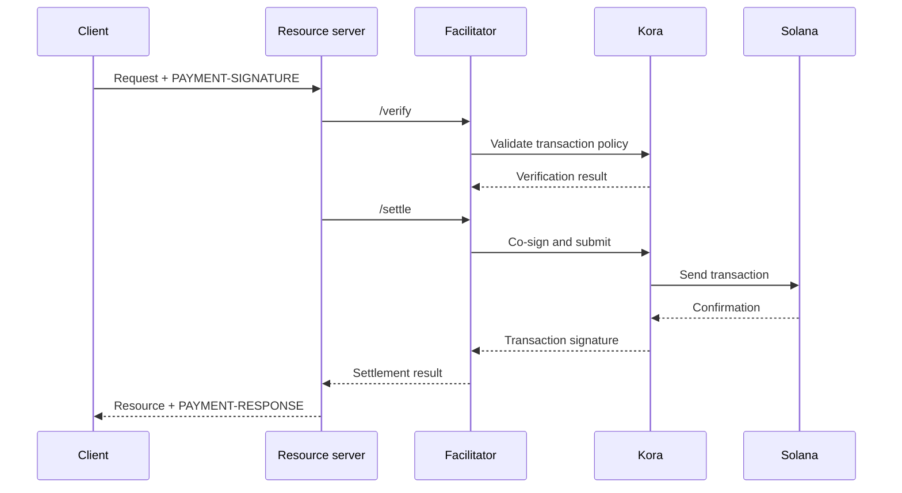

Facilitator x402 weryfikuje i rozlicza płatności dla jednego lub kilku serwerów
zasobów. Dzięki niemu API może przyjmować płatności onchain bez umieszczania
logiki RPC, przesyłania transakcji i płatnika opłat w każdym procesie aplikacji.

Facilitator to rola architektoniczna, a nie obowiązkowa usługa zewnętrzna. Możesz
skorzystać z usługi zarządzanej, uruchomić osobnego facilitatora albo pełnić tę
rolę samodzielnie wewnątrz własnego serwera zasobów.

## Interfejs facilitatora

x402 V2 definiuje trzy operacje HTTP:

| Endpoint     | Przeznaczenie                                                                       |
| ------------ | ----------------------------------------------------------------------------- |
| `/supported` | Wyświetla obsługiwane wersje protokołu, schematy, sieci, rozszerzenia i podpisujących |
| `/verify`    | Sprawdza ładunek płatności pod kątem wymagań bez jego rozliczania         |
| `/settle`    | Przesyła lub finalizuje płatność i zwraca wynik rozliczenia            |

Serwer zasobów powinien sprawdzać `/supported` podczas uruchamiania lub
wdrożenia. Nie ogłaszaj opcji płatności, dopóki wybrany facilitator nie potwierdzi
obsługi dokładnie tej wersji x402, tego schematu i tej sieci Solana.

```bash
curl https://facilitator.example/supported
```

## Weryfikacja przed realizacją

Bezpieczna kolejność obsługi żądania wygląda następująco:

1. Przeanalizuj ładunek `PAYMENT-SIGNATURE` za pomocą biblioteki protokołu.
2. Dopasuj go do dokładnie tych `PaymentRequirements`, które zostały pierwotnie zaproponowane.
3. Zweryfikuj ładunek lokalnie lub przez `/verify`.
4. Wykonaj operację na zasobie tylko wtedy, gdy wybrany przepływ płatności
   dopuszcza rozliczenie po realizacji.
5. Wywołaj `/settle` i zwróć `PAYMENT-RESPONSE` z wynikiem.

Różne schematy mogą definiować różną kolejność realizacji. Na przykład przepływ
oparty na autoryzacji może weryfikować płatność przed operacją na zasobie
i rozliczać ją po niej, a inny schemat może wymagać rozliczenia przed realizacją.
Postępuj zgodnie z przepływem zadeklarowanym przez wybrany schemat, zamiast
zakładać jedną kolejność dla każdej płatności.

<Callout type="warn" title="Traktuj odpowiedzi facilitatora jako decyzje płatnicze">
  Uwierzytelniaj ruch do facilitatora, waliduj każdą odpowiedź, stosuj rygorystyczne
  limity czasu i w razie wątpliwości odrzucaj żądanie (fail closed). Błąd sieci lub
  nieprawidłowa odpowiedź nie są dowodem zapłaty.
</Callout>

## Wybierz model wdrożenia

| Model                   | Kiedy stosować                                                        | Główna odpowiedzialność                                                    |
| ----------------------- | --------------------------------------------------------------- | ---------------------------------------------------------------------- |
| Facilitator zarządzany     | Chcesz mieć jak najmniejszy zakres operacyjny                       | Sprawdź obsługiwane sieci, model zaufania, dostępność i politykę danych  |
| Dedykowany, hostowany samodzielnie   | Kilka API współdzieli infrastrukturę podpisywania i rozliczeń        | Zabezpiecz klucze, RPC, magazyn danych, skalowanie i aktualizacje                      |
| Facilitacja w ramach procesu | Jedna usługa wymaga pełnej kontroli i może obsługiwać komponenty łańcucha | Izoluj kod płatności i zapobiegaj jego wyczerpaniu przez obciążenie żądaniami |

Nie wybieraj facilitatora tylko dlatego, że jego adres URL odpowiada na `/supported`.
Sprawdź, jak chroni klucze płatnika opłat, zapobiega powtórzeniom (replay),
potwierdza transakcje, radzi sobie z częściowymi awariami i zgłasza incydenty.

## Kora jako infrastruktura podpisywania w sieci Solana

[Kora](/docs/tools/kora) to węzeł podpisujący dla sieci Solana z politykami walidacji
transakcji i sponsorowania opłat. Facilitator x402 może używać Kora jako
backendu do podpisywania i przesyłania transakcji:



Kora nie zastępuje x402. Serwer zasobów i facilitator nadal implementują obiekty
i endpointy x402 V2; Kora egzekwuje politykę transakcji Solana i chroni podpisującego
płatnika opłat za swoim interfejsem RPC.

Skorzystaj z [przewodnika Kora x402](/docs/tools/kora/guides/x402), aby uzyskać aktualnie utrzymywane
demo i konfigurację.

## Lista kontrolna wdrożenia produkcyjnego

### Klucze i polityka transakcji

- Przechowuj klucze facilitatora i płatnika opłat w backendzie podpisywania opartym
  na sprzęcie lub zdalnym.
- Dodawaj do listy dozwolonych programy System, Compute Budget, Token, Token-2022
  oraz Associated Token wyłącznie w zakresie wymaganym przez obsługiwany schemat.
- Przed podpisaniem odrzucaj nieoczekiwane konta z uprawnieniami zapisu, podmioty
  autoryzujące transfery, odbiorców, mincie, instrukcje i ceny obliczeń.
- Oddziel konta odbierające płatności od operacyjnych kont płatnika opłat.

### Powtórzenia i idempotentność

- Zapisuj wykorzystane identyfikatory płatności i sygnatury transakcji we wspólnym,
  trwałym magazynie.
- Spraw, aby weryfikacja i zużycie były atomowe, tak aby dwie instancje serwera nie
  mogły jednocześnie zaakceptować tej samej autoryzacji.
- Wymagaj klucza idempotentności dla operacji na zasobach z efektami ubocznymi.
- W przypadku uprawnionej ponownej próby zwracaj pierwotny wynik zamiast ponownie
  obciążać płatnika.

### Dostępność i obsługa błędów

- Ustaw ograniczone limity czasu dla `/verify`, `/settle`, przesyłania przez RPC
  i potwierdzania.
- Rozróżniaj rozliczenia odrzucone, wygasłe, oczekujące, potwierdzone i zakończone błędem.
- Nie odbudowuj ani nie podpisuj ponownie transakcji po wygaśnięciu blockhasha bez
  poproszenia płatnika o autoryzację nowej transakcji.
- Korzystaj z więcej niż jednego endpointu RPC i monitoruj aktualność blockhasha,
  opóźnienie potwierdzeń oraz saldo płatnika opłat.

### Obserwowalność

Rejestruj zasób, identyfikator wyzwania, wybrany schemat i sieć, kwotę, aktywo,
odbiorcę, adres płatnika, sygnaturę transakcji, poziom potwierdzenia, opóźnienie
i końcowy status. Nigdy nie loguj zakodowanych danych uwierzytelniających płatności,
tokenów typu bearer, kluczy prywatnych ani surowych odpowiedzi podpisującego.

Ustaw alerty dla błędów rozliczeń, prób powtórzeń, odrzuceń przez politykę,
nieoczekiwanych aktywów lub odbiorców, wyczerpania środków płatnika opłat oraz
różnic między zweryfikowanymi płatnościami a zrealizowanymi zasobami.

## Powiązane zasoby

- [Specyfikacja facilitatora x402](https://github.com/x402-foundation/x402/blob/main/specs/x402-specification-v2.md#7-facilitator-interface)
- [x402 w sieci Solana](/docs/payments/agentic-payments/x402)
- [Przewodnik operatora Kora](/docs/tools/kora/operators)
- [Gotowość produkcyjna](/docs/tools/transaction-landing#rpc-infrastructure)
