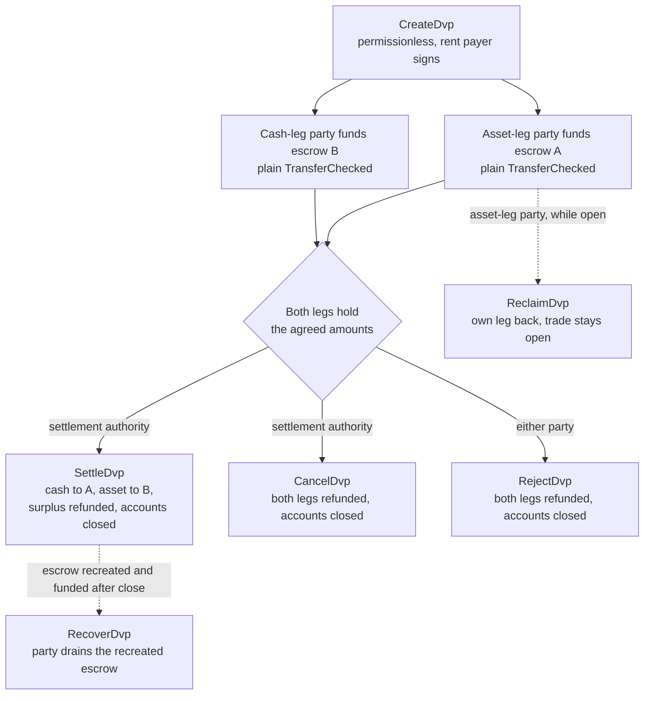
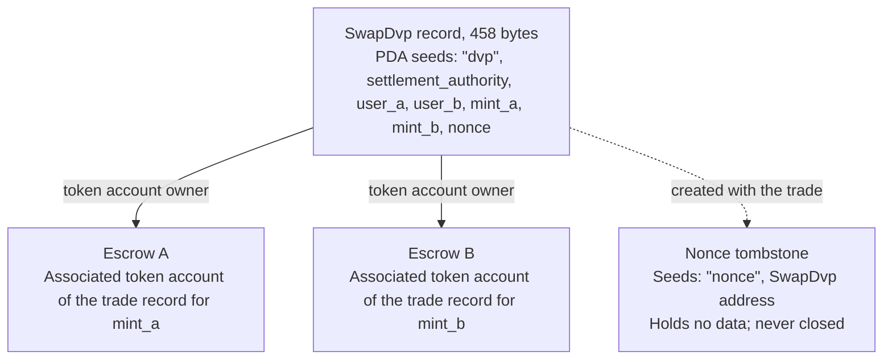

O programa DvP é o programa padrão para entrega contra pagamento na Solana,
mantido pela Solana Foundation e auditado pela Cantina. Duas partes acordam
uma operação, cada uma envia sua perna para uma conta de escrow com uma
transferência de token comum, e uma autoridade de liquidação liquida ambas as pernas em uma única transação, de modo que
ou as duas se movem ou nenhuma se move. A autoridade de liquidação é um terceiro endereço
indicado na operação, como a plataforma ou o agente que a intermediou. Nenhuma das partes
escreve ou implanta um programa, e uma carteira ou custodiante capaz de enviar uma transferência
padrão de token (`TransferChecked`) pode financiar uma perna sem nenhuma integração
específica com o DvP. Até a liquidação, qualquer uma das partes pode retirar a própria perna ou desfazer
a operação.

<Callout type="warn" title="Leia o registro antes de agir com base nele">

Criar um registro de operação não exige permissão, portanto um registro não é prova de
acordo. Cada parte lê os termos armazenados antes de financiar, e a autoridade de
liquidação os lê antes de liquidar (veja
[verificação](#verification-before-funding-and-settlement)).

</Callout>

## Como funciona

Cada operação recebe um registro pertencente ao programa e duas contas de escrow, uma por perna. A
parte da perna de ativo (`user_a`) e a parte da perna de caixa (`user_b`) financiam cada uma uma perna
transferindo tokens para a conta de escrow dessa perna. A autoridade de
liquidação é o único signatário que pode liquidar. A liquidação transfere o valor
acordado de cada perna para o outro lado, devolve qualquer excedente à parte dona
da perna e fecha o registro e ambos os escrows. A atomicidade vem das
[transações](/docs/core/transactions) da Solana: as duas transferências estão em uma única transação,
então ou ambas têm efeito ou nenhuma tem.

Todo reembolso, resgate e devolução de excedente vai para a associated
token account da própria parte: a conta de `user_a` para `mint_a`, a de `user_b` para `mint_b`. Um
custodiante ou sistema de tesouraria pode financiar uma perna a partir da própria conta, mas tudo o que
for devolvido vai para a conta da parte, não de volta ao custodiante. Cada operação
também deixa uma conta marcadora permanente (veja [Estado](#state)).

## Guias

As páginas de passos levam uma operação da criação até a liquidação, com TypeScript e
Rust para cada instrução.

<Cards>
  <Card title="Criar uma operação" href="/docs/defi/dvp-program/create-a-trade">
    Instale os clientes e registre os termos da operação com CreateDvp
  </Card>
  <Card title="Financiar as pernas" href="/docs/defi/dvp-program/fund-the-legs">
    Verifique os termos armazenados e financie cada perna com uma transferência simples
  </Card>
  <Card title="Liquidar a operação" href="/docs/defi/dvp-program/settle-the-trade">
    Liquide as duas pernas em uma única transação como autoridade de liquidação
  </Card>
  <Card title="Desfazer uma operação" href="/docs/defi/dvp-program/unwind-a-trade">
    Retire uma perna, cancele ou rejeite a operação e recupere depósitos tardios
  </Card>
</Cards>

Uma [demonstração na devnet](https://solana.com/delivery-vs-payment/demo) executa uma operação do
início ao fim: cria a operação, financia ambos os escrows com transferências padrão de token e
liquida as duas pernas em uma única transação.

## Como escolher entre o programa e a delegação

A [Entrega contra Pagamento (DvP) com delegação](/docs/tokenization/dvp) liquida a
mesma troca sem um programa: cada lado delega sua posição a um
agente de liquidação, que move as duas pernas em uma única transação.

- **O programa** não precisa de delegação, portanto o limite de um delegado por
  token account não se aplica, e a autoridade de liquidação não pode redirecionar os valores recebidos.
  Cada operação depende de um programa atualizável e de sua autoridade de atualização.
- **O padrão de delegação** não tem dependência de programa e funciona com mints que
  usam Scaled UI Amount. O programa rejeita esses mints, o que exclui qualquer
  mint criado a partir do template `tokenized-security` da Mosaic (veja
  [restrições de configuração do mint](#mint-configuration-constraints)).

## Papéis

O programa é simétrico. Em sua interface, as duas partes são `user_a`, que
entrega `mint_a`, e `user_b`, que entrega `mint_b`. O README e os
clientes gerados chamam `mint_a` de perna de ativo e `mint_b` de perna de caixa, e
estas páginas seguem essa convenção, mas nada no programa exige que a perna de caixa
seja um instrumento de caixa. Dois ativos, ou duas stablecoins, são liquidados da mesma
forma.

| Papel                 | Quem                               | Assina                                              | Observações                                                                                                                                                                                                     |
| -------------------- | --------------------------------- | -------------------------------------------------- | --------------------------------------------------------------------------------------------------------------------------------------------------------------------------------------------------------- |
| Parte da perna de ativo      | `user_a`, entrega `mint_a`       | Sua própria transferência de financiamento; Reclaim, Reject, Recover | Uma carteira keypair ou uma carteira inteligente baseada em PDA, como um cofre multisig. Uma conta multisig do SPL Token ou uma program account não pode ser parte: Create falha com `PartyNotSignerCapable`                   |
| Parte da perna de caixa       | `user_b`, entrega `mint_b`       | Sua própria transferência de financiamento; Reclaim, Reject, Recover | Mesmo requisito                                                                                                                                                                                          |
| Autoridade de liquidação | Um terceiro endereço indicado na criação | Settle, Cancel                                     | O único signatário que pode liquidar. Não pode redirecionar os valores recebidos, que são fixados na criação. Recebe o rent das contas fechadas quando liquida ou cancela                                         |
| Pagador do rent           | Quem assinar `CreateDvp`         | Create                                             | Financia o rent (o depósito em SOL que mantém uma conta aberta) do registro, do tombstone do nonce e de ambos os escrows. Não é registrado como destinatário de rent: o rent das contas fechadas vai para quem fechar a operação |

## ID do programa

```text
dvp34bdbcEm4f4FCUjGV4mDAkDshaQR4LkK8fdcsyZq
```

| Cluster      | Programa                                       | Autoridade de atualização                              | Último slot de implantação |
| ------------ | --------------------------------------------- | ---------------------------------------------- | ------------------ |
| mainnet-beta | `dvp34bdbcEm4f4FCUjGV4mDAkDshaQR4LkK8fdcsyZq` | `DXtFpbPjcn2hxPnw79x1Pfoj35vXh5AsWBkS37YnXMVv` | 452.058.374        |
| devnet       | `dvp34bdbcEm4f4FCUjGV4mDAkDshaQR4LkK8fdcsyZq` | `5EX1zFeJWj4rGYZv432WnYw8CbaSUeTdxPx4r573UgYU` | 479.376.863        |

O programa é atualizável nos dois clusters. Os valores acima são os que
`solana program show` informou em 2 de outubro de 2026; execute o mesmo comando para
obter os valores atuais. A build da devnet é mais antiga que o commit com base no qual as páginas de passos
foram escritas (veja [Instalação](/docs/defi/dvp-program/create-a-trade#install)),
com o mesmo conjunto de instruções e erros.

## Ciclo de vida



Uma operação fica aberta de `CreateDvp` até que Settle, Cancel ou Reject a feche.
O financiamento não tem instrução própria: uma perna está financiada quando sua conta
de escrow contém pelo menos o valor acordado. Reclaim atua por perna e mantém a
operação aberta, de modo que um problema em uma perna não obriga a outra parte a cancelar
a operação inteira.

## Estado

Cada operação tem uma conta `SwapDvp` de 458 bytes, pertencente ao programa. Seu
endereço é derivado da autoridade de liquidação, das duas partes, dos dois
mints e de um nonce (as seeds
`["dvp", settlement_authority, user_a, user_b, mint_a, mint_b, nonce]`). Os
valores e os horários são armazenados dentro da conta e não afetam o endereço,
por isso precisam ser lidos em vez de inferidos. Uma pequena conta marcadora,
o tombstone do nonce em `["nonce", swap_dvp]`, é criada junto com a operação e
nunca é fechada, de modo que cada combinação de partes, mints, autoridade e nonce só pode
ser usada em uma operação.



| Campo                                  | Tipo          | Significado                                                                                                 |
| -------------------------------------- | ------------- | ------------------------------------------------------------------------------------------------------- |
| `bump`                                 | `u8`          | Bump do PDA                                                                                                |
| `user_a`, `user_b`                     | `Pubkey`      | As duas partes                                                                                         |
| `mint_a`, `mint_b`                     | `Pubkey`      | Os mints da perna de ativo e da perna de caixa                                                                        |
| `settlement_authority`                 | `Pubkey`      | O único signatário que pode liquidar ou cancelar                                                               |
| `token_program_a`, `token_program_b`   | `Pubkey`      | O token program dono de cada mint; uma operação pode misturar pernas SPL Token e Token-2022                    |
| `amount_a`, `amount_b`                 | `u64`         | O valor acordado de cada perna, na menor unidade do mint (unidades base)                                 |
| `expiry_timestamp`                     | `i64`         | Após este horário da rede (o relógio on-chain), Settle é rejeitado. Reclaim, Cancel e Reject continuam funcionando |
| `nonce`                                | `u64`         | Diferencia operações que compartilham as demais seeds. De uso único                                             |
| `ref_string`                           | `[u8; 64]`    | Uma referência opaca do cliente, preenchida com zeros; o programa nunca a lê                                     |
| `user_a_settlement_destination`        | `Pubkey`      | Recebe a perna de caixa em Settle; o padrão é `user_a`                                                   |
| `user_b_settlement_destination`        | `Pubkey`      | Recebe a perna de ativo em Settle; o padrão é `user_b`                                                  |
| `mint_a_authority`, `mint_b_authority` | `Pubkey`      | As autoridades dos mints capturadas na criação; Settle falha se qualquer uma delas tiver mudado                           |
| `earliest_settlement_timestamp`        | `Option<i64>` | Se definido, Settle é rejeitado antes deste horário da rede                                                     |

A lista de campos foi extraída do IDL do programa no commit indicado em
[Criar uma operação](/docs/defi/dvp-program/create-a-trade#install).

## Instruções

| Instrução  | Signatário               | Efeito                                                                                                                                                              |
| ------------ | -------------------- | ------------------------------------------------------------------------------------------------------------------------------------------------------------------- |
| `CreateDvp`  | Qualquer pagador            | Cria o registro `SwapDvp`, seu tombstone de nonce e ambas as contas de escrow. Não move tokens                                                                        |
| `ReclaimDvp` | `user_a` ou `user_b` | Devolve do escrow a perna do próprio signatário. A operação continua aberta e a perna pode ser financiada novamente                                                                      |
| `SettleDvp`  | Autoridade de liquidação | Transfere `amount_a` para o destino de `user_b` e `amount_b` para o destino de `user_a`, devolve qualquer excedente à parte da perna e fecha o registro e ambos os escrows |
| `CancelDvp`  | Autoridade de liquidação | Reembolsa a `user_a` o que o escrow A contém e a `user_b` o que o escrow B contém, e fecha o registro e ambos os escrows                                                            |
| `RejectDvp`  | `user_a` ou `user_b` | Mesmo efeito de Cancel, assinado por uma parte                                                                                                                            |
| `RecoverDvp` | `user_a` ou `user_b` | Depois que a operação é encerrada: esvazia um escrow recriado para a token account do próprio signatário e o fecha. Cobre um depósito que chegou após Settle, Cancel ou Reject  |

Todo reembolso vai para a associated token account da própria parte referente ao
mint daquela perna, independentemente de quem financiou o escrow.

As contas e os argumentos de cada instrução estão na página do respectivo passo.

## Erros

| Código | Erro                            | Quando                                                                                                   |
| ---- | -------------------------------- | ------------------------------------------------------------------------------------------------------ |
| 0    | `SignerNotParty`                 | Reclaim, Reject ou Recover assinado por um endereço que não é `user_a` nem `user_b`                      |
| 1    | `DvpExpired`                     | Settle após `expiry_timestamp`                                                                        |
| 2    | `SettlementAuthorityMismatch`    | Settle ou Cancel assinado por um endereço diferente da autoridade de liquidação                              |
| 3    | `SettlementTooEarly`             | Settle antes de `earliest_settlement_timestamp`                                                          |
| 4    | `LegNotFunded`                   | Settle enquanto um escrow contém menos que o valor acordado                                               |
| 5    | `ExpiryNotInFuture`              | Create com uma expiração igual ou anterior ao horário atual da rede                                            |
| 6    | `EarliestAfterExpiry`            | Create com um horário mínimo de liquidação posterior à expiração                                               |
| 7    | `SelfDvp`                        | Create com `user_a` igual a `user_b`                                                                 |
| 8    | `SameMint`                       | Create com `mint_a` igual a `mint_b`                                                                 |
| 9    | `ZeroAmount`                     | Create com valor zero em qualquer uma das pernas                                                                |
| 10   | `BlockedMintExtension`           | Create ou Settle com um mint que tenha TransferFee, InterestBearing, ScaledUiAmount ou NonTransferable |
| 11   | `SettlementAuthorityIsParty`     | Create com a autoridade de liquidação igual a uma das partes                                                  |
| 12   | `SettlementAuthorityExecutable`  | Create com uma autoridade de liquidação executável                                                         |
| 13   | `NonceAlreadyUsed`               | Create reutilizando um `(seeds, nonce)` que já tem um tombstone                                         |
| 14   | `ExpiryTooFarInFuture`           | Create com uma expiração superior a um ano à frente                                                         |
| 15   | `RefStringTooLong`               | Create com uma referência maior que 64 bytes                                                           |
| 16   | `DvpStillOpen`                   | Recover enquanto a operação ainda está aberta; use Reclaim                                                     |
| 17   | `DvpNeverCreated`                | Recuperar com seeds que não têm tombstone                                                              |
| 18   | `EscrowPreloadedWithLamports`    | Criar quando um escrow não nativo contém lamports acima do mínimo isento de rent                           |
| 19   | `SettlementDestinationIsSwapDvp` | Criar com um destino de liquidação igual ao registo da operação                                         |
| 20   | `SwapDvpPreloadedWithLamports`   | Criar quando o endereço do registo contém lamports acima da sua reserva de rent                                   |
| 21   | `RecipientAtaMismatch`           | Uma token account de destinatário ou de reembolso já não pertence à carteira e ao mint esperados                  |
| 22   | `PartyNotSignerCapable`          | Criar com uma parte que não é uma conta não executável pertencente ao sistema                                 |
| 23   | `MintAuthorityChanged`           | Liquidar quando a mint authority de uma perna difere do valor registado na criação                         |

## Eventos e indexação

O programa não emite eventos onchain. Um indexador ou sistema de reconciliação lê
o estado da conta `SwapDvp` e os saldos de tokens dos dois escrows, e usa
`ref_string` para correlacionar uma operação com a respetiva ordem off-chain. Como o registo
é encerrado na liquidação, um sistema que precise dos termos posteriormente armazena-os
quando os lê, ou reconstrói-os a partir da transação que criou
a operação.

## Tokens suportados

Uma operação pode combinar uma perna SPL Token com uma perna Token-2022; cada perna transporta o
seu próprio token program. As pernas de SOL embrulhado (wrapped SOL) são suportadas.

| Extensão Token-2022 no mint de uma perna                                                     | Comportamento do programa                                                  |
| ---------------------------------------------------------------------------------------- | ----------------------------------------------------------------- |
| TransferFee, InterestBearing, ScaledUiAmount, NonTransferable                            | Rejeitada em Create e Settle com `BlockedMintExtension`         |
| PermanentDelegate, Pausable, DefaultAccountState, uma freeze authority, MintCloseAuthority | Aceite; cada autoridade pode agir sobre os tokens em escrow           |
| ConfidentialTransfer                                                                     | Aceite; os montantes nessa perna são públicos                          |
| TransferHook                                                                             | Suportada, até 32 contas adicionais por perna                        |
| MemoTransfer numa conta de destino ou de reembolso                                          | Aceite; o programa emite o memo exigido antes da transferência |

Uma comissão de transferência deixaria o lado recetor aquém do montante acordado.
Interest Bearing e Scaled UI Amount não alteram os montantes brutos, mas a sua taxa
ou multiplicador pode mudar entre a criação e a liquidação de uma operação, o que altera
a forma como os montantes acordados são apresentados. NonTransferable deixaria ambas as pernas bloqueadas.

As autoridades aceites podem movimentar, congelar ou suspender os tokens em escrow durante toda
a vida da operação (ver abaixo). O escrow não pode ser configurado para receber
transferências confidenciais, pelo que os montantes em escrow e liquidados numa perna
confidencial são públicos.

Para um mint com hook, o cliente resolve as contas adicionais do hook e acrescenta-as
a Settle, Cancel, Reject, Reclaim e Recover. O limite de 32 por perna
inclui o programa do hook e a respetiva conta de validação. Se a hook authority
aumentar a lista de contas do hook acima desse limite, todas as transferências nessa perna
falham, incluindo Reclaim, Cancel, Reject e Recover, até que a autoridade
reverta a alteração. O limite de contas por transação pode ser atingido antes do limite por perna quando
ambas as pernas têm hooks.

Quando uma conta de destino ou de reembolso exige memos, o programa chama o programa Memo
antes da transferência, razão pela qual todas as instruções que retiram tokens
do escrow recebem uma conta `memo_program`.

### Restrições de configuração do mint

**Scaled UI Amount.** O modelo `tokenized-security` do
[Mosaic](https://github.com/solana-foundation/mosaic), o kit de ferramentas de
emissão da Solana Foundation, adiciona sempre Scaled UI Amount, pelo que o programa não aceita um
mint criado a partir desse modelo como perna. Um mint destinado a este programa pode
ser criado sem a extensão (ver
[Token Extensions](/docs/tokens/extensions));
o [DvP com delegação](/docs/tokenization/dvp) liquida através de autoridade
delegada e não aplica esta verificação.

**Mints congelados por defeito.** O escrow de cada operação é uma associated token account
pertencente a um program-derived address novo para essa operação. Num mint com
Default Account State definido como congelado, o escrow é criado congelado e uma transferência
de financiamento para o mesmo falha até ser descongelado. Com
[Token ACL](/docs/tokenization/token-acl), isso significa que o emitente ou o seu agente de
transferência admite o escrow da operação antes do financiamento: ou adicionando o endereço
do registo da operação (o proprietário do escrow) à allowlist, para que qualquer pessoa possa descongelar
o escrow quando a configuração Token ACL do mint ativa o descongelamento sem permissões, ou
fazendo com que a freeze authority o descongele diretamente. Um escrow congelado também bloqueia
Settle, Reclaim, Cancel, Reject e Recover nessa perna, pelo que a freeze
authority, e num mint com hook a hook authority, é uma parte de confiança durante
a vida da operação. O percurso do escrow congelado é descrito aqui e não é exercitado
nos snippets de devnet.

## Limites

- Sem correspondência de ordens, descoberta de preços nem livro de ordens. As partes acordam os termos fora
  do ledger e uma delas regista-os.
- Sem compensação (netting) e apenas bilateral: um registo corresponde a uma operação entre duas partes.
- Sem execuções parciais. Settle move exatamente o montante acordado de cada perna e
  devolve qualquer excedente à parte dessa perna.
- Sem perna fora do ledger. Ambas as pernas são token accounts na Solana; uma perna em numerário
  em infraestruturas existentes é liquidada separadamente e reconciliada.
- Sem verificação de elegibilidade, allowlist nem KYC. Os controlos do próprio mint impõem
  a elegibilidade dos detentores.
- Sem liquidação automática. A autoridade de liquidação tem de assinar.
- Sem eventos e sem comissão de protocolo para além das comissões de transação e do rent.

O programa elimina o risco de principal entre as duas partes: nenhuma perna é movimentada
a menos que ambas o sejam. Não elimina o risco de crédito do emitente nem de resgate em nenhum dos
tokens, a capacidade de a autoridade de congelamento, pausa ou delegado permanente de um mint
agir sobre os tokens em escrow (ver [tokens suportados](#supported-tokens)), nem a
dependência de a autoridade de liquidação estar disponível para assinar.

## Verificação antes do financiamento e da liquidação

`CreateDvp` não requer permissões: só o pagador assina; as partes e a
autoridade de liquidação não. Qualquer pessoa pode, portanto, criar um registo que indique quaisquer
partes e quaisquer termos. Antes do financiamento, e novamente antes da liquidação, leia a
conta `SwapDvp` e confirme:

1. A conta pertence ao programa DvP e tem exatamente 458 bytes. Uma conta
   que não pertença ao programa pode ser preenchida com bytes que se descodificam como um
   registo real.
2. `user_a`, `user_b`, `mint_a`, `mint_b` e `settlement_authority` correspondem à
   operação acordada.
3. `amount_a`, `amount_b`, `expiry_timestamp` e
   `earliest_settlement_timestamp` correspondem aos termos acordados.
4. Ambos os destinos de liquidação são os endereços acordados. Um registo forjado pode
   redirecionar os fundos.

[Financiar as pernas](/docs/defi/dvp-program/fund-the-legs#verify-the-terms) apresenta os
leitores verificados dos clientes gerados e mostra a verificação em código.

Considere uma operação como liquidada quando a transação Settle atinge
[`finalized`](/docs/rpc#configuring-state-commitment). Trata-se de um nível de
compromisso da rede; se também marca a finalidade da liquidação para efeitos legais
depende dos acordos das partes e dos regimes aplicáveis.

## Versionamento

A conta `SwapDvp` não tem campo de versão. O seu layout está fixado em 458 bytes
(`SwapDvp::LEN`) e os leitores verificados rejeitam uma conta de qualquer outro tamanho.
O IDL tem a sua própria versão, `0.1.0` a 2 de outubro de 2026.

O programa é atualizável em ambos os clusters (ver [ID do programa](#program-id)). Um
registo de operação existe apenas até ser liquidado, cancelado ou rejeitado, por isso consulte
o repositório para saber como uma atualização trata as operações em aberto e regenere os clientes
a partir do IDL da versão implementada.

## Repositório e auditoria

O código-fonte, o IDL, os clientes gerados e os testes encontram-se em
[`solana-foundation/dvp`](https://github.com/solana-foundation/dvp) sob a
licença MIT. O programa é um programa Pinocchio `no_std`; os clientes são
gerados a partir do IDL com Codama. Os relatórios de vulnerabilidades são feitos através do link de
security advisory do repositório, conforme o seu `SECURITY.md`.

O programa foi auditado pela
[Cantina](https://cantina.xyz/portfolio/fe870bb4-d96d-4902-8aec-9dfcfa2d6a79).

## Relacionado

- [Delivery vs Payment (DvP) com delegação](/docs/tokenization/dvp): o
  padrão de delegação sem um programa
- [Token ACL](/docs/tokenization/token-acl): como um mint com acesso restrito interage com as
  contas de escrow
