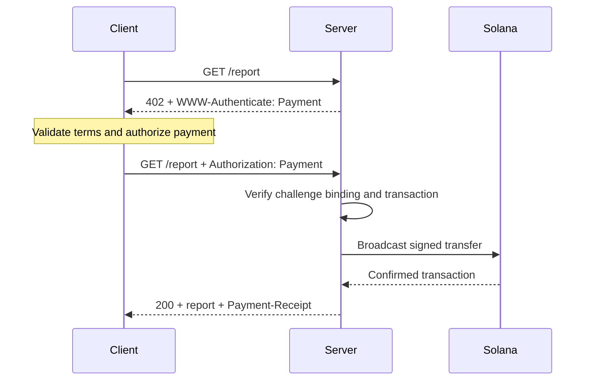
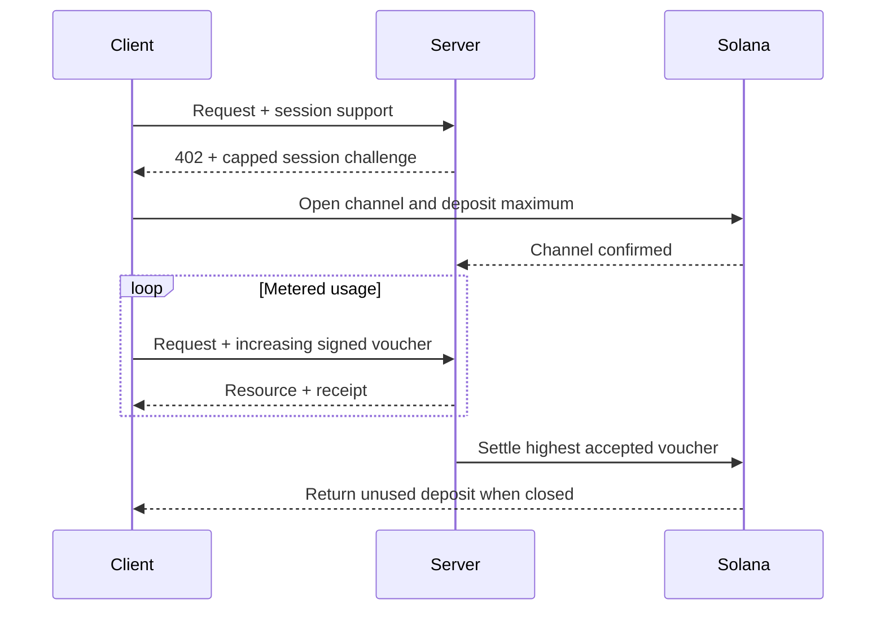

O [Machine Payments Protocol (MPP)](https://mpp.dev/) aplica a semântica de autenticação
HTTP aos pagamentos. Um servidor lança um desafio a uma requisição não paga, um
cliente devolve uma credencial de pagamento e o servidor devolve um recibo depois de
aceitar o pagamento.

O MPP separa três aspetos:

- Uma **intenção** (intent) descreve a interação comercial, como uma
  cobrança única (`charge`) ou uma sessão medida (`session`).
- Um **método de pagamento** descreve como o valor é movimentado. O método da Solana suporta
  SOL nativo e tokens SPL para cobranças.
- Um **transporte** HTTP transporta desafios, credenciais, recibos e erros.

O MPP é publicado como um conjunto de Internet-Drafts. Trate as
[especificações atuais](https://paymentauth.org/) como a fonte de verdade e
esteja preparado para que os detalhes evoluam enquanto os rascunhos estiverem em desenvolvimento.

## Troca HTTP

O MPP usa campos padrão de autenticação HTTP em vez de cabeçalhos de
pagamento específicos do protocolo:

| Mensagem                 | Representação HTTP                                         |
| ----------------------- | ----------------------------------------------------------- |
| Desafio de pagamento       | `402 Payment Required` com `WWW-Authenticate: Payment ...` |
| Credencial de pagamento      | Requisição repetida com `Authorization: Payment ...`           |
| Recibo de sucesso      | Resposta do recurso com `Payment-Receipt: ...`               |
| Detalhes de pagamento inválidos | Corpo Problem Details usando `application/problem+json`       |



Um desafio inclui um ID gerado pelo servidor, realm, método, intenção, pedido de
pagamento codificado e validade. A credencial reproduz o desafio e acrescenta a
prova de pagamento específica do método. O servidor deve verificar ambos; uma
transferência válida que pertença a um desafio diferente não pode desbloquear o recurso.

## Cobranças únicas na Solana

A intenção `charge` da Solana suporta dois tipos de credencial:

- O **modo pull** usa uma transação assinada. O cliente assina a transferência e
  envia a transação ao servidor. O servidor verifica, opcionalmente adiciona uma
  assinatura de fee payer, transmite, confirma e devolve a assinatura da transação
  no seu recibo.
- O **modo push** usa uma assinatura de transação. O cliente transmite primeiro e depois
  envia a assinatura confirmada ao servidor. O servidor obtém e verifica
  a transação antes de devolver o recurso.

O modo pull permite o patrocínio de taxas de transação pelo servidor e lógica de repetição no servidor.
O modo push é útil quando uma carteira exige que o cliente envie a sua própria
transação, mas não pode usar o patrocínio de taxas pelo servidor.

Para os campos normativos e as regras de verificação, consulte a
[especificação de cobrança da Solana](https://paymentauth.org/draft-solana-charge-00.html).

## Adicionar uma cobrança MPP a uma API Express

O Solana Pay Kit fornece uma integração atual em TypeScript para MPP e x402.
Instale-o com o Express:

```bash
pnpm add @solana/pay-kit @solana/kit@^6.9.0 express
pnpm add --save-dev @types/express tsx
```

Este exemplo mínimo usa a sandbox Surfpool hospedada e o destinatário de demonstração
público do pacote. Destina-se apenas ao desenvolvimento local:

```ts filename=server.ts
import express from "express";
import { createPayKit, usd } from "@solana/pay-kit";

const pay = await createPayKit({
  accept: ["mpp"],
  rpcUrl: "https://402.surfnet.dev:8899"
});

const app = express();

app.get("/report", pay.express(usd("0.01")), (_req, res) => {
  res.json({ report: "Paid report" });
});

app.listen(4567, () => {
  console.log("Paid API listening on http://127.0.0.1:4567");
});
```

Execute-o e compare uma requisição não paga com uma requisição com pagamento:

```bash
pnpm tsx server.ts
curl -i http://127.0.0.1:4567/report
pay --sandbox curl http://127.0.0.1:4567/report
```

O handler da rota só é executado depois de o middleware aceitar o pagamento.

<Callout type="warn" title="Substitua todos os valores padrão da sandbox em produção">
  Configure uma rede explícita, o destinatário do comerciante, um RPC dedicado, um segredo estável
  de associação ao desafio, um signatário de produção e um armazenamento durável contra replay. Nunca
  encaminhe pagamentos reais para um signatário de demonstração do pacote.
</Callout>

## Sessões medidas

Use uma `session` MPP da Solana quando um cliente fizer muitos pagamentos pequenos e relacionados.
Uma sessão abre um canal de pagamento onchain com um depósito máximo e depois usa
vouchers assinados cumulativos à medida que o uso cresce. O servidor pode verificar os vouchers
offchain e liquidar mais tarde o valor aceito mais alto.

Isto é útil para inferência medida por token, downloads medidos por byte, dados em tempo real
e chamadas repetidas de ferramentas. Não é o mesmo que enviar um pagamento
onchain separado para cada evento.



Chame a uma sessão **pagamento de sessão**, **canal de pagamento** ou **autorização repetida
com limite**. Só lhe chame pagamento em streaming quando o serviço e o contrato de pagamento
realmente medirem um fluxo de uso.

## Verificação em produção

Para cada cobrança na Solana, o servidor deve verificar pelo menos:

- O desafio é autêntico, não expirou, está associado a esta requisição e destina-se
  a este realm.
- A transação usa a rede, o ativo ou mint, o destinatário, o valor
  e o token program esperados.
- Quaisquer instruções de fee payer ou de associated token account estão explicitamente
  permitidas e não podem esvaziar o signatário do servidor.
- A transação foi bem-sucedida no nível de commitment exigido.
- A assinatura da transação ainda não foi consumida.
- A verificação de replay e a operação de consumo são atómicas em todas as instâncias do servidor.

Para sessões, persista também o estado do canal, o valor cumulativo aceito e a
marca de liquidação num armazenamento partilhado. Documente como os clientes recuperam os fundos
não utilizados se o servidor ficar indisponível.

## Recursos relacionados

- [Especificações do MPP](https://paymentauth.org/)
- [Documentação do protocolo MPP](https://mpp.dev/protocol)
- [Solana Pay Kit](https://github.com/solana-foundation/pay-kit)
- [Visão geral dos pagamentos agênticos](/docs/payments/agentic-payments)
- [Preparação para produção](/docs/tools/security#verify-addresses)
