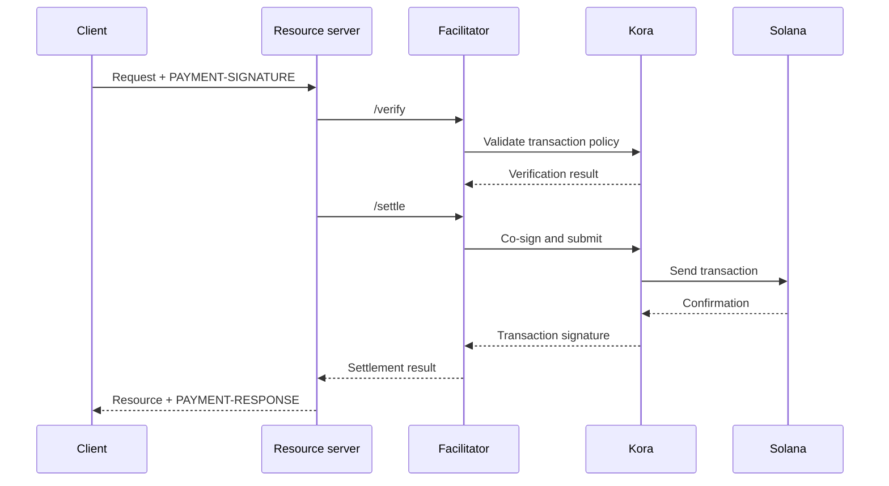

Um facilitador x402 realiza a verificação e a liquidação de pagamentos para um ou mais
servidores de recursos. Ele permite que uma API aceite pagamentos onchain sem incluir a lógica de RPC,
envio de transações e pagador de taxas (fee payer) em cada processo da aplicação.

Um facilitador é uma função arquitetural, não um terceiro obrigatório. Você pode usar
um serviço gerenciado, operar um facilitador separado ou fazer a autofacilitação dentro
do seu servidor de recursos.

## Interface do facilitador

O x402 V2 define três operações HTTP:

| Endpoint     | Finalidade                                                                       |
| ------------ | ----------------------------------------------------------------------------- |
| `/supported` | Lista as versões de protocolo, esquemas, redes, extensões e signatários compatíveis |
| `/verify`    | Verifica um payload de pagamento em relação aos seus requisitos sem liquidá-lo         |
| `/settle`    | Envia ou conclui o pagamento e retorna o resultado da liquidação            |

O seu servidor de recursos deve consultar `/supported` durante a inicialização ou o deploy. Não
anuncie uma opção de pagamento até que o facilitador selecionado confirme o suporte
para essa versão exata do x402, esquema e rede Solana.

```bash
curl https://facilitator.example/supported
```

## Verificação antes do atendimento

A ordem segura das requisições é:

1. Analise o payload de `PAYMENT-SIGNATURE` com uma biblioteca de protocolo.
2. Compare-o com os `PaymentRequirements` exatos oferecidos originalmente.
3. Verifique o payload localmente ou por meio de `/verify`.
4. Execute a operação do recurso somente se o fluxo de pagamento escolhido permitir
   a liquidação após o atendimento.
5. Chame `/settle` e retorne `PAYMENT-RESPONSE` com o resultado.

Esquemas diferentes podem definir ordens de atendimento diferentes. Por exemplo, um
fluxo de autorização pode verificar antes da operação do recurso e liquidar depois dela,
enquanto outro esquema pode exigir a liquidação antes do atendimento. Siga o fluxo
declarado pelo esquema selecionado em vez de presumir uma única ordem para todos os
pagamentos.

<Callout type="warn" title="Trate as respostas do facilitador como decisões de pagamento">
  Autentique o tráfego do facilitador, valide todas as respostas, use timeouts
  rigorosos e falhe de forma segura (fail closed). Um erro de rede ou uma resposta malformada não é prova
  de pagamento.
</Callout>

## Escolha um modelo de implantação

| Modelo                   | Use quando                                                        | Principal responsabilidade                                                    |
| ----------------------- | --------------------------------------------------------------- | ---------------------------------------------------------------------- |
| Facilitador gerenciado     | Você quer a menor superfície operacional possível                       | Analisar redes compatíveis, modelo de confiança, disponibilidade e política de dados  |
| Auto-hospedado dedicado   | Várias APIs compartilham a infraestrutura de assinatura e liquidação        | Proteger chaves, RPCs, armazenamento, escalabilidade e atualizações                      |
| Facilitação no mesmo processo | Um serviço precisa de controle total e consegue operar componentes da blockchain | Manter o código de pagamento isolado e impedir que a carga de requisições o esgote |

Não selecione um facilitador apenas porque a URL dele responde a `/supported`.
Analise como ele protege as chaves do pagador de taxas, evita replay, confirma transações,
lida com falhas parciais e reporta incidentes.

## Kora como infraestrutura de assinatura na Solana

O [Kora](/docs/tools/kora) é um nó signatário da Solana com validação de transações e
políticas de patrocínio de taxas. Um facilitador x402 pode usar o Kora como seu backend de assinatura e
envio:



O Kora não substitui o x402. O servidor de recursos e o facilitador continuam implementando
os objetos e endpoints do x402 V2; o Kora aplica a política de transações da Solana e
protege o signatário pagador de taxas por trás da sua interface RPC.

Siga o [guia Kora x402](/docs/tools/kora/guides/x402) para ver a
demonstração e a configuração mantidas.

## Checklist de produção

### Chaves e política de transações

- Armazene as chaves do facilitador e do pagador de taxas em um backend de assinatura
  com respaldo de hardware ou remoto.
- Inclua na lista de permissões os programas System, Compute Budget, Token, Token-2022 e Associated Token
  somente conforme exigido pelo esquema compatível.
- Rejeite contas graváveis, autoridades de transferência, destinatários, mints,
  instruções e preços de computação inesperados antes de assinar.
- Mantenha as contas que recebem pagamentos separadas das contas operacionais do pagador de taxas.

### Replay e idempotência

- Persista os identificadores de pagamento consumidos e as assinaturas de transação em um armazenamento
  compartilhado e durável.
- Torne a verificação e o consumo atômicos para que duas instâncias do servidor não possam aceitar a
  mesma autorização simultaneamente.
- Exija uma chave de idempotência para operações de recurso com efeitos colaterais.
- Retorne o resultado original em caso de nova tentativa legítima, em vez de cobrar novamente.

### Disponibilidade e tratamento de falhas

- Defina timeouts limitados para `/verify`, `/settle`, envio via RPC e
  confirmação.
- Diferencie liquidações rejeitadas, expiradas, pendentes, confirmadas e com falha.
- Não reconstrua nem assine novamente uma transação após a expiração do blockhash sem pedir
  que o pagador autorize a nova transação.
- Use mais de um endpoint RPC e monitore a atualidade do blockhash, a latência de
  confirmação e o saldo do pagador de taxas.

### Observabilidade

Registre o recurso, o ID do desafio, o esquema e a rede selecionados, o valor, o ativo,
o destinatário, o endereço do pagador, a assinatura da transação, o nível de confirmação, a latência
e o status final. Nunca registre em log credenciais de pagamento codificadas, bearer tokens, chaves
privadas ou respostas brutas do signatário.

Configure alertas para falhas de liquidação, tentativas de replay, rejeições de política, ativos
ou destinatários inesperados, esgotamento do saldo do pagador de taxas e diferenças entre pagamentos
verificados e recursos atendidos.

## Recursos relacionados

- [Especificação do facilitador x402](https://github.com/x402-foundation/x402/blob/main/specs/x402-specification-v2.md#7-facilitator-interface)
- [x402 na Solana](/docs/payments/agentic-payments/x402)
- [Guia do operador do Kora](/docs/tools/kora/operators)
- [Prontidão para produção](/docs/tools/transaction-landing#rpc-infrastructure)
