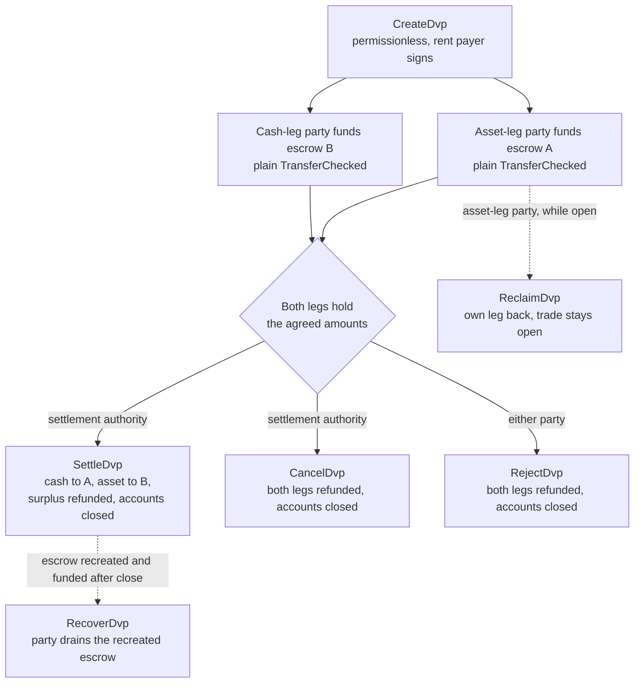
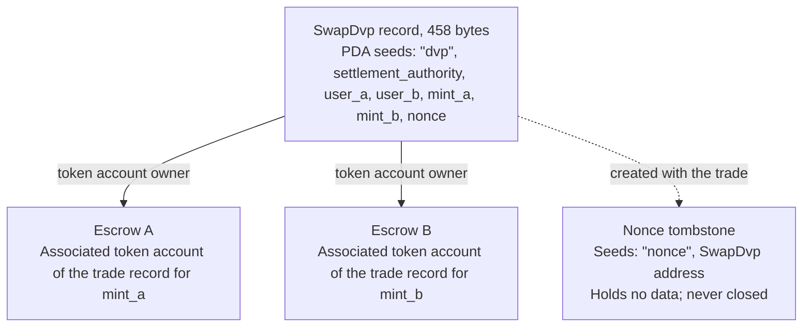

Программа DvP — стандартная программа для поставки против платежа (delivery versus payment) в Solana,
которую поддерживает Solana Foundation и аудит которой провела Cantina. Две стороны договариваются
о сделке, каждая отправляет свою ногу в эскроу-аккаунт обычным переводом токенов, а расчётный авторитет
проводит расчёт по обеим ногам в одной транзакции: либо перемещаются обе, либо ни одна. Расчётный
авторитет — это третий адрес, указанный в сделке, например площадка или агент, организовавшие её.
Ни одной из сторон не нужно писать или развёртывать программу, а кошелёк или кастодиан, способный
отправить стандартный перевод токенов (`TransferChecked`), может профинансировать ногу без какой-либо
интеграции с DvP. До расчёта любая из сторон может забрать свою ногу обратно или отменить сделку.

<Callout type="warn" title="Прочитайте запись, прежде чем на неё полагаться">

Создание записи о сделке не требует разрешений, поэтому сама запись не является доказательством
договорённости. Каждая сторона читает сохранённые условия перед финансированием, а расчётный
авторитет — перед расчётом (см.
[проверка](#verification-before-funding-and-settlement)).

</Callout>

## Как это работает

Для каждой сделки создаются принадлежащая программе запись и два эскроу-аккаунта — по одному на каждую
ногу. Сторона ноги актива (`user_a`) и сторона денежной ноги (`user_b`) финансируют свои ноги,
переводя токены на эскроу-аккаунт соответствующей ноги. Расчётный авторитет — единственный подписант,
который может провести расчёт. При расчёте согласованная сумма каждой ноги переводится противоположной
стороне, излишек возвращается стороне, которой принадлежит нога, а запись и оба эскроу закрываются.
Атомарность обеспечивают [транзакции](/docs/core/transactions) Solana: оба
перевода выполняются в одной транзакции, поэтому либо вступают в силу оба, либо ни один.

Любой возврат, востребование и возврат излишка направляются на associated token account самой стороны:
аккаунт `user_a` для `mint_a`, аккаунт `user_b` для `mint_b`. Кастодиан или казначейская система может
профинансировать ногу со своего аккаунта, но всё возвращаемое поступает на аккаунт стороны, а не обратно
кастодиану. Кроме того, каждая сделка оставляет постоянный аккаунт-маркер (см. [Состояние](#state)).

## Руководства

Страницы с шагами проводят одну сделку от создания до расчёта; для каждой инструкции приведены
примеры на TypeScript и Rust.

<Cards>
  <Card title="Создание сделки" href="/docs/defi/dvp-program/create-a-trade">
    Установите клиенты и запишите условия сделки с помощью CreateDvp
  </Card>
  <Card title="Финансирование ног" href="/docs/defi/dvp-program/fund-the-legs">
    Проверьте сохранённые условия, затем профинансируйте каждую ногу обычным переводом
  </Card>
  <Card title="Расчёт по сделке" href="/docs/defi/dvp-program/settle-the-trade">
    Проведите расчёт по обеим ногам в одной транзакции в роли расчётного авторитета
  </Card>
  <Card title="Откат сделки" href="/docs/defi/dvp-program/unwind-a-trade">
    Заберите ногу, отмените или отклоните сделку и верните запоздавшие депозиты
  </Card>
</Cards>

[Демо в devnet](https://solana.com/delivery-vs-payment/demo) проводит сделку от начала
до конца: создаёт сделку, финансирует оба эскроу стандартными переводами токенов и
проводит расчёт по обеим ногам в одной транзакции.

## Выбор между программой и делегированием

[Delivery vs Payment (DvP) с использованием делегирования](/docs/tokenization/dvp) реализует
тот же обмен без программы: каждая сторона делегирует свою позицию расчётному
агенту, который перемещает обе ноги в одной транзакции.

- **Программа** не требует делегирования, поэтому ограничение в один делегат на token
  account не действует, а расчётный авторитет не может перенаправить поступления.
  Каждая сделка зависит от обновляемой программы и её полномочий на обновление (upgrade authority).
- **Паттерн делегирования** не зависит от программы и работает с минтами,
  использующими Scaled UI Amount. Программа отклоняет такие минты, что исключает любой
  минт, созданный из шаблона `tokenized-security` от Mosaic (см.
  [ограничения конфигурации минта](#mint-configuration-constraints)).

## Роли

Программа симметрична. В её интерфейсе две стороны — это `user_a`, поставляющий `mint_a`,
и `user_b`, поставляющий `mint_b`. В README и сгенерированных клиентах `mint_a` называется ногой
актива, а `mint_b` — денежной ногой; эти страницы следуют той же конвенции, но ничто в программе
не требует, чтобы денежная нога была денежным инструментом. Два актива или два стейблкоина
рассчитываются точно так же.

| Роль                 | Кто                               | Подписывает                                              | Примечания                                                                                                                                                                                                     |
| -------------------- | --------------------------------- | -------------------------------------------------- | --------------------------------------------------------------------------------------------------------------------------------------------------------------------------------------------------------- |
| Сторона ноги актива      | `user_a`, поставляет `mint_a`       | Собственный перевод для финансирования; Reclaim, Reject, Recover | Кошелёк на keypair или смарт-кошелёк на основе PDA, например хранилище multisig. Multisig-аккаунт SPL Token или program account не может быть стороной: Create завершается ошибкой `PartyNotSignerCapable`                   |
| Сторона денежной ноги       | `user_b`, поставляет `mint_b`       | Собственный перевод для финансирования; Reclaim, Reject, Recover | То же требование                                                                                                                                                                                          |
| Расчётный авторитет | Третий адрес, указанный при создании | Settle, Cancel                                     | Единственный подписант, который может провести расчёт. Не может перенаправить поступления, которые фиксируются при создании. Получает rent закрытых аккаунтов при расчёте или отмене                                         |
| Плательщик rent           | Тот, кто подписывает `CreateDvp`         | Create                                             | Вносит rent (депозит в SOL, поддерживающий аккаунт открытым) за запись, nonce tombstone и оба эскроу. Не записывается как получатель rent: rent закрытых аккаунтов достаётся тому, кто закрывает сделку |

## ID программы

```text
dvp34bdbcEm4f4FCUjGV4mDAkDshaQR4LkK8fdcsyZq
```

| Кластер      | Программа                                       | Upgrade authority                              | Последний slot развёртывания |
| ------------ | --------------------------------------------- | ---------------------------------------------- | ------------------ |
| mainnet-beta | `dvp34bdbcEm4f4FCUjGV4mDAkDshaQR4LkK8fdcsyZq` | `DXtFpbPjcn2hxPnw79x1Pfoj35vXh5AsWBkS37YnXMVv` | 452,058,374        |
| devnet       | `dvp34bdbcEm4f4FCUjGV4mDAkDshaQR4LkK8fdcsyZq` | `5EX1zFeJWj4rGYZv432WnYw8CbaSUeTdxPx4r573UgYU` | 479,376,863        |

Программа является обновляемой в обоих кластерах. Приведённые выше значения — это то, что
вывела команда `solana program show` 2 октября 2026 года; выполните ту же команду, чтобы узнать
актуальные значения. Сборка в devnet старше коммита, по которому написаны страницы с шагами
(см. [Установка](/docs/defi/dvp-program/create-a-trade#install)),
при этом набор инструкций и ошибок тот же.

## Жизненный цикл



Сделка открыта с момента `CreateDvp`, пока её не закроет одна из инструкций Settle, Cancel или Reject.
У финансирования нет собственной инструкции: нога считается профинансированной, когда её эскроу-аккаунт
содержит не менее согласованной суммы. Reclaim действует для отдельной ноги и оставляет сделку открытой,
поэтому проблема с одной ногой не вынуждает другую сторону отменять всю сделку.

## Состояние

У каждой сделки есть один аккаунт `SwapDvp` размером 458 байт, принадлежащий программе. Его
адрес выводится из расчётного авторитета, двух сторон, двух минтов и nonce (seeds
`["dvp", settlement_authority, user_a, user_b, mint_a, mint_b, nonce]`). Суммы и время хранятся
внутри аккаунта и не влияют на адрес, поэтому их нужно считывать, а не угадывать. Небольшой
аккаунт-маркер, nonce tombstone по адресу `["nonce", swap_dvp]`, создаётся вместе со сделкой и
никогда не закрывается, поэтому каждую комбинацию сторон, минтов, авторитета и nonce можно
использовать только для одной сделки.



| Поле                                  | Тип          | Значение                                                                                                 |
| -------------------------------------- | ------------- | ------------------------------------------------------------------------------------------------------- |
| `bump`                                 | `u8`          | PDA bump                                                                                                |
| `user_a`, `user_b`                     | `Pubkey`      | Две стороны                                                                                         |
| `mint_a`, `mint_b`                     | `Pubkey`      | Минты ноги актива и денежной ноги                                                                        |
| `settlement_authority`                 | `Pubkey`      | Единственный подписант, который может провести расчёт или отменить сделку                                                               |
| `token_program_a`, `token_program_b`   | `Pubkey`      | Token Program, которой принадлежит каждый минт; в одной сделке можно сочетать ноги SPL Token и Token-2022                    |
| `amount_a`, `amount_b`                 | `u64`         | Согласованная сумма каждой ноги в наименьшей единице минта (базовых единицах)                                 |
| `expiry_timestamp`                     | `i64`         | После этого сетевого времени (ончейн-часов) Settle отклоняется. Reclaim, Cancel и Reject по-прежнему работают |
| `nonce`                                | `u64`         | Различает сделки, у которых остальные seeds совпадают. Одноразовый                                             |
| `ref_string`                           | `[u8; 64]`    | Непрозрачная клиентская ссылка, дополненная нулями; программа её никогда не читает                                     |
| `user_a_settlement_destination`        | `Pubkey`      | Получает денежную ногу при Settle; по умолчанию `user_a`                                                   |
| `user_b_settlement_destination`        | `Pubkey`      | Получает ногу актива при Settle; по умолчанию `user_b`                                                  |
| `mint_a_authority`, `mint_b_authority` | `Pubkey`      | Mint authority, зафиксированные при создании; Settle завершается ошибкой, если любая из них изменилась                           |
| `earliest_settlement_timestamp`        | `Option<i64>` | Если задано, Settle отклоняется до наступления этого сетевого времени                                                     |

Список полей взят из IDL программы в коммите, указанном в разделе
[Создание сделки](/docs/defi/dvp-program/create-a-trade#install).

## Инструкции

| Инструкция  | Подписант               | Действие                                                                                                                                                              |
| ------------ | -------------------- | ------------------------------------------------------------------------------------------------------------------------------------------------------------------- |
| `CreateDvp`  | Любой плательщик            | Создаёт запись `SwapDvp`, её nonce tombstone и оба эскроу-аккаунта. Токены не перемещает                                                                        |
| `ReclaimDvp` | `user_a` или `user_b` | Возвращает из эскроу собственную ногу подписавшего. Сделка остаётся открытой, и ногу можно профинансировать снова                                                                      |
| `SettleDvp`  | Расчётный авторитет | Переводит `amount_a` на адрес назначения `user_b`, а `amount_b` — на адрес назначения `user_a`, возвращает излишек стороне ноги, закрывает запись и оба эскроу |
| `CancelDvp`  | Расчётный авторитет | Возвращает всё, что хранится в эскроу A, стороне `user_a`, а в эскроу B — стороне `user_b`, закрывает запись и оба эскроу                                                            |
| `RejectDvp`  | `user_a` или `user_b` | Тот же эффект, что и у Cancel, но подписывает сторона                                                                                                                            |
| `RecoverDvp` | `user_a` или `user_b` | После закрытия сделки: переносит всё из заново созданного эскроу на собственный token account подписавшего и закрывает его. Покрывает депозит, поступивший после Settle, Cancel или Reject  |

Каждый возврат направляется на associated token account самой стороны для минта соответствующей ноги,
независимо от того, кто профинансировал эскроу.

Аккаунты и аргументы каждой инструкции приведены на странице соответствующего шага.

## Ошибки

| Код | Ошибка                            | Когда                                                                                                   |
| ---- | -------------------------------- | ------------------------------------------------------------------------------------------------------ |
| 0    | `SignerNotParty`                 | Reclaim, Reject или Recover подписаны адресом, который не является `user_a` или `user_b`                      |
| 1    | `DvpExpired`                     | Settle после `expiry_timestamp`                                                                        |
| 2    | `SettlementAuthorityMismatch`    | Settle или Cancel подписаны адресом, отличным от расчётного авторитета                              |
| 3    | `SettlementTooEarly`             | Settle до `earliest_settlement_timestamp`                                                          |
| 4    | `LegNotFunded`                   | Settle, пока в одном из эскроу меньше согласованной суммы                                               |
| 5    | `ExpiryNotInFuture`              | Create со сроком действия, равным текущему сетевому времени или более ранним                                            |
| 6    | `EarliestAfterExpiry`            | Create с самым ранним временем расчёта, наступающим после окончания срока действия                                               |
| 7    | `SelfDvp`                        | Create, где `user_a` равен `user_b`                                                                 |
| 8    | `SameMint`                       | Create, где `mint_a` равен `mint_b`                                                                 |
| 9    | `ZeroAmount`                     | Create с нулевой суммой на любой из ног                                                                |
| 10   | `BlockedMintExtension`           | Create или Settle с минтом, имеющим расширение TransferFee, InterestBearing, ScaledUiAmount или NonTransferable |
| 11   | `SettlementAuthorityIsParty`     | Create, где расчётный авторитет совпадает с одной из сторон                                                  |
| 12   | `SettlementAuthorityExecutable`  | Create с исполняемым (executable) расчётным авторитетом                                                         |
| 13   | `NonceAlreadyUsed`               | Create, повторно использующий `(seeds, nonce)`, для которого уже есть tombstone                                         |
| 14   | `ExpiryTooFarInFuture`           | Create со сроком действия более чем на год вперёд                                                         |
| 15   | `RefStringTooLong`               | Create со ссылкой длиннее 64 байт                                                           |
| 16   | `DvpStillOpen`                   | Recover, пока сделка ещё открыта; используйте Reclaim                                                     |
| 17   | `DvpNeverCreated`                | Recover с сидами, для которых нет tombstone                                                              |
| 18   | `EscrowPreloadedWithLamports`    | Create, когда нативно не связанное с SOL эскроу удерживает lamport сверх минимума, освобождающего от rent                           |
| 19   | `SettlementDestinationIsSwapDvp` | Create с адресом назначения расчёта, совпадающим с записью сделки                                         |
| 20   | `SwapDvpPreloadedWithLamports`   | Create, когда адрес записи удерживает lamport сверх своего резерва на rent                                   |
| 21   | `RecipientAtaMismatch`           | token account получателя или возврата больше не принадлежит ожидаемому кошельку и mint                  |
| 22   | `PartyNotSignerCapable`          | Create со стороной, которая не является аккаунтом, принадлежащим системной программе и не являющимся исполняемым                                 |
| 23   | `MintAuthorityChanged`           | Settle, когда mint authority плеча отличается от значения, зафиксированного при создании                         |

## События и индексация

Программа не выпускает ончейн-событий. Индексатор или система сверки считывает
состояние аккаунта `SwapDvp` и балансы токенов двух эскроу и использует
`ref_string`, чтобы сопоставить сделку с её офчейн-ордером. Поскольку запись
закрывается при расчёте, системе, которой условия нужны постфактум, следует
сохранять их при чтении или восстанавливать по транзакции, создавшей
сделку.

## Поддерживаемые токены

В сделке можно сочетать плечо с SPL Token и плечо с Token-2022; у каждого плеча
своя token program. Плечи с Wrapped SOL поддерживаются.

| Расширение Token-2022 на mint плеча                                                     | Поведение программы                                                  |
| ---------------------------------------------------------------------------------------- | ----------------------------------------------------------------- |
| TransferFee, InterestBearing, ScaledUiAmount, NonTransferable                            | Отклоняется при Create и Settle с ошибкой `BlockedMintExtension`         |
| PermanentDelegate, Pausable, DefaultAccountState, freeze authority, MintCloseAuthority | Принимается; каждый authority может действовать с токенами в эскроу           |
| ConfidentialTransfer                                                                     | Принимается; суммы на этом плече публичны                          |
| TransferHook                                                                             | Поддерживается, до 32 дополнительных аккаунтов на плечо                        |
| MemoTransfer на аккаунте назначения или возврата                                          | Принимается; программа отправляет требуемый memo перед переводом |

Комиссия за перевод привела бы к тому, что получающая сторона недополучила бы
согласованную сумму. Interest Bearing и Scaled UI Amount не меняют исходные
суммы, но их ставка или множитель могут измениться между созданием и расчётом
сделки, что изменит отображение согласованных сумм. NonTransferable заблокировал
бы оба плеча.

Допустимые authority могут перемещать, замораживать или останавливать токены в
эскроу на протяжении всей сделки (см. ниже). Эскроу нельзя настроить на приём
конфиденциальных переводов, поэтому суммы в эскроу и при расчёте на плече с
конфиденциальными переводами публичны.

Для mint с хуком клиент определяет дополнительные аккаунты хука и добавляет
их в Settle, Cancel, Reject, Reclaim и Recover. Ограничение в 32 на плечо
включает программу хука и её аккаунт валидации. Если hook authority
увеличит список аккаунтов хука сверх этого ограничения, каждый перевод на этом
плече будет завершаться ошибкой, включая Reclaim, Cancel, Reject и Recover, пока
authority не отменит изменение. Лимит аккаунтов в транзакции может сработать
раньше ограничения на плечо, когда хуки есть на обоих плечах.

Если аккаунт назначения или возврата требует memo, программа вызывает программу
Memo перед переводом, поэтому каждая инструкция, выводящая токены из эскроу,
принимает аккаунт `memo_program`.

### Ограничения конфигурации mint

**Scaled UI Amount.** Шаблон `tokenized-security` в
[Mosaic](https://github.com/solana-foundation/mosaic), наборе инструментов Solana Foundation для
эмиссии, всегда добавляет Scaled UI Amount, поэтому программа не принимает
mint, созданный из этого шаблона, в качестве плеча. Mint для этой программы
можно создать без этого расширения (см.
[Token Extensions](/docs/tokens/extensions));
[DvP с использованием делегирования](/docs/tokenization/dvp) рассчитывается через делегированные
полномочия и эту проверку не применяет.

**Mint, замороженные по умолчанию.** Эскроу каждой сделки — это associated token account,
принадлежащий Program Derived Address, новому для этой сделки. Если для mint
Default Account State установлено в frozen, эскроу создаётся замороженным, и
финансирующий перевод в него завершается ошибкой, пока он не разморожен. В
[Token ACL](/docs/tokenization/token-acl) это означает, что эмитент или его трансфер-агент допускает
эскроу сделки до финансирования: либо добавляя адрес записи сделки (владельца
эскроу) в allowlist, чтобы любой мог разморозить эскроу, если конфигурация
Token ACL для mint включает размораживание без разрешений, либо поручая
freeze authority разморозить его напрямую. Замороженное эскроу также блокирует
Settle, Reclaim, Cancel, Reject и Recover на этом плече, поэтому freeze
authority, а на mint с хуком — и hook authority, является доверенной стороной на
всё время сделки. Путь с замороженным эскроу описан здесь и не используется
в примерах для devnet.

## Ограничения

- Нет сопоставления ордеров, определения цены или книги ордеров. Стороны
  договариваются об условиях вне блокчейна, и одна из них записывает их.
- Нет неттинга, только двусторонние сделки: одна запись — одна сделка между двумя сторонами.
- Нет частичного исполнения. Settle перемещает ровно согласованную сумму каждого
  плеча и возвращает любой излишек стороне плеча.
- Нет плеча вне блокчейна. Оба плеча — это token account в Solana; денежное плечо
  по существующим каналам рассчитывается отдельно и сверяется.
- Нет проверки допуска, allowlist или KYC. Допуск держателей обеспечивают
  собственные средства контроля mint.
- Нет автоматического расчёта. Расчётный authority должен подписать транзакцию.
- Нет событий и нет комиссии протокола сверх комиссий за транзакции и rent.

Программа устраняет принципальный риск между двумя сторонами: ни одно плечо не
перемещается, если не перемещаются оба. Она не устраняет кредитный риск эмитента
или риск погашения по любому из токенов, возможность freeze, pause или permanent
delegate authority mint действовать с токенами в эскроу (см. [поддерживаемые токены](#supported-tokens)),
а также зависимость от того, что расчётный authority доступен для подписи.

## Проверка перед финансированием и расчётом

`CreateDvp` не требует разрешений: подписывает только плательщик, а стороны и
расчётный authority — нет. Поэтому любой может создать запись с произвольными
сторонами и условиями. Перед финансированием и снова перед расчётом прочитайте
аккаунт `SwapDvp` и убедитесь, что:

1. Аккаунт принадлежит программе DvP и имеет ровно 458 байт. Аккаунт, не
   принадлежащий программе, можно заполнить байтами, которые декодируются как
   настоящая запись.
2. `user_a`, `user_b`, `mint_a`, `mint_b` и `settlement_authority` соответствуют
   согласованной сделке.
3. `amount_a`, `amount_b`, `expiry_timestamp` и
   `earliest_settlement_timestamp` соответствуют согласованным условиям.
4. Оба адреса назначения расчёта — согласованные. Поддельная запись может
   перенаправить средства.

[Финансирование плеч](/docs/defi/dvp-program/fund-the-legs#verify-the-terms) перечисляет проверяющие
ридеры сгенерированных клиентов и показывает проверку в коде.

Считайте сделку рассчитанной, когда транзакция Settle достигает
[`finalized`](/docs/rpc#configuring-state-commitment). Это уровень подтверждения сети; считается ли он также
моментом окончательности расчёта в юридическом смысле, зависит от соглашений
сторон и применимого регулирования.

## Версионирование

У аккаунта `SwapDvp` нет поля версии. Его структура фиксирована и занимает 458 байт
(`SwapDvp::LEN`), а проверяющие ридеры отклоняют аккаунт любой другой длины.
У IDL своя версия: `0.1.0` по состоянию на 2 октября 2026 г.

Программа поддерживает обновление в обоих кластерах (см. [Program ID](#program-id)). Запись
сделки существует только до тех пор, пока сделка не рассчитана, не отменена и не отклонена,
поэтому в репозитории стоит проверить, как обновление влияет на открытые сделки, и
перегенерировать клиентов из IDL развёрнутой сборки.

## Репозиторий и аудит

Исходный код, IDL, сгенерированные клиенты и тесты находятся в
[`solana-foundation/dvp`](https://github.com/solana-foundation/dvp) под лицензией
MIT. Программа написана на Pinocchio в режиме `no_std`; клиенты
генерируются из IDL с помощью Codama. Сообщения об уязвимостях отправляются через
ссылку на security advisory репозитория согласно его `SECURITY.md`.

Программа прошла аудит в
[Cantina](https://cantina.xyz/portfolio/fe870bb4-d96d-4902-8aec-9dfcfa2d6a79).

## См. также

- [Delivery vs Payment (DvP) с использованием делегирования](/docs/tokenization/dvp): паттерн
  делегирования без программы
- [Token ACL](/docs/tokenization/token-acl): как mint с ограниченным доступом взаимодействует с
  аккаунтами эскроу
