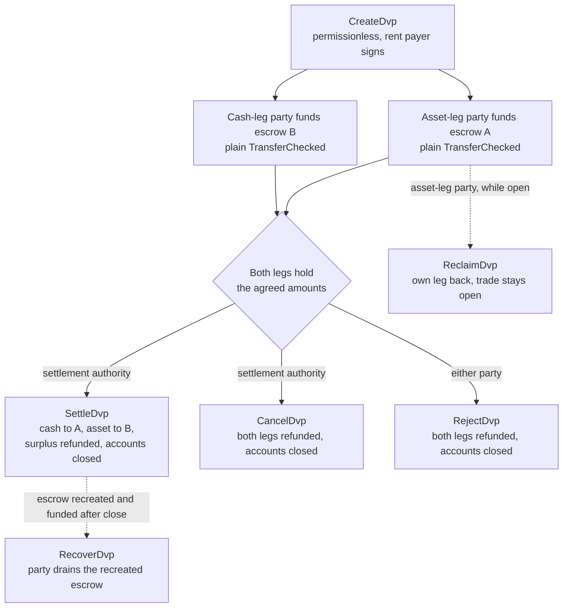
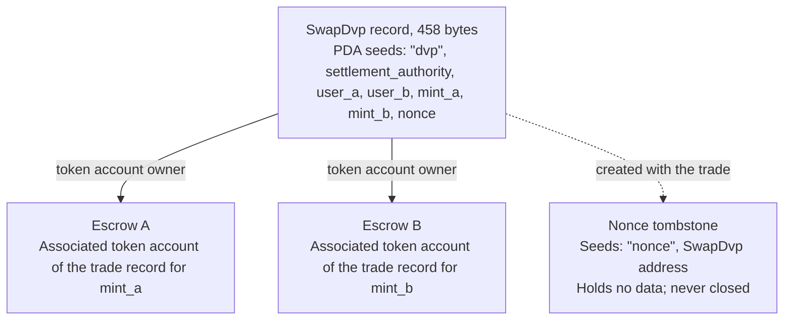

Программа DvP — стандартная программа поставки против платежа в Solana. Её поддерживает Solana Foundation, аудит провела Cantina. Две стороны договариваются о сделке, каждая отправляет свою ногу в эскроу-аккаунт обычным переводом токенов, а расчётный орган проводит расчёт по обеим ногам в одной транзакции: либо исполняются обе, либо ни одна. Расчётный орган — это третий адрес, указанный в сделке, например площадка или агент, организовавший её. Ни одной из сторон не нужно писать или развёртывать программу, а кошелёк или кастодиан, способный отправить стандартный перевод токенов (`TransferChecked`), может пополнить ногу без какой-либо интеграции с DvP. До расчёта любая сторона может забрать свою ногу обратно или расторгнуть сделку.

<Callout type="warn" title="Прочитайте запись, прежде чем действовать">

Создать запись о сделке может кто угодно, поэтому запись не доказывает наличие договорённости. Каждая сторона перед пополнением читает сохранённые условия, а расчётный орган — перед расчётом (см. [проверку](#verification-before-funding-and-settlement)).

</Callout>

## Как это работает

Для каждой сделки создаются принадлежащая программе запись и два эскроу-аккаунта — по одному на каждую ногу. Сторона с активом (`user_a`) и сторона с денежной ногой (`user_b`) пополняют каждая свою ногу, переводя токены в эскроу-аккаунт этой ноги. Расчёт может провести только расчётный орган. При расчёте согласованная сумма каждой ноги переводится противоположной стороне, излишек возвращается стороне, которой принадлежит нога, а запись и оба эскроу закрываются. Атомарность обеспечивают [транзакции](/docs/core/transactions) Solana: оба перевода выполняются в одной транзакции, поэтому либо вступают в силу оба, либо ни один.

Любой возврат, изъятие и возврат излишка направляются на собственный associated token account стороны: `user_a` — для `mint_a`, `user_b` — для `mint_b`. Кастодиан или казначейская система может пополнить ногу со своего аккаунта, но всё возвращаемое попадает на аккаунт стороны, а не обратно кастодиану. Каждая сделка также оставляет после себя постоянный аккаунт-маркер (см. [Состояние](#state)).

## Руководства

Страницы с шагами проводят одну сделку от создания до расчёта; для каждой инструкции приведены примеры на TypeScript и Rust.

<Cards>
  <Card title="Создание сделки" href="/docs/defi/dvp-program/create-a-trade">
    Установите клиенты и запишите условия сделки с помощью CreateDvp
  </Card>
  <Card title="Пополнение ног" href="/docs/defi/dvp-program/fund-the-legs">
    Проверьте сохранённые условия, затем пополните каждую ногу обычным переводом
  </Card>
  <Card title="Расчёт по сделке" href="/docs/defi/dvp-program/settle-the-trade">
    Проведите расчёт по обеим ногам в одной транзакции от имени расчётного органа
  </Card>
  <Card title="Расторжение сделки" href="/docs/defi/dvp-program/unwind-a-trade">
    Заберите ногу, отмените или отклоните сделку и верните поздние депозиты
  </Card>
</Cards>

[Демо в devnet](https://solana.com/delivery-vs-payment/demo) проводит сделку от начала до конца: создаёт её, пополняет оба эскроу стандартными переводами токенов и проводит расчёт по обеим ногам в одной транзакции.

## Выбор между программой и делегированием

[Поставка против платежа (DvP) с использованием делегирования](/docs/tokenization/dvp) проводит тот же обмен без программы: каждая сторона делегирует свою позицию расчётному агенту, который переводит обе ноги в одной транзакции.

- **Программа** не требует делегирования, поэтому ограничение в одного делегата на token account не действует, а расчётный орган не может перенаправить поступления. Каждая сделка зависит от обновляемой программы и её upgrade authority.
- **Паттерн делегирования** не зависит от программы и работает с минтами, у которых включён Scaled UI Amount. Программа отклоняет такие минты, что исключает любой минт, созданный по шаблону `tokenized-security` из Mosaic (см. [ограничения конфигурации минта](#mint-configuration-constraints)).

## Роли

Программа симметрична. В её интерфейсе две стороны — это `user_a`, который поставляет `mint_a`, и `user_b`, который поставляет `mint_b`. В README и сгенерированных клиентах `mint_a` называется ногой с активом, а `mint_b` — денежной ногой; эти страницы следуют той же конвенции, но программа не требует, чтобы денежная нога была денежным инструментом. Два актива или два стейблкоина проходят расчёт точно так же.

| Роль                 | Кто                               | Подписывает                                              | Примечания                                                                                                                                                                                                     |
| -------------------- | --------------------------------- | -------------------------------------------------- | --------------------------------------------------------------------------------------------------------------------------------------------------------------------------------------------------------- |
| Сторона с активом      | `user_a`, поставляет `mint_a`       | Собственный перевод для пополнения; Reclaim, Reject, Recover | Кошелёк с keypair или смарт-кошелёк на основе PDA, например мультиподписное хранилище. Сторонами не могут быть мультиподписной аккаунт SPL Token и program account: Create завершается ошибкой `PartyNotSignerCapable`                   |
| Сторона с денежной ногой       | `user_b`, поставляет `mint_b`       | Собственный перевод для пополнения; Reclaim, Reject, Recover | То же требование                                                                                                                                                                                          |
| Расчётный орган | Третий адрес, указанный при создании | Settle, Cancel                                     | Единственный подписант, который может провести расчёт. Не может перенаправить поступления, которые фиксируются при создании. Получает rent закрываемых аккаунтов при расчёте или отмене                                         |
| Плательщик rent           | Тот, кто подписывает `CreateDvp`         | Create                                             | Вносит rent (депозит в SOL, поддерживающий аккаунт открытым) за запись, nonce tombstone и оба эскроу. Не записывается как получатель rent: rent закрытых аккаунтов достаётся тому, кто закрывает сделку |

## ID программы

```text
dvp34bdbcEm4f4FCUjGV4mDAkDshaQR4LkK8fdcsyZq
```

| Кластер      | Программа                                       | Upgrade authority                              | Slot последнего развёртывания |
| ------------ | --------------------------------------------- | ---------------------------------------------- | ------------------ |
| mainnet-beta | `dvp34bdbcEm4f4FCUjGV4mDAkDshaQR4LkK8fdcsyZq` | `DXtFpbPjcn2hxPnw79x1Pfoj35vXh5AsWBkS37YnXMVv` | 452 058 374        |
| devnet       | `dvp34bdbcEm4f4FCUjGV4mDAkDshaQR4LkK8fdcsyZq` | `5EX1zFeJWj4rGYZv432WnYw8CbaSUeTdxPx4r573UgYU` | 479 376 863        |

Программа обновляема в обоих кластерах. Приведённые выше значения — это то, что показала команда `solana program show` 2 октября 2026 г.; запустите ту же команду, чтобы получить актуальные данные. Сборка в devnet старше коммита, по которому написаны страницы с шагами (см. [Установка](/docs/defi/dvp-program/create-a-trade#install)), но набор инструкций и ошибок у неё тот же.

## Жизненный цикл



Сделка остаётся открытой с момента `CreateDvp` до тех пор, пока её не закроет одна из инструкций Settle, Cancel или Reject. У пополнения нет отдельной инструкции: нога считается пополненной, когда её эскроу-аккаунт содержит не меньше согласованной суммы. Reclaim действует для каждой ноги отдельно и оставляет сделку открытой, поэтому проблема с одной ногой не заставляет другую сторону отменять всю сделку.

## Состояние

У каждой сделки есть один аккаунт `SwapDvp` размером 458 байт, принадлежащий программе. Его адрес выводится из расчётного органа, двух сторон, двух минтов и nonce (seeds `["dvp", settlement_authority, user_a, user_b, mint_a, mint_b, nonce]`). Суммы и время хранятся внутри аккаунта и на адрес не влияют, поэтому их нужно считывать, а не выводить. Небольшой аккаунт-маркер, nonce tombstone по адресу `["nonce", swap_dvp]`, создаётся вместе со сделкой и никогда не закрывается, поэтому каждую комбинацию сторон, минтов, органа и nonce можно использовать только для одной сделки.



| Поле                                  | Тип          | Значение                                                                                                 |
| -------------------------------------- | ------------- | ------------------------------------------------------------------------------------------------------- |
| `bump`                                 | `u8`          | PDA bump                                                                                                |
| `user_a`, `user_b`                     | `Pubkey`      | Две стороны                                                                                         |
| `mint_a`, `mint_b`                     | `Pubkey`      | Минты ноги с активом и денежной ноги                                                                        |
| `settlement_authority`                 | `Pubkey`      | Единственный подписант, который может провести расчёт или отмену                                                               |
| `token_program_a`, `token_program_b`   | `Pubkey`      | Token program, которой принадлежит каждый минт; в одной сделке могут сочетаться ноги SPL Token и Token-2022                    |
| `amount_a`, `amount_b`                 | `u64`         | Согласованная сумма каждой ноги в наименьшей единице минта (базовых единицах)                                 |
| `expiry_timestamp`                     | `i64`         | После этого сетевого времени (ончейн-часы) Settle отклоняется. Reclaim, Cancel и Reject по-прежнему работают |
| `nonce`                                | `u64`         | Различает сделки с одинаковыми остальными seeds. Одноразовый                                             |
| `ref_string`                           | `[u8; 64]`    | Непрозрачная клиентская ссылка, дополненная нулями; программа её никогда не читает                                     |
| `user_a_settlement_destination`        | `Pubkey`      | Получает денежную ногу при Settle; по умолчанию `user_a`                                                   |
| `user_b_settlement_destination`        | `Pubkey`      | Получает ногу с активом при Settle; по умолчанию `user_b`                                                  |
| `mint_a_authority`, `mint_b_authority` | `Pubkey`      | Mint authority, зафиксированные при создании; Settle завершается ошибкой, если любой из них изменился                           |
| `earliest_settlement_timestamp`        | `Option<i64>` | Если задано, Settle отклоняется до этого сетевого времени                                                     |

Список полей взят из IDL программы в коммите, указанном в разделе [Создание сделки](/docs/defi/dvp-program/create-a-trade#install).

## Инструкции

| Инструкция  | Подписант               | Эффект                                                                                                                                                              |
| ------------ | -------------------- | ------------------------------------------------------------------------------------------------------------------------------------------------------------------- |
| `CreateDvp`  | Любой плательщик            | Создаёт запись `SwapDvp`, её nonce tombstone и оба эскроу-аккаунта. Токены не перемещает                                                                        |
| `ReclaimDvp` | `user_a` или `user_b` | Возвращает из эскроу собственную ногу подписанта. Сделка остаётся открытой, и ногу можно пополнить снова                                                                      |
| `SettleDvp`  | Расчётный орган | Переводит `amount_a` на адрес назначения `user_b`, а `amount_b` — на адрес назначения `user_a`, возвращает излишек стороне соответствующей ноги, закрывает запись и оба эскроу |
| `CancelDvp`  | Расчётный орган | Возвращает `user_a` всё, что лежит в эскроу A, а `user_b` — всё, что лежит в эскроу B, и закрывает запись и оба эскроу                                                            |
| `RejectDvp`  | `user_a` или `user_b` | Тот же эффект, что и у Cancel, но подписывает сторона                                                                                                                            |
| `RecoverDvp` | `user_a` или `user_b` | После закрытия сделки: переводит всё из заново созданного эскроу на собственный token account подписанта и закрывает его. Покрывает депозит, поступивший после Settle, Cancel или Reject  |

Любой возврат направляется на собственный associated token account стороны для минта соответствующей ноги, независимо от того, кто пополнил эскроу.

Аккаунты и аргументы каждой инструкции описаны на странице соответствующего шага.

## Ошибки

| Код | Ошибка                            | Когда                                                                                                   |
| ---- | -------------------------------- | ------------------------------------------------------------------------------------------------------ |
| 0    | `SignerNotParty`                 | Reclaim, Reject или Recover подписаны адресом, не являющимся `user_a` или `user_b`                      |
| 1    | `DvpExpired`                     | Settle после `expiry_timestamp`                                                                        |
| 2    | `SettlementAuthorityMismatch`    | Settle или Cancel подписаны адресом, отличным от расчётного органа                              |
| 3    | `SettlementTooEarly`             | Settle до `earliest_settlement_timestamp`                                                          |
| 4    | `LegNotFunded`                   | Settle, пока в эскроу меньше согласованной суммы                                               |
| 5    | `ExpiryNotInFuture`              | Create со сроком действия, равным текущему сетевому времени или более ранним                                            |
| 6    | `EarliestAfterExpiry`            | Create с самым ранним временем расчёта позже срока действия                                               |
| 7    | `SelfDvp`                        | Create, где `user_a` равен `user_b`                                                                 |
| 8    | `SameMint`                       | Create, где `mint_a` равен `mint_b`                                                                 |
| 9    | `ZeroAmount`                     | Create с нулевой суммой для любой из ног                                                                |
| 10   | `BlockedMintExtension`           | Create или Settle с минтом, имеющим расширение TransferFee, InterestBearing, ScaledUiAmount или NonTransferable |
| 11   | `SettlementAuthorityIsParty`     | Create, где расчётный орган совпадает с одной из сторон                                                  |
| 12   | `SettlementAuthorityExecutable`  | Create с исполняемым расчётным органом                                                         |
| 13   | `NonceAlreadyUsed`               | Create с повторным использованием `(seeds, nonce)`, для которого уже есть tombstone                                         |
| 14   | `ExpiryTooFarInFuture`           | Create со сроком действия более чем на год вперёд                                                         |
| 15   | `RefStringTooLong`               | Create со ссылкой длиннее 64 байт                                                           |
| 16   | `DvpStillOpen`                   | Recover, пока сделка ещё открыта; используйте Reclaim                                                     |
| 17   | `DvpNeverCreated`                | Вызвать Recover с seed-значениями, для которых нет tombstone                                                              |
| 18   | `EscrowPreloadedWithLamports`    | Create, когда эскроу не-нативного токена держит lamports сверх минимума, освобождающего от rent                           |
| 19   | `SettlementDestinationIsSwapDvp` | Create с адресом получения расчёта, совпадающим с записью сделки                                         |
| 20   | `SwapDvpPreloadedWithLamports`   | Create, когда адрес записи держит lamports сверх своего резерва rent                                   |
| 21   | `RecipientAtaMismatch`           | Token account получателя или возврата больше не принадлежит ожидаемому кошельку и mint                  |
| 22   | `PartyNotSignerCapable`          | Create со стороной, которая не является аккаунтом, принадлежащим системной программе и не исполняемым                                 |
| 23   | `MintAuthorityChanged`           | Settle, когда mint authority ноги отличается от значения, зафиксированного при создании                         |

## События и индексация

Программа не генерирует ончейн-событий. Индексатор или система сверки читает состояние аккаунта `SwapDvp` и балансы токенов двух эскроу и использует `ref_string`, чтобы сопоставить сделку с её офчейн-ордером. Поскольку запись закрывается при расчёте, системе, которой нужны условия постфактум, следует сохранить их при чтении или восстановить из транзакции, создавшей сделку.

## Поддерживаемые токены

Сделка может сочетать ногу с SPL Token и ногу с Token-2022; у каждой ноги своя token program. Ноги с Wrapped SOL поддерживаются.

| Расширение Token-2022 на mint ноги                                                     | Поведение программы                                                  |
| ---------------------------------------------------------------------------------------- | ----------------------------------------------------------------- |
| TransferFee, InterestBearing, ScaledUiAmount, NonTransferable                            | Отклоняется при Create и Settle с ошибкой `BlockedMintExtension`         |
| PermanentDelegate, Pausable, DefaultAccountState, freeze authority, MintCloseAuthority | Допускается; каждая authority может действовать с токенами в эскроу           |
| ConfidentialTransfer                                                                     | Допускается; суммы на этой ноге публичны                          |
| TransferHook                                                                             | Поддерживается, до 32 дополнительных аккаунтов на ногу                        |
| MemoTransfer на аккаунте получателя или возврата                                          | Допускается; программа выдаёт требуемый memo перед переводом |

Комиссия за перевод оставила бы принимающую сторону без согласованной суммы. Interest Bearing и Scaled UI Amount не меняют исходные суммы, но их ставка или множитель могут измениться между созданием и расчётом сделки, из-за чего изменится отображение согласованных сумм. NonTransferable заблокировал бы обе ноги.

Допустимые authority могут перемещать, замораживать или останавливать токены в эскроу на протяжении жизни сделки (см. ниже). Эскроу нельзя настроить на получение конфиденциальных переводов, поэтому суммы в эскроу и при расчёте на ноге с конфиденциальным переводом публичны.

Для mint с хуком клиент определяет дополнительные аккаунты хука и добавляет их к Settle, Cancel, Reject, Reclaim и Recover. Лимит в 32 на ногу включает программу хука и её аккаунт валидации. Если hook authority расширит список аккаунтов хука сверх этого лимита, каждый перевод на этой ноге будет завершаться ошибкой, включая Reclaim, Cancel, Reject и Recover, пока authority не отменит изменение. Лимит аккаунтов в транзакции может сработать раньше лимита на ногу, когда хуки есть на обеих ногах.

Когда аккаунт получателя или возврата требует memo, программа вызывает программу Memo перед переводом — поэтому каждая инструкция, которая выводит токены из эскроу, принимает аккаунт `memo_program`.

### Ограничения конфигурации mint

**Scaled UI Amount.** Шаблон `tokenized-security` в [Mosaic](https://github.com/solana-foundation/mosaic), наборе инструментов Solana Foundation для эмиссии, всегда добавляет Scaled UI Amount, поэтому программа не принимает mint, созданный из этого шаблона, в качестве ноги. Mint для этой программы можно создать без этого расширения (см. [Token Extensions](/docs/tokens/extensions)); [DvP с использованием делегирования](/docs/tokenization/dvp) проводит расчёт через делегированные полномочия и эту проверку не применяет.

**Mint с заморозкой по умолчанию.** Эскроу каждой сделки — это associated token account, принадлежащий program-derived address, новому для этой сделки. На mint с Default Account State, установленным в frozen, эскроу создаётся замороженным, и пополняющий перевод в него завершится ошибкой, пока он не будет разморожен. В [Token ACL](/docs/tokenization/token-acl) это означает, что эмитент или его трансфер-агент допускает эскроу сделки до пополнения: либо добавляя адрес записи сделки (владельца эскроу) в allowlist, так что любой может разморозить эскроу, если конфигурация Token ACL у mint включает permissionless thaw, либо поручив freeze authority разморозить его напрямую. Замороженное эскроу также блокирует Settle, Reclaim, Cancel, Reject и Recover на этой ноге, поэтому freeze authority, а на mint с хуком — hook authority, является доверенной стороной на всё время жизни сделки. Путь с замороженным эскроу описан здесь и не используется в сниппетах для devnet.

## Ограничения

- Нет сопоставления, определения цены и книги ордеров. Стороны согласуют условия вне реестра, и одна из них их записывает.
- Нет неттинга, только двусторонние сделки: одна запись — одна сделка между двумя сторонами.
- Нет частичного исполнения. Settle перемещает ровно согласованную сумму каждой ноги и возвращает любой излишек стороне этой ноги.
- Нет внереестровой ноги. Обе ноги — это token accounts в Solana; денежная нога по существующим каналам рассчитывается отдельно и сверяется.
- Нет проверки допуска, allowlist или KYC. Допуск держателей обеспечивают собственные механизмы контроля mint.
- Нет автоматического расчёта. Подписать должна settlement authority.
- Нет событий и нет комиссии протокола сверх комиссий за транзакции и rent.

Программа устраняет принципальный риск между двумя сторонами: ни одна нога не перемещается, если не перемещаются обе. Она не устраняет кредитный риск эмитента или риск погашения по любому из токенов, возможность freeze, pause или permanent delegate authority у mint действовать с токенами в эскроу (см. [поддерживаемые токены](#supported-tokens)), а также зависимость от того, что settlement authority сможет подписать.

## Проверка перед пополнением и расчётом

`CreateDvp` не требует разрешений: подписывает только плательщик, а стороны и settlement authority — нет. Поэтому любой может создать запись с любыми сторонами и условиями. Перед пополнением и ещё раз перед расчётом прочитайте аккаунт `SwapDvp` и убедитесь, что:

1. Аккаунт принадлежит программе DvP и имеет ровно 458 байт. Аккаунт, не принадлежащий программе, можно заполнить байтами, которые декодируются как настоящая запись.
2. `user_a`, `user_b`, `mint_a`, `mint_b` и `settlement_authority` соответствуют согласованной сделке.
3. `amount_a`, `amount_b`, `expiry_timestamp` и `earliest_settlement_timestamp` соответствуют согласованным условиям.
4. Оба адреса получения расчёта — согласованные адреса. Поддельная запись может перенаправить средства.

[Пополнение ног](/docs/defi/dvp-program/fund-the-legs#verify-the-terms) перечисляет проверяющие функции чтения сгенерированных клиентов и показывает проверку в коде.

Считайте сделку рассчитанной, когда транзакция Settle достигает [`finalized`](/docs/rpc#configuring-state-commitment). Это уровень подтверждения сети; считается ли он также моментом окончательности расчётов в юридическом смысле, зависит от соглашений сторон и применимых режимов.

## Версионирование

Аккаунт `SwapDvp` не содержит поля версии. Его раскладка зафиксирована на 458 байтах (`SwapDvp::LEN`), а проверяющие функции чтения отклоняют аккаунт любой другой длины. IDL имеет собственную версию: `0.1.0` по состоянию на 2 октября 2026 года.

Программу можно обновлять в обоих кластерах (см. [ID программы](#program-id)). Запись сделки существует только до тех пор, пока сделка не рассчитана, не отменена и не отклонена, поэтому проверьте в репозитории, как обновление влияет на открытые сделки, и заново сгенерируйте клиенты из IDL развёрнутой сборки.

## Репозиторий и аудит

Исходный код, IDL, сгенерированные клиенты и тесты находятся в [`solana-foundation/dvp`](https://github.com/solana-foundation/dvp) под лицензией MIT. Программа — `no_std`-программа на Pinocchio; клиенты генерируются из IDL с помощью Codama. Сообщения об уязвимостях отправляются по ссылке на security advisory репозитория согласно его `SECURITY.md`.

Программа прошла аудит [Cantina](https://cantina.xyz/portfolio/fe870bb4-d96d-4902-8aec-9dfcfa2d6a79).

## Связанные материалы

- [Поставка против платежа (DvP) с использованием делегирования](/docs/tokenization/dvp): паттерн делегирования без программы
- [Token ACL](/docs/tokenization/token-acl): как mint с ограничениями взаимодействует с эскроу-аккаунтами
