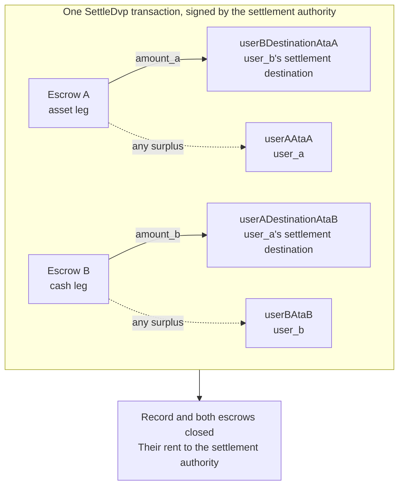

`SettleDvp` подписывает settlement authority, указанный в записи о сделке. В одной
транзакции инструкция переводит `amount_a` части с активом на адрес назначения стороны денежной части,
а `amount_b` денежной части — на адрес назначения стороны части с активом,
возвращает любой излишек в любом из эскроу стороне соответствующей части, а затем закрывает запись
и оба эскроу. Если хотя бы один из этих переводов не может завершиться, инструкция
завершается ошибкой, и ничего не перемещается.

Эта страница продолжает материалы [«Создание сделки»](/docs/defi/dvp-program/create-a-trade)
и [«Финансирование частей»](/docs/defi/dvp-program/fund-the-legs); клиент, подписанты,
`trade` и token accounts сторон переносятся оттуда.

## Повторная проверка перед подписанием

Settlement authority подписывает транзакцию, которая перемещает обе части, поэтому перед подписанием
она выполняет то же чтение, что и каждая сторона: владелец, размер, стороны,
mint-ы, суммы, срок действия и оба адреса назначения (см.
[финансирование частей](/docs/defi/dvp-program/fund-the-legs#verify-the-terms)). Сама
программа при расчёте повторно проверяет, что каждый mint по-прежнему принадлежит token
program, записанной при создании, не имеет заблокированных расширений и имеет тот же
mint authority, что и при создании сделки, поэтому mint, пересозданный с заблокированным
расширением, другой token program или другим mint authority, не может участвовать
в расчёте.

## Создание аккаунтов получателей

Settle записывает данные в четыре token accounts, которые программа не создаёт:

| Аккаунт                | Получает                     | Владелец                           |
| ---------------------- | ---------------------------- | ------------------------------- |
| `userADestinationAtaB` | Денежная часть (`amount_b`)    | `user_a_settlement_destination` |
| `userBDestinationAtaA` | Часть с активом (`amount_a`)   | `user_b_settlement_destination` |
| `userAAtaA`            | Любой излишек по части с активом | `user_a`                        |
| `userBAtaB`            | Любой излишек по денежной части  | `user_b`                        |

Аккаунты для излишка используются только тогда, когда эскроу содержит больше согласованной
суммы, но любой, у кого есть токены этого mint, может создать излишек, отправив несколько базовых
единиц в эскроу. Если аккаунта для возврата не существует, весь Settle
завершается ошибкой, поэтому создавайте все четыре идемпотентно в той же транзакции.

<Tabs items={["TypeScript", "Rust"]}>
  <Tab value="TypeScript">
    ```ts
    import {
      findAssociatedTokenPda,
      getCreateAssociatedTokenIdempotentInstruction,
    } from "@solana-program/token-2022";

    const destinationA = t.userASettlementDestination; // defaults to userA
    const destinationB = t.userBSettlementDestination; // defaults to userB

    const [userADestinationAtaB] = await findAssociatedTokenPda({
      mint: mintB,
      owner: destinationA,
      tokenProgram: tokenProgramB,
    });
    const [userBDestinationAtaA] = await findAssociatedTokenPda({
      mint: mintA,
      owner: destinationB,
      tokenProgram: tokenProgramA,
    });
    // userAAtaA and userBAtaB are from fund the legs.

    const createRecipientAccounts = [
      { ata: userADestinationAtaB, owner: destinationA, mint: mintB, tokenProgram: tokenProgramB },
      { ata: userBDestinationAtaA, owner: destinationB, mint: mintA, tokenProgram: tokenProgramA },
      { ata: userAAtaA, owner: userA, mint: mintA, tokenProgram: tokenProgramA },
      { ata: userBAtaB, owner: userB, mint: mintB, tokenProgram: tokenProgramB },
    ].map(({ ata, owner, mint, tokenProgram }) =>
      getCreateAssociatedTokenIdempotentInstruction({
        payer: authoritySigner,
        ata,
        owner,
        mint,
        tokenProgram,
      }),
    );
    ```

  </Tab>

  <Tab value="Rust">
    ```rust
    use spl_associated_token_account_client::address::get_associated_token_address_with_program_id;
    use spl_associated_token_account_client::instruction::create_associated_token_account_idempotent;

    let authority: Pubkey = pubkey!("SETTLEMENT_AUTHORITY_ADDRESS_HERE");
    let destination_a = trade.user_a_settlement_destination; // defaults to user_a
    let destination_b = trade.user_b_settlement_destination; // defaults to user_b

    let user_a_destination_ata_b =
        get_associated_token_address_with_program_id(&destination_a, &mint_b, &token_program_b);
    let user_b_destination_ata_a =
        get_associated_token_address_with_program_id(&destination_b, &mint_a, &token_program_a);
    let user_a_ata_a = get_associated_token_address_with_program_id(&user_a, &mint_a, &token_program_a);
    let user_b_ata_b = get_associated_token_address_with_program_id(&user_b, &mint_b, &token_program_b);

    let create_recipient_accounts = [
        create_associated_token_account_idempotent(&authority, &destination_a, &mint_b, &token_program_b),
        create_associated_token_account_idempotent(&authority, &destination_b, &mint_a, &token_program_a),
        create_associated_token_account_idempotent(&authority, &user_a, &mint_a, &token_program_a),
        create_associated_token_account_idempotent(&authority, &user_b, &mint_b, &token_program_b),
    ];
    ```

  </Tab>
</Tabs>

## Выполнение Settle

`legAExtrasCount` сообщает программе, сколько из аккаунтов, добавленных после
фиксированного списка, относятся к transfer hook перевода части с активом; остальные относятся к hook
денежной части. Для mint без transfer hooks передайте ноль и ничего не добавляйте. program account
для memo-программы обязателен для инструкции и используется только для адресов назначения,
которым требуется memo.

<Tabs items={["TypeScript", "Rust"]}>
  <Tab value="TypeScript">
    ```ts
    import { MEMO_PROGRAM_ADDRESS } from "@solana-program/memo";
    import { getSettleDvpInstruction } from "./dvp";

    const settleInstruction = getSettleDvpInstruction({
      settlementAuthority: authoritySigner,
      swapDvp,
      mintA,
      mintB,
      dvpAtaA: escrowA,
      dvpAtaB: escrowB,
      userADestinationAtaB,
      userBDestinationAtaA,
      userAAtaA,
      userBAtaB,
      tokenProgramA,
      tokenProgramB,
      memoProgram: MEMO_PROGRAM_ADDRESS,
      legAExtrasCount: 0,
    });

    const { context: settleContext } = await client.sendTransaction([
      ...createRecipientAccounts,
      settleInstruction,
    ]);
    const settleSignature = settleContext.signature;
    console.log("Submitted:", settleSignature);

    // sendTransaction returns at the client's commitment (confirmed by default).
    // Wait for finalized before recording the trade as settled.
    let finalized = false;
    for (let attempt = 0; attempt < 30 && !finalized; attempt++) {
      const {
        value: [status],
      } = await client.rpc.getSignatureStatuses([settleSignature]).send();
      if (status?.err) {
        throw new Error("Settle transaction failed");
      }
      finalized = status?.confirmationStatus === "finalized";
      if (!finalized) {
        await new Promise((resolve) => setTimeout(resolve, 2_000));
      }
    }
    if (!finalized) {
      // A closed record means it settled; an open one is safe to settle again.
      throw new Error("Settle not finalized after 60s; read the trade record");
    }
    console.log("Settled:", settleSignature);
    ```

  </Tab>

  <Tab value="Rust">
    ```rust
    use dvp_swap_program_client::instructions::SettleDvpBuilder;

    const MEMO_PROGRAM_ID: Pubkey = pubkey!("MemoSq4gqABAXKb96qnH8TysNcWxMyWCqXgDLGmfcHr");

    let settle_ix = SettleDvpBuilder::new()
        .settlement_authority(authority)
        .swap_dvp(swap_dvp)
        .mint_a(mint_a)
        .mint_b(mint_b)
        .dvp_ata_a(escrow_a)
        .dvp_ata_b(escrow_b)
        .user_a_destination_ata_b(user_a_destination_ata_b)
        .user_b_destination_ata_a(user_b_destination_ata_a)
        .user_a_ata_a(user_a_ata_a)
        .user_b_ata_b(user_b_ata_b)
        .token_program_a(token_program_a)
        .token_program_b(token_program_b)
        .memo_program(MEMO_PROGRAM_ID)
        .leg_a_extras_count(0)
        .instruction();
    ```

  </Tab>
</Tabs>



### Transfer hooks

Сгенерированный IDL перечисляет только фиксированные аккаунты, поэтому сгенерированные билдеры
ничего не знают об аккаунтах hook. Определите дополнительные метаданные аккаунтов (extra account metas) для каждого hook mint
тем же способом, каким вы делали бы это для прямого перевода этого токена, а затем добавьте их к
инструкции: сначала аккаунты части с активом, затем денежной части, при этом
`legAExtrasCount` равен числу аккаунтов в первой группе. В TypeScript разверните
полученные metas в массив `accounts` инструкции; в Rust используйте
`add_remaining_accounts` у билдера. Лимит — 32 аккаунта на часть,
включая программу hook и аккаунт валидации; лимит аккаунтов в транзакции
может сработать раньше, когда hooks есть у обеих частей. Программа снимает флаг подписанта
со всех передаваемых аккаунтов, поэтому hook не может получить подпись settlement authority
этим путём.

## Запись результата

Считайте сделку рассчитанной, когда транзакция Settle достигает статуса `finalized`.
После расчёта запись и оба эскроу больше не существуют, поэтому системе, которой нужны
условия позднее, следует сохранить их из чтения до расчёта или из транзакции создания.
Средства rent закрытых аккаунтов перешли к settlement authority.

## Ошибки Settle

`LegNotFunded` означает, что в эскроу меньше согласованной суммы; `DvpExpired`
и `SettlementTooEarly` означают, что временное окно упущено; `MintAuthorityChanged`
и `BlockedMintExtension` означают, что mint изменился после создания;
`RecipientAtaMismatch` означает, что token account назначения или возврата отсутствует либо
больше не принадлежит ожидаемому владельцу и mint, обычно потому, что описанный выше шаг
создания аккаунтов был пропущен. Во всех случаях ничего не переместилось, и
стороны могут отменить сделку с учётом полномочий mint (см.
[отмена сделки](/docs/defi/dvp-program/unwind-a-trade)).

## Следующие шаги

- [Отмена сделки](/docs/defi/dvp-program/unwind-a-trade): возврат профинансированных
  частей, если сделка не рассчитана
