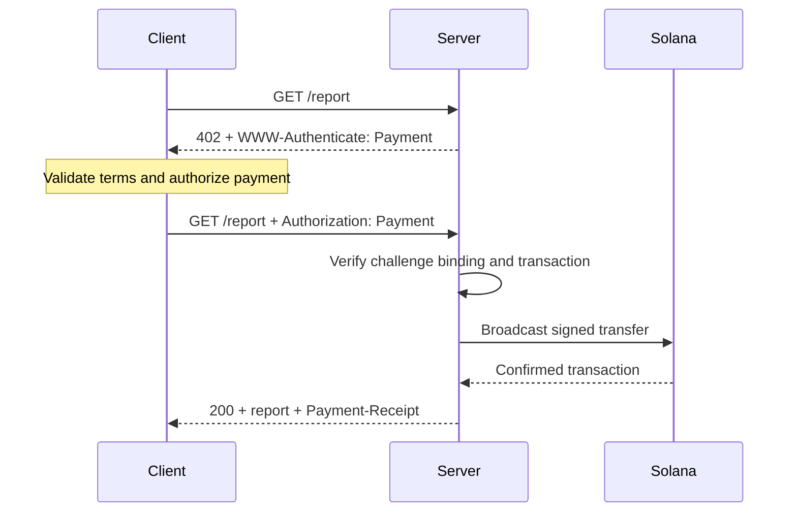
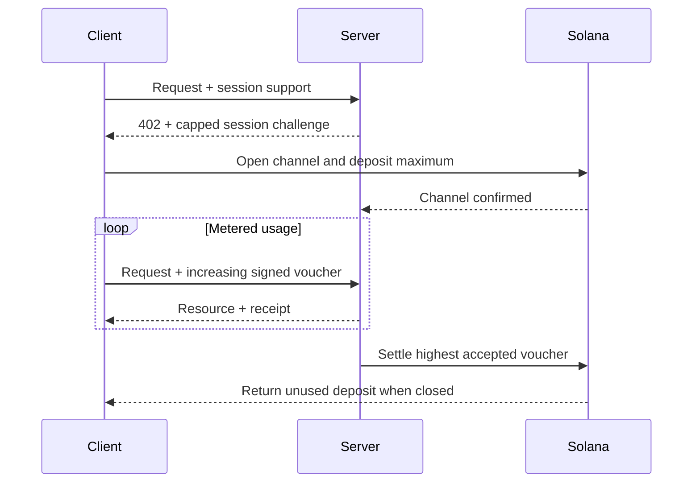

[Machine Payments Protocol (MPP)](https://mpp.dev/) применяет семантику HTTP-аутентификации
к платежам. Сервер отвечает challenge-запросом на неоплаченный запрос, клиент
возвращает платёжные учётные данные, а сервер после принятия платежа отправляет
квитанцию.

MPP разделяет три аспекта:

- **Intent** (намерение) описывает коммерческое взаимодействие, например разовый
  платёж `charge` или тарифицируемую по использованию сессию `session`.
- **Способ оплаты** описывает, как передаётся стоимость. Способ для Solana
  поддерживает для платежей `charge` нативный SOL и токены SPL.
- **Транспорт** HTTP передаёт challenge-запросы, учётные данные, квитанции и ошибки.

MPP публикуется в виде набора Internet-Drafts. Считайте
[актуальные спецификации](https://paymentauth.org/) источником истины и
учитывайте, что детали могут меняться, пока черновики находятся в работе.

## Обмен по HTTP

MPP использует стандартные поля HTTP-аутентификации вместо специальных
платёжных заголовков протокола:

| Сообщение                 | Представление в HTTP                                         |
| ----------------------- | ----------------------------------------------------------- |
| Платёжный challenge-запрос       | `402 Payment Required` с `WWW-Authenticate: Payment ...` |
| Платёжные учётные данные      | Повторный запрос с `Authorization: Payment ...`           |
| Квитанция об успешной оплате      | Ответ с ресурсом и `Payment-Receipt: ...`               |
| Некорректные платёжные данные | Тело Problem Details с типом `application/problem+json`       |



Challenge-запрос включает сгенерированный сервером ID, realm, способ оплаты,
intent, закодированный платёжный запрос и срок действия. Учётные данные
воспроизводят challenge-запрос и добавляют подтверждение платежа, специфичное
для способа оплаты. Сервер должен проверить обе части: корректный перевод,
относящийся к другому challenge-запросу, не должен открывать доступ к ресурсу.

## Разовые платежи на Solana

Intent `charge` для Solana поддерживает два типа учётных данных:

- **Режим pull** использует подписанную транзакцию. Клиент подписывает перевод и
  отправляет транзакцию на сервер. Сервер проверяет её, при необходимости
  добавляет подпись плательщика комиссии, транслирует транзакцию в сеть,
  дожидается подтверждения и возвращает подпись транзакции в квитанции.
- **Режим push** использует подпись транзакции. Сначала клиент сам транслирует
  транзакцию в сеть, затем отправляет серверу подтверждённую подпись. Сервер
  получает и проверяет транзакцию, прежде чем вернуть ресурс.

Режим pull позволяет серверу оплачивать комиссии за транзакции и выполнять
повторные попытки на стороне сервера. Режим push полезен, когда кошелёк требует,
чтобы клиент сам отправлял свою транзакцию, но в нём нельзя использовать
оплату комиссий сервером.

Нормативные поля и правила проверки см. в
[спецификации платежа Solana charge](https://paymentauth.org/draft-solana-charge-00.html).

## Добавление платежа MPP в API на Express

Solana Pay Kit предоставляет актуальную интеграцию на TypeScript для MPP и x402.
Установите его вместе с Express:

```bash
pnpm add @solana/pay-kit @solana/kit@^6.9.0 express
pnpm add --save-dev @types/express tsx
```

Этот минимальный пример использует размещённую песочницу Surfpool и публичного
демонстрационного получателя из пакета. Он предназначен только для локальной
разработки:

```ts filename=server.ts
import express from "express";
import { createPayKit, usd } from "@solana/pay-kit";

const pay = await createPayKit({
  accept: ["mpp"],
  rpcUrl: "https://402.surfnet.dev:8899"
});

const app = express();

app.get("/report", pay.express(usd("0.01")), (_req, res) => {
  res.json({ report: "Paid report" });
});

app.listen(4567, () => {
  console.log("Paid API listening on http://127.0.0.1:4567");
});
```

Запустите его и сравните неоплаченный запрос с запросом, учитывающим оплату:

```bash
pnpm tsx server.ts
curl -i http://127.0.0.1:4567/report
pay --sandbox curl http://127.0.0.1:4567/report
```

Обработчик маршрута выполняется только после того, как middleware принимает платёж.

<Callout type="warn" title="Замените все значения песочницы по умолчанию в продакшене">
  Настройте явную сеть, получателя-продавца, выделенный RPC, стабильный секрет
  привязки challenge-запросов, продакшен-подписанта и надёжное хранилище для защиты
  от повторного воспроизведения. Никогда не направляйте реальные платежи на
  демонстрационного подписанта из пакета.
</Callout>

## Сессии с тарификацией по использованию

Используйте `session` Solana MPP, когда клиент будет совершать много мелких
связанных платежей. Сессия открывает ончейн-платёжный канал с максимальным
депозитом, а затем использует накопительные подписанные ваучеры по мере роста
потребления. Сервер может проверять ваучеры офчейн и позже рассчитаться по
наибольшей принятой сумме.

Это удобно для инференса с тарификацией по токенам, загрузок с тарификацией по
байтам, потоковых данных и повторяющихся вызовов инструментов. Это не то же
самое, что отправка отдельного ончейн-платежа за каждое событие.



Называйте сессию **платежом в рамках сессии**, **платёжным каналом** или
**повторяющейся авторизацией с лимитом**. Называйте её потоковым платежом, только
если сервис и платёжный контракт действительно тарифицируют поток потребления.

## Проверка в продакшене

Для каждого платежа Solana charge сервер должен проверить как минимум следующее:

- Challenge-запрос подлинный, не истёк, привязан к этому запросу и предназначен
  для данного realm.
- Транзакция использует ожидаемые сеть, актив или mint, получателя, сумму
  и token program.
- Любые инструкции плательщика комиссии или associated-token-account явно
  разрешены и не могут опустошить счёт подписанта сервера.
- Транзакция выполнена успешно на требуемом уровне подтверждения.
- Подпись транзакции ещё не была использована.
- Проверка на повторное воспроизведение и операция потребления атомарны на всех экземплярах сервера.

Для сессий также сохраняйте состояние канала, принятую накопленную сумму и
отметку расчёта в общем хранилище. Опишите в документации, как клиенты могут
вернуть неиспользованные средства, если сервер станет недоступен.

## Связанные ресурсы

- [Спецификации MPP](https://paymentauth.org/)
- [Документация по протоколу MPP](https://mpp.dev/protocol)
- [Solana Pay Kit](https://github.com/solana-foundation/pay-kit)
- [Обзор агентных платежей](/docs/payments/agentic-payments)
- [Готовность к продакшену](/docs/tools/production-readiness)
