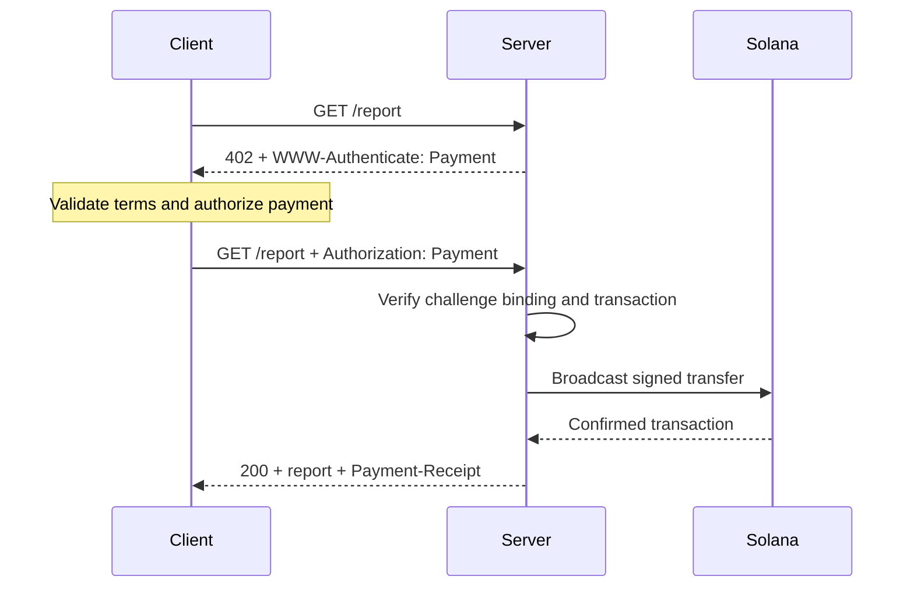
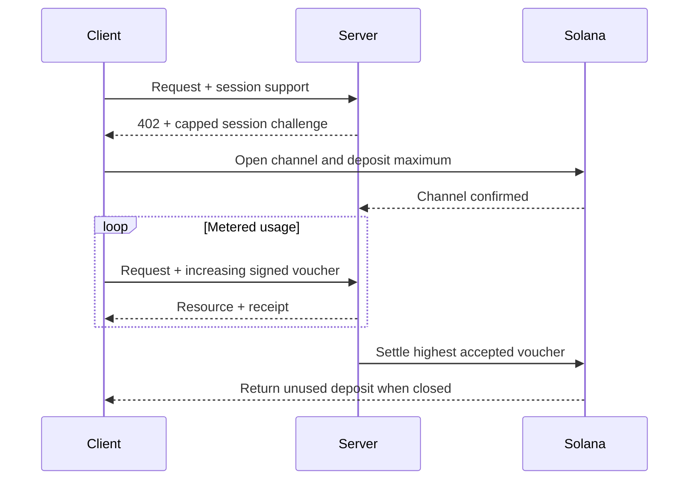

[Machine Payments Protocol (MPP)](https://mpp.dev/) применяет семантику HTTP-аутентификации к платежам. Сервер отправляет challenge в ответ на неоплаченный запрос, клиент возвращает платёжные учётные данные, а сервер после принятия платежа возвращает квитанцию.

MPP разделяет три аспекта:

- **Intent** (намерение) описывает коммерческое взаимодействие, например разовое списание `charge` или сессию с учётом использования `session`.
- **Способ оплаты** описывает, как перемещается стоимость. Метод для Solana поддерживает нативный SOL и токены SPL для списаний.
- HTTP-**транспорт** передаёт challenge, учётные данные, квитанции и ошибки.

MPP публикуется в виде набора Internet-Draft. Считайте [актуальные спецификации](https://paymentauth.org/) источником истины и учитывайте, что детали могут меняться, пока черновики находятся в разработке.

## HTTP-обмен

MPP использует стандартные поля HTTP-аутентификации вместо специфичных для протокола платёжных заголовков:

| Сообщение                 | Представление в HTTP                                         |
| ----------------------- | ----------------------------------------------------------- |
| Платёжный challenge       | `402 Payment Required` с `WWW-Authenticate: Payment ...` |
| Платёжные учётные данные      | Повторный запрос с `Authorization: Payment ...`           |
| Квитанция об успешной оплате      | Ответ с ресурсом и `Payment-Receipt: ...`               |
| Недопустимые платёжные данные | Тело Problem Details с `application/problem+json`       |



Challenge включает сгенерированный сервером ID, realm, метод, intent, закодированный платёжный запрос и срок действия. Учётные данные повторяют challenge и добавляют подтверждение платежа, специфичное для метода. Сервер должен проверить обе части: корректный перевод, относящийся к другому challenge, не должен открывать доступ к ресурсу.

## Разовые списания в Solana

Intent `charge` для Solana поддерживает два типа учётных данных:

- **Режим pull** использует подписанную транзакцию. Клиент подписывает перевод и отправляет транзакцию на сервер. Сервер проверяет её, при необходимости добавляет подпись плательщика комиссии, рассылает в сеть, дожидается подтверждения и возвращает подпись транзакции в квитанции.
- **Режим push** использует подпись транзакции. Сначала клиент рассылает транзакцию в сеть, затем отправляет серверу подтверждённую подпись. Сервер получает и проверяет транзакцию, прежде чем вернуть ресурс.

Режим pull позволяет серверу оплачивать комиссии за транзакции и реализовывать повторные попытки на стороне сервера. Режим push полезен, когда кошелёк требует, чтобы клиент сам отправлял свою транзакцию, но в нём нельзя использовать оплату комиссий сервером.

Нормативные поля и правила проверки см. в [спецификации Solana charge](https://paymentauth.org/draft-solana-charge-00.html).

## Добавление MPP-списания в API на Express

Solana Pay Kit предоставляет актуальную интеграцию MPP и x402 на TypeScript. Установите его вместе с Express:

```bash
pnpm add @solana/pay-kit @solana/kit@^6.9.0 express
pnpm add --save-dev @types/express tsx
```

В этом минимальном примере используются размещённая песочница Surfpool и публичный демонстрационный получатель из пакета. Он предназначен только для локальной разработки:

```ts filename=server.ts
import express from "express";
import { createPayKit, usd } from "@solana/pay-kit";

const pay = await createPayKit({
  accept: ["mpp"],
  rpcUrl: "https://402.surfnet.dev:8899"
});

const app = express();

app.get("/report", pay.express(usd("0.01")), (_req, res) => {
  res.json({ report: "Paid report" });
});

app.listen(4567, () => {
  console.log("Paid API listening on http://127.0.0.1:4567");
});
```

Запустите его и сравните неоплаченный запрос с запросом, поддерживающим оплату:

```bash
pnpm tsx server.ts
curl -i http://127.0.0.1:4567/report
pay --sandbox curl http://127.0.0.1:4567/report
```

Обработчик маршрута выполняется только после того, как middleware принимает платёж.

<Callout type="warn" title="Замените все настройки песочницы по умолчанию в продакшене">
  Настройте явную сеть, получателя-продавца, выделенный RPC, постоянный секрет привязки challenge, производственный подписант и надёжное хранилище для защиты от повторного воспроизведения. Никогда не направляйте реальные платежи на демонстрационного подписанта из пакета.
</Callout>

## Сессии с учётом использования

Используйте `session` MPP для Solana, когда клиент будет совершать много небольших взаимосвязанных платежей. Сессия открывает ончейн-платёжный канал с максимальным депозитом, а затем по мере роста использования применяет накопительные подписанные ваучеры. Сервер может проверять ваучеры офчейн и позже рассчитаться по наибольшей принятой сумме.

Это удобно для инференса с оплатой по токенам, загрузок с оплатой по байтам, данных в реальном времени и повторяющихся вызовов инструментов. Это не то же самое, что отправка отдельного ончейн-платежа за каждое событие.



Называйте сессию **платежом за сессию**, **платёжным каналом** или **ограниченной повторяющейся авторизацией**. Называйте её потоковым платежом, только если сервис и платёжный контракт действительно измеряют поток использования.

## Проверка в продакшене

Для каждого списания в Solana сервер должен проверить как минимум следующее:

- Challenge подлинный, не истёк, привязан к этому запросу и предназначен для данного realm.
- Транзакция использует ожидаемую сеть, актив или mint, получателя, сумму и token program.
- Любые инструкции плательщика комиссии или associated token account явно разрешены и не могут опустошить подписанта сервера.
- Транзакция выполнена успешно на требуемом уровне подтверждения.
- Подпись транзакции ещё не была использована.
- Проверка на повторное воспроизведение и операция фиксации использования атомарны на всех экземплярах сервера.

Для сессий также сохраняйте состояние канала, принятую накопительную сумму и отметку расчёта в общем хранилище. Опишите в документации, как клиенты могут вернуть неиспользованные средства, если сервер станет недоступен.

## Связанные ресурсы

- [Спецификации MPP](https://paymentauth.org/)
- [Документация по протоколу MPP](https://mpp.dev/protocol)
- [Solana Pay Kit](https://github.com/solana-foundation/pay-kit)
- [Обзор агентных платежей](/docs/payments/agentic-payments)
- [Готовность к продакшену](/docs/tools/security#verify-addresses)
