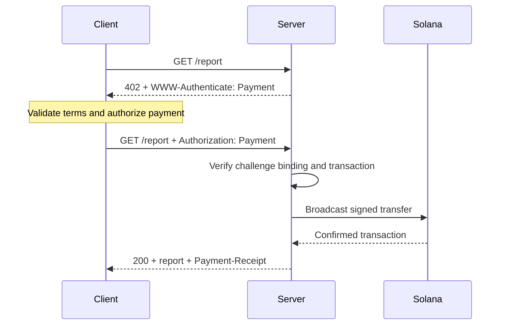
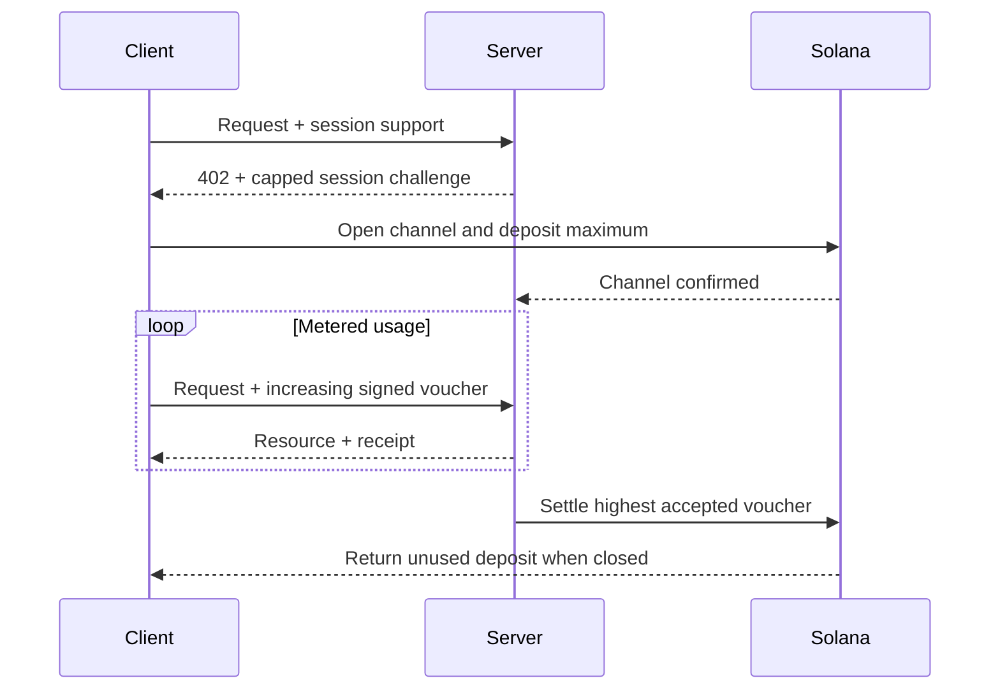

[Machine Payments Protocol (MPP)](https://mpp.dev/) применяет семантику HTTP-аутентификации к платежам. Сервер отправляет challenge в ответ на неоплаченный запрос, клиент возвращает платёжные учётные данные, а после принятия платежа сервер возвращает квитанцию.

MPP разделяет три задачи:

- **Intent** (намерение) описывает коммерческое взаимодействие, например разовое списание `charge` или сессию с учётом потребления `session`.
- **Способ оплаты** описывает, как перемещается стоимость. Метод Solana поддерживает для списаний нативный SOL и токены SPL.
- HTTP-**транспорт** передаёт challenge, учётные данные, квитанции и ошибки.

MPP публикуется в виде набора Internet-Drafts. Считайте [актуальные спецификации](https://paymentauth.org/) первоисточником и учитывайте, что детали могут меняться, пока черновики находятся в разработке.

## HTTP-обмен

MPP использует стандартные поля HTTP-аутентификации вместо специфичных для протокола платёжных заголовков:

| Сообщение                 | Представление в HTTP                                         |
| ----------------------- | ----------------------------------------------------------- |
| Платёжный challenge       | `402 Payment Required` с `WWW-Authenticate: Payment ...` |
| Платёжные учётные данные      | Повторный запрос с `Authorization: Payment ...`           |
| Квитанция об успешной оплате      | Ответ с ресурсом и `Payment-Receipt: ...`               |
| Недопустимые платёжные данные | Тело Problem Details с `application/problem+json`       |



Challenge включает сгенерированный сервером ID, realm, метод, intent, закодированный платёжный запрос и срок действия. Учётные данные повторяют challenge и добавляют подтверждение платежа, специфичное для метода. Сервер должен проверить обе части: валидный перевод, относящийся к другому challenge, не должен открывать доступ к ресурсу.

## Разовые списания в Solana

Intent `charge` в Solana поддерживает два типа учётных данных:

- **Режим pull** использует подписанную транзакцию. Клиент подписывает перевод и отправляет транзакцию на сервер. Сервер проверяет её, при необходимости добавляет подпись плательщика комиссии, транслирует транзакцию в сеть, дожидается подтверждения и возвращает сигнатуру транзакции в квитанции.
- **Режим push** использует сигнатуру транзакции. Сначала клиент транслирует транзакцию в сеть, затем отправляет подтверждённую сигнатуру на сервер. Перед возвратом ресурса сервер получает и проверяет транзакцию.

Режим pull позволяет серверу спонсировать комиссии за транзакции и реализовывать повторные попытки на стороне сервера. Режим push полезен, когда кошелёк требует, чтобы клиент сам отправлял свою транзакцию, но в этом случае спонсирование комиссий сервером недоступно.

Нормативные поля и правила проверки приведены в [спецификации Solana charge](https://paymentauth.org/draft-solana-charge-00.html).

## Добавление платежа MPP в API на Express

Solana Pay Kit предоставляет актуальную интеграцию MPP и x402 на TypeScript. Установите его вместе с Express:

```bash
pnpm add @solana/pay-kit @solana/kit@^6.9.0 express
pnpm add --save-dev @types/express tsx
```

Этот минимальный пример использует размещённую песочницу Surfpool и публичного демонстрационного получателя из пакета. Он предназначен только для локальной разработки:

```ts filename=server.ts
import express from "express";
import { createPayKit, usd } from "@solana/pay-kit";

const pay = await createPayKit({
  accept: ["mpp"],
  rpcUrl: "https://402.surfnet.dev:8899"
});

const app = express();

app.get("/report", pay.express(usd("0.01")), (_req, res) => {
  res.json({ report: "Paid report" });
});

app.listen(4567, () => {
  console.log("Paid API listening on http://127.0.0.1:4567");
});
```

Запустите его и сравните неоплаченный запрос с запросом, учитывающим оплату:

```bash
pnpm tsx server.ts
curl -i http://127.0.0.1:4567/report
pay --sandbox curl http://127.0.0.1:4567/report
```

Обработчик маршрута выполняется только после того, как middleware принимает платёж.

<Callout type="warn" title="Замените все значения песочницы по умолчанию в продакшене">
  Настройте явную сеть, получателя-продавца, выделенный RPC, стабильный секрет привязки challenge, продакшен-подписанта и надёжное хранилище для защиты от повторного использования. Никогда не направляйте реальные платежи на демонстрационного подписанта из пакета.
</Callout>

## Сессии с учётом потребления

Используйте `session` Solana MPP, когда клиент будет совершать множество мелких связанных платежей. Сессия открывает ончейн-платёжный канал с максимальным депозитом, а затем по мере роста потребления использует накопительные подписанные ваучеры. Сервер может проверять ваучеры офчейн и позже рассчитаться по наибольшей принятой сумме.

Это полезно для инференса с оплатой по токенам, загрузок с оплатой по байтам, данных в реальном времени и повторных вызовов инструментов. Это не то же самое, что отправка отдельного ончейн-платежа для каждого события.



Называйте сессию **платежом по сессии**, **платёжным каналом** или **ограниченной повторной авторизацией**. Называйте её потоковым платежом, только если сервис и платёжный контракт действительно измеряют поток потребления.

## Проверка в продакшене

Для каждого списания в Solana сервер должен проверять как минимум следующее:

- Challenge подлинный, не просрочен, привязан к этому запросу и предназначен для данного realm.
- Транзакция использует ожидаемые сеть, актив или mint, получателя, сумму и token program.
- Любые инструкции плательщика комиссии или associated token account явно разрешены и не могут опустошить подписанта сервера.
- Транзакция выполнена успешно на требуемом уровне подтверждения.
- Сигнатура транзакции ещё не была использована.
- Проверка повторного использования и операция потребления атомарны на всех экземплярах сервера.

Для сессий также сохраняйте состояние канала, принятую накопленную сумму и отметку расчёта в общем хранилище. Опишите в документации, как клиенты могут вернуть неиспользованные средства, если сервер станет недоступен.

## Связанные ресурсы

- [Спецификации MPP](https://paymentauth.org/)
- [Документация по протоколу MPP](https://mpp.dev/protocol)
- [Solana Pay Kit](https://github.com/solana-foundation/pay-kit)
- [Обзор агентных платежей](/docs/payments/agentic-payments)
- [Готовность к продакшену](/docs/tools/production-readiness)
