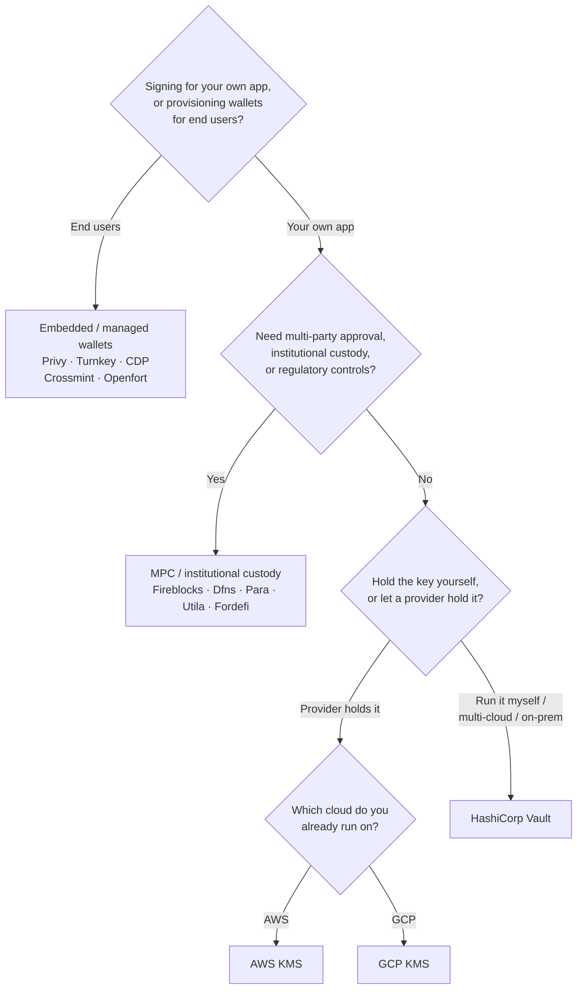

Keychain предоставляет единый базовый интерфейс `SolanaSigner` для всех бэкендов,
поэтому для большинства бэкендов выбор носит операционный, а не архитектурный
характер: его можно изменить позже через конфигурацию. Исключение — форма
транзакции. Crossmint и Fordefi в нативном автоматическом режиме подписывают и
отправляют транзакции на стороне сервера, а Fordefi в нативном ручном режиме
перезаписывает транзакцию перед подписанием, поэтому переход на любой из них или
с него меняет способ вызова подписанта. Именно поэтому **начните с ваших
требований, а не с продукта.** Два вопроса решают большинство задач: _где хранится
приватный ключ и кому разрешено авторизовать подпись с его помощью?_

Все бэкенды, кроме Ledger, доступны на всех четырёх языках (Rust, TypeScript,
Python и Go). Ledger поддерживается только в Rust и подключается опционально
через функцию `ledger`.

Единственного лучшего бэкенда не существует. Каждый из них лучше подходит для
определённого набора ограничений: облако, которое вы уже используете, желание
самостоятельно управлять инфраструктурой ключей, а также требуемые вам средства
контроля хранения и подтверждений. Схема ниже сопоставляет эти ограничения с
бэкендом.

<Callout type="info">
  В этом руководстве рассматривается подпись на стороне бэкенда (сервера). Если
  ваши конечные пользователи подписывают собственные транзакции в браузере,
  используйте кошелёк через Wallet Standard. См. [Подпись в
  продакшене](/docs/core/transactions/signing-in-production).
</Callout>

## Схема принятия решений

<Callout type="info">
  Для локальной разработки и тестов всё это не нужно: используйте бэкенд **Memory**
  для прототипирования, а затем перейдите на один из рабочих бэкендов, указанных
  выше, через конфигурацию.
</Callout>

## Разбор вопросов

<Steps>

<Step>

### Вы подписываете для собственного приложения или для конечных пользователей?

Если вы предоставляете кошельки, которыми владеют и управляют **конечные
пользователи** (потребительские приложения, процессы подключения), используйте
бэкенд **встроенных / управляемых кошельков**: Privy, Turnkey, CDP, Crossmint или
Openfort. Они управляют кошельками и аутентификацией для каждого пользователя от
вашего имени.

Если вы подписываете как **собственное приложение** (плательщик комиссий,
казначейство, автоматизация бэкенда), продолжайте ниже.

</Step>

<Step>

### Нужны ли вам многосторонние подтверждения, институциональное хранение или регуляторный контроль?

Если подписи должны пройти политику подтверждения, лимит расходов или процедуру
комплаенса до их создания, либо вам нужен регулируемый кастодиан, хранящий ключи,
используйте бэкенд **MPC / институционального хранения**: Fireblocks, Dfns, Para,
Utila или Fordefi. Они разделяют ключ или хранят его и выполняют совместную
подпись в соответствии с вашей политикой.

Если вам нужен лишь ключ, который подписывает по запросу, продолжайте ниже.

</Step>

<Step>

### Хотите ли вы хранить ключ самостоятельно или доверить это провайдеру?

Если облачный провайдер должен хранить ключ в аппаратно защищённой
инфраструктуре, а ваша политика IAM определяет, кто может подписывать,
используйте KMS этого облака:

- **Работаете на AWS** → AWS KMS
- **Работаете на GCP** → GCP KMS

Если вы хотите самостоятельно управлять инфраструктурой ключей либо используете
несколько облаков или собственные серверы, выберите **HashiCorp Vault**. Вы
запускаете и аудируете его сами; ключ остаётся внутри движка Transit и подписывает
по запросу.

</Step>

</Steps>

## Модели хранения

Бэкенды делятся на шесть моделей хранения. Схема выше приводит вас к одной из
них.

- **Самостоятельное хранение (в процессе)**: ваше приложение хранит необработанный
  приватный ключ. Удобно для разработки, но непригодно для продакшена. Бэкенд:
  **Memory**.
- **Самостоятельное хранение (аппаратный кошелёк)**: ключ никогда не покидает
  устройство Ledger, а каждую подпись человек подтверждает на его экране. Подходит
  для интерактивной подписи оператором, но не для работающих без присмотра
  сервисов. Только Rust, опционально, аудитом не охвачено. Бэкенд: **Ledger**.
- **Самостоятельное управление ключами**: вы сами управляете инфраструктурой
  ключей; ключ остаётся внутри неё и подписывает по запросу. Бэкенд: **HashiCorp
  Vault**.
- **Облачный KMS / HSM**: облачный провайдер хранит ключ в аппаратно защищённой
  инфраструктуре; ключ никогда не покидает сервис, а ваша политика IAM определяет,
  кто может подписывать. Бэкенды: **AWS KMS**, **GCP KMS**.
- **MPC и институциональное хранение**: ключ разделяется или хранится у
  провайдера, который выполняет совместную подпись в соответствии с вашей
  политикой (подтверждения, лимиты). Бэкенды: **Fireblocks**, **Dfns**, **Para**,
  **Utila**, **Fordefi**.
- **Встроенные и управляемые кошельки**: провайдер управляет кошельками от вашего
  имени, часто для подключения конечных пользователей. Бэкенды: **Privy**,
  **Turnkey**, **CDP**, **Crossmint**, **Openfort**.

## Сравнение бэкендов

| Бэкенд         | Модель хранения                  | Лучше всего подходит для                                     | Примечания                                                                                                              |
| --------------- | ------------------------------ | -------------------------------------------- | ------------------------------------------------------------------------------------------------------------------ |
| Memory          | Самостоятельное хранение (в процессе)      | Локальная разработка, тесты, CI                 | Необработанный ключ в процессе; не используйте в продакшене                                                                       |
| Ledger          | Самостоятельное хранение (аппаратный кошелёк) | Интерактивная подпись оператором из инструментов на Rust | Только Rust, опциональная функция `ledger`, без аудита; каждая подпись подтверждается на устройстве                                 |
| HashiCorp Vault | Самостоятельное управление ключами     | Команды, использующие собственную инфраструктуру ключей   | Transit engine; вы сами управляете и проводите аудит                                                                           |
| AWS KMS         | Облачный KMS / HSM                | Бэкенды, работающие на AWS                      | Ключ никогда не покидает KMS; IAM управляет подписью                                                                         |
| GCP KMS         | Облачный KMS / HSM                | Бэкенды, работающие на GCP                      | Ключ никогда не покидает KMS; IAM управляет подписью                                                                         |
| Fireblocks      | MPC / институциональное хранение    | Казначейства, биржи, регулируемое хранение     | Движок политик и процессы согласования                                                                               |
| Dfns            | MPC-инфраструктура кошельков      | Программные кошельки с контролем политик    | Подпись Ed25519                                                                                                    |
| Para            | MPC-кошельки                    | Приложения с кошельками на базе MPC            | API-ключ + ID кошелька                                                                                                |
| Utila           | MPC-хранение + со-подписант        | Существующие кошельки Solana под управлением Utila        | `signMessage` не поддерживается; транзакцию транслируете вы                                                                    |
| Fordefi         | MPC / институциональное хранение    | Институциональное хранение ключей с управлением политиками   | Чёрный ящик: отправляете вы. Нативный авто: Fordefi перезаписывает и отправляет. Нативный ручной: Fordefi перезаписывает, результат отправляете вы |
| Privy           | Встроенные кошельки               | Потребительские приложения для подключения пользователей к кошелькам    | Встроенные кошельки под управлением приложения                                                                                       |
| Turnkey         | Некастодиальное управление ключами   | Программная подпись с контролем политик           | Некастодиальное управление ключами                                                                                       |
| CDP             | Управляемый кошелёк (Coinbase)      | Приложения на платформе Coinbase Developer Platform      | `signMessage` принимает только UTF-8                                                                          |
| Crossmint       | Управляемые кошельки                | Маркетплейсы и приложения с управляемыми кошельками         | Только отправка: транслирует на стороне сервера, может перезаписывать для спонсирования газа; `signMessage` не поддерживается                   |
| Openfort        | Встроенные бэкенд-кошельки       | Серверные кошельки                          | Ключи хранятся в TEE                                                                                                    |

## Форма возможностей

Помимо способа хранения, у каждого бэкенда есть одна форма транзакции, и она
определяет, как вы вызываете подписанта:

- **Подпись**: провайдер подписывает байты, которые вы собрали, а отправляете их
  вы. Большинство бэкендов, включая Ledger и Fordefi в режиме чёрного ящика.
- **Перезапись и подпись**: провайдер перезаписывает транзакцию, а затем подписывает
  её без отправки. Дальше работайте с возвращённой транзакцией. Fordefi в
  нативном ручном режиме.
- **Подпись и отправка**: провайдер подписывает и отправляет транзакцию на стороне
  сервера, поэтому сбой не означает, что ничего не было записано в сеть. Crossmint
  и Fordefi в нативном автоматическом режиме.

Таблица возможностей подписантов в README каждого языка описывает форму каждого
бэкенда; [модель безопасности](https://github.com/solana-foundation/solana-keychain/blob/main/docs/SECURITY_MODEL.md)
объясняет, что гарантирует каждая форма.

## Корпоративные сценарии

Одному приложению часто требуется сразу несколько таких вариантов. Поскольку
интерфейс общий, вы можете использовать разные бэкенды для разных ролей без
изменения мест вызова, если бэкенды имеют одинаковую форму возможностей.

- **Операции с казначейством** — разделите операционный «горячий» подписант и
  «холодный» казначейский. Подкрепите казначейство MPC-хранилищем или облачным
  HSM и требуйте политики подтверждения перед подписанием крупных транзакций.
- **Рабочие процессы согласования** — бэкенды MPC и хранилища (например,
  Fireblocks) обеспечивают многостороннее согласование перед формированием
  подписи.
- **Соответствие требованиям и аудит** — облачные KMS (AWS/GCP) и Vault ведут
  журналы аудита подписания; институциональные кастодианы добавляют применение
  политик и отчётность.
- **Регулируемые среды** — храните ключевой материал в HSM, KMS или у
  институционального кастодиана, чтобы исходные ключи никогда не попадали в ваше
  приложение.

Ознакомьтесь с
[рекомендациями для production-среды](/docs/tools/keychain/production-best-practices)
по безопасной эксплуатации этих бэкендов.

<Cards>
  <Card title="Руководство по Rust" href="/docs/tools/keychain/getting-started/rust">
    Настройка каждого бэкенда на Rust.
  </Card>
  <Card
    title="Руководство по TypeScript"
    href="/docs/tools/keychain/getting-started/typescript"
  >
    Настройка каждого бэкенда на TypeScript.
  </Card>
</Cards>
