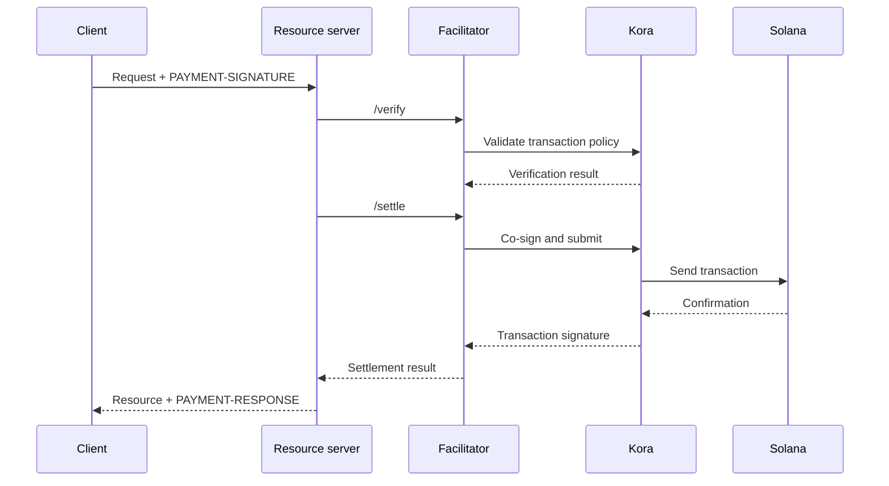

Фасилитатор x402 выполняет проверку платежей и расчёты для одного или нескольких
серверов ресурсов. Он позволяет API принимать ончейн-платежи, не встраивая логику RPC,
отправки транзакций и плательщика комиссий в каждый процесс приложения.

Фасилитатор — это архитектурная роль, а не обязательная сторонняя служба. Вы можете использовать
управляемый сервис, запустить отдельный фасилитатор или выполнять функции фасилитатора
непосредственно внутри своего сервера ресурсов.

## Интерфейс фасилитатора

x402 V2 определяет три HTTP-операции:

| Эндпоинт     | Назначение                                                                       |
| ------------ | ----------------------------------------------------------------------------- |
| `/supported` | Перечисляет поддерживаемые версии протокола, схемы, сети, расширения и подписантов |
| `/verify`    | Проверяет полезную нагрузку платежа на соответствие требованиям без проведения расчёта         |
| `/settle`    | Отправляет или завершает платёж и возвращает результат расчёта            |

Ваш сервер ресурсов должен проверять `/supported` при запуске или развёртывании. Не
предлагайте вариант оплаты, пока выбранный фасилитатор не подтвердит поддержку
именно этой версии x402, схемы и сети Solana.

```bash
curl https://facilitator.example/supported
```

## Проверка перед выполнением запроса

Безопасный порядок обработки запроса:

1. Разберите полезную нагрузку `PAYMENT-SIGNATURE` с помощью библиотеки протокола.
2. Сопоставьте её с точными `PaymentRequirements`, которые были предложены изначально.
3. Проверьте полезную нагрузку локально или через `/verify`.
4. Выполняйте операцию над ресурсом, только если выбранный платёжный процесс допускает
   расчёт после выполнения.
5. Вызовите `/settle` и верните `PAYMENT-RESPONSE` с результатом.

Разные схемы могут определять разный порядок выполнения. Например, процесс
с авторизацией может проверять платёж до операции над ресурсом и проводить расчёт после неё,
тогда как другая схема может требовать расчёта до выполнения. Следуйте процессу,
объявленному выбранной схемой, а не предполагайте один и тот же порядок для каждого
платежа.

<Callout type="warn" title="Относитесь к ответам фасилитатора как к платёжным решениям">
  Аутентифицируйте трафик фасилитатора, проверяйте каждый ответ, используйте строгие
  тайм-ауты и отказывайте по умолчанию. Сетевая ошибка или некорректный ответ не являются
  доказательством оплаты.
</Callout>

## Выберите модель развёртывания

| Модель                   | Когда использовать                                                        | Основная ответственность                                                    |
| ----------------------- | --------------------------------------------------------------- | ---------------------------------------------------------------------- |
| Управляемый фасилитатор     | Вам нужна минимальная операционная нагрузка                       | Проверьте поддерживаемые сети, модель доверия, доступность и политику обработки данных  |
| Выделенный собственный хостинг   | Несколько API используют общую инфраструктуру подписи и расчётов        | Защита ключей, RPC, хранилища, масштабирование и обновления                      |
| Фасилитация внутри процесса | Одному сервису нужен полный контроль, и он может обслуживать компоненты работы с блокчейном | Изолируйте платёжный код и не допускайте его исчерпания нагрузкой от запросов |

Не выбирайте фасилитатор только потому, что его URL отвечает на `/supported`.
Проверьте, как он защищает ключи плательщика комиссий, предотвращает повторное воспроизведение,
подтверждает транзакции, обрабатывает частичные сбои и сообщает об инцидентах.

## Kora как инфраструктура подписи Solana

[Kora](/docs/tools/kora) — это узел-подписант Solana с политиками проверки транзакций и
спонсирования комиссий. Фасилитатор x402 может использовать Kora в качестве бэкенда
для подписи и отправки транзакций:



Kora не заменяет x402. Сервер ресурсов и фасилитатор по-прежнему реализуют
объекты и эндпоинты x402 V2; Kora обеспечивает соблюдение политики транзакций Solana и
защищает подписанта плательщика комиссий за своим RPC-интерфейсом.

Следуйте [руководству Kora по x402](/docs/tools/kora/guides/x402), чтобы получить поддерживаемые
демо и конфигурацию.

## Чек-лист для продакшена

### Ключи и политика транзакций

- Храните ключи фасилитатора и плательщика комиссий в аппаратном или удалённом
  бэкенде подписи.
- Добавляйте в список разрешённых только программы System, Compute Budget, Token, Token-2022 и Associated Token,
  и только в той мере, в какой это требуется поддерживаемой схеме.
- Перед подписанием отклоняйте неожиданные аккаунты с правом записи, authority переводов, получателей, mint-адреса,
  инструкции и цены вычислений.
- Храните аккаунты для приёма платежей отдельно от операционных аккаунтов плательщика комиссий.

### Повторное воспроизведение и идемпотентность

- Сохраняйте использованные идентификаторы платежей и подписи транзакций в общем
  долговременном хранилище.
- Делайте проверку и использование атомарными, чтобы два экземпляра сервера не могли принять
  одну и ту же авторизацию одновременно.
- Требуйте ключ идемпотентности для операций над ресурсами с побочными эффектами.
- При законном повторе запроса возвращайте исходный результат вместо повторного списания.

### Доступность и обработка сбоев

- Задавайте ограниченные тайм-ауты для `/verify`, `/settle`, отправки через RPC и
  подтверждения.
- Различайте отклонённые, истёкшие, ожидающие, подтверждённые и неудавшиеся расчёты.
- Не пересобирайте и не подписывайте транзакцию повторно после истечения blockhash, не попросив
  плательщика авторизовать новую транзакцию.
- Используйте более одного RPC-эндпоинта и отслеживайте актуальность blockhash, задержку
  подтверждения и баланс плательщика комиссий.

### Наблюдаемость

Записывайте ресурс, идентификатор вызова, выбранную схему и сеть, сумму, актив,
получателя, адрес плательщика, подпись транзакции, уровень подтверждения, задержку
и итоговый статус. Никогда не логируйте закодированные платёжные учётные данные, bearer-токены, приватные
ключи или необработанные ответы подписанта.

Настройте оповещения о сбоях расчётов, попытках повторного воспроизведения, отказах по политике, неожиданных
активах или получателях, истощении средств плательщика комиссий и расхождениях между проверенными
платежами и предоставленными ресурсами.

## Связанные ресурсы

- [Спецификация фасилитатора x402](https://github.com/x402-foundation/x402/blob/main/specs/x402-specification-v2.md#7-facilitator-interface)
- [x402 в Solana](/docs/payments/agentic-payments/x402)
- [Руководство оператора Kora](/docs/tools/kora/operators)
- [Готовность к продакшену](/docs/tools/transaction-landing#rpc-infrastructure)
