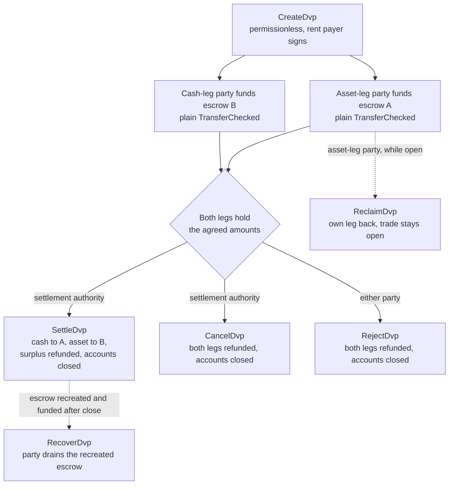
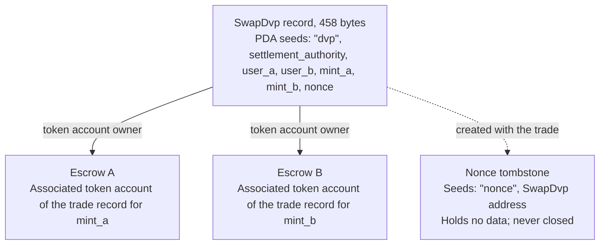

DvP programı, Solana'da teslimat karşılığı ödeme (delivery versus payment) için standart programdır;
Solana Foundation tarafından sürdürülür ve Cantina tarafından denetlenmiştir. İki taraf
bir alım satım üzerinde anlaşır, her biri kendi bacağını sıradan bir token
transferiyle bir escrow hesabına gönderir ve bir takas yetkilisi her iki bacağı tek bir işlemde
takas eder; böylece ya ikisi de gerçekleşir ya da hiçbiri. Takas yetkilisi, alım satımda
belirtilen üçüncü bir adrestir; örneğin alım satımı ayarlayan platform ya da aracı. Taraflardan hiçbiri
program yazmaz veya dağıtmaz; standart bir
token transferi (`TransferChecked`) gönderebilen bir cüzdan ya da saklayıcı kuruluş, DvP'ye özel bir entegrasyon olmadan bir bacağı fonlayabilir. Takasa kadar her iki taraf da kendi bacağını geri alabilir veya
alım satımı geri sarabilir.

<Callout type="warn" title="Harekete geçmeden önce kaydı okuyun">

Alım satım kaydı oluşturmak izin gerektirmez, dolayısıyla bir kayıt anlaşmanın kanıtı değildir. Her taraf fonlamadan önce saklanan koşulları, takas
yetkilisi ise takas etmeden önce bunları okumalıdır (bkz.
[doğrulama](#verification-before-funding-and-settlement)).

</Callout>

## Nasıl çalışır

Her alım satım için programa ait bir kayıt ve bacak başına bir tane olmak üzere iki escrow hesabı oluşturulur.
Varlık bacağı tarafı (`user_a`) ve nakit bacağı tarafı (`user_b`), ilgili bacağın
escrow hesabına token aktararak bacağını fonlar. Takas
yetkilisi, takas edebilen tek imzacıdır. Takas, her bacağın üzerinde anlaşılan
tutarını karşı tarafa aktarır, fazlalığı bacağın sahibi olan tarafa iade eder
ve kaydı ile her iki escrow hesabını kapatır. Atomiklik Solana
[işlemlerinden](/docs/core/transactions) gelir: her iki transfer de tek bir işlemde yer alır,
dolayısıyla ya ikisi de geçerli olur ya da hiçbiri.

Her iade, geri alma ve fazlalık iadesi tarafın kendi associated
token account hesabına gider: `user_a` için `mint_a` hesabı, `user_b` için `mint_b` hesabı. Bir
saklayıcı kuruluş veya hazine sistemi bir bacağı kendi hesabından fonlayabilir, ancak
iade edilen her şey tarafın hesabına gider, saklayıcıya geri dönmez. Her alım satım
ayrıca kalıcı bir işaretleyici hesap bırakır (bkz. [Durum](#state)).

## Rehberler

Adım sayfaları, bir alım satımı oluşturmadan takasa kadar götürür; her talimat için TypeScript ve
Rust örnekleri bulunur.

<Cards>
  <Card title="Alım satım oluşturun" href="/docs/defi/dvp-program/create-a-trade">
    İstemcileri kurun ve alım satımın koşullarını CreateDvp ile kaydedin
  </Card>
  <Card title="Bacakları fonlayın" href="/docs/defi/dvp-program/fund-the-legs">
    Saklanan koşulları doğrulayın, ardından her bacağı basit bir transferle fonlayın
  </Card>
  <Card title="Alım satımı takas edin" href="/docs/defi/dvp-program/settle-the-trade">
    Takas yetkilisi olarak her iki bacağı tek bir işlemde takas edin
  </Card>
  <Card title="Alım satımı geri sarın" href="/docs/defi/dvp-program/unwind-a-trade">
    Bir bacağı geri alın, alım satımı iptal edin veya reddedin ve geç yapılan para yatırmalarını kurtarın
  </Card>
</Cards>

Bir [devnet demosu](https://solana.com/delivery-vs-payment/demo) bir alım satımı baştan
sona çalıştırır: alım satımı oluşturur, her iki escrow hesabını standart token transferleriyle fonlar ve
her iki bacağı tek bir işlemde takas eder.

## Program ile delegasyon arasında seçim yapma

[Delegasyon kullanarak teslimat karşılığı ödeme (DvP)](/docs/tokenization/dvp), aynı
işlemi program olmadan takas eder: her taraf pozisyonunu bir
takas aracısına devreder ve aracı her iki bacağı tek bir işlemde taşır.

- **Program** delegasyon gerektirmez; bu nedenle token account başına bir delegate sınırı
  geçerli değildir ve takas yetkilisi gelirleri başka bir yöne yönlendiremez.
  Her alım satım, yükseltilebilir bir programa ve onun yükseltme yetkisine bağlıdır.
- **Delegasyon deseni** program bağımlılığı içermez ve Scaled UI Amount
  taşıyan mint'lerle çalışır. Program bu mint'leri reddeder; bu durum Mosaic'in `tokenized-security` şablonundan oluşturulan
  tüm mint'leri dışarıda bırakır (bkz.
  [mint yapılandırma kısıtlamaları](#mint-configuration-constraints)).

## Roller

Program simetriktir. Arayüzünde iki taraf, `mint_a`'yı teslim eden `user_a` ve
`mint_b`'yi teslim eden `user_b`'dir. README ve oluşturulmuş istemciler `mint_a`'ya varlık bacağı,
`mint_b`'ye nakit bacağı der ve bu sayfalar da bu kurala uyar, ancak programda nakit
bacağının bir nakit enstrümanı olmasını gerektiren hiçbir şey yoktur. İki varlık ya da iki stablecoin de
aynı şekilde takas edilir.

| Rol                 | Kim                               | İmzalar                                              | Notlar                                                                                                                                                                                                     |
| -------------------- | --------------------------------- | -------------------------------------------------- | --------------------------------------------------------------------------------------------------------------------------------------------------------------------------------------------------------- |
| Varlık bacağı tarafı      | `mint_a`'yı teslim eden `user_a`       | Kendi fonlama transferi; Reclaim, Reject, Recover | Bir keypair cüzdanı veya multisig kasası gibi PDA tabanlı bir akıllı cüzdan. Bir SPL Token multisig hesabı veya bir program account taraf olamaz: Create, `PartyNotSignerCapable` hatasıyla başarısız olur                   |
| Nakit bacağı tarafı       | `mint_b`'yi teslim eden `user_b`       | Kendi fonlama transferi; Reclaim, Reject, Recover | Aynı gereksinim                                                                                                                                                                                          |
| Takas yetkilisi | Oluşturma sırasında belirtilen üçüncü bir adres | Settle, Cancel                                     | Takas edebilen tek imzacı. Oluşturma sırasında belirlenen gelirleri başka bir yöne yönlendiremez. Takas ettiğinde veya iptal ettiğinde kapatılan hesapların rent'ini alır                                         |
| Rent ödeyen           | `CreateDvp`'yi kim imzalarsa         | Create                                             | Kayıt, nonce mezar taşı ve her iki escrow hesabı için rent'i (bir hesabı açık tutan SOL depozitosu) karşılar. Rent alıcısı olarak kaydedilmez: kapatılan hesapların rent'i alım satımı kapatan kişiye gider |

## Program ID'si

```text
dvp34bdbcEm4f4FCUjGV4mDAkDshaQR4LkK8fdcsyZq
```

| Küme      | Program                                       | Yükseltme yetkisi                              | Son dağıtım slot'u |
| ------------ | --------------------------------------------- | ---------------------------------------------- | ------------------ |
| mainnet-beta | `dvp34bdbcEm4f4FCUjGV4mDAkDshaQR4LkK8fdcsyZq` | `DXtFpbPjcn2hxPnw79x1Pfoj35vXh5AsWBkS37YnXMVv` | 452.058.374        |
| devnet       | `dvp34bdbcEm4f4FCUjGV4mDAkDshaQR4LkK8fdcsyZq` | `5EX1zFeJWj4rGYZv432WnYw8CbaSUeTdxPx4r573UgYU` | 479.376.863        |

Program her iki kümede de yükseltilebilir. Yukarıdaki değerler,
`solana program show` komutunun 2 Ekim 2026'da bildirdiği değerlerdir; güncel değerler için aynı komutu çalıştırın. Devnet derlemesi, adım sayfalarının
yazıldığı commit'ten (bkz. [Kurulum](/docs/defi/dvp-program/create-a-trade#install)) daha eskidir;
talimat ve hata kümesi aynıdır.

## Yaşam döngüsü



Bir alım satım, `CreateDvp` ile açılır ve Settle, Cancel veya Reject'ten biri onu kapatana kadar açık kalır.
Fonlamanın kendine ait bir talimatı yoktur: bir bacak, escrow
hesabında en az üzerinde anlaşılan tutar bulunduğunda fonlanmış sayılır. Reclaim bacak başınadır ve alım satımı
açık bırakır; böylece bir bacakla ilgili sorun, diğer tarafı tüm alım satımı
iptal etmeye zorlamaz.

## Durum

Her alım satımın programa ait, 458 baytlık bir `SwapDvp` hesabı vardır. Adresi; takas yetkilisinden, iki taraftan, iki
mint'ten ve bir nonce'tan türetilir (seed'ler
`["dvp", settlement_authority, user_a, user_b, mint_a, mint_b, nonce]`). Tutarlar
ve zamanlar hesabın içinde saklanır ve adresi etkilemez;
bu yüzden çıkarım yapılmak yerine okunmaları gerekir. `["nonce", swap_dvp]` adresindeki küçük bir işaretleyici hesap olan
nonce mezar taşı, alım satımla birlikte oluşturulur ve
hiçbir zaman kapatılmaz; böylece her taraf, mint, yetkili ve nonce kombinasyonu
yalnızca bir alım satım için kullanılabilir.



| Alan                                  | Tür          | Anlamı                                                                                                 |
| -------------------------------------- | ------------- | ------------------------------------------------------------------------------------------------------- |
| `bump`                                 | `u8`          | PDA bump değeri                                                                                                |
| `user_a`, `user_b`                     | `Pubkey`      | İki taraf                                                                                         |
| `mint_a`, `mint_b`                     | `Pubkey`      | Varlık bacağı ve nakit bacağı mint'leri                                                                        |
| `settlement_authority`                 | `Pubkey`      | Takas edebilen veya iptal edebilen tek imzacı                                                               |
| `token_program_a`, `token_program_b`   | `Pubkey`      | Her mint'in sahibi olan token program; bir alım satımda SPL Token ve Token-2022 bacakları karışık olabilir                    |
| `amount_a`, `amount_b`                 | `u64`         | Her bacak için üzerinde anlaşılan tutar, mint'in en küçük birimi cinsinden (temel birimler)                                 |
| `expiry_timestamp`                     | `i64`         | Bu ağ zamanından (zincir üstü saat) sonra Settle reddedilir. Reclaim, Cancel ve Reject yine çalışır |
| `nonce`                                | `u64`         | Diğer seed'leri paylaşan alım satımları birbirinden ayırır. Tek kullanımlıktır                                             |
| `ref_string`                           | `[u8; 64]`    | Sıfırlarla doldurulmuş, anlamı program tarafından yorumlanmayan bir istemci referansı; program bunu hiçbir zaman okumaz                                     |
| `user_a_settlement_destination`        | `Pubkey`      | Settle sırasında nakit bacağını alır; varsayılan değer `user_a`'dır                                                   |
| `user_b_settlement_destination`        | `Pubkey`      | Settle sırasında varlık bacağını alır; varsayılan değer `user_b`'dir                                                  |
| `mint_a_authority`, `mint_b_authority` | `Pubkey`      | Oluşturma sırasında kaydedilen mint yetkilileri; biri değişmişse Settle başarısız olur                           |
| `earliest_settlement_timestamp`        | `Option<i64>` | Ayarlanmışsa, bu ağ zamanından önce Settle reddedilir                                                     |

Alan listesi, [Alım satım oluşturun](/docs/defi/dvp-program/create-a-trade#install) bölümünde belirtilen commit'teki
program IDL'inden alınmıştır.

## Talimatlar

| Talimat  | İmzacı               | Etki                                                                                                                                                              |
| ------------ | -------------------- | ------------------------------------------------------------------------------------------------------------------------------------------------------------------- |
| `CreateDvp`  | Herhangi bir ödeyen            | `SwapDvp` kaydını, nonce mezar taşını ve her iki escrow hesabını oluşturur. Hiç token taşımaz                                                                        |
| `ReclaimDvp` | `user_a` veya `user_b` | İmzacının kendi bacağını escrow'dan geri verir. Alım satım açık kalır ve bacak yeniden fonlanabilir                                                                      |
| `SettleDvp`  | Takas yetkilisi | `amount_a` tutarını `user_b`'nin hedefine, `amount_b` tutarını `user_a`'nın hedefine aktarır, fazlalığı bacağın tarafına iade eder, kaydı ve her iki escrow hesabını kapatır |
| `CancelDvp`  | Takas yetkilisi | Escrow A'da bulunanı `user_a`'ya, escrow B'de bulunanı `user_b`'ye iade eder, kaydı ve her iki escrow hesabını kapatır                                                            |
| `RejectDvp`  | `user_a` veya `user_b` | Cancel ile aynı etki; bir taraf tarafından imzalanır                                                                                                                            |
| `RecoverDvp` | `user_a` veya `user_b` | Alım satım kapatıldıktan sonra: yeniden oluşturulmuş bir escrow'u imzacının kendi token account hesabına boşaltır ve kapatır. Settle, Cancel veya Reject'ten sonra gelen bir yatırmayı kapsar  |

Her iade, escrow'u kim fonlamış olursa olsun, tarafın o bacağın
mint'i için kendi associated token account hesabına gider.

Her talimatın hesapları ve argümanları, o adımın sayfasında yer alır.

## Hatalar

| Kod | Hata                            | Ne zaman                                                                                                   |
| ---- | -------------------------------- | ------------------------------------------------------------------------------------------------------ |
| 0    | `SignerNotParty`                 | Reclaim, Reject veya Recover işleminin `user_a` ya da `user_b` olmayan bir adres tarafından imzalanması                      |
| 1    | `DvpExpired`                     | `expiry_timestamp` sonrasında Settle                                                                        |
| 2    | `SettlementAuthorityMismatch`    | Settle veya Cancel işleminin takas yetkilisi dışında bir adres tarafından imzalanması                              |
| 3    | `SettlementTooEarly`             | `earliest_settlement_timestamp` öncesinde Settle                                                          |
| 4    | `LegNotFunded`                   | Bir escrow, üzerinde anlaşılan tutardan azını tutarken Settle                                               |
| 5    | `ExpiryNotInFuture`              | Geçerlilik sonu, mevcut ağ zamanına eşit veya öncesinde olacak şekilde Create                                            |
| 6    | `EarliestAfterExpiry`            | En erken takas zamanı geçerlilik sonundan sonra olacak şekilde Create                                               |
| 7    | `SelfDvp`                        | `user_a`, `user_b`'ye eşit olacak şekilde Create                                                                 |
| 8    | `SameMint`                       | `mint_a`, `mint_b`'ye eşit olacak şekilde Create                                                                 |
| 9    | `ZeroAmount`                     | Bacaklardan birinde sıfır tutarla Create                                                                |
| 10   | `BlockedMintExtension`           | TransferFee, InterestBearing, ScaledUiAmount veya NonTransferable taşıyan bir mint ile Create veya Settle |
| 11   | `SettlementAuthorityIsParty`     | Takas yetkilisi bir tarafa eşit olacak şekilde Create                                                  |
| 12   | `SettlementAuthorityExecutable`  | Çalıştırılabilir bir takas yetkilisiyle Create                                                         |
| 13   | `NonceAlreadyUsed`               | Zaten bir mezar taşı bulunan bir `(seeds, nonce)` değerini yeniden kullanan Create                                         |
| 14   | `ExpiryTooFarInFuture`           | Geçerlilik sonu bir yıldan daha ileride olacak şekilde Create                                                         |
| 15   | `RefStringTooLong`               | 64 bayttan uzun bir referansla Create                                                           |
| 16   | `DvpStillOpen`                   | Alım satım hâlâ açıkken Recover; Reclaim kullanın                                                     |
| 17   | `DvpNeverCreated`                | Tombstone'u olmayan seed'lerle Recover çağrısı yapıldığında                                                              |
| 18   | `EscrowPreloadedWithLamports`    | Native olmayan bir escrow, rent-exempt minimum değerin üzerinde lamport tuttuğunda Create çağrısı yapıldığında                           |
| 19   | `SettlementDestinationIsSwapDvp` | Takas hedefi işlem kaydına eşit olacak şekilde Create çağrısı yapıldığında                                         |
| 20   | `SwapDvpPreloadedWithLamports`   | Kayıt adresi rent rezervinin üzerinde lamport tuttuğunda Create çağrısı yapıldığında                                   |
| 21   | `RecipientAtaMismatch`           | Bir alıcı veya iade token account'u artık beklenen cüzdana ve mint'e ait olmadığında                  |
| 22   | `PartyNotSignerCapable`          | Sistem sahipli, çalıştırılabilir olmayan bir hesap olmayan bir taraf ile Create çağrısı yapıldığında                                 |
| 23   | `MintAuthorityChanged`           | Bir bacağın mint authority değeri, oluşturma sırasında kaydedilen değerden farklı olduğunda Settle çağrısı yapıldığında                         |

## Olaylar ve indeksleme

Program zincir üstü (onchain) olay yaymaz. Bir indexer veya mutabakat sistemi, `SwapDvp` hesap durumunu ve iki escrow'un token bakiyelerini okur; bir işlemi zincir dışı siparişiyle eşleştirmek için `ref_string` değerini kullanır. Kayıt takas sırasında kapatıldığından, koşullara sonradan ihtiyaç duyan bir sistem bunları okuduğu anda saklamalı ya da işlemi oluşturan transaction'dan yeniden türetmelidir.

## Desteklenen token'lar

Bir işlem, bir SPL Token bacağını bir Token-2022 bacağıyla eşleştirebilir; her bacak kendi token program'ını taşır. Wrapped SOL bacakları desteklenir.

| Bir bacağın mint'indeki Token-2022 uzantısı                                                     | Program davranışı                                                  |
| ---------------------------------------------------------------------------------------- | ----------------------------------------------------------------- |
| TransferFee, InterestBearing, ScaledUiAmount, NonTransferable                            | Create ve Settle sırasında `BlockedMintExtension` ile reddedilir         |
| PermanentDelegate, Pausable, DefaultAccountState, bir freeze authority, MintCloseAuthority | Kabul edilir; her yetkili escrow'daki token'lar üzerinde işlem yapabilir           |
| ConfidentialTransfer                                                                     | Kabul edilir; o bacaktaki tutarlar herkese açıktır                          |
| TransferHook                                                                             | Desteklenir; bacak başına en fazla 32 ek hesap                        |
| Bir hedef veya iade hesabında MemoTransfer                                          | Kabul edilir; program, transferden önce gerekli memo'yu yayar |

Bir transfer ücreti, alıcı tarafın anlaşılan tutarın altında kalmasına yol açar. Interest Bearing ve Scaled UI Amount ham tutarları değiştirmez, ancak oranları veya çarpanları bir işlem oluşturulduktan sonra takas edilene kadar değişebilir; bu da anlaşılan tutarların nasıl görüntüleneceğini değiştirir. NonTransferable ise her iki bacağı da kilitli bırakır.

Kabul edilen yetkililer, işlemin ömrü boyunca escrow'daki token'ları taşıyabilir, dondurabilir veya durdurabilir (aşağıya bakın). Escrow gizli transferleri alacak şekilde yapılandırılamaz; bu nedenle gizli bir bacakta escrow'daki ve takas edilen tutarlar herkese açıktır.

Hook'lu bir mint için istemci, hook'un ek hesaplarını çözümler ve bunları Settle, Cancel, Reject, Reclaim ve Recover çağrılarına ekler. Bacak başına 32'lik üst sınır, hook programını ve onun doğrulama hesabını da sayar. Hook authority, hook'un hesap listesini bu sınırın ötesine genişletirse, bu bacaktaki her transfer (Reclaim, Cancel, Reject ve Recover dahil) authority bunu geri alana kadar başarısız olur. Her iki bacakta da hook varsa, transaction hesap sınırı bacak başına düşen sınırdan önce devreye girebilir.

Bir hedef veya iade hesabı memo gerektirdiğinde, program transferden önce Memo program'ını çağırır; bu yüzden token'ları escrow'dan çıkaran her instruction bir `memo_program` hesabı alır.

### Mint yapılandırma kısıtları

**Scaled UI Amount.** Solana Foundation'ın ihraç araç seti olan [Mosaic](https://github.com/solana-foundation/mosaic) içindeki `tokenized-security` şablonu her zaman Scaled UI Amount ekler; bu nedenle program, bu şablondan oluşturulan bir mint'i bacak olarak kabul etmez. Bu program için tasarlanan bir mint, bu uzantı olmadan oluşturulabilir (bkz. [Token Extensions](/docs/tokens/extensions)); [delegasyon kullanan DvP](/docs/tokenization/dvp) ise devredilmiş yetki üzerinden takas edilir ve bu kontrolü uygulamaz.

**Varsayılan olarak dondurulmuş mint'ler.** Her işlemin escrow'u, o işlem için yeni oluşturulan bir program-derived address'e ait associated token account'tur. Default Account State değeri frozen olan bir mint'te escrow dondurulmuş olarak oluşturulur ve çözülene kadar içine yapılan fonlama transferi başarısız olur. [Token ACL](/docs/tokenization/token-acl) altında bu, ihraççının veya transfer acentesinin fonlamadan önce işlemin escrow'unu onaylaması anlamına gelir: ya işlem kaydının adresini (escrow'un sahibini) allowlist'e ekleyerek, böylece mint'in Token ACL yapılandırması izinsiz çözmeye (permissionless thaw) olanak tanıyorsa herkesin escrow'u çözebilmesini sağlayarak, ya da freeze authority'nin escrow'u doğrudan çözmesiyle. Dondurulmuş bir escrow ayrıca o bacaktaki Settle, Reclaim, Cancel, Reject ve Recover çağrılarını da engeller; dolayısıyla freeze authority ve hook'lu bir mint'te hook authority, işlemin ömrü boyunca güvenilen bir taraftır. Dondurulmuş escrow yolu burada açıklanmıştır ve devnet kod parçalarında uygulanmaz.

## Sınırlar

- Eşleştirme, fiyat keşfi veya emir defteri yoktur. Taraflar koşulları defter dışında kararlaştırır ve içlerinden biri bunları kaydeder.
- Netleştirme yoktur ve yalnızca ikili işlem desteklenir: bir kayıt, iki taraf arasındaki tek bir işlemdir.
- Kısmi dolum yoktur. Settle, her bacağın tam olarak anlaşılan tutarını taşır ve fazlalığı bacağın tarafına iade eder.
- Defter dışı bacak yoktur. Her iki bacak da Solana üzerindeki token account'lardır; mevcut altyapılar üzerindeki bir nakit bacağı ayrıca takas edilir ve mutabakata bağlanır.
- Uygunluk kontrolü, allowlist veya KYC yoktur. Hamil uygunluğunu mint'in kendi kontrolleri sağlar.
- Otomatik takas yoktur. Takas yetkilisinin imzalaması gerekir.
- Olay yoktur; transaction ücretleri ve rent dışında protokol ücreti de yoktur.

Program, iki taraf arasındaki ana para riskini ortadan kaldırır: her ikisi de hareket etmedikçe hiçbir bacak hareket etmez. Ancak her iki token üzerindeki ihraççı kredi veya itfa riskini, bir mint'in freeze, pause veya permanent delegate yetkisinin escrow'daki token'lar üzerinde işlem yapabilme olasılığını (bkz. [desteklenen token'lar](#supported-tokens)) ve takas yetkilisinin imzalamak için hazır bulunmasına olan bağımlılığı ortadan kaldırmaz.

## Fonlama ve takas öncesi doğrulama

`CreateDvp` izinsizdir: yalnızca payer imzalar; taraflar ve takas yetkilisi imzalamaz. Bu nedenle herkes, istediği tarafları ve koşulları belirten bir kayıt oluşturabilir. Fonlamadan önce ve takastan önce yeniden, `SwapDvp` hesabını okuyun ve şunları doğrulayın:

1. Hesap DvP programına aittir ve tam olarak 458 bayttır. Programa ait olmayan bir hesap, gerçek bir kayıt gibi çözümlenen baytlarla doldurulabilir.
2. `user_a`, `user_b`, `mint_a`, `mint_b` ve `settlement_authority` anlaşılan işlemle eşleşir.
3. `amount_a`, `amount_b`, `expiry_timestamp` ve `earliest_settlement_timestamp` anlaşılan koşullarla eşleşir.
4. Her iki takas hedefi de anlaşılan adreslerdir. Sahte bir kayıt, gelirleri başka yere yönlendirebilir.

[Bacakları fonlama](/docs/defi/dvp-program/fund-the-legs#verify-the-terms) bölümü, oluşturulan istemcilerin kontrollü okuyucularını listeler ve kontrolü kod üzerinde gösterir.

Settle transaction'ı [`finalized`](/docs/rpc#configuring-state-commitment) seviyesine ulaştığında işlemi takas edilmiş sayın. Bu bir ağ taahhüt seviyesidir; yasal açıdan da takas kesinliği anlamına gelip gelmediği tarafların sözleşmelerine ve geçerli düzenlemelere bağlıdır.

## Sürümleme

`SwapDvp` hesabında sürüm alanı yoktur. Düzeni 458 bayt olarak sabittir (`SwapDvp::LEN`) ve kontrollü okuyucular başka uzunluktaki hesapları reddeder. IDL'in kendi sürümü vardır: 2 Ekim 2026 itibarıyla `0.1.0`.

Program her iki cluster'da da yükseltilebilirdir (bkz. [Program ID](#program-id)). Bir işlem kaydı yalnızca takas edilene, iptal edilene veya reddedilene kadar var olur; bu nedenle bir yükseltmenin açık işlemleri nasıl ele aldığını depodan kontrol edin ve istemcileri dağıtılan sürümün IDL'inden yeniden oluşturun.

## Depo ve denetim

Kaynak kod, IDL, oluşturulan istemciler ve testler MIT lisansı altında [`solana-foundation/dvp`](https://github.com/solana-foundation/dvp) deposundadır. Program, `no_std` bir Pinocchio programıdır; istemciler IDL'den Codama ile oluşturulur. Güvenlik açığı bildirimleri, `SECURITY.md` dosyasında belirtildiği üzere deponun güvenlik danışma bağlantısı üzerinden iletilir.

Program [Cantina](https://cantina.xyz/portfolio/fe870bb4-d96d-4902-8aec-9dfcfa2d6a79) tarafından denetlenmiştir.

## İlgili içerikler

- [Delegasyon kullanan Delivery vs Payment (DvP)](/docs/tokenization/dvp): program olmadan delegasyon deseni
- [Token ACL](/docs/tokenization/token-acl): kapılı bir mint'in escrow hesaplarıyla nasıl etkileşime girdiği
