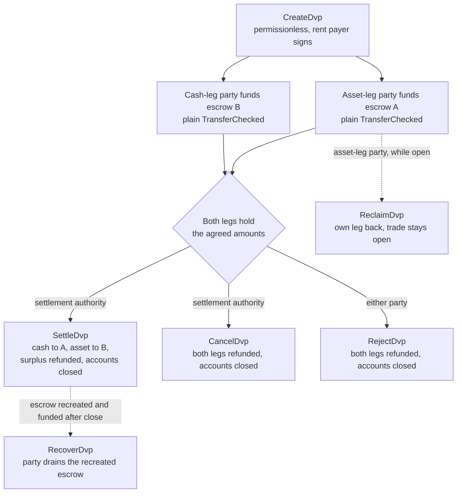
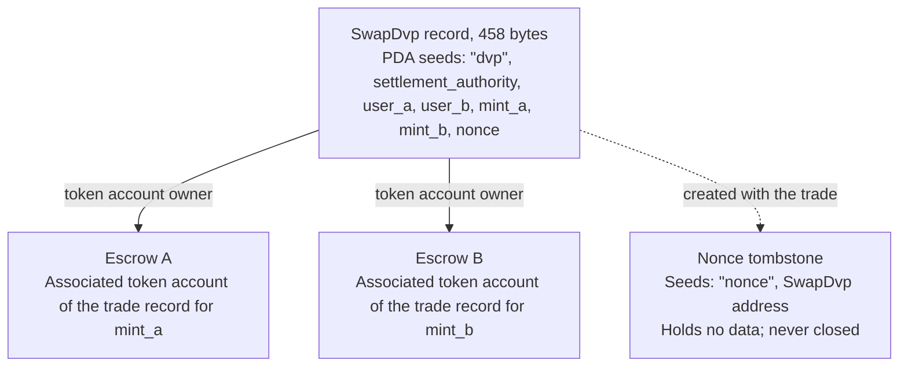

DvP programı, Solana'da teslimat karşılığı ödeme için standart programdır;
Solana Foundation tarafından sürdürülür ve Cantina tarafından denetlenmiştir.
İki taraf bir alım satım üzerinde anlaşır, her biri kendi bacağını sıradan bir
token transferiyle bir escrow hesabına gönderir ve bir takas yetkilisi her iki
bacağı tek bir işlemde takas eder; böylece ya ikisi birden gerçekleşir ya da
hiçbiri. Takas yetkilisi, alım satımda adı geçen üçüncü bir adrestir; örneğin
alım satımı ayarlayan platform veya aracı. Taraflardan hiçbiri program yazmaz
veya dağıtmaz; standart bir token transferi (`TransferChecked`) gönderebilen bir
cüzdan veya saklayıcı, DvP'ye özgü herhangi bir entegrasyon olmadan bir bacağı
fonlayabilir. Takas gerçekleşene kadar her iki taraf da kendi bacağını geri
alabilir veya alım satımı sonlandırabilir.

<Callout type="warn" title="İşlem yapmadan önce kaydı okuyun">

Alım satım kaydı oluşturmak izin gerektirmez; dolayısıyla bir kayıt,
anlaşmanın kanıtı değildir. Her taraf fonlamadan önce, takas yetkilisi ise takas
etmeden önce saklanan koşulları okur (bkz.
[doğrulama](#verification-before-funding-and-settlement)).

</Callout>

## Nasıl çalışır

Her alım satım için programa ait bir kayıt ve her bacak için birer tane olmak
üzere iki escrow hesabı oluşturulur. Varlık bacağı tarafı (`user_a`) ve nakit
bacağı tarafı (`user_b`), token'ları ilgili bacağın escrow hesabına aktararak
kendi bacağını fonlar. Takas edebilecek tek imzalayan takas yetkilisidir. Takas,
her bacağın üzerinde anlaşılan miktarını karşı tarafa aktarır, fazla tutarı
bacağın sahibi olan tarafa iade eder ve kaydı ile her iki escrow hesabını
kapatır. Atomiklik Solana [işlemlerinden](/docs/core/transactions) gelir: her iki transfer de
tek bir işlemde yer alır, dolayısıyla ya ikisi birden geçerli olur ya da
hiçbiri.

Her iade, geri alma ve fazla tutar iadesi tarafın kendi associated token
account'una gider: `mint_a` için `user_a`'nın, `mint_b` için `user_b`'nin
hesabı. Bir saklayıcı veya hazine sistemi bir bacağı kendi hesabından
fonlayabilir, ancak iade edilen her şey saklayıcıya değil tarafın hesabına
geçer. Her alım satım ayrıca kalıcı bir işaretleyici hesap bırakır (bkz.
[Durum](#state)).

## Kılavuzlar

Adım sayfaları, her talimat için TypeScript ve Rust örnekleriyle bir alım
satımı oluşturulmasından takasa kadar ele alır.

<Cards>
  <Card title="Alım satım oluştur" href="/docs/defi/dvp-program/create-a-trade">
    İstemcileri kurun ve alım satımın koşullarını CreateDvp ile kaydedin
  </Card>
  <Card title="Bacakları fonla" href="/docs/defi/dvp-program/fund-the-legs">
    Saklanan koşulları doğrulayın, ardından her bacağı düz bir transferle fonlayın
  </Card>
  <Card title="Alım satımı takas et" href="/docs/defi/dvp-program/settle-the-trade">
    Takas yetkilisi olarak her iki bacağı tek bir işlemde takas edin
  </Card>
  <Card title="Alım satımı geri al" href="/docs/defi/dvp-program/unwind-a-trade">
    Bir bacağı geri alın, alım satımı iptal edin veya reddedin ve geç yatırılan tutarları kurtarın
  </Card>
</Cards>

Bir [devnet demosu](https://solana.com/delivery-vs-payment/demo) alım satımı baştan sona çalıştırır: alım satımı
oluşturur, her iki escrow'u standart token transferleriyle fonlar ve her iki
bacağı tek bir işlemde takas eder.

## Program ile delegasyon arasında seçim yapma

[Delegasyon kullanan Teslimat karşılığı ödeme (DvP)](/docs/tokenization/dvp), aynı değişimi
program olmadan gerçekleştirir: her taraf pozisyonunu bir takas aracısına devreder
ve aracı her iki bacağı tek bir işlemde hareket ettirir.

- **Program** delegasyon gerektirmez; dolayısıyla token account başına tek delegate
  sınırı geçerli olmaz ve takas yetkilisi gelirleri başka yere yönlendiremez.
  Her alım satım, yükseltilebilir bir programa ve onun yükseltme yetkisine bağlıdır.
- **Delegasyon deseni** program bağımlılığı içermez ve Scaled UI Amount taşıyan
  mint'lerle çalışır. Program bu mint'leri reddeder; bu da Mosaic'in
  `tokenized-security` şablonundan oluşturulan tüm mint'leri dışarıda bırakır (bkz.
  [mint yapılandırma kısıtlamaları](#mint-configuration-constraints)).

## Roller

Program simetriktir. Arayüzünde iki taraf, `mint_a`'yı teslim eden `user_a` ve
`mint_b`'yi teslim eden `user_b`'dir. README ve oluşturulan istemciler `mint_a`'ya
varlık bacağı, `mint_b`'ye nakit bacağı der; bu sayfalar da bu kuralı izler,
ancak programda nakit bacağının bir nakit aracı olmasını gerektiren hiçbir şey
yoktur. İki varlık veya iki stablecoin de aynı şekilde takas edilir.

| Rol                 | Kim                               | İmzalar                                              | Notlar                                                                                                                                                                                                     |
| -------------------- | --------------------------------- | -------------------------------------------------- | --------------------------------------------------------------------------------------------------------------------------------------------------------------------------------------------------------- |
| Varlık bacağı tarafı      | `user_a`, `mint_a`'yı teslim eder       | Kendi fonlama transferi; Reclaim, Reject, Recover | Bir keypair cüzdan veya multisig vault gibi PDA tabanlı bir akıllı cüzdan. Bir SPL Token multisig hesabı veya bir program account taraf olamaz: Create, `PartyNotSignerCapable` ile başarısız olur                   |
| Nakit bacağı tarafı       | `user_b`, `mint_b`'yi teslim eder       | Kendi fonlama transferi; Reclaim, Reject, Recover | Aynı gereksinim                                                                                                                                                                                          |
| Takas yetkilisi | Oluşturma sırasında belirtilen üçüncü bir adres | Settle, Cancel                                     | Takas edebilen tek imzalayan. Oluşturma sırasında sabitlenen gelirleri başka yere yönlendiremez. Takas ettiğinde veya iptal ettiğinde kapatılan hesapların rent'ini alır                                         |
| Rent ödeyen           | `CreateDvp`'yi kim imzalarsa         | Create                                             | Kayıt, nonce tombstone ve her iki escrow için rent'i (bir hesabın açık kalmasını sağlayan SOL depozitosu) fonlar. Rent alıcısı olarak kaydedilmez: kapatılan hesapların rent'i alım satımı kapatana gider |

## Program ID

```text
dvp34bdbcEm4f4FCUjGV4mDAkDshaQR4LkK8fdcsyZq
```

| Cluster      | Program                                       | Yükseltme yetkisi                              | Son dağıtılan slot |
| ------------ | --------------------------------------------- | ---------------------------------------------- | ------------------ |
| mainnet-beta | `dvp34bdbcEm4f4FCUjGV4mDAkDshaQR4LkK8fdcsyZq` | `DXtFpbPjcn2hxPnw79x1Pfoj35vXh5AsWBkS37YnXMVv` | 452,058,374        |
| devnet       | `dvp34bdbcEm4f4FCUjGV4mDAkDshaQR4LkK8fdcsyZq` | `5EX1zFeJWj4rGYZv432WnYw8CbaSUeTdxPx4r573UgYU` | 479,376,863        |

Program her iki cluster'da da yükseltilebilir. Yukarıdaki değerler, `solana
program show` komutunun 2 Ekim 2026'da bildirdiği değerlerdir; güncel değerler
için aynı komutu çalıştırın. Devnet derlemesi, adım sayfalarının yazıldığı
commit'ten (bkz. [Kurulum](/docs/defi/dvp-program/create-a-trade#install)) daha eskidir; talimat ve hata kümesi
aynıdır.

## Yaşam döngüsü



Bir alım satım, `CreateDvp` ile açılır ve Settle, Cancel veya Reject'ten biri
onu kapatana kadar açık kalır. Fonlamanın kendine ait bir talimatı yoktur: bir
bacak, escrow hesabı üzerinde anlaşılan miktarın en az tamamını tuttuğunda
fonlanmış olur. Reclaim bacak bazındadır ve alım satımı açık bırakır; böylece bir
bacakla ilgili sorun, diğer tarafı tüm alım satımı iptal etmeye zorlamaz.

## Durum

Her alım satımın, programa ait 458 baytlık tek bir `SwapDvp` hesabı vardır.
Adresi; takas yetkilisinden, iki taraftan, iki mint'ten ve bir nonce'tan türetilir
(`["dvp", settlement_authority, user_a, user_b, mint_a, mint_b, nonce]`
seed'leri). Miktarlar ve zamanlar hesabın içinde saklanır ve adresi etkilemez;
bu yüzden tahmin edilmek yerine okunmaları gerekir. `["nonce", swap_dvp]`
adresindeki küçük bir işaretleyici hesap olan nonce tombstone, alım satımla
birlikte oluşturulur ve asla kapatılmaz; dolayısıyla taraflar, mint'ler, yetkili
ve nonce'un her kombinasyonu yalnızca bir alım satım için kullanılabilir.



| Alan                                  | Tür          | Anlam                                                                                                 |
| -------------------------------------- | ------------- | ------------------------------------------------------------------------------------------------------- |
| `bump`                                 | `u8`          | PDA bump                                                                                                |
| `user_a`, `user_b`                     | `Pubkey`      | İki taraf                                                                                         |
| `mint_a`, `mint_b`                     | `Pubkey`      | Varlık bacağı ve nakit bacağı mint'leri                                                                        |
| `settlement_authority`                 | `Pubkey`      | Takas veya iptal edebilen tek imzalayan                                                               |
| `token_program_a`, `token_program_b`   | `Pubkey`      | Her mint'in sahibi olan Token Program; bir alım satım SPL Token ve Token-2022 bacaklarını karıştırabilir                    |
| `amount_a`, `amount_b`                 | `u64`         | Her bacağın üzerinde anlaşılan miktarı, mint'in en küçük biriminde (base units)                                 |
| `expiry_timestamp`                     | `i64`         | Bu ağ zamanından (zincir üstü saat) sonra Settle reddedilir. Reclaim, Cancel ve Reject yine çalışır |
| `nonce`                                | `u64`         | Diğer seed'leri paylaşan alım satımları birbirinden ayırır. Tek kullanımlık                                             |
| `ref_string`                           | `[u8; 64]`    | Opak bir istemci referansı, sıfırla doldurulmuş; program bunu hiçbir zaman okumaz                                     |
| `user_a_settlement_destination`        | `Pubkey`      | Settle sırasında nakit bacağını alır; varsayılan olarak `user_a`                                                   |
| `user_b_settlement_destination`        | `Pubkey`      | Settle sırasında varlık bacağını alır; varsayılan olarak `user_b`                                                  |
| `mint_a_authority`, `mint_b_authority` | `Pubkey`      | Oluşturma sırasında kaydedilen mint yetkilileri; biri değişmişse Settle başarısız olur                           |
| `earliest_settlement_timestamp`        | `Option<i64>` | Ayarlanmışsa, bu ağ zamanından önce Settle reddedilir                                                     |

Alan listesi, [Alım satım oluştur](/docs/defi/dvp-program/create-a-trade#install) bölümünde belirtilen commit'teki
programın IDL'sinden alınmıştır.

## Talimatlar

| Talimat  | İmzalayan               | Etki                                                                                                                                                              |
| ------------ | -------------------- | ------------------------------------------------------------------------------------------------------------------------------------------------------------------- |
| `CreateDvp`  | Herhangi bir ödeyen            | `SwapDvp` kaydını, nonce tombstone'unu ve her iki escrow hesabını oluşturur. Hiç token taşımaz                                                                        |
| `ReclaimDvp` | `user_a` veya `user_b` | İmzalayanın kendi bacağını escrow'dan iade eder. Alım satım açık kalır ve bacak yeniden fonlanabilir                                                                      |
| `SettleDvp`  | Takas yetkilisi | `amount_a`'yı `user_b`'nin hedefine ve `amount_b`'yi `user_a`'nın hedefine aktarır, fazla tutarı bacağın tarafına iade eder, kaydı ve her iki escrow'u kapatır |
| `CancelDvp`  | Takas yetkilisi | Escrow A'da ne varsa `user_a`'ya, escrow B'dekini `user_b`'ye iade eder, kaydı ve her iki escrow'u kapatır                                                            |
| `RejectDvp`  | `user_a` veya `user_b` | Cancel ile aynı etki, bir taraf tarafından imzalanır                                                                                                                            |
| `RecoverDvp` | `user_a` veya `user_b` | Alım satım kapatıldıktan sonra: yeniden oluşturulmuş bir escrow'u imzalayanın kendi token account'una boşaltır ve kapatır. Settle, Cancel veya Reject'ten sonra gelen bir yatırmayı kapsar  |

Escrow'u kim fonlamış olursa olsun, her iade, tarafın ilgili bacağın mint'i için
kendi associated token account'una gider.

Her talimatın hesapları ve argümanları, o adımın sayfasında yer alır.

## Hatalar

| Kod | Hata                            | Ne zaman                                                                                                   |
| ---- | -------------------------------- | ------------------------------------------------------------------------------------------------------ |
| 0    | `SignerNotParty`                 | `user_a` veya `user_b` olmayan bir adres tarafından imzalanan Reclaim, Reject veya Recover                      |
| 1    | `DvpExpired`                     | `expiry_timestamp` sonrasında Settle                                                                        |
| 2    | `SettlementAuthorityMismatch`    | Takas yetkilisi dışındaki bir adres tarafından imzalanan Settle veya Cancel                              |
| 3    | `SettlementTooEarly`             | `earliest_settlement_timestamp` öncesinde Settle                                                          |
| 4    | `LegNotFunded`                   | Bir escrow, üzerinde anlaşılan miktardan azını tutarken Settle                                               |
| 5    | `ExpiryNotInFuture`              | Geçerli ağ zamanında veya öncesinde bir son kullanma süresiyle Create                                            |
| 6    | `EarliestAfterExpiry`            | En erken takas zamanı son kullanma süresinden sonra olacak şekilde Create                                               |
| 7    | `SelfDvp`                        | `user_a`, `user_b`'ye eşit olacak şekilde Create                                                                 |
| 8    | `SameMint`                       | `mint_a`, `mint_b`'ye eşit olacak şekilde Create                                                                 |
| 9    | `ZeroAmount`                     | Herhangi bir bacağın miktarı sıfır olacak şekilde Create                                                                |
| 10   | `BlockedMintExtension`           | TransferFee, InterestBearing, ScaledUiAmount veya NonTransferable taşıyan bir mint ile Create veya Settle |
| 11   | `SettlementAuthorityIsParty`     | Takas yetkilisi bir tarafa eşit olacak şekilde Create                                                  |
| 12   | `SettlementAuthorityExecutable`  | Yürütülebilir (executable) bir takas yetkilisiyle Create                                                         |
| 13   | `NonceAlreadyUsed`               | Zaten bir tombstone'u bulunan bir `(seeds, nonce)` değerini yeniden kullanan Create                                         |
| 14   | `ExpiryTooFarInFuture`           | Bir yıldan daha ileri bir son kullanma süresiyle Create                                                         |
| 15   | `RefStringTooLong`               | 64 bayttan uzun bir referansla Create                                                           |
| 16   | `DvpStillOpen`                   | Alım satım hâlâ açıkken Recover; Reclaim kullanın                                                     |
| 17   | `DvpNeverCreated`                | Recover, tombstone kaydı bulunmayan seed'lerle çağrıldığında                                                              |
| 18   | `EscrowPreloadedWithLamports`    | Create, yerel olmayan bir escrow rent muafiyeti için gereken minimum tutarın üzerinde lamport tuttuğunda                           |
| 19   | `SettlementDestinationIsSwapDvp` | Create, takas hedefi alım satım kaydına eşit olacak şekilde çağrıldığında                                         |
| 20   | `SwapDvpPreloadedWithLamports`   | Create, kayıt adresi rent rezervinin üzerinde lamport tuttuğunda                                   |
| 21   | `RecipientAtaMismatch`           | Bir alıcı veya iade token account'u artık beklenen cüzdana ve mint'e ait değil                  |
| 22   | `PartyNotSignerCapable`          | Create, sisteme ait ve çalıştırılabilir olmayan bir hesap olmayan bir tarafla çağrıldığında                                 |
| 23   | `MintAuthorityChanged`           | Settle, bir bacağın mint authority'si oluşturma sırasında kaydedilen değerden farklı olduğunda                         |

## Olaylar ve indeksleme

Program zincir üzerinde hiçbir olay yaymaz. Bir indexer veya mutabakat sistemi
`SwapDvp` hesap durumunu ve iki escrow'un token bakiyelerini okur; bir alım
satımı zincir dışındaki siparişiyle eşleştirmek için `ref_string` kullanır.
Kayıt takas sırasında kapatıldığı için, şartlara sonradan ihtiyaç duyan bir
sistem bunları okurken saklar ya da alım satımı oluşturan işlemden yeniden
oluşturur.

## Desteklenen token'lar

Bir alım satım, bir SPL Token bacağını bir Token-2022 bacağıyla eşleştirebilir;
her bacak kendi token program'ını taşır. Wrapped SOL bacakları desteklenir.

| Bir bacağın mint'indeki Token-2022 uzantısı                                                     | Program davranışı                                                  |
| ---------------------------------------------------------------------------------------- | ----------------------------------------------------------------- |
| TransferFee, InterestBearing, ScaledUiAmount, NonTransferable                            | Create ve Settle sırasında `BlockedMintExtension` ile reddedilir         |
| PermanentDelegate, Pausable, DefaultAccountState, bir freeze authority, MintCloseAuthority | Kabul edilir; her yetkili, escrow'daki token'lar üzerinde işlem yapabilir           |
| ConfidentialTransfer                                                                     | Kabul edilir; bu bacaktaki tutarlar herkese açıktır                          |
| TransferHook                                                                             | Desteklenir, bacak başına en fazla 32 ek hesap                        |
| Bir hedef veya iade hesabında MemoTransfer                                          | Kabul edilir; program, transferden önce gerekli memo'yu ekler |

Bir transfer ücreti, alıcı tarafı kararlaştırılan tutarın altında bırakır.
Interest Bearing ve Scaled UI Amount ham tutarları değiştirmez, ancak oranları
veya çarpanları bir alım satımın oluşturulması ile takas edilmesi arasında
değişebilir; bu da kararlaştırılan tutarların nasıl görüntülendiğini değiştirir.
NonTransferable her iki bacağı da sıkışıp kalmış halde bırakır.

Kabul edilen yetkililer, alım satımın ömrü boyunca escrow'daki token'ları
taşıyabilir, dondurabilir veya durdurabilir (aşağıya bakın). Escrow gizli
transferleri alacak şekilde yapılandırılamaz; bu nedenle gizli bir bacaktaki
escrow'a alınan ve takas edilen tutarlar herkese açıktır.

Hook'lu bir mint için istemci, hook'un ek hesaplarını çözümler ve bunları
Settle, Cancel, Reject, Reclaim ve Recover'a ekler. Bacak başına 32 sınırı,
hook programını ve doğrulama hesabını da sayar. Hook yetkilisi hook'un hesap
listesini bu sınırın ötesine genişletirse, o bacaktaki Reclaim, Cancel, Reject
ve Recover dahil her transfer, yetkili bunu geri alana kadar başarısız olur.
Her iki bacakta da hook varsa, işlem hesap sınırı bacak başına sınırdan önce
devreye girebilir.

Bir hedef veya iade hesabı memo gerektirdiğinde, program transferden önce Memo
programını çağırır; bu nedenle token'ları escrow'dan çıkaran her talimat bir
`memo_program` hesabı alır.

### Mint yapılandırma kısıtları

**Scaled UI Amount.** Solana Foundation'ın ihraç araç seti olan
[Mosaic](https://github.com/solana-foundation/mosaic)'teki `tokenized-security` şablonu her zaman Scaled UI Amount
ekler; bu nedenle program, bu şablondan oluşturulan bir mint'i bacak olarak
kabul etmez. Bu program için tasarlanan bir mint uzantı olmadan oluşturulabilir
(bkz. [Token Extensions](/docs/tokens/extensions)); [delegasyon kullanan DvP](/docs/tokenization/dvp) devredilen
yetki üzerinden takas eder ve bu kontrolü uygulamaz.

**Varsayılan olarak dondurulmuş mint'ler.** Her alım satımın escrow'u, o alım
satım için yeni oluşturulan bir program-derived address'in sahip olduğu bir
associated token account'tur. Default Account State değeri frozen olan bir
mint'te escrow dondurulmuş olarak oluşturulur ve çözülene kadar buna yapılan
fonlama transferi başarısız olur. [Token ACL](/docs/tokenization/token-acl) kapsamında bu, ihraççının
veya transfer acentesinin fonlamadan önce alım satımın escrow'unu kabul etmesi
demektir: ya alım satım kaydının adresini (escrow'un sahibi) izin listesine
ekleyerek (mint'in Token ACL yapılandırması izinsiz çözmeyi etkinleştiriyorsa
herkes escrow'u çözebilir), ya da dondurma yetkilisinin escrow'u doğrudan
çözmesiyle. Dondurulmuş bir escrow ayrıca o bacaktaki Settle, Reclaim, Cancel,
Reject ve Recover işlemlerini de engeller; bu nedenle dondurma yetkilisi ve
hook'lu bir mint'te hook yetkilisi, alım satımın ömrü boyunca güvenilen bir
taraftır. Dondurulmuş escrow yolu burada açıklanmıştır ve devnet kod
örneklerinde uygulanmamıştır.

## Sınırlar

- Eşleştirme, fiyat keşfi veya emir defteri yoktur. Taraflar şartları defter
  dışında kararlaştırır ve biri bunları kaydeder.
- Netleştirme yoktur ve yalnızca ikili (bilateral) çalışır: bir kayıt, iki taraf
  arasındaki tek bir alım satımdır.
- Kısmi dolum yoktur. Settle, her bacağın kararlaştırılan tutarını aynen taşır
  ve fazlalığı bacağın tarafına iade eder.
- Defter dışı bacak yoktur. Her iki bacak da Solana üzerindeki token
  account'lardır; mevcut altyapılar üzerindeki bir nakit bacağı ayrı olarak
  takas edilir ve mutabakata bağlanır.
- Uygunluk kontrolü, izin listesi veya KYC yoktur. Hak sahibi uygunluğunu
  mint'in kendi kontrolleri uygular.
- Otomatik takas yoktur. Takas yetkilisinin imzalaması gerekir.
- Olay yoktur; işlem ücretleri ve rent dışında protokol ücreti de yoktur.

Program, iki taraf arasındaki anapara riskini ortadan kaldırır: ikisi de
hareket etmedikçe hiçbir bacak hareket etmez. Ancak her iki token üzerindeki
ihraççı kredi veya itfa riskini, bir mint'in dondurma, duraklatma veya kalıcı
delege yetkisinin escrow'daki token'lar üzerinde işlem yapabilmesini (bkz.
[desteklenen token'lar](#supported-tokens)) ya da imzalamak için takas yetkilisinin
hazır bulunmasına olan bağımlılığı ortadan kaldırmaz.

## Fonlama ve takas öncesi doğrulama

`CreateDvp` izin gerektirmez: yalnızca ödeyen imzalar; taraflar ve takas
yetkilisi imzalamaz. Bu nedenle herkes, istediği tarafları ve şartları
adlandıran bir kayıt oluşturabilir. Fonlamadan önce ve takastan önce tekrar,
`SwapDvp` hesabını okuyun ve şunları doğrulayın:

1. Hesap DvP programına aittir ve tam olarak 458 bayttır. Programa ait olmayan bir
   hesap, gerçek bir kayıt gibi çözümlenen baytlarla doldurulabilir.
2. `user_a`, `user_b`, `mint_a`, `mint_b` ve `settlement_authority`, kararlaştırılan
   alım satımla eşleşir.
3. `amount_a`, `amount_b`, `expiry_timestamp` ve
   `earliest_settlement_timestamp`, kararlaştırılan şartlarla eşleşir.
4. Her iki takas hedefi de kararlaştırılan adreslerdir. Sahte bir kayıt gelirleri
   başka bir yere yönlendirebilir.

[Bacakları fonlama](/docs/defi/dvp-program/fund-the-legs#verify-the-terms) bölümü, oluşturulan istemcilerin kontrollü
okuyucularını listeler ve kontrolü kodla gösterir.

Settle işlemi [`finalized`](/docs/rpc#configuring-state-commitment) düzeyine ulaştığında alım satımı takas
edilmiş sayın. Bu, bir ağ onay (commitment) düzeyidir; aynı zamanda hukuki
amaçlar bakımından takas kesinliğini de belirtip belirtmediği tarafların
sözleşmelerine ve geçerli düzenlemelere bağlıdır.

## Sürümleme

`SwapDvp` hesabında sürüm alanı yoktur. Yerleşimi 458 bayta (`SwapDvp::LEN`)
sabitlenmiştir ve kontrollü okuyucular başka uzunluktaki hesapları reddeder.
IDL'in kendi sürümü vardır: 2 Ekim 2026 itibarıyla `0.1.0`.

Program her iki kümede de yükseltilebilir (bkz. [Program ID](#program-id)). Bir alım
satım kaydı yalnızca takas edilene, iptal edilene veya reddedilene kadar var
olur; bu nedenle bir yükseltmenin açık alım satımlara nasıl davrandığını depodan
kontrol edin ve istemcileri dağıtılan derlemenin IDL'inden yeniden oluşturun.

## Depo ve denetim

Kaynak kod, IDL, oluşturulan istemciler ve testler MIT lisansı altında
[`solana-foundation/dvp`](https://github.com/solana-foundation/dvp) deposundadır. Program, `no_std` bir Pinocchio
programıdır; istemciler IDL'den Codama ile oluşturulur. Güvenlik açığı
bildirimleri, `SECURITY.md` uyarınca deponun güvenlik danışma bağlantısı
üzerinden iletilir.

Program [Cantina](https://cantina.xyz/portfolio/fe870bb4-d96d-4902-8aec-9dfcfa2d6a79) tarafından denetlenmiştir.

## İlgili

- [Delegasyon kullanan Delivery vs Payment (DvP)](/docs/tokenization/dvp): programsız
  delegasyon deseni
- [Token ACL](/docs/tokenization/token-acl): kapılı bir mint'in escrow hesaplarıyla nasıl etkileşime
  girdiği
