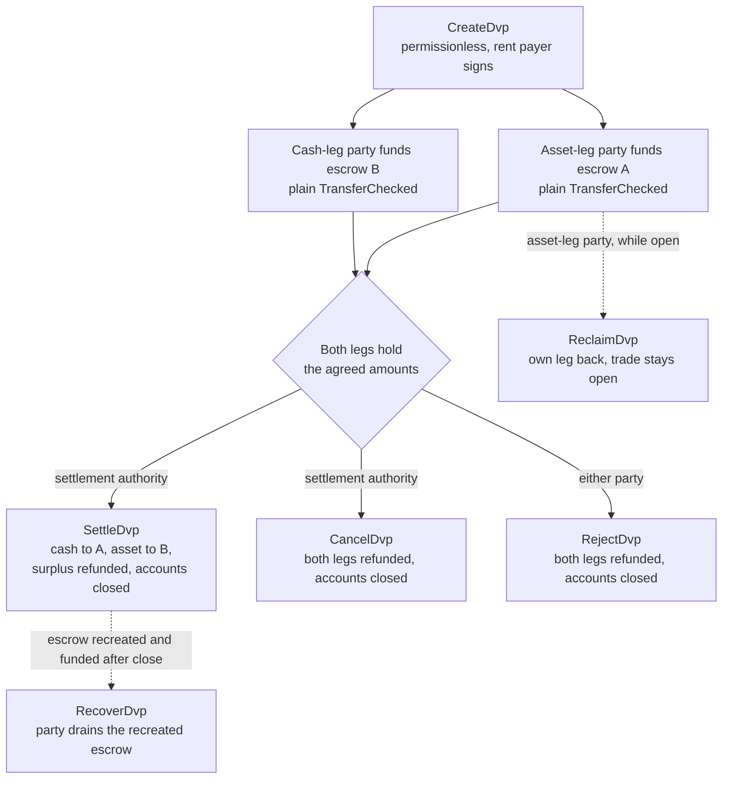
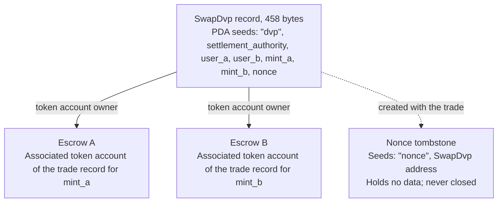

DvP programı, Solana'da ödemeye karşı teslimat için standart programdır;
Solana Foundation tarafından sürdürülür ve Cantina tarafından denetlenmiştir. İki taraf
bir alım satım üzerinde anlaşır, her biri kendi bacağını sıradan bir token
transferiyle bir escrow hesabına gönderir ve bir takas yetkilisi her iki bacağı tek bir işlemde takas eder;
böylece ya ikisi de hareket eder ya da hiçbiri etmez. Takas yetkilisi, alım satımda
adı geçen üçüncü bir adrestir; örneğin alım satımı ayarlayan platform veya aracı. Taraflardan hiçbiri
program yazmaz veya dağıtmaz; standart bir token transferi (`TransferChecked`) gönderebilen bir cüzdan veya saklayıcı,
DvP'ye özgü herhangi bir entegrasyon olmadan bir bacağı fonlayabilir. Takas gerçekleşene kadar taraflardan her biri kendi bacağını geri alabilir veya alım satımı
geri çekebilir.

<Callout type="warn" title="Harekete geçmeden önce kaydı okuyun">

Alım satım kaydı oluşturmak izin gerektirmez (permissionless); bu nedenle bir kayıt, mutabakatın kanıtı değildir. Her taraf fonlamadan önce, takas yetkilisi de takas etmeden önce kayıtlı koşulları okur (bkz.
[doğrulama](#verification-before-funding-and-settlement)).

</Callout>

## Nasıl çalışır

Her alım satım için programa ait bir kayıt ve her bacak için birer tane olmak üzere iki escrow hesabı oluşturulur.
Varlık bacağı tarafı (`user_a`) ve nakit bacağı tarafı (`user_b`), token'ları ilgili bacağın escrow hesabına
transfer ederek bacaklarını fonlar. Takas yetkilisi, takas edebilen tek imzacıdır.
Takas, her bacak için üzerinde anlaşılan tutarı karşı tarafa aktarır, fazla tutarı
bacağın sahibi olan tarafa iade eder ve kaydı ile her iki escrow'u kapatır. Atomiklik, Solana
[işlemlerinden](/docs/core/transactions) gelir: her iki transfer de tek bir işlemde yer alır,
dolayısıyla ya ikisi de geçerli olur ya da hiçbiri olmaz.

Her iade, geri alma ve fazla tutar iadesi, tarafın kendi associated
token account hesabına gider: `mint_a` için `user_a`'nın hesabına, `mint_b` için `user_b`'nin hesabına. Bir
saklayıcı veya hazine sistemi bir bacağı kendi hesabından fonlayabilir, ancak
iade edilen her şey saklayıcıya değil, tarafın hesabına gider. Her alım satım
ayrıca kalıcı bir işaretleyici hesap bırakır (bkz. [State](#state)).

## Kılavuzlar

Adım sayfaları, bir alım satımı oluşturmadan takasa kadar götürür; her talimat için TypeScript ve
Rust örnekleri içerir.

<Cards>
  <Card title="Alım satım oluşturun" href="/docs/defi/dvp-program/create-a-trade">
    İstemcileri kurun ve alım satımın koşullarını CreateDvp ile kaydedin
  </Card>
  <Card title="Bacakları fonlayın" href="/docs/defi/dvp-program/fund-the-legs">
    Kayıtlı koşulları doğrulayın, ardından her bacağı basit bir transferle fonlayın
  </Card>
  <Card title="Alım satımı takas edin" href="/docs/defi/dvp-program/settle-the-trade">
    Takas yetkilisi olarak her iki bacağı tek bir işlemde takas edin
  </Card>
  <Card title="Alım satımı geri çekin" href="/docs/defi/dvp-program/unwind-a-trade">
    Bir bacağı geri alın, alım satımı iptal edin veya reddedin ve geç yatırılan tutarları kurtarın
  </Card>
</Cards>

Bir [devnet demosu](https://solana.com/delivery-vs-payment/demo) bir alım satımı baştan
sona çalıştırır: alım satımı oluşturur, her iki escrow'u standart token transferleriyle fonlar ve
her iki bacağı tek bir işlemde takas eder.

## Program ile delegasyon arasında seçim yapma

[Delegasyon kullanarak Ödemeye Karşı Teslimat (DvP)](/docs/tokenization/dvp), aynı
değişimi program olmadan gerçekleştirir: her taraf pozisyonunu bir
takas aracısına devreder ve aracı her iki bacağı tek bir işlemde hareket ettirir.

- **Program** delegasyon gerektirmez; bu nedenle token
  account başına bir delegate sınırı geçerli değildir ve takas yetkilisi gelirleri başka yere yönlendiremez.
  Her alım satım, yükseltilebilir bir programa ve onun yükseltme yetkilisine bağlıdır.
- **Delegasyon deseninin** program bağımlılığı yoktur ve Scaled UI Amount
  taşıyan mint'lerle çalışır. Program bu mint'leri reddeder; bu durum, Mosaic'in `tokenized-security` şablonundan oluşturulan
  tüm mint'leri dışarıda bırakır (bkz.
  [mint yapılandırma kısıtlamaları](#mint-configuration-constraints)).

## Roller

Program simetriktir. Arayüzünde iki taraf, `mint_a`'yı teslim eden `user_a` ve
`mint_b`'yi teslim eden `user_b`'dir. README ve oluşturulan istemciler `mint_a`'ya varlık bacağı, `mint_b`'ye nakit bacağı der;
bu sayfalar da bu kurala uyar, ancak programda nakit bacağının
bir nakit enstrümanı olmasını gerektiren hiçbir şey yoktur. İki varlık veya iki stablecoin de aynı
şekilde takas edilir.

| Rol                 | Kim                               | İmzaladığı işlemler                                              | Notlar                                                                                                                                                                                                     |
| -------------------- | --------------------------------- | -------------------------------------------------- | --------------------------------------------------------------------------------------------------------------------------------------------------------------------------------------------------------- |
| Varlık bacağı tarafı      | `user_a`, `mint_a`'yı teslim eder       | Kendi fonlama transferi; Reclaim, Reject, Recover | Bir keypair cüzdanı veya multisig kasası gibi PDA tabanlı bir akıllı cüzdan. Bir SPL Token multisig hesabı veya bir program account taraf olamaz: Create, `PartyNotSignerCapable` hatasıyla başarısız olur                   |
| Nakit bacağı tarafı       | `user_b`, `mint_b`'yi teslim eder       | Kendi fonlama transferi; Reclaim, Reject, Recover | Aynı gereksinim                                                                                                                                                                                          |
| Takas yetkilisi | Oluşturma sırasında belirtilen üçüncü bir adres | Settle, Cancel                                     | Takas edebilen tek imzacı. Oluşturma sırasında sabitlenen gelirleri başka yere yönlendiremez. Takas veya iptal sırasında kapatılan hesapların rent'ini alır                                         |
| Rent'i ödeyen           | `CreateDvp`'yi kim imzalıyorsa o         | Create                                             | Kayıt, nonce tombstone ve her iki escrow için rent'i (bir hesabı açık tutan SOL depozitosu) karşılar. Rent alıcısı olarak kaydedilmez: kapatılan hesapların rent'i, alım satımı kapatana gider |

## Program ID

```text
dvp34bdbcEm4f4FCUjGV4mDAkDshaQR4LkK8fdcsyZq
```

| Cluster      | Program                                       | Yükseltme yetkilisi                              | Son dağıtım slot'u |
| ------------ | --------------------------------------------- | ---------------------------------------------- | ------------------ |
| mainnet-beta | `dvp34bdbcEm4f4FCUjGV4mDAkDshaQR4LkK8fdcsyZq` | `DXtFpbPjcn2hxPnw79x1Pfoj35vXh5AsWBkS37YnXMVv` | 452.058.374        |
| devnet       | `dvp34bdbcEm4f4FCUjGV4mDAkDshaQR4LkK8fdcsyZq` | `5EX1zFeJWj4rGYZv432WnYw8CbaSUeTdxPx4r573UgYU` | 479.376.863        |

Program her iki cluster'da da yükseltilebilir. Yukarıdaki değerler,
`solana program show` komutunun 2 Ekim 2026'da bildirdiği değerlerdir; güncel değerler için aynı komutu çalıştırın.
Devnet derlemesi, adım sayfalarının esas alındığı commit'ten (bkz. [Kurulum](/docs/defi/dvp-program/create-a-trade#install))
daha eskidir; talimat ve hata kümesi aynıdır.

## Yaşam döngüsü



Bir alım satım, `CreateDvp` ile açıldığı andan Settle, Cancel veya Reject'ten biri onu kapatana
kadar açık kalır. Fonlamanın kendine ait bir talimatı yoktur: bir bacak, escrow
hesabı üzerinde anlaşılan tutarın en az kendisini tuttuğunda fonlanmış sayılır. Reclaim bacak bazındadır ve
alım satımı açık bırakır; böylece bir bacakla ilgili sorun, diğer tarafı alım satımın
tamamını iptal etmeye zorlamaz.

## State

Her alım satımın, programa ait, 458 baytlık tek bir `SwapDvp` hesabı vardır. Adresi; takas yetkilisinden, iki taraftan, iki
mint'ten ve bir nonce'tan türetilir (seed'ler:
`["dvp", settlement_authority, user_a, user_b, mint_a, mint_b, nonce]`). Tutarlar
ve zamanlar hesabın içinde saklanır ve adresi etkilemez;
bu nedenle bunların çıkarım yapılarak değil, okunarak öğrenilmesi gerekir. `["nonce", swap_dvp]` adresindeki küçük bir işaretleyici hesap olan
nonce tombstone, alım satımla birlikte oluşturulur ve
hiçbir zaman kapatılmaz; böylece taraf, mint, yetkili ve nonce'un her kombinasyonu
yalnızca tek bir alım satım için kullanılabilir.



| Alan                                  | Tür          | Anlamı                                                                                                 |
| -------------------------------------- | ------------- | ------------------------------------------------------------------------------------------------------- |
| `bump`                                 | `u8`          | PDA bump değeri                                                                                                |
| `user_a`, `user_b`                     | `Pubkey`      | İki taraf                                                                                         |
| `mint_a`, `mint_b`                     | `Pubkey`      | Varlık bacağı ve nakit bacağı mint'leri                                                                        |
| `settlement_authority`                 | `Pubkey`      | Takas veya iptal edebilen tek imzacı                                                               |
| `token_program_a`, `token_program_b`   | `Pubkey`      | Her mint'in sahibi olan token program; bir alım satımda SPL Token ve Token-2022 bacakları karışık olabilir                    |
| `amount_a`, `amount_b`                 | `u64`         | Her bacak için üzerinde anlaşılan tutar, mint'in en küçük biriminde (temel birimler)                                 |
| `expiry_timestamp`                     | `i64`         | Bu ağ zamanından (onchain saat) sonra Settle reddedilir. Reclaim, Cancel ve Reject çalışmaya devam eder |
| `nonce`                                | `u64`         | Diğer seed'leri paylaşan alım satımları birbirinden ayırır. Tek kullanımlıktır                                             |
| `ref_string`                           | `[u8; 64]`    | Sıfırlarla doldurulmuş, opak bir istemci referansı; program bunu hiçbir zaman okumaz                                     |
| `user_a_settlement_destination`        | `Pubkey`      | Settle sırasında nakit bacağını alır; varsayılan değeri `user_a`'dır                                                   |
| `user_b_settlement_destination`        | `Pubkey`      | Settle sırasında varlık bacağını alır; varsayılan değeri `user_b`'dir                                                  |
| `mint_a_authority`, `mint_b_authority` | `Pubkey`      | Oluşturma sırasında kaydedilen mint yetkilileri; biri değişmişse Settle başarısız olur                           |
| `earliest_settlement_timestamp`        | `Option<i64>` | Ayarlanmışsa, bu ağ zamanından önce Settle reddedilir                                                     |

Alan listesi, [Alım satım oluşturma](/docs/defi/dvp-program/create-a-trade#install) bölümünde belirtilen commit'teki programın IDL'sinden
alınmıştır.

## Talimatlar

| Talimat  | İmzacı               | Etki                                                                                                                                                              |
| ------------ | -------------------- | ------------------------------------------------------------------------------------------------------------------------------------------------------------------- |
| `CreateDvp`  | Herhangi bir ödeyici            | `SwapDvp` kaydını, nonce tombstone'unu ve her iki escrow hesabını oluşturur. Hiçbir token taşımaz                                                                        |
| `ReclaimDvp` | `user_a` veya `user_b` | İmzacının kendi bacağını escrow'dan geri verir. Alım satım açık kalır ve bacak yeniden fonlanabilir                                                                      |
| `SettleDvp`  | Takas yetkilisi | `amount_a` tutarını `user_b`'nin hedefine, `amount_b` tutarını `user_a`'nın hedefine aktarır, fazla tutarı bacağın tarafına iade eder, kaydı ve her iki escrow'u kapatır |
| `CancelDvp`  | Takas yetkilisi | Escrow A'da ne varsa `user_a`'ya, escrow B'dekini `user_b`'ye iade eder, kaydı ve her iki escrow'u kapatır                                                            |
| `RejectDvp`  | `user_a` veya `user_b` | Cancel ile aynı etki; bir taraf tarafından imzalanır                                                                                                                            |
| `RecoverDvp` | `user_a` veya `user_b` | Alım satım kapatıldıktan sonra: yeniden oluşturulmuş bir escrow'u imzacının kendi token account hesabına boşaltır ve kapatır. Settle, Cancel veya Reject'ten sonra yatırılan bir depozitoyu kapsar  |

Escrow'u kim fonlamış olursa olsun, her iade, ilgili bacağın mint'i için tarafın kendi
associated token account hesabına gider.

Her talimatın hesapları ve argümanları, ilgili adımın sayfasında yer alır.

## Hatalar

| Kod | Hata                            | Ne zaman                                                                                                   |
| ---- | -------------------------------- | ------------------------------------------------------------------------------------------------------ |
| 0    | `SignerNotParty`                 | Reclaim, Reject veya Recover işleminin `user_a` ya da `user_b` olmayan bir adres tarafından imzalanması                      |
| 1    | `DvpExpired`                     | `expiry_timestamp` sonrasında Settle yapılması                                                                        |
| 2    | `SettlementAuthorityMismatch`    | Settle veya Cancel işleminin takas yetkilisi dışındaki bir adres tarafından imzalanması                              |
| 3    | `SettlementTooEarly`             | `earliest_settlement_timestamp` öncesinde Settle yapılması                                                          |
| 4    | `LegNotFunded`                   | Bir escrow, üzerinde anlaşılan tutardan az token tutarken Settle yapılması                                               |
| 5    | `ExpiryNotInFuture`              | Son kullanma zamanı mevcut ağ zamanına eşit veya ondan önce olacak şekilde Create yapılması                                            |
| 6    | `EarliestAfterExpiry`            | En erken takas zamanı son kullanma zamanından sonra olacak şekilde Create yapılması                                               |
| 7    | `SelfDvp`                        | `user_a` ile `user_b` aynı olacak şekilde Create yapılması                                                                 |
| 8    | `SameMint`                       | `mint_a` ile `mint_b` aynı olacak şekilde Create yapılması                                                                 |
| 9    | `ZeroAmount`                     | Bacaklardan birinde tutar sıfır olacak şekilde Create yapılması                                                                |
| 10   | `BlockedMintExtension`           | TransferFee, InterestBearing, ScaledUiAmount veya NonTransferable taşıyan bir mint ile Create ya da Settle yapılması |
| 11   | `SettlementAuthorityIsParty`     | Takas yetkilisi taraflardan biriyle aynı olacak şekilde Create yapılması                                                  |
| 12   | `SettlementAuthorityExecutable`  | Çalıştırılabilir (executable) bir takas yetkilisiyle Create yapılması                                                         |
| 13   | `NonceAlreadyUsed`               | Zaten bir tombstone'u bulunan bir `(seeds, nonce)` değerinin yeniden kullanılarak Create yapılması                                         |
| 14   | `ExpiryTooFarInFuture`           | Son kullanma zamanı bir yıldan daha ileride olacak şekilde Create yapılması                                                         |
| 15   | `RefStringTooLong`               | 64 bayttan uzun bir referansla Create yapılması                                                           |
| 16   | `DvpStillOpen`                   | Alım satım hâlâ açıkken Recover yapılması; Reclaim kullanın                                                     |
| 17   | `DvpNeverCreated`                | Tombstone'u olmayan seed'lerle Recover                                                              |
| 18   | `EscrowPreloadedWithLamports`    | Native olmayan bir escrow, rent-exempt asgari tutarının üzerinde lamport tuttuğunda Create                           |
| 19   | `SettlementDestinationIsSwapDvp` | Takas hedefi işlem kaydına eşit olacak şekilde Create                                         |
| 20   | `SwapDvpPreloadedWithLamports`   | Kayıt adresi rent rezervinin üzerinde lamport tuttuğunda Create                                   |
| 21   | `RecipientAtaMismatch`           | Bir alıcı veya iade token account'u artık beklenen cüzdana ve mint'e ait değil                  |
| 22   | `PartyNotSignerCapable`          | Sistem programına ait, çalıştırılabilir olmayan (non-executable) bir hesap olmayan bir tarafla Create                                 |
| 23   | `MintAuthorityChanged`           | Bir bacağın mint authority'si, oluşturma sırasında kaydedilen değerden farklı olduğunda Settle                         |

## Olaylar ve indeksleme

Program zincir üstünde (onchain) hiçbir olay yayınlamaz. Bir indeksleyici veya mutabakat sistemi,
`SwapDvp` hesap durumunu ve iki escrow'un token bakiyelerini okur ve bir işlemi zincir dışı
emriyle eşleştirmek için `ref_string` alanını kullanır. Kayıt takas sırasında
kapatıldığından, sonradan şartlara ihtiyaç duyan bir sistem bunları okurken
saklamalı veya işlemi oluşturan transaction'dan yeniden oluşturmalıdır.

## Desteklenen token'lar

Bir işlem, bir SPL Token bacağını bir Token-2022 bacağıyla eşleştirebilir; her bacak
kendi token programını taşır. Wrapped SOL bacakları desteklenir.

| Bir bacağın mint'indeki Token-2022 uzantısı                                                     | Program davranışı                                                  |
| ---------------------------------------------------------------------------------------- | ----------------------------------------------------------------- |
| TransferFee, InterestBearing, ScaledUiAmount, NonTransferable                            | Create ve Settle sırasında `BlockedMintExtension` ile reddedilir         |
| PermanentDelegate, Pausable, DefaultAccountState, bir freeze authority, MintCloseAuthority | Kabul edilir; her authority escrow'daki token'lar üzerinde işlem yapabilir           |
| ConfidentialTransfer                                                                     | Kabul edilir; o bacaktaki tutarlar herkese açıktır                          |
| TransferHook                                                                             | Desteklenir, bacak başına en fazla 32 ek hesap                        |
| Bir hedef veya iade hesabında MemoTransfer                                          | Kabul edilir; program, transferden önce gerekli memo'yu yayınlar |

Bir transfer ücreti, alıcı tarafın üzerinde anlaşılan tutarın altında kalmasına yol açar.
Interest Bearing ve Scaled UI Amount ham tutarları değiştirmez, ancak oranları
veya çarpanları bir işlemin oluşturulması ile takası arasında değişebilir; bu da
üzerinde anlaşılan tutarların nasıl görüntülendiğini değiştirir. NonTransferable ise her iki bacağı da
kilitli bırakır.

Kabul edilen authority'ler, işlemin ömrü boyunca escrow'daki token'ları
taşıyabilir, dondurabilir veya durdurabilir (aşağıya bakın). Escrow, gizli transferleri
alacak şekilde yapılandırılamaz; bu nedenle gizli (confidential) bir bacaktaki escrow'a alınan ve takas edilen tutarlar
herkese açıktır.

Hook'lu bir mint için istemci, hook'un ek hesaplarını çözümler ve bunları
Settle, Cancel, Reject, Reclaim ve Recover işlemlerine ekler. Bacak başına 32 sınırı,
hook programını ve doğrulama hesabını da sayar. Hook authority'si hook'un hesap
listesini bu sınırın ötesine genişletirse, o bacaktaki her transfer başarısız olur;
buna Reclaim, Cancel, Reject ve Recover da dahildir. Bu durum, authority bunu geri alana kadar sürer.
Her iki bacak da hook taşıdığında, transaction hesap sınırı bacak başına sınırdan önce devreye girebilir.

Bir hedef veya iade hesabı memo gerektirdiğinde, program transferden önce Memo
programını çağırır; bu nedenle token'ları escrow'dan çıkaran her instruction
bir `memo_program` hesabı alır.

### Mint yapılandırma kısıtlamaları

**Scaled UI Amount.** Solana Foundation'ın ihraç araç seti olan
[Mosaic](https://github.com/solana-foundation/mosaic) içindeki `tokenized-security` şablonu her zaman Scaled UI Amount ekler;
bu yüzden program, bu şablondan oluşturulmuş bir mint'i bacak olarak kabul etmez. Bu program için
tasarlanan bir mint, bu uzantı olmadan oluşturulabilir (bkz.
[Token Extensions](/docs/tokens/extensions));
[Delegasyon kullanan DvP](/docs/tokenization/dvp) devredilmiş yetki üzerinden takas yapar ve
bu kontrolü uygulamaz.

**Varsayılan olarak dondurulmuş mint'ler.** Her işlemin escrow'u, o işlem için yeni oluşturulan
bir Program Derived Address'e ait bir associated token account'tur. Default Account State değeri
dondurulmuş olarak ayarlanmış bir mint'te escrow dondurulmuş olarak oluşturulur ve ona yapılacak
fonlama transferi, çözülene (thaw) kadar başarısız olur.
[Token ACL](/docs/tokenization/token-acl) altında bu, ihraççının veya transfer
acentesinin fonlamadan önce işlemin escrow'unu kabul etmesi anlamına gelir: ya işlem
kaydının adresini (escrow'un sahibi) izin listesine ekleyerek, böylece mint'in Token ACL yapılandırması
izinsiz çözmeyi (permissionless thaw) etkinleştiriyorsa herkes escrow'u çözebilir, ya da
freeze authority'nin escrow'u doğrudan çözmesiyle. Dondurulmuş bir escrow ayrıca o bacaktaki
Settle, Reclaim, Cancel, Reject ve Recover işlemlerini de engeller; bu nedenle freeze
authority ve hook'lu bir mint'te hook authority'si, işlemin ömrü boyunca güvenilen bir taraftır.
Dondurulmuş escrow yolu burada açıklanmıştır ve devnet kod örneklerinde uygulanmamıştır.

## Sınırlar

- Eşleştirme, fiyat keşfi veya emir defteri yoktur. Taraflar şartları defter
  dışında kararlaştırır ve biri bunları kaydeder.
- Netleştirme (netting) yoktur ve yalnızca ikili işlem desteklenir: bir kayıt, iki taraf arasındaki tek bir işlemdir.
- Kısmi dolum yoktur. Settle, her bacağın üzerinde anlaşılan tutarının tamamını taşır ve
  fazlalığı bacağın tarafına iade eder.
- Defter dışı bacak yoktur. Her iki bacak da Solana üzerindeki token account'lardır; mevcut ağlar üzerindeki
  bir nakit bacağı ayrı olarak takas edilir ve mutabakata bağlanır.
- Uygunluk kontrolü, izin listesi veya KYC yoktur. Hak sahibi uygunluğunu mint'in kendi
  kontrolleri uygular.
- Otomatik takas yoktur. Takas authority'sinin imzalaması gerekir.
- Olay yoktur ve transaction ücretleri ile rent dışında protokol ücreti yoktur.

Program, iki taraf arasındaki anapara riskini ortadan kaldırır: her iki bacak da hareket etmedikçe
hiçbiri hareket etmez. Ancak her iki token üzerindeki ihraççı kredi veya itfa riskini, bir mint'in freeze, pause veya permanent delegate authority'sinin
escrow'daki token'lar üzerinde işlem yapabilme yetkisini (bkz. [desteklenen token'lar](#supported-tokens)) veya
takas authority'sinin imzalamak için hazır bulunmasına olan bağımlılığı ortadan kaldırmaz.

## Fonlama ve takas öncesi doğrulama

`CreateDvp` izin gerektirmez: yalnızca payer imzalar; taraflar ve
takas authority'si imzalamaz. Bu nedenle herkes, herhangi bir tarafı ve herhangi bir şartı belirten bir kayıt oluşturabilir. Fonlamadan önce ve takastan önce tekrar,
`SwapDvp` hesabını okuyun ve şunları doğrulayın:

1. Hesap DvP programına aittir ve tam olarak 458 bayttır. Programa ait
   olmayan bir hesap, gerçek bir kayıt gibi çözümlenen baytlarla doldurulabilir.
2. `user_a`, `user_b`, `mint_a`, `mint_b` ve `settlement_authority`, üzerinde anlaşılan
   işlemle eşleşir.
3. `amount_a`, `amount_b`, `expiry_timestamp` ve
   `earliest_settlement_timestamp`, üzerinde anlaşılan şartlarla eşleşir.
4. Her iki takas hedefi de üzerinde anlaşılan adreslerdir. Sahte bir kayıt,
   gelirleri başka bir yere yönlendirebilir.

[Bacakları fonlama](/docs/defi/dvp-program/fund-the-legs#verify-the-terms) bölümü,
üretilen istemcilerin kontrollü okuyucularını listeler ve kontrolü kodla gösterir.

Settle transaction'ı [`finalized`](/docs/rpc#configuring-state-commitment) seviyesine ulaştığında işlemi takas edilmiş kabul edin. Bu,
bir ağ taahhüt (commitment) seviyesidir; hukuki amaçlar bakımından da takas kesinliğini
ifade edip etmediği, tarafların sözleşmelerine ve uygulanan düzenlemelere bağlıdır.

## Sürümleme

`SwapDvp` hesabında sürüm alanı yoktur. Düzeni 458 bayt olarak sabittir
(`SwapDvp::LEN`) ve kontrollü okuyucular başka uzunluktaki hesapları reddeder.
IDL'in kendi sürümü vardır: 2 Ekim 2026 itibarıyla `0.1.0`.

Program her iki cluster'da da yükseltilebilir (bkz. [Program ID](#program-id)). Bir
işlem kaydı yalnızca takas edilene, iptal edilene veya reddedilene kadar var olur; bu nedenle bir yükseltmenin açık işlemlere nasıl davrandığını
depodan kontrol edin ve istemcileri dağıtılan sürümün IDL'inden yeniden üretin.

## Depo ve denetim

Kaynak kod, IDL, üretilmiş istemciler ve testler MIT lisansı altında
[`solana-foundation/dvp`](https://github.com/solana-foundation/dvp) deposundadır. Program, `no_std` bir Pinocchio programıdır;
istemciler IDL'den Codama ile üretilir. Güvenlik açığı bildirimleri,
`SECURITY.md` uyarınca deponun güvenlik danışma bağlantısı üzerinden iletilir.

Program [Cantina](https://cantina.xyz/portfolio/fe870bb4-d96d-4902-8aec-9dfcfa2d6a79) tarafından denetlenmiştir.

## İlgili

- [Delegasyon kullanan Delivery vs Payment (DvP)](/docs/tokenization/dvp): program olmadan
  delegasyon deseni
- [Token ACL](/docs/tokenization/token-acl): erişimi kısıtlı bir mint'in escrow hesaplarıyla
  nasıl etkileşime girdiği
