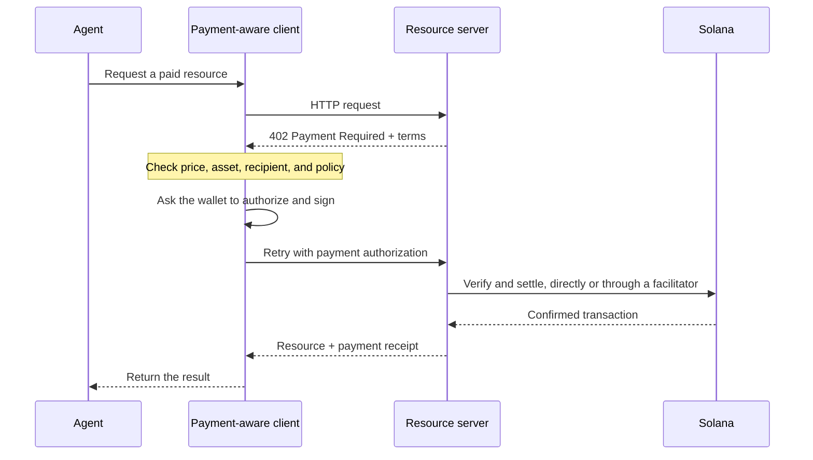

Ajan tabanlı ödemeler, yazılımın fiyatı keşfetmesine, ödemeyi yetkilendirmesine ve kaynağı
aynı HTTP iş akışı içinde almasına olanak tanır. Bir ajan, önce bir faturalandırma hesabı oluşturmadan veya
bir API anahtarı kopyalamadan bir veri sorgusu, model çıkarımı
veya araç çağrısı için ödeme yapabilir.

<Cards>
  <Card title="MPP" href="/docs/payments/agentic-payments/mpp">
    Tek seferlik ücretler ve kullanım bazlı ödeme oturumları için HTTP kimlik doğrulamasını kullanın.
  </Card>
  <Card title="x402" href="/docs/payments/agentic-payments/x402">
    Bir HTTP kaynağına x402 V2 ödeme gereksinimlerini, imzalarını ve
    sonuçlandırmayı ekleyin.
  </Card>
</Cards>

## Ortak ödeme akışı

MPP ve x402 farklı başlıklar ve veri modelleri kullanır, ancak temel HTTP akışları
benzerdir:

## MPP ve x402

Her iki protokol de Solana üzerinde stablecoin ödemelerini sonuçlandırabilir. Seçimi yalnızca ortak `402`
durum koduna göre değil, hizmetinizin ihtiyaç duyduğu
ödeme modeline ve birlikte çalışabilirliğe göre yapın.

|                         | MPP                                                               | x402                                                                     |
| ----------------------- | ----------------------------------------------------------------- | ------------------------------------------------------------------------ |
| Meydan okuma (challenge)               | `WWW-Authenticate: Payment`                                       | `PAYMENT-REQUIRED`                                                       |
| İstemci yetkilendirmesi    | `Authorization: Payment`                                          | `PAYMENT-SIGNATURE`                                                      |
| Makbuz                 | `Payment-Receipt`                                                 | `PAYMENT-RESPONSE`                                                       |
| Solana ödeme modelleri   | Tek seferlik `charge` ve üst sınırlı, kullanım bazlı `session` amaçları           | `exact` ve `upto` gibi şemalar; destek ağa ve istemciye göre değişir |
| Sonuçlandırma mimarisi | Sunucu doğrulaması veya isteğe bağlı bir röle ya da ağ geçidi                | Yerel doğrulamalı kaynak sunucusu veya bir facilitator                 |
| İyi bir başlangıç noktası     | HTTP kimlik doğrulama semantiğine veya tekrarlı kullanım ölçümüne ihtiyaç duyan API'ler | İstek başına ödemeli kaynaklar ve mevcut x402 istemcileri                      |

MPP, **Machine Payments Protocol** (Makine Ödemeleri Protokolü) anlamına gelir. Bunu **Model
Context Protocol (MCP)** ile karıştırmayın. MCP, ajanlara araçları ve kaynakları sunar; MPP veya x402 ise
bir ajan bu araçlardan birini çağırdığında ödeme talep edebilir.

<Callout type="info">
  Bir hizmet birden fazla protokol sunabilir. İstemci, desteklediği bir ödeme
  seçeneğini belirler, ardından tüm iletişim boyunca eşleşen meydan okuma, yetkilendirme ve
  makbuz başlıklarını kullanır.
</Callout>
