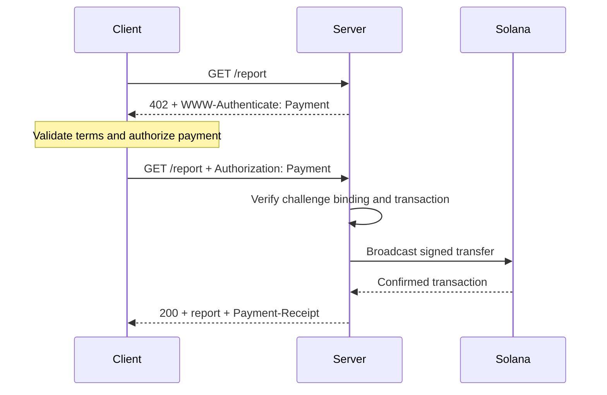
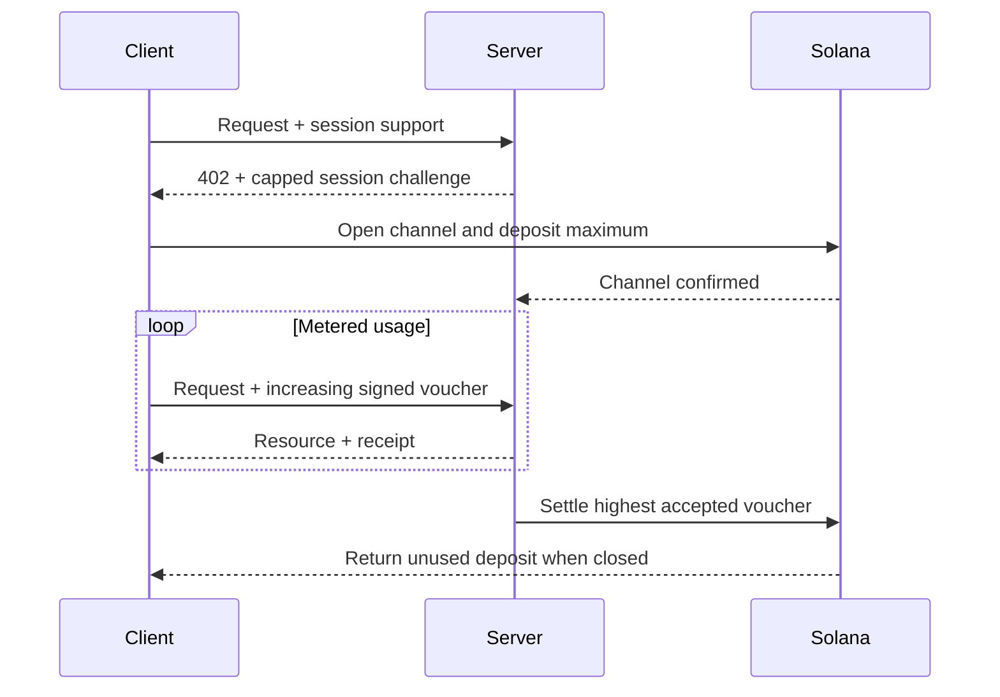

[Machine Payments Protocol (MPP)](https://mpp.dev/), HTTP kimlik doğrulama semantiğini ödemelere uygular. Sunucu, ödenmemiş bir isteğe challenge ile karşılık verir, istemci bir ödeme kimlik bilgisi (credential) döndürür ve sunucu ödemeyi kabul ettikten sonra bir makbuz döndürür.

MPP üç konuyu birbirinden ayırır:

- Bir **intent**, tek seferlik bir `charge` veya kullanıma göre ölçülen bir `session` gibi ticari etkileşimi tanımlar.
- Bir **ödeme yöntemi**, değerin nasıl taşındığını tanımlar. Solana yöntemi, tahsilatlar için yerel SOL'u ve SPL token'larını destekler.
- Bir HTTP **taşıma katmanı** challenge'ları, kimlik bilgilerini, makbuzları ve hataları iletir.

MPP, bir dizi Internet-Draft olarak yayımlanmaktadır. [Güncel spesifikasyonları](https://paymentauth.org/) tek doğru kaynak olarak kabul edin ve taslaklar üzerinde çalışma sürdüğü için ayrıntıların değişebileceğini unutmayın.

## HTTP alışverişi

MPP, protokole özgü ödeme başlıkları yerine standart HTTP kimlik doğrulama alanlarını kullanır:

| Mesaj                 | HTTP gösterimi                                         |
| ----------------------- | ----------------------------------------------------------- |
| Ödeme challenge'ı       | `402 Payment Required` ve `WWW-Authenticate: Payment ...` |
| Ödeme kimlik bilgisi      | `Authorization: Payment ...` ile yeniden denenen istek           |
| Başarılı makbuz      | `Payment-Receipt: ...` içeren kaynak yanıtı               |
| Geçersiz ödeme ayrıntıları | `application/problem+json` kullanan Problem Details gövdesi       |



Bir challenge; sunucu tarafından oluşturulan bir kimlik (ID), realm, yöntem, intent, kodlanmış ödeme isteği ve son kullanma süresi içerir. Kimlik bilgisi challenge'ı yansıtır ve yönteme özgü ödeme kanıtını ekler. Sunucu her iki parçayı da doğrulamalıdır; farklı bir challenge'a ait geçerli bir transfer kaynağın kilidini açmamalıdır.

## Tek seferlik Solana tahsilatları

Solana `charge` intent'i iki kimlik bilgisi türünü destekler:

- **Pull modu**, imzalı bir işlem kullanır. İstemci transferi imzalar ve işlemi sunucuya gönderir. Sunucu işlemi doğrular, isteğe bağlı olarak bir ücret ödeyen (fee-payer) imzası ekler, işlemi ağa yayınlar, onaylar ve makbuzunda işlem imzasını döndürür.
- **Push modu**, bir işlem imzası kullanır. İstemci önce işlemi ağa yayınlar, ardından onaylanmış imzayı sunucuya gönderir. Sunucu, kaynağı döndürmeden önce işlemi getirir ve doğrular.

Pull modu, sunucu tarafından karşılanan işlem ücretlerini ve sunucu tarafında yeniden deneme mantığını mümkün kılar. Push modu, bir cüzdan istemcinin kendi işlemini göndermesini gerektirdiğinde kullanışlıdır, ancak sunucunun ücret sponsorluğundan yararlanamaz.

Normatif alanlar ve doğrulama kuralları için [Solana charge spesifikasyonuna](https://paymentauth.org/draft-solana-charge-00.html) bakın.

## Bir Express API'sine MPP tahsilatı ekleme

Solana Pay Kit, MPP ve x402 için güncel bir TypeScript entegrasyonu sunar. Express ile birlikte kurun:

```bash
pnpm add @solana/pay-kit @solana/kit@^6.9.0 express
pnpm add --save-dev @types/express tsx
```

Bu en küçük örnek, barındırılan Surfpool sandbox'ını ve paketin herkese açık demo alıcısını kullanır. Yalnızca yerel geliştirme içindir:

```ts filename=server.ts
import express from "express";
import { createPayKit, usd } from "@solana/pay-kit";

const pay = await createPayKit({
  accept: ["mpp"],
  rpcUrl: "https://402.surfnet.dev:8899"
});

const app = express();

app.get("/report", pay.express(usd("0.01")), (_req, res) => {
  res.json({ report: "Paid report" });
});

app.listen(4567, () => {
  console.log("Paid API listening on http://127.0.0.1:4567");
});
```

Çalıştırın ve ödenmemiş bir isteği ödeme farkındalıklı bir istekle karşılaştırın:

```bash
pnpm tsx server.ts
curl -i http://127.0.0.1:4567/report
pay --sandbox curl http://127.0.0.1:4567/report
```

Rota işleyicisi (route handler) yalnızca ara katman yazılımı (middleware) ödemeyi kabul ettikten sonra çalışır.

<Callout type="warn" title="Üretimde tüm sandbox varsayılanlarını değiştirin">
  Açık bir ağ, satıcı alıcısı, ayrılmış bir RPC, sabit bir challenge bağlama gizli anahtarı, üretim imzalayıcısı ve kalıcı bir tekrar saldırısı (replay) deposu yapılandırın. Gerçek ödemeleri asla bir paket demo imzalayıcısına yönlendirmeyin.
</Callout>

## Kullanıma göre ölçülen oturumlar

Bir istemci birçok küçük ve ilişkili ödeme yapacağında Solana MPP `session` kullanın. Bir oturum, azami depozitoyla zincir üstü bir ödeme kanalı açar, ardından kullanım arttıkça kümülatif imzalı voucher'lar kullanır. Sunucu voucher'ları zincir dışında doğrulayabilir ve kabul edilen en yüksek tutarı daha sonra uzlaştırabilir.

Bu yöntem; token bazında ölçülen çıkarım (inference), bayt bazında ölçülen indirmeler, canlı veriler ve tekrarlanan araç çağrıları için kullanışlıdır. Her olay için ayrı bir zincir üstü ödeme göndermekle aynı şey değildir.



Bir oturumu **oturum ödemesi**, **ödeme kanalı** veya **üst sınırlı tekrarlı yetkilendirme** olarak adlandırın. Buna yalnızca hizmet ve ödeme sözleşmesi gerçekten bir kullanım akışını ölçüyorsa akış halinde ödeme deyin.

## Üretim doğrulaması

Her Solana tahsilatı için sunucunun en azından şunları doğrulaması gerekir:

- Challenge'ın gerçek olduğu, süresinin dolmadığı, bu isteğe bağlı olduğu ve bu realm için amaçlandığı.
- İşlemin beklenen ağı, varlığı veya mint'i, alıcıyı, tutarı ve token program'ı kullandığı.
- Herhangi bir ücret ödeyen veya associated token account talimatının açıkça izin verilmiş olduğu ve sunucu imzalayıcısını boşaltamayacağı.
- İşlemin gereken onay (commitment) düzeyinde başarılı olduğu.
- İşlem imzasının daha önce tüketilmemiş olduğu.
- Tekrar saldırısı kontrolü ile tüketme işleminin tüm sunucu örneklerinde atomik olduğu.

Oturumlar için ayrıca kanal durumunu, kabul edilen kümülatif tutarı ve uzlaşma eşiğini (settlement watermark) paylaşılan bir depoda kalıcı olarak saklayın. Sunucu erişilemez hale gelirse istemcilerin kullanılmayan fonları nasıl geri alacağını belgelendirin.

## İlgili kaynaklar

- [MPP spesifikasyonları](https://paymentauth.org/)
- [MPP protokol dokümantasyonu](https://mpp.dev/protocol)
- [Solana Pay Kit](https://github.com/solana-foundation/pay-kit)
- [Ajan tabanlı ödemelere genel bakış](/docs/payments/agentic-payments)
- [Üretim hazırlığı](/docs/tools/security#verify-addresses)
