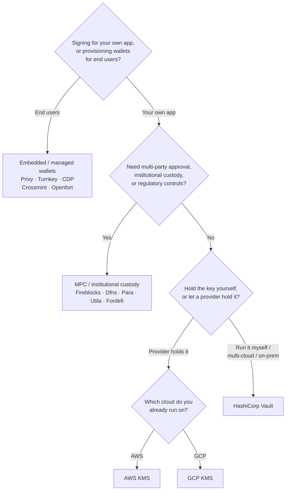

Keychain, her backend genelinde tek bir `SolanaSigner` temel arayüzü sunar;
bu nedenle çoğu backend için tercih mimari değil, operasyoneldir: daha sonra
yapılandırma yoluyla değiştirebilirsiniz. İstisna, işlem biçimidir. Crossmint
ve Fordefi native auto modu sunucu tarafında imzalayıp yayınlar, Fordefi native
manual modu ise işlemi imzalamadan önce yeniden yazar; dolayısıyla bunlara
geçmek ya da bunlardan ayrılmak imzalayıcıyı nasıl çağırdığınızı değiştirir.
Bu nedenle **bir üründen değil, gereksinimlerinizden başlayın.** Çoğu şeyi iki
soru belirler: _özel anahtar nerede bulunuyor ve bununla imza yetkilendirmesine
kim izinli?_

Ledger dışındaki her backend dört dilin tamamında (Rust, TypeScript,
Python ve Go) sunulur. Ledger yalnızca Rust içindir ve isteğe bağlı `ledger`
özelliğinin arkasındadır.

En iyi tek bir backend yoktur. Her biri belirli kısıtlara daha uygundur:
hâlihazırda kullandığınız bulut, anahtar altyapısını kendinizin işletmek
isteyip istemediğiniz ve sahip olmanız gereken saklama ile onay kontrolleri.
Aşağıdaki akış bu kısıtları bir backend ile eşleştirir.

<Callout type="info">
  Bu kılavuz backend (sunucu taraflı) imzalamayı kapsar. Son kullanıcılarınız
  kendi işlemlerini tarayıcıda imzalıyorsa bunun yerine Wallet Standard
  üzerinden bir cüzdan kullanın. Bkz. [Production'da
  İmzalama](/docs/core/transactions/signing-in-production).
</Callout>

## Karar akışı

<Callout type="info">
  Yerel geliştirme ve testler için bunların hiçbirine gerek yoktur: prototip
  oluşturmak için **Memory** backend'ini kullanın, ardından yapılandırma
  yoluyla yukarıdaki production backend'lerinden birine geçin.
</Callout>

## Soruları yanıtlayın

<Steps>

<Step>

### Kendi uygulamanız için mi yoksa son kullanıcılarınız için mi imzalıyorsunuz?

**Son kullanıcıların** sahip olduğu ve kullandığı cüzdanlar sağlıyorsanız
(tüketici uygulamaları, onboarding akışları), **gömülü / yönetilen cüzdan**
backend'i kullanın: Privy, Turnkey, CDP, Crossmint veya Openfort. Bunlar,
kullanıcı başına cüzdanları ve kimlik doğrulamayı sizin adınıza yönetir.

**Kendi uygulamanız** olarak imzalıyorsanız (ücret ödeyici, hazine, backend
otomasyonu), aşağıdan devam edin.

</Step>

<Step>

### Çok taraflı onaya, kurumsal saklamaya veya düzenleyici kontrollere ihtiyacınız var mı?

İmzalar üretilmeden önce bir onay politikasından, harcama limitinden ya da
uyumluluk iş akışından geçmek zorundaysa veya anahtarları tutan düzenlemeye
tabi bir saklama kuruluşuna ihtiyacınız varsa, bir **MPC / kurumsal saklama**
backend'i kullanın: Fireblocks, Dfns, Para, Utila veya Fordefi. Bunlar anahtarı
böler ya da saklar ve politikanıza göre birlikte imzalar.

Yalnızca istek üzerine imzalayan bir anahtara ihtiyacınız varsa aşağıdan devam
edin.

</Step>

<Step>

### Anahtarı kendiniz mi tutmak istiyorsunuz, yoksa bir sağlayıcının tutmasını mı?

Anahtarı bir bulut sağlayıcısının donanım destekli altyapıda tutmasını ve kimin
imzalayabileceğini IAM politikanızın denetlemesini istiyorsanız, o bulutun
KMS'sini kullanın:

- **AWS üzerinde çalışıyorsanız** → AWS KMS
- **GCP üzerinde çalışıyorsanız** → GCP KMS

Anahtar altyapısını kendiniz işletmek istiyorsanız ya da çoklu bulut veya
on-prem kullanıyorsanız **HashiCorp Vault** kullanın. Siz işletir ve denetlersiniz;
anahtar Transit motorunun içinde kalır ve istek üzerine imzalar.

</Step>

</Steps>

## Saklama modelleri

Backend'ler altı saklama modelinde toplanır. Yukarıdaki akış sizi bunlardan
birine yönlendirir.

- **Öz-saklama (süreç içi)**: uygulamanız ham özel anahtarı tutar.
  Geliştirme için kullanışlıdır ancak production için uygun değildir. Backend:
  **Memory**.
- **Öz-saklama (donanım cüzdanı)**: anahtar Ledger cihazından asla çıkmaz ve
  her imzayı bir kişi cihazın ekranında onaylar. Gözetimsiz servisler için değil,
  etkileşimli operatör imzalaması için uygundur. Yalnızca Rust, isteğe bağlıdır
  ve denetim kapsamında değildir. Backend: **Ledger**.
- **Kendi barındırmalı anahtar yönetimi**: anahtar altyapısını siz işletirsiniz;
  anahtar altyapının içinde kalır ve istek üzerine imzalar. Backend:
  **HashiCorp Vault**.
- **Bulut KMS / HSM**: bir bulut sağlayıcısı anahtarı donanım destekli altyapıda
  saklar; anahtar servisten asla çıkmaz ve kimin imzalayabileceğini IAM
  politikanız belirler. Backend'ler: **AWS KMS**, **GCP KMS**.
- **MPC ve kurumsal saklama**: anahtar bir sağlayıcı üzerinde bölünür veya
  saklanır; sağlayıcı politikanıza (onaylar, limitler) göre birlikte imzalar.
  Backend'ler: **Fireblocks**, **Dfns**, **Para**, **Utila**, **Fordefi**.
- **Gömülü ve yönetilen cüzdanlar**: bir sağlayıcı cüzdanları sizin adınıza
  yönetir, çoğunlukla son kullanıcıları onboard etmek için. Backend'ler:
  **Privy**, **Turnkey**, **CDP**, **Crossmint**, **Openfort**.

## Backend karşılaştırması

| Backend         | Saklama modeli                  | En iyi kullanım alanı                                     | Notlar                                                                                                              |
| --------------- | ------------------------------ | -------------------------------------------- | ------------------------------------------------------------------------------------------------------------------ |
| Memory          | Öz-saklama (süreç içi)      | Yerel geliştirme, testler, CI                 | Süreç içinde ham anahtar; production'da kullanmayın                                                                       |
| Ledger          | Öz-saklama (donanım cüzdanı) | Rust araçlarından etkileşimli operatör imzalama | Yalnızca Rust, isteğe bağlı `ledger` özelliği, denetlenmemiş; her imza cihaz üzerinde onaylanır                                 |
| HashiCorp Vault | Kendi barındırmalı anahtar yönetimi     | Kendi anahtar altyapısını işleten ekipler   | Transit motoru; siz işletir ve denetlersiniz                                                                           |
| AWS KMS         | Bulut KMS / HSM                | AWS üzerinde çalışan backend'ler                      | Anahtar asla KMS'den çıkmaz; IAM imzalamayı denetler                                                                         |
| GCP KMS         | Bulut KMS / HSM                | GCP üzerinde çalışan backend'ler                      | Anahtar asla KMS'den çıkmaz; IAM imzalamayı denetler                                                                         |
| Fireblocks      | MPC / kurumsal saklama    | Hazineler, borsalar, düzenlenmiş saklama     | Politika motoru ve onay iş akışları                                                                               |
| Dfns            | MPC cüzdan altyapısı      | Politika kontrollü programatik cüzdanlar    | Ed25519 imzalama                                                                                                    |
| Para            | MPC cüzdanlar                    | MPC destekli cüzdan isteyen uygulamalar            | API anahtarı + cüzdan kimliği                                                                                                |
| Utila           | MPC saklama + ortak imzalayıcı        | Mevcut Utila tarafından yönetilen Solana cüzdanları        | `signMessage` desteklenmiyor; tx'i siz yayınlarsınız                                                                    |
| Fordefi         | MPC / kurumsal saklama    | Politika kontrolleriyle kurumsal saklama   | Kara kutu: siz gönderirsiniz. Native auto: Fordefi yeniden yazar ve gönderir. Native manual: Fordefi yeniden yazar, sonucu siz gönderirsiniz |
| Privy           | Gömülü cüzdanlar               | Kullanıcıları cüzdanlara yönlendiren tüketici uygulamaları    | Uygulama tarafından yönetilen gömülü cüzdanlar                                                                                       |
| Turnkey         | Emanetsiz anahtar yönetimi   | Programatik, politika kapılı imzalama           | Emanetsiz anahtar yönetimi                                                                                       |
| CDP             | Yönetilen cüzdan (Coinbase)      | Coinbase Geliştirici Platformundaki uygulamalar      | `signMessage` yalnızca UTF-8 yükleri kabul eder                                                                          |
| Crossmint       | Yönetilen cüzdanlar                | Pazaryerleri ve yönetilen cüzdan uygulamaları         | Yalnızca gönderim: sunucu tarafında yayınlar, gas sponsorluğu için yeniden yazabilir; `signMessage` desteklenmez                   |
| Openfort        | Gömülü backend cüzdanları       | Sunucu taraflı cüzdanlar                          | TEE'de depolanan anahtarlar                                                                                                    |

## Yetenek biçimi

Saklamanın ötesinde, her backend'in tek bir işlem biçimi vardır ve bu biçim
imzalayıcıyı nasıl çağıracağınızı belirler:

- **İmzala**: sağlayıcı sizin oluşturduğunuz baytları imzalar ve onları siz
  yayınlarsınız. Ledger ve Fordefi black box modu dahil çoğu backend.
- **Yeniden yaz ve imzala**: sağlayıcı işlemi yeniden yazar, ardından yayınlamadan
  imzalar. Döndürdüğü işlemden devam edin. Fordefi native manual modu.
- **İmzala ve yayınla**: sağlayıcı sunucu tarafında imzalar ve yayınlar; bu
  nedenle bir hata, hiçbir şeyin ağa ulaşmadığı anlamına gelmez. Crossmint ve
  Fordefi native auto modu.

Her dilin README dosyasındaki imzalayıcı yetenekleri tablosu, her backend'in
biçimini listeler;
[güvenlik modeli](https://github.com/solana-foundation/solana-keychain/blob/main/docs/SECURITY_MODEL.md)
her biçimin neyi garanti ettiğini açıklar.

## Kurumsal senaryolar

Tek bir uygulama çoğu zaman bunlardan birden fazlasına aynı anda ihtiyaç duyar.
Arayüz ortak olduğundan, backend'ler aynı yetenek biçimini paylaştığı sürece çağrı
noktalarını değiştirmeden her rol için farklı bir backend çalıştırabilirsiniz.

- **Hazine işlemleri** — operasyonel bir "sıcak" imzalayıcıyı "soğuk" bir hazine
  imzalayıcısından ayırın. Hazineyi MPC saklama veya bir bulut HSM ile
  destekleyin ve yüksek değerli imzalar öncesinde onay politikaları zorunlu
  kılın.
- **Onay iş akışları** — MPC ve saklama arka uçları (ör. Fireblocks), imza
  üretilmeden önce çok taraflı onayı zorunlu kılar.
- **Uyumluluk ve denetim** — bulut KMS (AWS/GCP) ve Vault, imzalama denetim
  günlükleri yayar; kurumsal saklama sağlayıcıları politika uygulaması ve
  raporlama ekler.
- **Düzenlenmiş ortamlar** — ham anahtarlar uygulamanıza hiç temas etmeyecek
  şekilde anahtar materyalini bir HSM, KMS veya kurumsal saklama sağlayıcısında
  tutun.

Bu arka uçları güvenli şekilde işletmek için bkz.
[Üretim en iyi uygulamaları](/docs/tools/keychain/production-best-practices).

<Cards>
  <Card title="Rust rehberi" href="/docs/tools/keychain/getting-started/rust">
    Her arka ucu Rust ile yapılandırın.
  </Card>
  <Card
    title="TypeScript rehberi"
    href="/docs/tools/keychain/getting-started/typescript"
  >
    Her arka ucu TypeScript ile yapılandırın.
  </Card>
</Cards>
