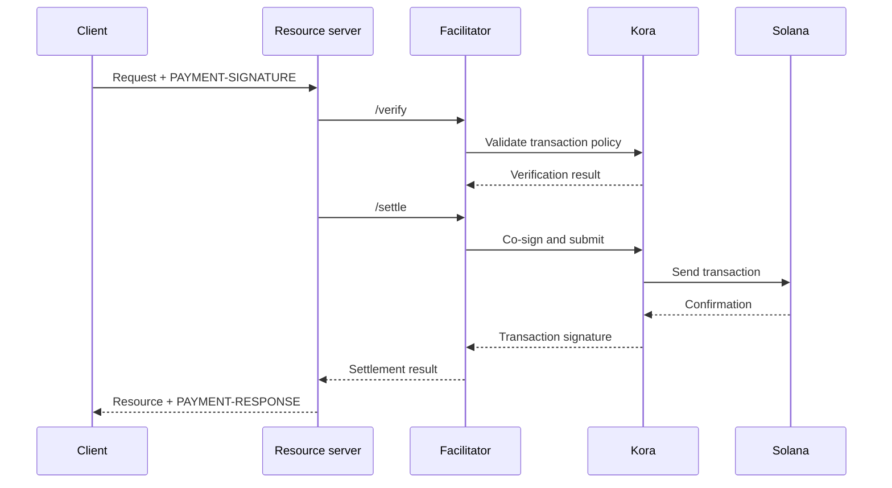

Bir x402 facilitator, bir veya daha fazla kaynak sunucusu için ödeme doğrulama ve
mutabakat (settlement) işlemlerini gerçekleştirir. Bir API'nin, RPC, işlem gönderimi
ve ücret ödeyici (fee-payer) mantığını her uygulama sürecine yerleştirmeden zincir üstü
ödemeleri kabul etmesini sağlar.

Facilitator, zorunlu bir üçüncü taraf değil, mimari bir roldür. Yönetilen bir hizmet
kullanabilir, ayrı bir facilitator işletebilir veya kaynak sunucunuzun içinde
kendi kendinize facilitator olabilirsiniz.

## Facilitator arayüzü

x402 V2 üç HTTP işlemi tanımlar:

| Uç nokta     | Amaç                                                                       |
| ------------ | ----------------------------------------------------------------------------- |
| `/supported` | Desteklenen protokol sürümlerini, şemaları, ağları, uzantıları ve imzalayıcıları listeler |
| `/verify`    | Bir ödeme yükünü, ödemeyi tamamlamadan gereksinimlerine göre denetler         |
| `/settle`    | Ödemeyi gönderir veya tamamlar ve mutabakat sonucunu döndürür            |

Kaynak sunucunuz, başlangıçta veya dağıtım sırasında `/supported` uç noktasını
kontrol etmelidir. Seçilen facilitator, ilgili x402 sürümü, şeması ve Solana ağı
için desteği tam olarak onaylamadan bir ödeme seçeneğini duyurmayın.

```bash
curl https://facilitator.example/supported
```

## Teslimattan önce doğrulama

Güvenli istek sırası şöyledir:

1. `PAYMENT-SIGNATURE` yükünü bir protokol kütüphanesiyle ayrıştırın.
2. Yükü, başlangıçta sunulan `PaymentRequirements` ile birebir eşleştirin.
3. Yükü yerel olarak veya `/verify` üzerinden doğrulayın.
4. Kaynak işlemini yalnızca seçilen ödeme akışı teslimat sonrası mutabakata
   izin veriyorsa gerçekleştirin.
5. `/settle` çağrısını yapın ve sonucu içeren `PAYMENT-RESPONSE` yanıtını döndürün.

Farklı şemalar farklı teslimat sıraları tanımlayabilir. Örneğin, bir yetkilendirme
akışı kaynak işleminden önce doğrulama yapıp işlemden sonra mutabakata varabilirken,
başka bir şema teslimattan önce mutabakat gerektirebilir. Her ödeme için tek bir
sıra varsaymak yerine seçilen şemanın belirttiği akışı izleyin.

<Callout type="warn" title="Facilitator yanıtlarını ödeme kararı olarak değerlendirin">
  Facilitator trafiğini doğrulayın, her yanıtı denetleyin, katı zaman aşımları
  kullanın ve hata durumunda isteği reddedin. Bir ağ hatası veya hatalı biçimlendirilmiş
  yanıt, ödemenin kanıtı değildir.
</Callout>

## Bir dağıtım modeli seçin

| Model                   | Şu durumda kullanın                                                        | Ana sorumluluk                                                    |
| ----------------------- | --------------------------------------------------------------- | ---------------------------------------------------------------------- |
| Yönetilen facilitator     | En küçük operasyonel yüzeyi istiyorsanız                       | Desteklenen ağları, güven modelini, kullanılabilirliği ve veri politikasını inceleyin  |
| Özel, kendi kendine barındırılan   | Birden fazla API imzalama ve mutabakat altyapısını paylaşıyorsa        | Anahtarları, RPC'leri, depolamayı, ölçeklemeyi ve yükseltmeleri güvence altına alın                      |
| Süreç içi facilitator | Tek bir hizmetin tam kontrole ihtiyacı varsa ve zincir bileşenlerini işletebiliyorsa | Ödeme kodunu izole tutun ve istek yükünün onu tüketmesini önleyin |

Bir facilitator'ı yalnızca URL'si `/supported` isteğine yanıt veriyor diye seçmeyin.
Fee-payer anahtarlarını nasıl koruduğunu, tekrar saldırılarını (replay) nasıl
engellediğini, işlemleri nasıl onayladığını, kısmi hataları nasıl ele aldığını ve
olayları nasıl raporladığını inceleyin.

## Solana imzalama altyapısı olarak Kora

[Kora](/docs/tools/kora), işlem doğrulama ve ücret sponsorluğu politikalarına sahip bir Solana
imzalayıcı düğümüdür. Bir x402 facilitator, Kora'yı imzalama ve gönderim arka ucu
olarak kullanabilir:



Kora, x402'nin yerini almaz. Kaynak sunucusu ve facilitator yine x402 V2 nesnelerini
ve uç noktalarını uygular; Kora ise Solana işlem politikasını uygular ve RPC arayüzünün
arkasındaki fee-payer imzalayıcısını korur.

Güncel demo ve yapılandırma için [Kora x402 kılavuzunu](/docs/tools/kora/guides/x402)
izleyin.

## Üretim kontrol listesi

### Anahtarlar ve işlem politikası

- Facilitator ve fee-payer anahtarlarını donanım destekli veya uzak bir imzalama
  arka ucunda saklayın.
- System, Compute Budget, Token, Token-2022 ve Associated Token programlarını yalnızca
  desteklenen şemanın gerektirdiği ölçüde izin listesine ekleyin.
- İmzalamadan önce beklenmeyen yazılabilir hesapları, transfer yetkililerini, alıcıları,
  mint'leri, talimatları ve compute fiyatlarını reddedin.
- Ödeme alan hesapları operasyonel fee-payer hesaplarından ayrı tutun.

### Tekrar saldırısı (replay) ve idempotency

- Tüketilmiş ödeme tanımlayıcılarını ve işlem imzalarını paylaşılan, kalıcı bir
  depoda saklayın.
- Doğrulama ve tüketme işlemini atomik yapın; böylece iki sunucu örneği aynı
  yetkilendirmeyi eşzamanlı olarak kabul edemez.
- Yan etkisi olan kaynak işlemleri için bir idempotency anahtarı zorunlu tutun.
- Meşru bir yeniden denemede tekrar ücret almak yerine orijinal sonucu döndürün.

### Kullanılabilirlik ve hata yönetimi

- `/verify`, `/settle`, RPC gönderimi ve onay için sınırlı zaman aşımları belirleyin.
- Reddedilen, süresi dolan, bekleyen, onaylanan ve başarısız olan mutabakatları birbirinden ayırın.
- Blockhash süresi dolduktan sonra, ödeyenden yeni işlemi yetkilendirmesini istemeden
  bir işlemi yeniden oluşturmayın veya yeniden imzalamayın.
- Birden fazla RPC uç noktası kullanın; blockhash güncelliğini, onay gecikmesini ve
  fee-payer bakiyesini izleyin.

### Gözlemlenebilirlik

Kaynağı, challenge kimliğini, seçilen şemayı ve ağı, tutarı, varlığı, alıcıyı, ödeyen
adresini, işlem imzasını, onay seviyesini, gecikmeyi ve nihai durumu kaydedin. Kodlanmış
ödeme kimlik bilgilerini, bearer token'ları, özel anahtarları veya ham imzalayıcı
yanıtlarını asla günlüğe kaydetmeyin.

Mutabakat hataları, tekrar denemeleri, politika ret kararları, beklenmeyen varlıklar veya
alıcılar, fee-payer bakiyesinin tükenmesi ve doğrulanan ödemelerle teslim edilen kaynaklar
arasındaki farklar için uyarı oluşturun.

## İlgili kaynaklar

- [x402 facilitator spesifikasyonu](https://github.com/x402-foundation/x402/blob/main/specs/x402-specification-v2.md#7-facilitator-interface)
- [Solana'da x402](/docs/payments/agentic-payments/x402)
- [Kora operatör kılavuzu](/docs/tools/kora/operators)
- [Üretim hazırlığı](/docs/tools/transaction-landing#rpc-infrastructure)
