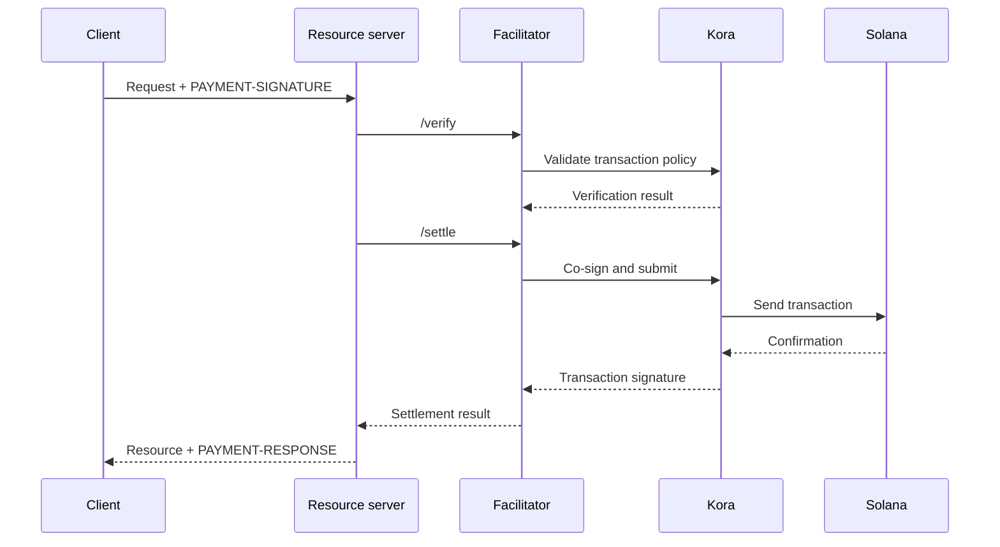

Bir x402 facilitator'ı, bir veya daha fazla kaynak sunucusu için ödeme doğrulama ve
yerleşim (settlement) işlemlerini gerçekleştirir. Böylece bir API, RPC, işlem gönderimi
ve fee-payer mantığını her uygulama sürecine eklemeden zincir üstü ödemeleri kabul edebilir.

Facilitator mimari bir roldür, zorunlu bir üçüncü taraf değildir. Yönetilen bir hizmet
kullanabilir, ayrı bir facilitator işletebilir veya kaynak sunucunuzun içinde
kendi kendinize facilitator olabilirsiniz.

## Facilitator arayüzü

x402 V2 üç HTTP işlemi tanımlar:

| Uç nokta     | Amaç                                                                       |
| ------------ | ----------------------------------------------------------------------------- |
| `/supported` | Desteklenen protokol sürümlerini, şemaları, ağları, uzantıları ve imzalayanları listeler |
| `/verify`    | Bir ödeme yükünü (payload), yerleştirmeden gereksinimlerine göre kontrol eder         |
| `/settle`    | Ödemeyi gönderir veya tamamlar ve yerleşim sonucunu döndürür            |

Kaynak sunucunuz başlangıçta veya dağıtım sırasında `/supported` uç noktasını
kontrol etmelidir. Seçilen facilitator tam olarak o x402 sürümü, şeması ve Solana
ağı için desteği doğrulamadan bir ödeme seçeneği duyurmayın.

```bash
curl https://facilitator.example/supported
```

## Teslimattan önce doğrulama

Güvenli istek sırası şöyledir:

1. `PAYMENT-SIGNATURE` yükünü bir protokol kütüphanesiyle ayrıştırın.
2. Yükü, başlangıçta sunulan `PaymentRequirements` ile birebir eşleştirin.
3. Yükü yerel olarak veya `/verify` üzerinden doğrulayın.
4. Kaynak işlemini yalnızca seçilen ödeme akışı teslimat sonrası yerleşime
   izin veriyorsa gerçekleştirin.
5. `/settle` çağrısı yapın ve sonuçla birlikte `PAYMENT-RESPONSE` döndürün.

Farklı şemalar farklı teslimat sıralamaları tanımlayabilir. Örneğin, bir yetkilendirme
akışı kaynak işleminden önce doğrulama yapıp işlemden sonra yerleşim
gerçekleştirebilirken, başka bir şema teslimattan önce yerleşim gerektirebilir. Her
ödeme için tek bir sıra varsaymak yerine seçilen şemanın belirttiği akışı izleyin.

<Callout type="warn" title="Facilitator yanıtlarını ödeme kararı olarak değerlendirin">
  Facilitator trafiğini doğrulayın (authenticate), her yanıtı kontrol edin, katı
  zaman aşımları kullanın ve hata durumunda erişimi kapalı tutun (fail closed). Bir ağ hatası veya hatalı biçimlendirilmiş yanıt
  ödemenin kanıtı değildir.
</Callout>

## Bir dağıtım modeli seçin

| Model                   | Ne zaman kullanılır                                                        | Temel sorumluluk                                                    |
| ----------------------- | --------------------------------------------------------------- | ---------------------------------------------------------------------- |
| Yönetilen facilitator     | En küçük operasyonel yüzeyi istiyorsanız                       | Desteklenen ağları, güven modelini, kullanılabilirliği ve veri politikasını inceleyin  |
| Özel, kendi barındırdığınız   | Birden fazla API imzalama ve yerleşim altyapısını paylaşıyorsa        | Anahtarları, RPC'leri, depolamayı, ölçeklendirmeyi ve yükseltmeleri güvenceye alın                      |
| Süreç içi facilitation | Tek bir hizmetin tam kontrole ihtiyacı varsa ve zincir bileşenlerini işletebiliyorsa | Ödeme kodunu yalıtılmış tutun ve istek yükünün onu tüketmesini önleyin |

Bir facilitator'ı yalnızca URL'si `/supported` isteğine yanıt verdiği için seçmeyin.
Fee-payer anahtarlarını nasıl koruduğunu, tekrar saldırılarını (replay) nasıl önlediğini, işlemleri nasıl
onayladığını, kısmi hataları nasıl ele aldığını ve olayları nasıl raporladığını inceleyin.

## Solana imzalama altyapısı olarak Kora

[Kora](/docs/tools/kora), işlem doğrulama ve ücret sponsorluğu politikalarına sahip bir Solana
imzalayıcı düğümüdür. Bir x402 facilitator'ı, Kora'yı imzalama ve gönderim
arka ucu olarak kullanabilir:



Kora, x402'nin yerini almaz. Kaynak sunucusu ve facilitator yine x402 V2 nesnelerini
ve uç noktalarını uygular; Kora ise Solana işlem politikasını uygular ve RPC arayüzünün
arkasındaki fee-payer imzalayıcısını korur.

Güncel demo ve yapılandırma için [Kora x402 kılavuzunu](/docs/tools/kora/guides/x402)
takip edin.

## Üretim kontrol listesi

### Anahtarlar ve işlem politikası

- Facilitator ve fee-payer anahtarlarını donanım destekli veya uzak bir imzalama
  arka ucunda saklayın.
- System, Compute Budget, Token, Token-2022 ve Associated Token Program'ı yalnızca
  desteklenen şemanın gerektirdiği ölçüde izin listesine ekleyin.
- İmzalamadan önce beklenmeyen yazılabilir hesapları, transfer yetkililerini, alıcıları, mint'leri,
  talimatları ve işlem hesaplama fiyatlarını reddedin.
- Ödeme alan hesapları operasyonel fee-payer hesaplarından ayrı tutun.

### Tekrar (replay) ve idempotency

- Kullanılmış ödeme tanımlayıcılarını ve işlem imzalarını paylaşımlı, kalıcı bir
  depoda saklayın.
- Doğrulama ve tüketme işlemini atomik yapın; böylece iki sunucu örneği aynı
  yetkilendirmeyi eşzamanlı olarak kabul edemez.
- Yan etkisi olan kaynak işlemleri için bir idempotency anahtarı zorunlu kılın.
- Meşru bir yeniden denemede tekrar ücret almak yerine ilk sonucu döndürün.

### Kullanılabilirlik ve hata yönetimi

- `/verify`, `/settle`, RPC gönderimi ve onay için sınırlı zaman aşımları
  belirleyin.
- Reddedilen, süresi dolan, bekleyen, onaylanan ve başarısız yerleşimleri birbirinden ayırın.
- Blockhash süresi dolduktan sonra, ödeme yapandan yeni işlemi yetkilendirmesini
  istemeden işlemi yeniden oluşturmayın veya yeniden imzalamayın.
- Birden fazla RPC uç noktası kullanın ve blockhash tazeliğini, onay
  gecikmesini ve fee-payer bakiyesini izleyin.

### Gözlemlenebilirlik

Kaynağı, challenge kimliğini, seçilen şemayı ve ağı, tutarı, varlığı,
alıcıyı, ödeme yapan adresi, işlem imzasını, onay seviyesini, gecikmeyi
ve nihai durumu kaydedin. Kodlanmış ödeme kimlik bilgilerini, bearer token'ları, özel
anahtarları veya ham imzalayıcı yanıtlarını asla günlüğe kaydetmeyin.

Yerleşim hataları, tekrar (replay) denemeleri, politika ret durumları, beklenmeyen
varlıklar veya alıcılar, fee-payer bakiyesinin tükenmesi ve doğrulanmış
ödemelerle teslim edilen kaynaklar arasındaki farklar için uyarı oluşturun.

## İlgili kaynaklar

- [x402 facilitator spesifikasyonu](https://github.com/x402-foundation/x402/blob/main/specs/x402-specification-v2.md#7-facilitator-interface)
- [Solana'da x402](/docs/payments/agentic-payments/x402)
- [Kora operatör kılavuzu](/docs/tools/kora/operators)
- [Üretim hazırlığı](/docs/tools/transaction-landing#rpc-infrastructure)
