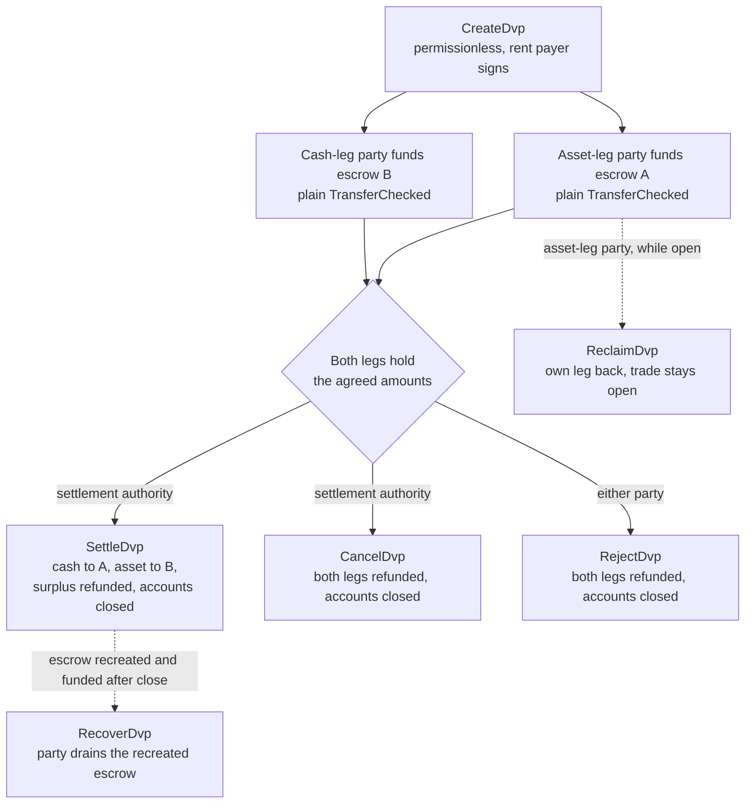
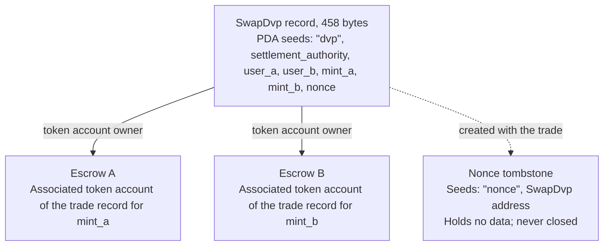

Програма DvP — це стандартна програма для «поставки проти платежу» (delivery versus payment) у Solana,
яку підтримує Solana Foundation і яку аудитувала Cantina. Дві сторони погоджують
угоду, кожна надсилає свою складову на ескроу-акаунт звичайним переказом
токенів, а розрахунковий орган виконує розрахунок за обома складовими в одній транзакції, тож
або переміщуються обидві, або жодна. Розрахунковий орган — це третя адреса,
указана в угоді, наприклад майданчик або агент, який її організував. Жодна зі сторін не
пише й не розгортає програму, а гаманець чи кастодіан, який може надіслати стандартний
переказ токенів (`TransferChecked`), може поповнити складову без жодної
інтеграції, специфічної для DvP. До розрахунку кожна зі сторін може забрати свою
складову назад або скасувати угоду.

<Callout type="warn" title="Перевіряйте запис, перш ніж діяти на його основі">

Створення запису угоди не потребує жодних дозволів, тому запис не є доказом
домовленості. Кожна сторона перед поповненням перевіряє збережені умови, а розрахунковий
орган — перед виконанням розрахунку (див.
[перевірка](#verification-before-funding-and-settlement)).

</Callout>

## Як це працює

Кожна угода отримує запис, що належить програмі, і два ескроу-акаунти — по одному на складову.
Сторона зі складовою активу (`user_a`) і сторона з грошовою складовою (`user_b`) поповнюють свою
складову, переказуючи токени на ескроу-акаунт цієї складової. Розрахунковий
орган — єдиний підписант, який може виконати розрахунок. Під час розрахунку узгоджена
сума кожної складової переказується іншій стороні, залишок повертається стороні, якій належить
складова, а запис і обидва ескроу закриваються. Атомарність забезпечують
[транзакції](/docs/core/transactions) Solana: обидва перекази виконуються в одній транзакції,
тож або набувають чинності обидва, або жоден.

Кожне відшкодування, повернення та повернення залишку надходить на власний associated
token account сторони: акаунт `user_a` для `mint_a`, акаунт `user_b` для `mint_b`. Кастодіан
або казначейська система може поповнити складову зі свого акаунта, але все, що
повертається, потрапляє на акаунт сторони, а не назад до кастодіана. Кожна угода
також залишає постійний акаунт-маркер (див. [Стан](#state)).

## Посібники

Сторінки з кроками проводять одну угоду від створення до розрахунку, із TypeScript і
Rust для кожної інструкції.

<Cards>
  <Card title="Створення угоди" href="/docs/defi/dvp-program/create-a-trade">
    Установіть клієнти та запишіть умови угоди за допомогою CreateDvp
  </Card>
  <Card title="Поповнення складових" href="/docs/defi/dvp-program/fund-the-legs">
    Перевірте збережені умови, а потім поповніть кожну складову звичайним переказом
  </Card>
  <Card title="Розрахунок за угодою" href="/docs/defi/dvp-program/settle-the-trade">
    Виконайте розрахунок за обома складовими в одній транзакції як розрахунковий орган
  </Card>
  <Card title="Згортання угоди" href="/docs/defi/dvp-program/unwind-a-trade">
    Заберіть складову, скасуйте або відхиліть угоду та поверніть пізні депозити
  </Card>
</Cards>

[Демо в devnet](https://solana.com/delivery-vs-payment/demo) проводить угоду від початку
до кінця: створює угоду, поповнює обидва ескроу стандартними переказами токенів і
виконує розрахунок за обома складовими в одній транзакції.

## Вибір між програмою та делегуванням

[Delivery vs Payment (DvP) із використанням делегування](/docs/tokenization/dvp) забезпечує
той самий обмін без програми: кожна сторона делегує свою позицію агенту
розрахунків, який переміщує обидві складові в одній транзакції.

- **Програма** не потребує делегування, тож обмеження в одного делегата на token
  account не діє, а розрахунковий орган не може перенаправити виручку.
  Кожна угода залежить від оновлюваної програми та її повноважень на оновлення.
- **Шаблон делегування** не залежить від програми й працює з mint, які
  мають Scaled UI Amount. Програма відхиляє такі mint, що виключає будь-який
  mint, створений із шаблону `tokenized-security` від Mosaic (див.
  [обмеження конфігурації mint](#mint-configuration-constraints)).

## Ролі

Програма симетрична. В її інтерфейсі дві сторони — це `user_a`, який
постачає `mint_a`, і `user_b`, який постачає `mint_b`. README та згенеровані клієнти
називають `mint_a` складовою активу, а `mint_b` — грошовою складовою, і ці сторінки
дотримуються цієї умови, але ніщо в програмі не вимагає, щоб грошова
складова була грошовим інструментом. Два активи або два стейблкоїни розраховуються так
само.

| Роль                 | Хто                               | Підписує                                              | Примітки                                                                                                                                                                                                     |
| -------------------- | --------------------------------- | -------------------------------------------------- | --------------------------------------------------------------------------------------------------------------------------------------------------------------------------------------------------------- |
| Сторона зі складовою активу      | `user_a`, постачає `mint_a`       | Власний переказ для поповнення; Reclaim, Reject, Recover | Гаманець на keypair або смарт-гаманець на основі PDA, наприклад сховище multisig. Мультипідписний акаунт SPL Token або program account не можуть бути стороною: Create завершується помилкою `PartyNotSignerCapable`                   |
| Сторона з грошовою складовою       | `user_b`, постачає `mint_b`       | Власний переказ для поповнення; Reclaim, Reject, Recover | Ті самі вимоги                                                                                                                                                                                          |
| Розрахунковий орган | Третя адреса, указана під час створення | Settle, Cancel                                     | Єдиний підписант, який може виконати розрахунок. Він не може перенаправити виручку, яка фіксується під час створення. Отримує rent закритих акаунтів, коли виконує розрахунок або скасовує угоду                                         |
| Платник rent           | Той, хто підписує `CreateDvp`         | Create                                             | Вносить rent (депозит у SOL, що утримує акаунт відкритим) за запис, nonce tombstone та обидва ескроу. Не записується як одержувач rent: rent закритих акаунтів надходить тому, хто закриває угоду |

## ID програми

```text
dvp34bdbcEm4f4FCUjGV4mDAkDshaQR4LkK8fdcsyZq
```

| Кластер      | Програма                                       | Повноваження на оновлення                              | Останній slot розгортання |
| ------------ | --------------------------------------------- | ---------------------------------------------- | ------------------ |
| mainnet-beta | `dvp34bdbcEm4f4FCUjGV4mDAkDshaQR4LkK8fdcsyZq` | `DXtFpbPjcn2hxPnw79x1Pfoj35vXh5AsWBkS37YnXMVv` | 452,058,374        |
| devnet       | `dvp34bdbcEm4f4FCUjGV4mDAkDshaQR4LkK8fdcsyZq` | `5EX1zFeJWj4rGYZv432WnYw8CbaSUeTdxPx4r573UgYU` | 479,376,863        |

Програма є оновлюваною в обох кластерах. Наведені вище значення — це те, що
`solana program show` показала 2 жовтня 2026 року; запустіть ту саму команду, щоб побачити
поточні значення. Збірка в devnet старіша за коміт, на основі якого написано сторінки з кроками (див. [Встановлення](/docs/defi/dvp-program/create-a-trade#install)),
але з тим самим набором інструкцій і помилок.

## Життєвий цикл



Угода відкрита від `CreateDvp`, доки одна з інструкцій Settle, Cancel або Reject не закриє
її. Поповнення не має власної інструкції: складова вважається поповненою, коли її ескроу-акаунт
містить щонайменше узгоджену суму. Reclaim діє для окремої складової й залишає
угоду відкритою, тож проблема з однією складовою не змушує іншу сторону скасовувати
всю угоду.

## Стан

Кожна угода має один акаунт `SwapDvp` розміром 458 байтів, що належить програмі. Його
адреса виводиться з розрахункового органу, двох сторін, двох
mint і nonce (seeds
`["dvp", settlement_authority, user_a, user_b, mint_a, mint_b, nonce]`). Суми
та час зберігаються всередині акаунта й не впливають на адресу, тому їх
потрібно читати, а не припускати. Невеликий акаунт-маркер,
nonce tombstone за адресою `["nonce", swap_dvp]`, створюється разом з угодою й
ніколи не закривається, тож кожну комбінацію сторін, mint, органу та nonce можна
використати лише для однієї угоди.



| Поле                                  | Тип          | Значення                                                                                                 |
| -------------------------------------- | ------------- | ------------------------------------------------------------------------------------------------------- |
| `bump`                                 | `u8`          | Bump PDA                                                                                                |
| `user_a`, `user_b`                     | `Pubkey`      | Дві сторони                                                                                         |
| `mint_a`, `mint_b`                     | `Pubkey`      | Mint складової активу та грошової складової                                                                        |
| `settlement_authority`                 | `Pubkey`      | Єдиний підписант, який може виконати розрахунок або скасувати угоду                                                               |
| `token_program_a`, `token_program_b`   | `Pubkey`      | Token program, що володіє кожним mint; в одній угоді можна змішувати складові SPL Token і Token-2022                    |
| `amount_a`, `amount_b`                 | `u64`         | Узгоджена сума кожної складової в найменшій одиниці mint (базові одиниці)                                 |
| `expiry_timestamp`                     | `i64`         | Після цього мережевого часу (годинника в блокчейні) Settle відхиляється. Reclaim, Cancel і Reject і далі працюють |
| `nonce`                                | `u64`         | Розрізняє угоди, які мають решту спільних seeds. Одноразовий                                             |
| `ref_string`                           | `[u8; 64]`    | Непрозоре посилання клієнта, доповнене нулями; програма його ніколи не читає                                     |
| `user_a_settlement_destination`        | `Pubkey`      | Отримує грошову складову під час Settle; за замовчуванням `user_a`                                                   |
| `user_b_settlement_destination`        | `Pubkey`      | Отримує складову активу під час Settle; за замовчуванням `user_b`                                                  |
| `mint_a_authority`, `mint_b_authority` | `Pubkey`      | Mint authority, зафіксовані під час створення; Settle завершується помилкою, якщо будь-який із них змінився                           |
| `earliest_settlement_timestamp`        | `Option<i64>` | Якщо задано, Settle відхиляється до цього мережевого часу                                                     |

Перелік полів узято з IDL програми в коміті, указаному в розділі
[Створення угоди](/docs/defi/dvp-program/create-a-trade#install).

## Інструкції

| Інструкція  | Підписант               | Дія                                                                                                                                                              |
| ------------ | -------------------- | ------------------------------------------------------------------------------------------------------------------------------------------------------------------- |
| `CreateDvp`  | Будь-який платник            | Створює запис `SwapDvp`, його nonce tombstone та обидва ескроу-акаунти. Не переміщує жодних токенів                                                                        |
| `ReclaimDvp` | `user_a` або `user_b` | Повертає з ескроу власну складову підписанта. Угода залишається відкритою, і складову можна поповнити знову                                                                      |
| `SettleDvp`  | Розрахунковий орган | Переказує `amount_a` на адресу призначення `user_b`, а `amount_b` — на адресу призначення `user_a`, повертає залишок стороні складової, закриває запис і обидва ескроу |
| `CancelDvp`  | Розрахунковий орган | Повертає все, що містить ескроу A, стороні `user_a`, а ескроу B — стороні `user_b`, закриває запис і обидва ескроу                                                            |
| `RejectDvp`  | `user_a` або `user_b` | Той самий ефект, що й Cancel, але підписує сторона                                                                                                                            |
| `RecoverDvp` | `user_a` або `user_b` | Після закриття угоди: спорожнює повторно створений ескроу на власний token account підписанта й закриває його. Охоплює депозит, що надійшов після Settle, Cancel або Reject  |

Кожне повернення надходить на власний associated token account сторони для mint
цієї складової, незалежно від того, хто поповнив ескроу.

Акаунти й аргументи кожної інструкції наведено на сторінці відповідного кроку.

## Помилки

| Код | Помилка                            | Коли                                                                                                   |
| ---- | -------------------------------- | ------------------------------------------------------------------------------------------------------ |
| 0    | `SignerNotParty`                 | Reclaim, Reject або Recover підписано адресою, яка не є `user_a` чи `user_b`                      |
| 1    | `DvpExpired`                     | Settle після `expiry_timestamp`                                                                        |
| 2    | `SettlementAuthorityMismatch`    | Settle або Cancel підписано адресою, що не є розрахунковим органом                              |
| 3    | `SettlementTooEarly`             | Settle до `earliest_settlement_timestamp`                                                          |
| 4    | `LegNotFunded`                   | Settle, коли ескроу містить менше за свою узгоджену суму                                               |
| 5    | `ExpiryNotInFuture`              | Create із терміном дії, що збігається з поточним мережевим часом або передує йому                                            |
| 6    | `EarliestAfterExpiry`            | Create із часом найранішого розрахунку, що настає після завершення терміну дії                                               |
| 7    | `SelfDvp`                        | Create, де `user_a` дорівнює `user_b`                                                                 |
| 8    | `SameMint`                       | Create, де `mint_a` дорівнює `mint_b`                                                                 |
| 9    | `ZeroAmount`                     | Create з нульовою сумою для будь-якої зі складових                                                                |
| 10   | `BlockedMintExtension`           | Create або Settle з mint, що має TransferFee, InterestBearing, ScaledUiAmount або NonTransferable |
| 11   | `SettlementAuthorityIsParty`     | Create, де розрахунковий орган збігається зі стороною                                                  |
| 12   | `SettlementAuthorityExecutable`  | Create з виконуваним розрахунковим органом                                                         |
| 13   | `NonceAlreadyUsed`               | Create повторно використовує `(seeds, nonce)`, для якого вже є tombstone                                         |
| 14   | `ExpiryTooFarInFuture`           | Create із терміном дії понад один рік уперед                                                         |
| 15   | `RefStringTooLong`               | Create з посиланням довшим за 64 байти                                                           |
| 16   | `DvpStillOpen`                   | Recover, поки угода ще відкрита; використовуйте Reclaim                                                     |
| 17   | `DvpNeverCreated`                | Recover із seeds, для яких немає tombstone                                                              |
| 18   | `EscrowPreloadedWithLamports`    | Create, коли ненативний ескроу містить lamports понад мінімальний баланс для звільнення від rent                           |
| 19   | `SettlementDestinationIsSwapDvp` | Create, де адреса призначення розрахунку збігається із записом угоди                                         |
| 20   | `SwapDvpPreloadedWithLamports`   | Create, коли адреса запису містить lamports понад свій резерв rent                                   |
| 21   | `RecipientAtaMismatch`           | Token account одержувача або повернення коштів більше не належить очікуваному гаманцю й mint                  |
| 22   | `PartyNotSignerCapable`          | Create зі стороною, яка не є акаунтом, що належить системній програмі та не є виконуваним                                 |
| 23   | `MintAuthorityChanged`           | Settle, коли mint authority ланки відрізняється від значення, зафіксованого під час створення                         |

## Події та індексація

Програма не генерує ончейн-подій. Індексатор або система звірки зчитує
стан акаунта `SwapDvp` і баланси токенів двох ескроу та використовує
`ref_string`, щоб зіставити угоду з її офчейн-ордером. Оскільки запис
закривається під час розрахунку, система, якій потрібні умови пізніше, зберігає
їх під час зчитування або відновлює з транзакції, що створила угоду.

## Підтримувані токени

В угоді можна поєднати ланку SPL Token з ланкою Token-2022; кожна ланка має
власну token program. Підтримуються ланки з wrapped SOL.

| Розширення Token-2022 на mint ланки                                                     | Поведінка програми                                                  |
| ---------------------------------------------------------------------------------------- | ----------------------------------------------------------------- |
| TransferFee, InterestBearing, ScaledUiAmount, NonTransferable                            | Відхиляється під час Create і Settle з помилкою `BlockedMintExtension`         |
| PermanentDelegate, Pausable, DefaultAccountState, freeze authority, MintCloseAuthority | Приймається; кожен із цих authority може діяти з токенами в ескроу           |
| ConfidentialTransfer                                                                     | Приймається; суми на цій ланці є публічними                          |
| TransferHook                                                                             | Підтримується, до 32 додаткових акаунтів на ланку                        |
| MemoTransfer на акаунті призначення або повернення коштів                                          | Приймається; програма додає потрібний memo перед переказом |

Комісія за переказ призведе до того, що отримувальна сторона недоотримає
узгоджену суму. Interest Bearing і Scaled UI Amount не змінюють необроблені
суми, але їхня ставка чи множник можуть змінитися між створенням і розрахунком
угоди, через що зміниться відображення узгоджених сум. NonTransferable призведе
до того, що обидві ланки застрягнуть.

Прийняті authority можуть переміщувати, заморожувати чи зупиняти токени в ескроу
впродовж усього життєвого циклу угоди (див. нижче). Ескроу не можна налаштувати
на отримання конфіденційних переказів, тому суми в ескроу та суми розрахунку на
конфіденційній ланці є публічними.

Для mint із hook клієнт визначає додаткові акаунти hook і додає їх до Settle,
Cancel, Reject, Reclaim та Recover. Ліміт у 32 на ланку враховує програму hook
і її акаунт валідації. Якщо hook authority збільшить список акаунтів hook понад
цей ліміт, кожен переказ на цій ланці завершуватиметься помилкою, зокрема
Reclaim, Cancel, Reject і Recover, доки authority не скасує зміну. Ліміт
акаунтів у транзакції може спрацювати раніше за ліміт на ланку, коли hook є на
обох ланках.

Коли акаунт призначення або повернення коштів вимагає memo, програма викликає
програму Memo перед переказом, тому кожна інструкція, що переміщує токени з
ескроу, приймає акаунт `memo_program`.

### Обмеження конфігурації mint

**Scaled UI Amount.** Шаблон `tokenized-security` у
[Mosaic](https://github.com/solana-foundation/mosaic), інструментарії випуску від Solana Foundation, завжди додає
Scaled UI Amount, тому програма не приймає як ланку mint, створений за цим
шаблоном. Mint для цієї програми можна створити без цього розширення (див.
[Token Extensions](/docs/tokens/extensions));
[DvP із використанням делегування](/docs/tokenization/dvp) виконує розрахунок через делеговані
повноваження й цю перевірку не застосовує.

**Mint, заморожені за замовчуванням.** Ескроу кожної угоди — це associated token account,
власником якого є Program Derived Address, новий для цієї угоди. На mint із Default Account State,
встановленим у frozen, ескроу створюється замороженим, і переказ для його поповнення
завершується помилкою, доки його не розморозять. У
[Token ACL](/docs/tokenization/token-acl) це означає, що емітент або його трансфер-агент допускає ескроу угоди
до поповнення: або додавши адресу запису угоди (власника ескроу) до allowlist, щоб
будь-хто міг розморозити ескроу, якщо конфігурація Token ACL цього mint вмикає
permissionless thaw, або через розморожування безпосередньо freeze authority. Заморожене
ескроу також блокує Settle, Reclaim, Cancel, Reject і Recover на цій ланці, тож freeze
authority, а на mint із hook — hook authority, є довіреною стороною протягом усього життя
угоди. Шлях із замороженим ескроу описано тут, але він не використовується у фрагментах
для devnet.

## Обмеження

- Немає зіставлення ордерів, визначення цін чи книги ордерів. Сторони погоджують
  умови поза реєстром, і одна з них їх записує.
- Немає неттінгу, лише двосторонні угоди: один запис — це одна угода між двома сторонами.
- Немає часткового виконання. Settle переміщує рівно узгоджену суму кожної ланки
  та повертає будь-який надлишок стороні цієї ланки.
- Немає позареєстрової ланки. Обидві ланки є token account у Solana; касова ланка
  через наявні платіжні системи розраховується окремо та зіставляється.
- Немає перевірки допустимості, allowlist чи KYC. Допустимість власників
  забезпечують власні засоби контролю mint.
- Немає автоматичного розрахунку. Settlement authority має підписати.
- Немає подій і немає комісії протоколу, окрім комісій за транзакції та rent.

Програма усуває ризик втрати основної суми між двома сторонами: жодна ланка не
переміщується, доки не переміститься й інша. Вона не усуває кредитного ризику
емітента чи ризику погашення для жодного з токенів, можливості freeze, pause чи
permanent delegate authority mint діяти на токенах в ескроу (див.
[підтримувані токени](#supported-tokens)), а також залежності від того, що settlement
authority буде доступний для підпису.

## Перевірка перед поповненням і розрахунком

`CreateDvp` не потребує дозволів: підписує лише платник, а сторони та
settlement authority — ні. Тож будь-хто може створити запис із будь-якими
сторонами та умовами. Перед поповненням і ще раз перед розрахунком зчитайте
акаунт `SwapDvp` і переконайтеся, що:

1. Акаунт належить програмі DvP і має рівно 458 байт. Акаунт, який не належить
   програмі, можна заповнити байтами, що декодуються як справжній запис.
2. `user_a`, `user_b`, `mint_a`, `mint_b` і `settlement_authority` відповідають
   узгодженій угоді.
3. `amount_a`, `amount_b`, `expiry_timestamp` і
   `earliest_settlement_timestamp` відповідають узгодженим умовам.
4. Обидві адреси призначення розрахунку є узгодженими адресами. Підроблений запис
   може перенаправити кошти.

У розділі [Поповнення ланок](/docs/defi/dvp-program/fund-the-legs#verify-the-terms) наведено функції зчитування з перевіркою
у згенерованих клієнтах і показано перевірку в коді.

Вважайте угоду розрахованою, коли транзакція Settle досягає
[`finalized`](/docs/rpc#configuring-state-commitment). Це рівень підтвердження мережі; чи позначає він також
остаточність розрахунку для юридичних цілей, залежить від домовленостей сторін
і застосовних правових режимів.

## Версіонування

Акаунт `SwapDvp` не містить поля версії. Його структура фіксована — 458 байт
(`SwapDvp::LEN`), а функції зчитування з перевіркою відхиляють акаунт будь-якої
іншої довжини. IDL має власну версію: `0.1.0` станом на 2 жовтня 2026 року.

Програму можна оновлювати в обох кластерах (див. [ID програми](#program-id)). Запис
угоди існує лише доти, доки її не розраховано, не скасовано чи не відхилено, тож
перевірте в репозиторії, як оновлення впливає на відкриті угоди, і
перегенеруйте клієнти з IDL розгорнутої збірки.

## Репозиторій і аудит

Вихідний код, IDL, згенеровані клієнти й тести містяться в
[`solana-foundation/dvp`](https://github.com/solana-foundation/dvp) за ліцензією MIT. Програма — це `no_std`
Pinocchio-програма; клієнти генеруються з IDL за допомогою Codama. Повідомлення
про вразливості надсилаються через посилання на security advisory репозиторію,
відповідно до його `SECURITY.md`.

Аудит програми провела
[Cantina](https://cantina.xyz/portfolio/fe870bb4-d96d-4902-8aec-9dfcfa2d6a79).

## Пов’язане

- [Поставка проти платежу (DvP) із використанням делегування](/docs/tokenization/dvp): шаблон
  делегування без програми
- [Token ACL](/docs/tokenization/token-acl): як mint з обмеженим доступом взаємодіє з акаунтами
  ескроу
