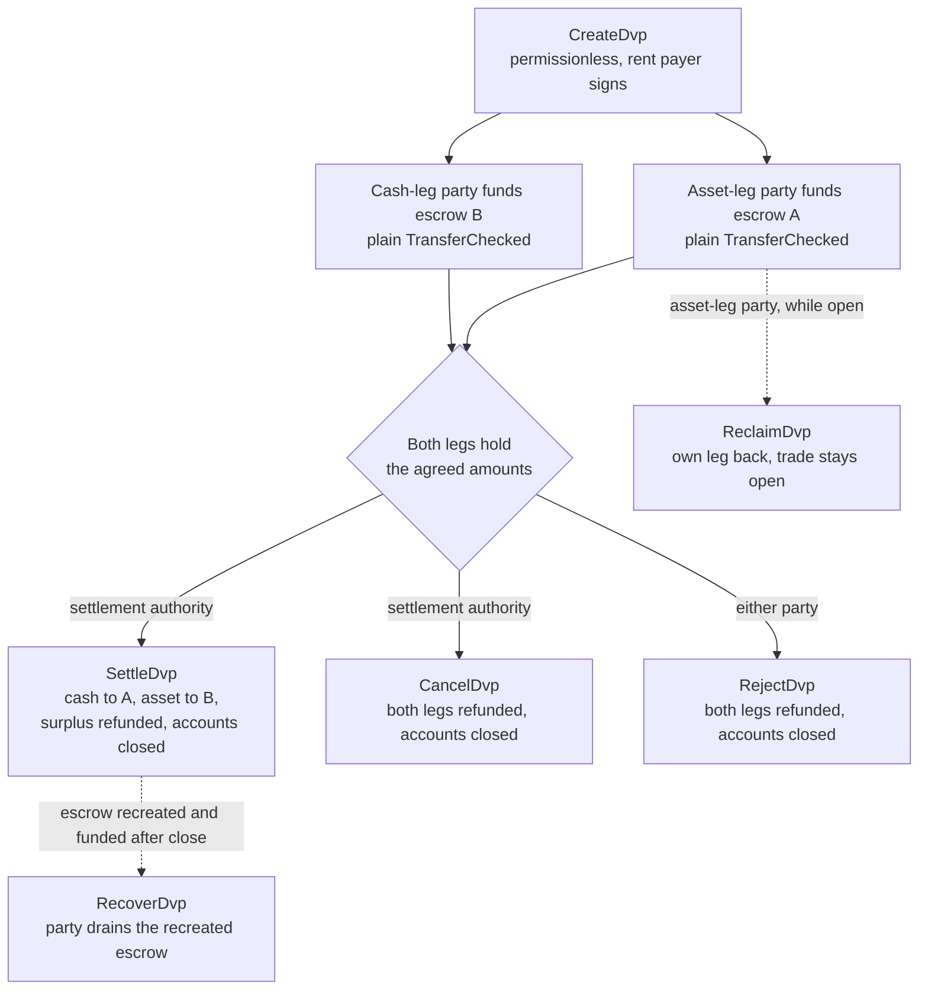
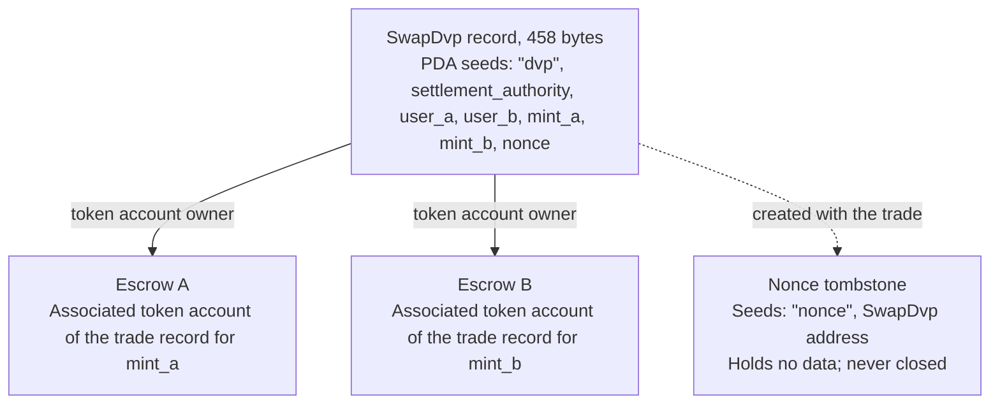

Програма DvP — це стандартна програма для «поставки проти оплати» (delivery versus payment) у Solana,
яку підтримує Solana Foundation і яку аудитувала Cantina. Дві сторони домовляються
про угоду, кожна надсилає свою ногу на ескроу-акаунт звичайним переказом токенів,
а розрахунковий орган виконує розрахунок за обома ногами в одній транзакції: або
переміщуються обидві, або жодна. Розрахунковий орган — це третя адреса, указана
в угоді, наприклад майданчик або агент, який її організував. Жодній зі сторін
не потрібно писати чи розгортати програму, а гаманець або кастодіан, що може
надіслати стандартний переказ токенів (`TransferChecked`), може профінансувати
ногу без жодної інтеграції, специфічної для DvP. До розрахунку кожна зі сторін
може забрати свою ногу назад або розірвати угоду.

<Callout type="warn" title="Перевіряйте запис, перш ніж діяти на його підставі">

Створення запису про угоду не потребує дозволів, тому запис не є доказом
домовленості. Кожна сторона перевіряє збережені умови перед фінансуванням, а
розрахунковий орган — перед розрахунком (див.
[перевірка](#verification-before-funding-and-settlement)).

</Callout>

## Як це працює

Кожна угода отримує запис, що належить програмі, та два ескроу-акаунти — по одному
на кожну ногу. Сторона активної ноги (`user_a`) і сторона грошової ноги (`user_b`)
фінансують свою ногу, переказуючи токени на ескроу-акаунт цієї ноги. Розрахунковий
орган — єдиний підписант, який може виконати розрахунок. Розрахунок переказує
погоджену суму кожної ноги протилежній стороні, повертає будь-який надлишок
стороні, якій належить нога, і закриває запис та обидва ескроу. Атомарність
забезпечують [транзакції](/docs/core/transactions) Solana: обидва перекази
відбуваються в одній транзакції, тож або набувають чинності обидва, або жоден.

Кожне повернення коштів, повернення ноги та повернення надлишку надходить на власний
associated token account сторони: акаунт `user_a` для `mint_a`, акаунт `user_b` для
`mint_b`. Кастодіан або казначейська система може профінансувати ногу зі свого
акаунта, але все повернене потрапляє на акаунт сторони, а не назад до кастодіана.
Кожна угода також залишає постійний акаунт-маркер (див. [Стан](#state)).

## Посібники

Сторінки з кроками проводять одну угоду від створення до розрахунку, із прикладами
TypeScript і Rust для кожної інструкції.

<Cards>
  <Card title="Створити угоду" href="/docs/defi/dvp-program/create-a-trade">
    Установіть клієнти й запишіть умови угоди за допомогою CreateDvp
  </Card>
  <Card title="Профінансувати ноги" href="/docs/defi/dvp-program/fund-the-legs">
    Перевірте збережені умови, а потім профінансуйте кожну ногу звичайним переказом
  </Card>
  <Card title="Виконати розрахунок за угодою" href="/docs/defi/dvp-program/settle-the-trade">
    Виконайте розрахунок за обома ногами в одній транзакції як розрахунковий орган
  </Card>
  <Card title="Розірвати угоду" href="/docs/defi/dvp-program/unwind-a-trade">
    Заберіть ногу назад, скасуйте або відхиліть угоду та поверніть запізнілі депозити
  </Card>
</Cards>

[Демо в devnet](https://solana.com/delivery-vs-payment/demo) проводить угоду від
початку до кінця: створює угоду, фінансує обидва ескроу стандартними переказами
токенів і виконує розрахунок за обома ногами в одній транзакції.

## Вибір між програмою та делегуванням

[Поставка проти оплати (DvP) із делегуванням](/docs/tokenization/dvp) забезпечує
той самий обмін без програми: кожна сторона делегує свою позицію
розрахунковому агенту, який переміщує обидві ноги в одній транзакції.

- **Програма** не потребує делегування, тому обмеження в одного делегата на token
  account не діє, а розрахунковий орган не може перенаправити виплати.
  Кожна угода залежить від оновлюваної програми та її authority для оновлення.
- **Патерн делегування** не залежить від програми та працює з mint-ами, що
  мають Scaled UI Amount. Програма відхиляє такі mint-и, що виключає будь-який
  mint, створений із шаблону `tokenized-security` від Mosaic (див.
  [обмеження конфігурації mint](#mint-configuration-constraints)).

## Ролі

Програма симетрична. В її інтерфейсі двоє сторін: `user_a`, який постачає `mint_a`,
і `user_b`, який постачає `mint_b`. У README та згенерованих клієнтах `mint_a`
називають активною ногою, а `mint_b` — грошовою ногою, і ці сторінки дотримуються
цієї конвенції, але ніщо в програмі не вимагає, щоб грошова нога була грошовим
інструментом. Два активи або два стейблкоїни розраховуються так само.

| Роль                 | Хто                               | Підписує                                              | Примітки                                                                                                                                                                                                     |
| -------------------- | --------------------------------- | -------------------------------------------------- | --------------------------------------------------------------------------------------------------------------------------------------------------------------------------------------------------------- |
| Сторона активної ноги      | `user_a`, постачає `mint_a`       | Власний переказ для фінансування; Reclaim, Reject, Recover | Гаманець на основі keypair або смарт-гаманець на основі PDA, наприклад мультипідписне сховище. Мультипідписний акаунт SPL Token або program account не може бути стороною: Create завершується помилкою `PartyNotSignerCapable`                   |
| Сторона грошової ноги       | `user_b`, постачає `mint_b`       | Власний переказ для фінансування; Reclaim, Reject, Recover | Та сама вимога                                                                                                                                                                                          |
| Розрахунковий орган | Третя адреса, указана під час створення | Settle, Cancel                                     | Єдиний підписант, який може виконати розрахунок. Він не може перенаправити виплати, які фіксуються під час створення. Отримує rent закритих акаунтів, коли виконує Settle або Cancel                                         |
| Платник rent           | Той, хто підписує `CreateDvp`         | Create                                             | Сплачує rent (депозит у SOL, що підтримує акаунт відкритим) за запис, nonce tombstone і обидва ескроу. Не фіксується як отримувач rent: rent закритих акаунтів отримує той, хто закриває угоду |

## ID програми

```text
dvp34bdbcEm4f4FCUjGV4mDAkDshaQR4LkK8fdcsyZq
```

| Кластер      | Програма                                       | Authority для оновлення                              | Останній розгорнутий slot |
| ------------ | --------------------------------------------- | ---------------------------------------------- | ------------------ |
| mainnet-beta | `dvp34bdbcEm4f4FCUjGV4mDAkDshaQR4LkK8fdcsyZq` | `DXtFpbPjcn2hxPnw79x1Pfoj35vXh5AsWBkS37YnXMVv` | 452,058,374        |
| devnet       | `dvp34bdbcEm4f4FCUjGV4mDAkDshaQR4LkK8fdcsyZq` | `5EX1zFeJWj4rGYZv432WnYw8CbaSUeTdxPx4r573UgYU` | 479,376,863        |

Програму можна оновлювати в обох кластерах. Наведені вище значення — це те, що
`solana program show` повернула 2 жовтня 2026 року; щоб отримати актуальні значення,
виконайте ту саму команду. Збірка в devnet старіша за коміт, під який написано
сторінки з кроками (див. [Встановлення](/docs/defi/dvp-program/create-a-trade#install)),
але набір інструкцій і помилок у них однаковий.

## Життєвий цикл



Угода залишається відкритою від `CreateDvp`, доки її не закриє одна з інструкцій
Settle, Cancel або Reject. Фінансування не має власної інструкції: нога вважається
профінансованою, коли її ескроу-акаунт містить принаймні погоджену суму. Reclaim
діє на рівні окремої ноги й залишає угоду відкритою, тож проблема з однією ногою
не змушує іншу сторону скасовувати всю угоду.

## Стан

Кожна угода має один акаунт `SwapDvp` розміром 458 байтів, що належить програмі.
Його адреса виводиться з розрахункового органу, двох сторін, двох mint-ів і nonce
(seeds `["dvp", settlement_authority, user_a, user_b, mint_a, mint_b, nonce]`).
Суми й часові значення зберігаються всередині акаунта та не впливають на адресу,
тому їх потрібно зчитувати, а не виводити. Невеликий акаунт-маркер, nonce tombstone
за адресою `["nonce", swap_dvp]`, створюється разом з угодою та ніколи не
закривається, тож кожну комбінацію сторін, mint-ів, органу й nonce можна
використати лише для однієї угоди.



| Поле                                  | Тип          | Значення                                                                                                 |
| -------------------------------------- | ------------- | ------------------------------------------------------------------------------------------------------- |
| `bump`                                 | `u8`          | bump PDA                                                                                                |
| `user_a`, `user_b`                     | `Pubkey`      | Дві сторони                                                                                         |
| `mint_a`, `mint_b`                     | `Pubkey`      | Mint-и активної та грошової ноги                                                                        |
| `settlement_authority`                 | `Pubkey`      | Єдиний підписант, який може виконати Settle або Cancel                                                               |
| `token_program_a`, `token_program_b`   | `Pubkey`      | token program, якій належить кожен mint; в одній угоді можна поєднувати ноги SPL Token і Token-2022                    |
| `amount_a`, `amount_b`                 | `u64`         | Погоджена сума кожної ноги в найменшій одиниці mint-а (базові одиниці)                                 |
| `expiry_timestamp`                     | `i64`         | Після цього мережевого часу (годинник ончейну) Settle відхиляється. Reclaim, Cancel і Reject усе ще працюють |
| `nonce`                                | `u64`         | Розрізняє угоди, що мають однакові інші seeds. Одноразовий                                             |
| `ref_string`                           | `[u8; 64]`    | Непрозоре посилання клієнта, доповнене нулями; програма його ніколи не читає                                     |
| `user_a_settlement_destination`        | `Pubkey`      | Отримує грошову ногу під час Settle; за замовчуванням `user_a`                                                   |
| `user_b_settlement_destination`        | `Pubkey`      | Отримує активну ногу під час Settle; за замовчуванням `user_b`                                                  |
| `mint_a_authority`, `mint_b_authority` | `Pubkey`      | Authority mint-ів, зафіксовані під час створення; Settle завершується помилкою, якщо будь-яка з них змінилася                           |
| `earliest_settlement_timestamp`        | `Option<i64>` | Якщо задано, Settle відхиляється до цього мережевого часу                                                     |

Перелік полів узято з IDL програми для коміту, указаного в розділі
[Створення угоди](/docs/defi/dvp-program/create-a-trade#install).

## Інструкції

| Інструкція  | Підписант               | Результат                                                                                                                                                              |
| ------------ | -------------------- | ------------------------------------------------------------------------------------------------------------------------------------------------------------------- |
| `CreateDvp`  | Будь-який платник            | Створює запис `SwapDvp`, його nonce tombstone та обидва ескроу-акаунти. Токени не переміщує                                                                        |
| `ReclaimDvp` | `user_a` або `user_b` | Повертає з ескроу ногу самого підписанта. Угода залишається відкритою, і ногу можна профінансувати знову                                                                      |
| `SettleDvp`  | Розрахунковий орган | Переказує `amount_a` на адресу призначення `user_b`, а `amount_b` — на адресу призначення `user_a`, повертає будь-який надлишок стороні відповідної ноги, закриває запис і обидва ескроу |
| `CancelDvp`  | Розрахунковий орган | Повертає все, що містить ескроу A, стороні `user_a`, а ескроу B — стороні `user_b`, закриває запис і обидва ескроу                                                            |
| `RejectDvp`  | `user_a` або `user_b` | Той самий результат, що й у Cancel, але підписує сторона угоди                                                                                                                            |
| `RecoverDvp` | `user_a` або `user_b` | Після закриття угоди: виводить кошти зі створеного повторно ескроу на власний token account підписанта та закриває його. Охоплює депозит, що надійшов після Settle, Cancel або Reject  |

Кожне повернення коштів надходить на власний associated token account сторони для
mint-а відповідної ноги, незалежно від того, хто профінансував ескроу.

Акаунти й аргументи кожної інструкції описано на сторінці відповідного кроку.

## Помилки

| Код | Помилка                            | Коли                                                                                                   |
| ---- | -------------------------------- | ------------------------------------------------------------------------------------------------------ |
| 0    | `SignerNotParty`                 | Reclaim, Reject або Recover підписано адресою, яка не є `user_a` чи `user_b`                      |
| 1    | `DvpExpired`                     | Settle після `expiry_timestamp`                                                                        |
| 2    | `SettlementAuthorityMismatch`    | Settle або Cancel підписано адресою, яка не є розрахунковим органом                              |
| 3    | `SettlementTooEarly`             | Settle до `earliest_settlement_timestamp`                                                          |
| 4    | `LegNotFunded`                   | Settle, поки одне з ескроу містить менше за погоджену суму                                               |
| 5    | `ExpiryNotInFuture`              | Create із закінченням строку, що збігається з поточним мережевим часом або передує йому                                            |
| 6    | `EarliestAfterExpiry`            | Create із найранішим часом розрахунку, що настає після закінчення строку                                               |
| 7    | `SelfDvp`                        | Create, де `user_a` дорівнює `user_b`                                                                 |
| 8    | `SameMint`                       | Create, де `mint_a` дорівнює `mint_b`                                                                 |
| 9    | `ZeroAmount`                     | Create з нульовою сумою на будь-якій із ніг                                                                |
| 10   | `BlockedMintExtension`           | Create або Settle з mint-ом, що має TransferFee, InterestBearing, ScaledUiAmount або NonTransferable |
| 11   | `SettlementAuthorityIsParty`     | Create, де розрахунковий орган збігається з однією зі сторін                                                  |
| 12   | `SettlementAuthorityExecutable`  | Create із виконуваним розрахунковим органом                                                         |
| 13   | `NonceAlreadyUsed`               | Create із повторним використанням `(seeds, nonce)`, для якого вже існує tombstone                                         |
| 14   | `ExpiryTooFarInFuture`           | Create із закінченням строку більш ніж на рік уперед                                                         |
| 15   | `RefStringTooLong`               | Create з посиланням довшим за 64 байти                                                           |
| 16   | `DvpStillOpen`                   | Recover, поки угода ще відкрита; використовуйте Reclaim                                                     |
| 17   | `DvpNeverCreated`                | Recover із seed-ами, для яких немає tombstone                                                              |
| 18   | `EscrowPreloadedWithLamports`    | Create, коли ненативний escrow містить lamports понад мінімум для звільнення від rent                           |
| 19   | `SettlementDestinationIsSwapDvp` | Create з адресою призначення розрахунку, що збігається із записом угоди                                         |
| 20   | `SwapDvpPreloadedWithLamports`   | Create, коли адреса запису містить lamports понад свій резерв rent                                   |
| 21   | `RecipientAtaMismatch`           | token account одержувача або повернення коштів більше не належить очікуваному гаманцю та mint                  |
| 22   | `PartyNotSignerCapable`          | Create зі стороною, яка не є невиконуваним акаунтом, що належить системній програмі                                 |
| 23   | `MintAuthorityChanged`           | Settle, коли mint authority складової відрізняється від значення, зафіксованого під час створення                         |

## Події та індексація

Програма не генерує ончейн-подій. Індексатор або система звірки читає стан
акаунта `SwapDvp` і баланси токенів двох escrow та використовує
`ref_string`, щоб зіставити угоду з її офчейн-ордером. Оскільки запис
закривається під час розрахунку, система, якій згодом потрібні умови, зберігає
їх під час зчитування або відновлює з транзакції, що створила
угоду.

## Підтримувані токени

Угода може поєднувати складову SPL Token зі складовою Token-2022; кожна складова має
власну Token Program. Складові з Wrapped SOL підтримуються.

| Розширення Token-2022 на mint складової                                                     | Поведінка програми                                                  |
| ---------------------------------------------------------------------------------------- | ----------------------------------------------------------------- |
| TransferFee, InterestBearing, ScaledUiAmount, NonTransferable                            | Відхиляється в Create і Settle з `BlockedMintExtension`         |
| PermanentDelegate, Pausable, DefaultAccountState, freeze authority, MintCloseAuthority | Приймається; кожен authority може діяти щодо токенів в escrow           |
| ConfidentialTransfer                                                                     | Приймається; суми на цій складовій публічні                          |
| TransferHook                                                                             | Підтримується, до 32 додаткових акаунтів на складову                        |
| MemoTransfer на акаунті призначення або повернення                                          | Приймається; програма додає потрібний memo перед переказом |

Комісія за переказ залишила б отримувальну сторону з сумою, меншою за узгоджену.
Interest Bearing і Scaled UI Amount не змінюють сирі суми, але їхня ставка
або множник можуть змінитися між створенням і розрахунком угоди, що змінює
те, як відображаються узгоджені суми. NonTransferable заблокував би обидві складові.

Допущені authority можуть переміщувати, заморожувати або зупиняти токени в escrow
протягом усього життєвого циклу угоди (див. нижче). Escrow не можна налаштувати на
отримання конфіденційних переказів, тому суми в escrow і розраховані суми на
конфіденційній складовій є публічними.

Для mint із hook клієнт визначає додаткові акаунти hook і додає
їх до Settle, Cancel, Reject, Reclaim та Recover. Ліміт у 32 на складову
враховує програму hook і її акаунт валідації. Якщо hook authority
збільшить список акаунтів hook понад цей ліміт, кожен переказ на цій складовій
завершуватиметься помилкою, зокрема Reclaim, Cancel, Reject і Recover, доки authority
не скасує зміну. Ліміт акаунтів у транзакції може спрацювати раніше за ліміт на складову,
коли hook є на обох складових.

Коли акаунт призначення або повернення вимагає memo, програма викликає програму Memo
перед переказом, тому кожна інструкція, що виводить токени
з escrow, приймає акаунт `memo_program`.

### Обмеження конфігурації mint

**Scaled UI Amount.** Шаблон `tokenized-security` у
[Mosaic](https://github.com/solana-foundation/mosaic), інструментарії випуску від Solana Foundation,
завжди додає Scaled UI Amount, тому програма не приймає
mint, створений із цього шаблону, як складову. Mint для цієї програми можна
створити без цього розширення (див.
[Token Extensions](/docs/tokens/extensions));
[DvP із делегуванням](/docs/tokenization/dvp) виконує розрахунок через делегований
authority і не застосовує цю перевірку.

**Mint, заморожені за замовчуванням.** Escrow кожної угоди — це associated token account,
що належить Program Derived Address, новому для кожної угоди. На mint із
Default Account State, встановленим у frozen, escrow створюється замороженим, і переказ
для його фінансування завершується помилкою, доки його не розморозять. У рамках
[Token ACL](/docs/tokenization/token-acl) це означає, що емітент або його transfer agent допускає escrow угоди
перед фінансуванням: або додаючи адресу запису угоди (власника escrow) до allowlist,
щоб будь-хто міг розморозити escrow, якщо конфігурація Token ACL для mint вмикає
permissionless thaw, або через розморожування безпосередньо freeze authority. Заморожений escrow також блокує
Settle, Reclaim, Cancel, Reject і Recover на цій складовій, тож freeze
authority, а на mint із hook — hook authority, є довіреною стороною протягом
життя угоди. Шлях із замороженим escrow описано тут, але він не використовується
у фрагментах для devnet.

## Обмеження

- Немає зіставлення ордерів, визначення цін чи книги ордерів. Сторони узгоджують умови поза
  реєстром (ledger), і одна з них їх записує.
- Немає неттінгу, лише двосторонні угоди: один запис — одна угода між двома сторонами.
- Немає часткового виконання. Settle переміщує рівно узгоджену суму кожної складової та
  повертає будь-який надлишок стороні цієї складової.
- Немає позаблокчейнової складової. Обидві складові — це token account на Solana; кешова складова
  через наявні платіжні системи розраховується окремо та звіряється.
- Немає перевірки допустимості, allowlist чи KYC. Допустимість власників забезпечують
  власні засоби контролю mint.
- Немає автоматичного розрахунку. Settlement authority має підписати.
- Немає подій і немає комісії протоколу, окрім комісій за транзакції та rent.

Програма усуває принципальний ризик між двома сторонами: жодна складова не переміщується,
якщо не переміщуються обидві. Вона не усуває кредитний ризик емітента чи ризик погашення за будь-яким
із токенів, здатність freeze, pause чи permanent delegate authority mint
діяти щодо токенів в escrow (див. [підтримувані токени](#supported-tokens)), а також
залежність від того, що settlement authority буде доступний для підпису.

## Перевірка перед фінансуванням і розрахунком

`CreateDvp` не потребує дозволів: підписує лише платник, а сторони та
settlement authority — ні. Тож будь-хто може створити запис із будь-якими
сторонами й умовами. Перед фінансуванням і ще раз перед розрахунком прочитайте
акаунт `SwapDvp` та переконайтеся, що:

1. Акаунт належить програмі DvP і має рівно 458 байтів. Акаунт,
   що не належить програмі, можна заповнити байтами, які декодуються як
   справжній запис.
2. `user_a`, `user_b`, `mint_a`, `mint_b` і `settlement_authority` відповідають
   узгодженій угоді.
3. `amount_a`, `amount_b`, `expiry_timestamp` і
   `earliest_settlement_timestamp` відповідають узгодженим умовам.
4. Обидві адреси призначення розрахунку — узгоджені. Підроблений запис може
   перенаправити кошти.

[Фінансування складових](/docs/defi/dvp-program/fund-the-legs#verify-the-terms) перелічує
перевірювальні рідери згенерованих клієнтів і показує перевірку в коді.

Вважайте угоду розрахованою, коли транзакція Settle досягає
[`finalized`](/docs/rpc#configuring-state-commitment). Це рівень підтвердження мережі (commitment level); чи позначає він також
остаточність розрахунку для юридичних цілей, залежить від домовленостей сторін
і застосовних режимів регулювання.

## Версіонування

Акаунт `SwapDvp` не має поля версії. Його макет фіксований — 458 байтів
(`SwapDvp::LEN`), а перевірювальні рідери відхиляють акаунт будь-якої іншої довжини.
IDL має власну версію: `0.1.0` станом на 2 жовтня 2026 року.

Програма є оновлюваною в обох кластерах (див. [ID програми](#program-id)). Запис
угоди існує лише доти, доки її не розраховано, скасовано чи відхилено, тож перевірте
в репозиторії, як оновлення впливає на відкриті угоди, і перегенеруйте клієнти
з IDL розгорнутої збірки.

## Репозиторій та аудит

Вихідний код, IDL, згенеровані клієнти й тести містяться в
[`solana-foundation/dvp`](https://github.com/solana-foundation/dvp) за ліцензією MIT. Програма є
`no_std` Pinocchio-програмою; клієнти генеруються з IDL за допомогою Codama. Повідомлення про вразливості
надсилаються через посилання на security advisory репозиторію згідно з його `SECURITY.md`.

Програму проаудитувала
[Cantina](https://cantina.xyz/portfolio/fe870bb4-d96d-4902-8aec-9dfcfa2d6a79).

## Пов’язане

- [Delivery vs Payment (DvP) із делегуванням](/docs/tokenization/dvp): патерн
  делегування без програми
- [Token ACL](/docs/tokenization/token-acl): як mint з обмеженим доступом взаємодіє
  з акаунтами escrow
