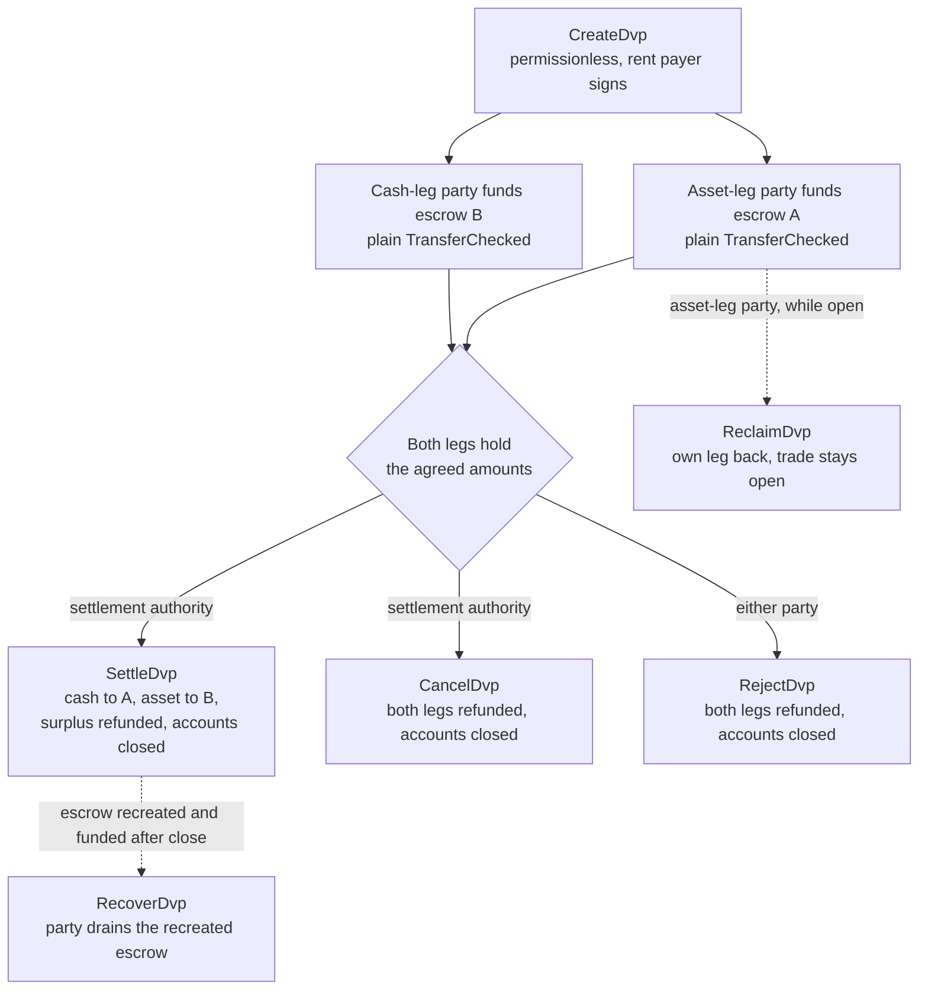
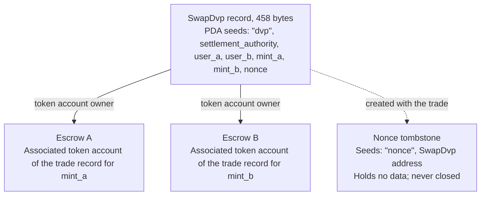

Програма DvP — це стандартна програма для розрахунків за принципом «поставка проти платежу» на Solana,
яку підтримує Solana Foundation і яку аудитувала Cantina. Дві сторони домовляються
про угоду, кожна надсилає свою частину в ескроу-акаунт звичайним переказом
токенів, а орган розрахунків проводить обидві частини в одній транзакції, тож
або виконуються обидві, або жодна. Орган розрахунків — це третя адреса,
зазначена в угоді, наприклад майданчик або агент, який її організував. Жодній зі сторін не потрібно
писати чи розгортати програму, а гаманець або кастодіан, який може надіслати стандартний
переказ токенів (`TransferChecked`), може поповнити частину без жодної
інтеграції, специфічної для DvP. До розрахунку кожна сторона може забрати свою частину назад або скасувати
угоду.

<Callout type="warn" title="Перевірте запис, перш ніж діяти на його основі">

Створення запису про угоду не потребує дозволів, тож запис не є доказом
домовленості. Кожна сторона перевіряє збережені умови, перш ніж поповнювати свою частину, а орган
розрахунків — перш ніж проводити розрахунок (див.
[перевірка](#verification-before-funding-and-settlement)).

</Callout>

## Як це працює

Для кожної угоди створюється запис, що належить програмі, та два ескроу-акаунти — по одному на частину.
Сторона з активом (`user_a`) і сторона з грошима (`user_b`) поповнюють свої частини,
переказуючи токени в ескроу-акаунт відповідної частини. Орган розрахунків
— єдиний підписант, який може провести розрахунок. Розрахунок переказує погоджену
суму кожної частини протилежній стороні, повертає надлишок стороні, якій належить
частина, і закриває запис та обидва ескроу. Атомарність забезпечують
[транзакції](/docs/core/transactions) Solana: обидва перекази відбуваються в одній транзакції,
тож або набувають чинності обидва, або жоден.

Кожне повернення коштів, забирання та повернення надлишку надходить на власний associated
token account сторони: на акаунт `user_a` для `mint_a`, на акаунт `user_b` для `mint_b`. Кастодіан
або казначейська система може поповнити частину зі свого акаунта, але все, що
повертається, потрапляє на акаунт сторони, а не назад до кастодіана. Кожна угода
також залишає постійний акаунт-маркер (див. [Стан](#state)).

## Посібники

Сторінки з кроками проводять одну угоду від створення до розрахунку, з прикладами на TypeScript і
Rust для кожної інструкції.

<Cards>
  <Card title="Створення угоди" href="/docs/defi/dvp-program/create-a-trade">
    Встановіть клієнти та зафіксуйте умови угоди за допомогою CreateDvp
  </Card>
  <Card title="Поповнення частин" href="/docs/defi/dvp-program/fund-the-legs">
    Перевірте збережені умови, а потім поповніть кожну частину звичайним переказом
  </Card>
  <Card title="Розрахунок за угодою" href="/docs/defi/dvp-program/settle-the-trade">
    Проведіть обидві частини в одній транзакції від імені органу розрахунків
  </Card>
  <Card title="Скасування угоди" href="/docs/defi/dvp-program/unwind-a-trade">
    Заберіть частину, скасуйте або відхиліть угоду та поверніть пізні депозити
  </Card>
</Cards>

[Демо в devnet](https://solana.com/delivery-vs-payment/demo) проходить угоду
від початку до кінця: створює угоду, поповнює обидва ескроу стандартними переказами токенів і
проводить обидві частини в одній транзакції.

## Вибір між програмою та делегуванням

[Поставка проти платежу (DvP) із використанням делегування](/docs/tokenization/dvp) проводить
той самий обмін без програми: кожна сторона делегує свою позицію
агенту розрахунків, який переміщує обидві частини в одній транзакції.

- **Програма** не потребує делегування, тож обмеження в один делегат на токен-акаунт
  не застосовується, а орган розрахунків не може перенаправити виручку.
  Кожна угода залежить від оновлюваної програми та її органу оновлення.
- **Шаблон делегування** не залежить від програми й працює з мінтами, які
  мають Scaled UI Amount. Програма відхиляє такі мінти, що виключає будь-який
  мінт, створений із шаблону `tokenized-security` від Mosaic (див.
  [обмеження конфігурації мінта](#mint-configuration-constraints)).

## Ролі

Програма симетрична. У її інтерфейсі дві сторони — це `user_a`, який
поставляє `mint_a`, і `user_b`, який поставляє `mint_b`. У README та
згенерованих клієнтах `mint_a` називається частиною з активом, а `mint_b` — грошовою частиною,
і ці сторінки дотримуються цієї домовленості, але ніщо в програмі не вимагає, щоб грошова
частина була грошовим інструментом. Два активи або два стейблкоїни розраховуються так
само.

| Роль                 | Хто                               | Підписує                                              | Примітки                                                                                                                                                                                                     |
| -------------------- | --------------------------------- | -------------------------------------------------- | --------------------------------------------------------------------------------------------------------------------------------------------------------------------------------------------------------- |
| Сторона з активом      | `user_a`, поставляє `mint_a`       | Власний переказ для поповнення; Reclaim, Reject, Recover | Гаманець на основі keypair або смарт-гаманець на основі PDA, наприклад мультипідписне сховище. Мультипідписний акаунт SPL Token або program account не може бути стороною: Create завершується помилкою `PartyNotSignerCapable`                   |
| Сторона з грошима       | `user_b`, поставляє `mint_b`       | Власний переказ для поповнення; Reclaim, Reject, Recover | Та сама вимога                                                                                                                                                                                          |
| Орган розрахунків | Третя адреса, зазначена при створенні | Settle, Cancel                                     | Єдиний підписант, який може провести розрахунок. Він не може перенаправити виручку, яка фіксується при створенні. Він отримує rent закритих акаунтів, коли проводить розрахунок або скасовує угоду                                         |
| Платник rent           | Той, хто підписує `CreateDvp`         | Create                                             | Вносить rent (депозит у SOL, що підтримує акаунт відкритим) за запис, nonce tombstone та обидва ескроу. Не фіксується як одержувач rent: rent закритих акаунтів надходить тому, хто закриває угоду |

## ID програми

```text
dvp34bdbcEm4f4FCUjGV4mDAkDshaQR4LkK8fdcsyZq
```

| Кластер      | Програма                                       | Орган оновлення                              | Останній slot розгортання |
| ------------ | --------------------------------------------- | ---------------------------------------------- | ------------------ |
| mainnet-beta | `dvp34bdbcEm4f4FCUjGV4mDAkDshaQR4LkK8fdcsyZq` | `DXtFpbPjcn2hxPnw79x1Pfoj35vXh5AsWBkS37YnXMVv` | 452,058,374        |
| devnet       | `dvp34bdbcEm4f4FCUjGV4mDAkDshaQR4LkK8fdcsyZq` | `5EX1zFeJWj4rGYZv432WnYw8CbaSUeTdxPx4r573UgYU` | 479,376,863        |

Програма є оновлюваною в обох кластерах. Наведені вище значення — це те, що
`solana program show` показала 2 жовтня 2026 року; виконайте ту саму команду, щоб отримати
актуальні значення. Збірка в devnet старіша за коміт, під який
написано сторінки з кроками (див. [Встановлення](/docs/defi/dvp-program/create-a-trade#install)),
але має той самий набір інструкцій і помилок.

## Життєвий цикл



Угода відкрита від `CreateDvp` до моменту, коли одна з інструкцій Settle, Cancel або Reject закриє
її. Поповнення не має власної інструкції: частина вважається поповненою, коли її ескроу-
акаунт містить щонайменше погоджену суму. Reclaim діє для окремої частини й залишає
угоду відкритою, тож проблема з однією частиною не змушує іншу сторону скасовувати
всю угоду.

## Стан

Кожна угода має один акаунт `SwapDvp` розміром 458 байтів, що належить програмі. Його
адреса виводиться з органу розрахунків, двох сторін, двох
мінтів і nonce (seeds
`["dvp", settlement_authority, user_a, user_b, mint_a, mint_b, nonce]`). Суми
та часові значення зберігаються всередині акаунта і не впливають на адресу,
тому їх потрібно зчитувати, а не виводити. Невеликий акаунт-маркер,
«надгробок» nonce за адресою `["nonce", swap_dvp]`, створюється разом з угодою і
ніколи не закривається, тож кожну комбінацію сторін, мінтів, органу та nonce можна
використати лише для однієї угоди.



| Поле                                  | Тип          | Значення                                                                                                 |
| -------------------------------------- | ------------- | ------------------------------------------------------------------------------------------------------- |
| `bump`                                 | `u8`          | PDA bump                                                                                                |
| `user_a`, `user_b`                     | `Pubkey`      | Дві сторони                                                                                         |
| `mint_a`, `mint_b`                     | `Pubkey`      | Мінти частини з активом і грошової частини                                                                        |
| `settlement_authority`                 | `Pubkey`      | Єдиний підписант, який може провести розрахунок або скасувати угоду                                                               |
| `token_program_a`, `token_program_b`   | `Pubkey`      | token program, якій належить кожен мінт; угода може поєднувати частини SPL Token і Token-2022                    |
| `amount_a`, `amount_b`                 | `u64`         | Погоджена сума кожної частини в найменшій одиниці мінта (базові одиниці)                                 |
| `expiry_timestamp`                     | `i64`         | Після цього мережевого часу (onchain-годинника) Settle відхиляється. Reclaim, Cancel і Reject, як і раніше, працюють |
| `nonce`                                | `u64`         | Розрізняє угоди, що мають однакові інші seeds. Одноразовий                                             |
| `ref_string`                           | `[u8; 64]`    | Непрозорий клієнтський референс, доповнений нулями; програма його ніколи не зчитує                                     |
| `user_a_settlement_destination`        | `Pubkey`      | Отримує грошову частину при Settle; за замовчуванням `user_a`                                                   |
| `user_b_settlement_destination`        | `Pubkey`      | Отримує частину з активом при Settle; за замовчуванням `user_b`                                                  |
| `mint_a_authority`, `mint_b_authority` | `Pubkey`      | Органи мінтів, зафіксовані при створенні; Settle завершується помилкою, якщо будь-який із них змінився                           |
| `earliest_settlement_timestamp`        | `Option<i64>` | Якщо задано, Settle відхиляється до цього мережевого часу                                                     |

Список полів узято з IDL програми на коміті, указаному в розділі
[Створення угоди](/docs/defi/dvp-program/create-a-trade#install).

## Інструкції

| Інструкція  | Підписант               | Ефект                                                                                                                                                              |
| ------------ | -------------------- | ------------------------------------------------------------------------------------------------------------------------------------------------------------------- |
| `CreateDvp`  | Будь-який платник            | Створює запис `SwapDvp`, його nonce tombstone та обидва ескроу-акаунти. Не переміщує токенів                                                                        |
| `ReclaimDvp` | `user_a` або `user_b` | Повертає власну частину підписанта з ескроу. Угода залишається відкритою, а частину можна поповнити знову                                                                      |
| `SettleDvp`  | Орган розрахунків | Переказує `amount_a` на адресу призначення `user_b`, а `amount_b` — на адресу призначення `user_a`, повертає надлишок стороні відповідної частини, закриває запис і обидва ескроу |
| `CancelDvp`  | Орган розрахунків | Повертає все, що містить ескроу A, стороні `user_a`, а ескроу B — стороні `user_b`, закриває запис і обидва ескроу                                                            |
| `RejectDvp`  | `user_a` або `user_b` | Той самий ефект, що й у Cancel, але підписаний стороною                                                                                                                            |
| `RecoverDvp` | `user_a` або `user_b` | Після закриття угоди: спорожнює повторно створене ескроу на власний token account підписанта та закриває його. Охоплює депозит, що надійшов після Settle, Cancel або Reject  |

Кожне повернення коштів надходить на власний associated token account сторони для мінта
відповідної частини, хоч би хто поповнив ескроу.

Акаунти й аргументи кожної інструкції описано на сторінці відповідного кроку.

## Помилки

| Код | Помилка                            | Коли                                                                                                   |
| ---- | -------------------------------- | ------------------------------------------------------------------------------------------------------ |
| 0    | `SignerNotParty`                 | Reclaim, Reject або Recover підписано адресою, яка не є `user_a` чи `user_b`                      |
| 1    | `DvpExpired`                     | Settle після `expiry_timestamp`                                                                        |
| 2    | `SettlementAuthorityMismatch`    | Settle або Cancel підписано адресою, яка не є органом розрахунків                              |
| 3    | `SettlementTooEarly`             | Settle до `earliest_settlement_timestamp`                                                          |
| 4    | `LegNotFunded`                   | Settle, коли ескроу містить менше за погоджену суму                                               |
| 5    | `ExpiryNotInFuture`              | Create із терміном дії, що збігається з поточним мережевим часом або передує йому                                            |
| 6    | `EarliestAfterExpiry`            | Create із найранішим часом розрахунку після закінчення терміну дії                                               |
| 7    | `SelfDvp`                        | Create, де `user_a` дорівнює `user_b`                                                                 |
| 8    | `SameMint`                       | Create, де `mint_a` дорівнює `mint_b`                                                                 |
| 9    | `ZeroAmount`                     | Create з нульовою сумою в будь-якій частині                                                                |
| 10   | `BlockedMintExtension`           | Create або Settle з мінтом, що має TransferFee, InterestBearing, ScaledUiAmount або NonTransferable |
| 11   | `SettlementAuthorityIsParty`     | Create, де орган розрахунків збігається зі стороною                                                  |
| 12   | `SettlementAuthorityExecutable`  | Create із виконуваним органом розрахунків                                                         |
| 13   | `NonceAlreadyUsed`               | Create повторно використовує `(seeds, nonce)`, для якого вже існує tombstone                                         |
| 14   | `ExpiryTooFarInFuture`           | Create із терміном дії понад один рік уперед                                                         |
| 15   | `RefStringTooLong`               | Create з референсом довшим за 64 байти                                                           |
| 16   | `DvpStillOpen`                   | Recover, поки угода ще відкрита; використовуйте Reclaim                                                     |
| 17   | `DvpNeverCreated`                | Recover із seed-значеннями, для яких немає tombstone                                                              |
| 18   | `EscrowPreloadedWithLamports`    | Create, коли ненативний escrow містить lamports понад мінімальний баланс для звільнення від rent                           |
| 19   | `SettlementDestinationIsSwapDvp` | Create з адресою призначення розрахунку, що збігається із записом угоди                                         |
| 20   | `SwapDvpPreloadedWithLamports`   | Create, коли адреса запису містить lamports понад свій резерв rent                                   |
| 21   | `RecipientAtaMismatch`           | Token account одержувача або повернення коштів більше не належить очікуваному гаманцю та mint                  |
| 22   | `PartyNotSignerCapable`          | Create зі стороною, яка не є невиконуваним акаунтом, що належить системі                                 |
| 23   | `MintAuthorityChanged`           | Settle, коли mint authority ноги відрізняється від значення, зафіксованого під час створення                         |

## Події та індексація

Програма не генерує жодних onchain-подій. Індексатор або система звірки зчитує
стан акаунта `SwapDvp` і баланси токенів двох escrow та використовує
`ref_string`, щоб зіставити угоду з її off-chain ордером. Оскільки запис
закривається під час розрахунку, система, якій потрібні умови постфактум,
зберігає їх під час зчитування або відновлює з транзакції, що створила
угоду.

## Підтримувані токени

Угода може поєднувати ногу SPL Token із ногою Token-2022; кожна нога має
власну token program. Підтримуються ноги з Wrapped SOL.

| Розширення Token-2022 на mint ноги                                                     | Поведінка програми                                                  |
| ---------------------------------------------------------------------------------------- | ----------------------------------------------------------------- |
| TransferFee, InterestBearing, ScaledUiAmount, NonTransferable                            | Відхиляється в Create і Settle з помилкою `BlockedMintExtension`         |
| PermanentDelegate, Pausable, DefaultAccountState, freeze authority, MintCloseAuthority | Приймається; кожен authority може діяти із токенами в escrow           |
| ConfidentialTransfer                                                                     | Приймається; суми на цій нозі публічні                          |
| TransferHook                                                                             | Підтримується, до 32 додаткових акаунтів на ногу                        |
| MemoTransfer на акаунті призначення або повернення                                          | Приймається; програма надсилає потрібний memo перед переказом |

Комісія за переказ призведе до того, що отримувач не дорахується узгодженої суми.
Interest Bearing і Scaled UI Amount не змінюють сирі суми, але їхня ставка
або множник можуть змінитися між створенням і розрахунком угоди, що змінює
відображення узгоджених сум. NonTransferable заблокував би обидві ноги.

Дозволені authority можуть переміщувати, заморожувати або зупиняти токени в escrow
протягом усього життєвого циклу угоди (див. нижче). Escrow не можна налаштувати
на отримання конфіденційних переказів, тому суми в escrow і суми розрахунку
на нозі з ConfidentialTransfer є публічними.

Для mint із hook клієнт визначає додаткові акаунти hook і додає
їх до Settle, Cancel, Reject, Reclaim та Recover. Ліміт у 32 на ногу
включає програму hook і її акаунт валідації. Якщо hook authority
збільшить список акаунтів hook понад цей ліміт, кожен переказ на цій нозі
завершуватиметься помилкою, зокрема Reclaim, Cancel, Reject і Recover, доки authority
не скасує зміну. Ліміт акаунтів у транзакції може спрацювати раніше за ліміт
на ногу, якщо hook мають обидві ноги.

Коли акаунт призначення або повернення вимагає memo, програма викликає програму
Memo перед переказом, тому кожна інструкція, що переміщує токени з escrow,
приймає акаунт `memo_program`.

### Обмеження конфігурації mint

**Scaled UI Amount.** Шаблон `tokenized-security` у
[Mosaic](https://github.com/solana-foundation/mosaic), інструментарії випуску від Solana Foundation, завжди додає
Scaled UI Amount, тому програма не приймає mint, створений із цього шаблону, як
ногу. Mint для цієї програми можна створити без цього розширення (див.
[Token Extensions](/docs/tokens/extensions));
[DvP з використанням делегування](/docs/tokenization/dvp) виконує розрахунок через делеговані
повноваження і не застосовує цю перевірку.

**Mint із заморожуванням за замовчуванням.** Escrow кожної угоди — це associated token account,
власником якого є Program Derived Address, новий для кожної угоди. Для mint із Default Account State у стані frozen
escrow створюється замороженим, і переказ для його фінансування завершується помилкою, доки
escrow не розморозять. У разі використання
[Token ACL](/docs/tokenization/token-acl) це означає, що емітент або його transfer agent допускає escrow угоди до фінансування: або додаючи адресу
запису угоди (власника escrow) до allowlist, щоб будь-хто міг розморозити
escrow, якщо конфігурація Token ACL для mint вмикає permissionless thaw, або через
розморожування безпосередньо freeze authority. Заморожений escrow також блокує
Settle, Reclaim, Cancel, Reject і Recover на цій нозі, тому freeze
authority, а для mint із hook — hook authority, є довіреною стороною протягом
усього життя угоди. Шлях із замороженим escrow описано тут, і він не відтворюється
у фрагментах для devnet.

## Обмеження

- Немає зіставлення ордерів, визначення ціни чи книги ордерів. Сторони погоджують умови поза
  блокчейном, і одна з них їх записує.
- Немає неттінгу, лише двосторонні угоди: один запис — це одна угода між двома сторонами.
- Немає часткового виконання. Settle переміщує рівно узгоджену суму кожної ноги та
  повертає будь-який надлишок стороні цієї ноги.
- Немає ноги поза блокчейном. Обидві ноги — це token accounts у Solana; грошова нога через
  наявні платіжні системи розраховується окремо та звіряється.
- Немає перевірки прийнятності, allowlist чи KYC. Допуск власників забезпечують
  власні засоби контролю mint.
- Немає автоматичного розрахунку. Розрахунковий authority має підписати транзакцію.
- Немає подій і немає комісії протоколу, окрім комісій за транзакції та rent.

Програма усуває ризик втрати основної суми між двома сторонами: жодна нога не
переміщується, якщо не переміщуються обидві. Вона не усуває кредитний ризик емітента чи ризик погашення
на жодному з токенів, можливість freeze, pause чи permanent delegate authority mint
діяти із токенами в escrow (див. [підтримувані токени](#supported-tokens)), а також
залежність від доступності розрахункового authority для підписання.

## Перевірка перед фінансуванням і розрахунком

`CreateDvp` не потребує дозволів: підписує лише платник, а сторони й
розрахунковий authority — ні. Тому будь-хто може створити запис із будь-якими
сторонами й умовами. Перед фінансуванням і ще раз перед розрахунком зчитайте
акаунт `SwapDvp` і переконайтеся, що:

1. Акаунт належить програмі DvP і має рівно 458 байтів. Акаунт,
   який не належить програмі, можна заповнити байтами, що декодуються як
   справжній запис.
2. `user_a`, `user_b`, `mint_a`, `mint_b` і `settlement_authority` відповідають
   узгодженій угоді.
3. `amount_a`, `amount_b`, `expiry_timestamp` і
   `earliest_settlement_timestamp` відповідають узгодженим умовам.
4. Обидві адреси призначення розрахунку — це узгоджені адреси. Підроблений запис може
   перенаправити кошти.

[Фінансування ніг](/docs/defi/dvp-program/fund-the-legs#verify-the-terms) перелічує
зчитувачі з перевіркою згенерованих клієнтів і показує перевірку в коді.

Вважайте угоду розрахованою, коли транзакція Settle досягає
[`finalized`](/docs/rpc#configuring-state-commitment). Це рівень підтвердження мережі; чи означає він також остаточність розрахунку для юридичних цілей,
залежить від угод сторін і застосовних правових режимів.

## Версіонування

Акаунт `SwapDvp` не має поля версії. Його розкладка фіксована — 458 байтів
(`SwapDvp::LEN`), а зчитувачі з перевіркою відхиляють акаунт будь-якої іншої довжини.
IDL має власну версію: `0.1.0` станом на 2 жовтня 2026 року.

Програму можна оновлювати в обох кластерах (див. [ID програми](#program-id)). Запис
угоди існує лише доти, доки її не розраховано, скасовано чи відхилено, тому перевірте
в репозиторії, як оновлення впливає на відкриті угоди, і заново згенеруйте клієнти
з IDL розгорнутої збірки.

## Репозиторій і аудит

Вихідний код, IDL, згенеровані клієнти та тести розміщено в
[`solana-foundation/dvp`](https://github.com/solana-foundation/dvp) за ліцензією MIT. Програма — це `no_std` програма на Pinocchio;
клієнти генеруються з IDL за допомогою Codama. Звіти про вразливості надсилайте через
посилання на security advisory репозиторію згідно з його `SECURITY.md`.

Програму проаудитовано компанією
[Cantina](https://cantina.xyz/portfolio/fe870bb4-d96d-4902-8aec-9dfcfa2d6a79).

## Пов’язане

- [Delivery vs Payment (DvP) з використанням делегування](/docs/tokenization/dvp): шаблон
  делегування без програми
- [Token ACL](/docs/tokenization/token-acl): як mint з обмеженим доступом взаємодіє з
  акаунтами escrow
