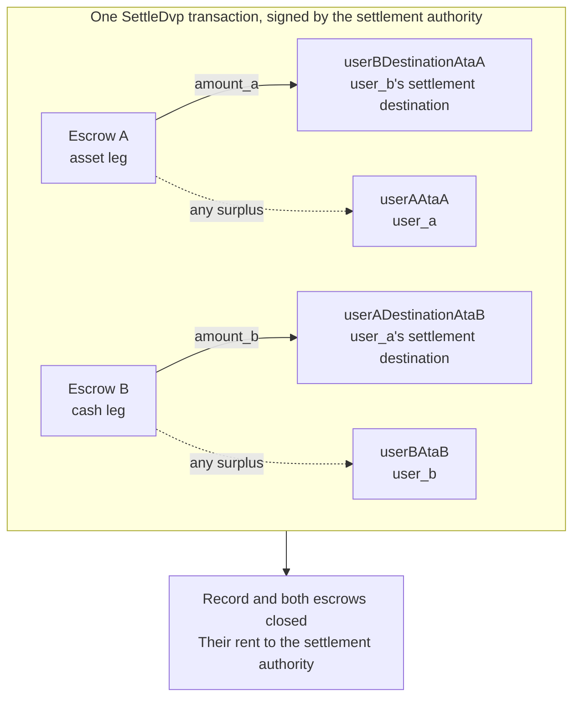

`SettleDvp` підписує розрахунковий орган, указаний у записі угоди. В одній
транзакції інструкція переказує `amount_a` частини з активом на адресу
призначення сторони грошової частини, а `amount_b` грошової частини — на адресу
призначення сторони частини з активом, повертає будь-який надлишок в обох
ескроу стороні відповідної частини та закриває запис і обидва ескроу.
Якщо будь-який із цих переказів неможливо виконати, інструкція завершується
помилкою, і нічого не переміщується.

Ця сторінка є продовженням розділів [створення угоди](/docs/defi/dvp-program/create-a-trade)
та [фінансування частин](/docs/defi/dvp-program/fund-the-legs); клієнт, підписанти,
`trade` і token account сторін переходять звідти.

## Повторна перевірка перед підписанням

Розрахунковий орган підписує транзакцію, що переміщує обидві частини, тому
перед підписанням він виконує те саме читання, що й кожна зі сторін: власник,
розмір, сторони, мінти, суми, строк дії та обидві адреси призначення (див.
[фінансування частин](/docs/defi/dvp-program/fund-the-legs#verify-the-terms)). Сама
програма під час розрахунку повторно перевіряє, що кожен мінт досі належить
token program, записаній при створенні, не має заблокованого розширення та має
ті самі повноваження мінту, що й на момент створення угоди. Тому мінт,
відтворений із заблокованим розширенням, іншою token program або іншими
повноваженнями мінту, розрахуватися не може.

## Створення акаунтів отримувачів

Розрахунок записує дані до чотирьох token account, які програма не створює:

| Акаунт                | Отримує                     | Власник                           |
| ---------------------- | ---------------------------- | ------------------------------- |
| `userADestinationAtaB` | Грошова частина (`amount_b`)    | `user_a_settlement_destination` |
| `userBDestinationAtaA` | Частина з активом (`amount_a`)   | `user_b_settlement_destination` |
| `userAAtaA`            | Будь-який надлишок у частині з активом | `user_a`                        |
| `userBAtaB`            | Будь-який надлишок у грошовій частині  | `user_b`                        |

Акаунти для надлишку використовуються лише тоді, коли в ескроу лежить більше
за узгоджену суму, але будь-хто, хто володіє мінтом, може створити надлишок,
надіславши кілька базових одиниць в ескроу. Якщо акаунта для повернення не
існує, уся транзакція розрахунку завершується помилкою, тому створіть усі
чотири ідемпотентно в тій самій транзакції.

<Tabs items={["TypeScript", "Rust"]}>
  <Tab value="TypeScript">
    ```ts
    import {
      findAssociatedTokenPda,
      getCreateAssociatedTokenIdempotentInstruction,
    } from "@solana-program/token-2022";

    const destinationA = t.userASettlementDestination; // defaults to userA
    const destinationB = t.userBSettlementDestination; // defaults to userB

    const [userADestinationAtaB] = await findAssociatedTokenPda({
      mint: mintB,
      owner: destinationA,
      tokenProgram: tokenProgramB,
    });
    const [userBDestinationAtaA] = await findAssociatedTokenPda({
      mint: mintA,
      owner: destinationB,
      tokenProgram: tokenProgramA,
    });
    // userAAtaA and userBAtaB are from fund the legs.

    const createRecipientAccounts = [
      { ata: userADestinationAtaB, owner: destinationA, mint: mintB, tokenProgram: tokenProgramB },
      { ata: userBDestinationAtaA, owner: destinationB, mint: mintA, tokenProgram: tokenProgramA },
      { ata: userAAtaA, owner: userA, mint: mintA, tokenProgram: tokenProgramA },
      { ata: userBAtaB, owner: userB, mint: mintB, tokenProgram: tokenProgramB },
    ].map(({ ata, owner, mint, tokenProgram }) =>
      getCreateAssociatedTokenIdempotentInstruction({
        payer: authoritySigner,
        ata,
        owner,
        mint,
        tokenProgram,
      }),
    );
    ```

  </Tab>

  <Tab value="Rust">
    ```rust
    use spl_associated_token_account_client::address::get_associated_token_address_with_program_id;
    use spl_associated_token_account_client::instruction::create_associated_token_account_idempotent;

    let authority: Pubkey = pubkey!("SETTLEMENT_AUTHORITY_ADDRESS_HERE");
    let destination_a = trade.user_a_settlement_destination; // defaults to user_a
    let destination_b = trade.user_b_settlement_destination; // defaults to user_b

    let user_a_destination_ata_b =
        get_associated_token_address_with_program_id(&destination_a, &mint_b, &token_program_b);
    let user_b_destination_ata_a =
        get_associated_token_address_with_program_id(&destination_b, &mint_a, &token_program_a);
    let user_a_ata_a = get_associated_token_address_with_program_id(&user_a, &mint_a, &token_program_a);
    let user_b_ata_b = get_associated_token_address_with_program_id(&user_b, &mint_b, &token_program_b);

    let create_recipient_accounts = [
        create_associated_token_account_idempotent(&authority, &destination_a, &mint_b, &token_program_b),
        create_associated_token_account_idempotent(&authority, &destination_b, &mint_a, &token_program_a),
        create_associated_token_account_idempotent(&authority, &user_a, &mint_a, &token_program_a),
        create_associated_token_account_idempotent(&authority, &user_b, &mint_b, &token_program_b),
    ];
    ```

  </Tab>
</Tabs>

## Виконання розрахунку

`legAExtrasCount` повідомляє програмі, скільки з акаунтів, доданих після
фіксованого списку, належать transfer hook переказу частини з активом; решта
належать transfer hook грошової частини. Для мінтів без transfer hook передайте
нуль і нічого не додавайте. Memo program account є обов’язковим для інструкції
і використовується лише для адрес призначення, які вимагають memo.

<Tabs items={["TypeScript", "Rust"]}>
  <Tab value="TypeScript">
    ```ts
    import { MEMO_PROGRAM_ADDRESS } from "@solana-program/memo";
    import { getSettleDvpInstruction } from "./dvp";

    const settleInstruction = getSettleDvpInstruction({
      settlementAuthority: authoritySigner,
      swapDvp,
      mintA,
      mintB,
      dvpAtaA: escrowA,
      dvpAtaB: escrowB,
      userADestinationAtaB,
      userBDestinationAtaA,
      userAAtaA,
      userBAtaB,
      tokenProgramA,
      tokenProgramB,
      memoProgram: MEMO_PROGRAM_ADDRESS,
      legAExtrasCount: 0,
    });

    const { context: settleContext } = await client.sendTransaction([
      ...createRecipientAccounts,
      settleInstruction,
    ]);
    const settleSignature = settleContext.signature;
    console.log("Submitted:", settleSignature);

    // sendTransaction returns at the client's commitment (confirmed by default).
    // Wait for finalized before recording the trade as settled.
    let finalized = false;
    for (let attempt = 0; attempt < 30 && !finalized; attempt++) {
      const {
        value: [status],
      } = await client.rpc.getSignatureStatuses([settleSignature]).send();
      if (status?.err) {
        throw new Error("Settle transaction failed");
      }
      finalized = status?.confirmationStatus === "finalized";
      if (!finalized) {
        await new Promise((resolve) => setTimeout(resolve, 2_000));
      }
    }
    if (!finalized) {
      // A closed record means it settled; an open one is safe to settle again.
      throw new Error("Settle not finalized after 60s; read the trade record");
    }
    console.log("Settled:", settleSignature);
    ```

  </Tab>

  <Tab value="Rust">
    ```rust
    use dvp_swap_program_client::instructions::SettleDvpBuilder;

    const MEMO_PROGRAM_ID: Pubkey = pubkey!("MemoSq4gqABAXKb96qnH8TysNcWxMyWCqXgDLGmfcHr");

    let settle_ix = SettleDvpBuilder::new()
        .settlement_authority(authority)
        .swap_dvp(swap_dvp)
        .mint_a(mint_a)
        .mint_b(mint_b)
        .dvp_ata_a(escrow_a)
        .dvp_ata_b(escrow_b)
        .user_a_destination_ata_b(user_a_destination_ata_b)
        .user_b_destination_ata_a(user_b_destination_ata_a)
        .user_a_ata_a(user_a_ata_a)
        .user_b_ata_b(user_b_ata_b)
        .token_program_a(token_program_a)
        .token_program_b(token_program_b)
        .memo_program(MEMO_PROGRAM_ID)
        .leg_a_extras_count(0)
        .instruction();
    ```

  </Tab>
</Tabs>



### Transfer hook

Згенерований IDL містить лише фіксовані акаунти, тому згенеровані білдери
не знають про акаунти hook. Визначте додаткові account meta кожного мінту з hook
так само, як і для прямого переказу цього токена, а потім додайте їх до
інструкції: спочатку акаунти частини з активом, потім грошової частини, а
`legAExtrasCount` має дорівнювати кількості в першій групі. У TypeScript
розгорніть визначені meta в масив `accounts` інструкції; у Rust використовуйте
`add_remaining_accounts` у білдері. Ліміт становить 32 акаунти на частину,
включно з програмою hook і акаунтом валідації; ліміт акаунтів у транзакції може
спрацювати раніше, якщо обидві частини мають hook. Програма знімає прапорець
підписанта з кожного переданого акаунта, тому hook не може отримати підпис
розрахункового органу цим шляхом.

## Фіксація результату

Вважайте угоду розрахованою, коли транзакція розрахунку досягає статусу
`finalized`. Після розрахунку запис і обидва ескроу більше не існують, тож
система, якій згодом потрібні умови, зберігає їх зі свого читання перед
розрахунком або з транзакції створення. rent закритих акаунтів переходить до
розрахункового органу.

## Помилки розрахунку

`LegNotFunded` означає, що в ескроу менше за узгоджену суму; `DvpExpired`
і `SettlementTooEarly` означають, що часове вікно пропущено; `MintAuthorityChanged`
і `BlockedMintExtension` означають, що мінт змінився після створення;
`RecipientAtaMismatch` означає, що token account призначення або повернення
відсутній чи більше не належить очікуваному власнику та мінту, зазвичай через
пропущений вище крок створення акаунтів. У кожному з цих випадків нічого не
переміщується, і сторони можуть скасувати угоду з урахуванням повноважень мінту
(див. [скасування угоди](/docs/defi/dvp-program/unwind-a-trade)).

## Наступні кроки

- [Скасування угоди](/docs/defi/dvp-program/unwind-a-trade): повернення профінансованих
  частин, якщо угода не розраховується
