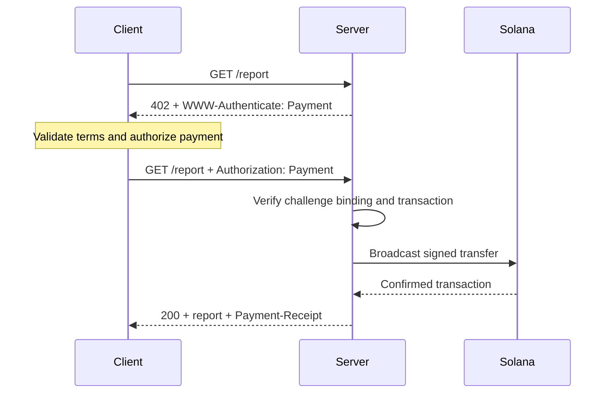
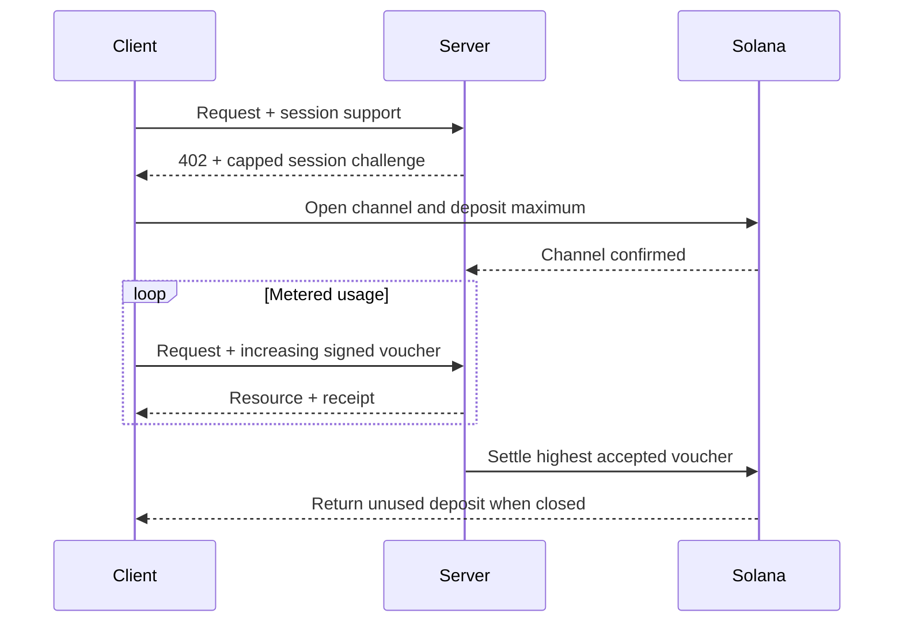

[Machine Payments Protocol (MPP)](https://mpp.dev/) застосовує семантику HTTP-автентифікації до платежів. Сервер надсилає запит на оплату у відповідь на неоплачений запит, клієнт повертає платіжні облікові дані, а сервер після прийняття платежу повертає квитанцію.

MPP розділяє три аспекти:

- **Intent (намір)** описує комерційну взаємодію, наприклад одноразове списання (`charge`) або сесію з обліком використання (`session`).
- **Платіжний метод** описує, як переміщується вартість. Метод Solana підтримує нативний SOL та токени SPL для списань.
- HTTP-**транспорт** передає запити на оплату, облікові дані, квитанції та помилки.

MPP опубліковано як набір Internet-Drafts. Вважайте [актуальні специфікації](https://paymentauth.org/) джерелом істини та очікуйте, що деталі змінюватимуться, доки чернетки перебувають у розробці.

## HTTP-обмін

MPP використовує стандартні поля HTTP-автентифікації замість специфічних для протоколу платіжних заголовків:

| Повідомлення                 | Подання в HTTP                                         |
| ----------------------- | ----------------------------------------------------------- |
| Запит на оплату       | `402 Payment Required` із `WWW-Authenticate: Payment ...` |
| Платіжні облікові дані      | Повторений запит із `Authorization: Payment ...`           |
| Квитанція про успішну оплату      | Відповідь із ресурсом та `Payment-Receipt: ...`               |
| Недійсні платіжні дані | Тіло Problem Details з `application/problem+json`       |



Запит на оплату містить згенерований сервером ID, realm, метод, intent, закодований платіжний запит і строк дії. Облікові дані повторюють запит на оплату та додають платіжне підтвердження, специфічне для методу. Сервер має перевірити обидві частини: дійсний переказ, що належить до іншого запиту на оплату, не повинен розблоковувати ресурс.

## Одноразові списання у Solana

Intent `charge` у Solana підтримує два типи облікових даних:

- **Режим pull** використовує підписану транзакцію. Клієнт підписує переказ і надсилає транзакцію на сервер. Сервер перевіряє її, за потреби додає підпис платника комісії, транслює, підтверджує та повертає підпис транзакції у квитанції.
- **Режим push** використовує підпис транзакції. Клієнт спочатку транслює транзакцію, а потім надсилає підтверджений підпис на сервер. Сервер отримує та перевіряє транзакцію, перш ніж повернути ресурс.

Режим pull уможливлює спонсорування комісій за транзакції сервером і логіку повторних спроб на стороні сервера. Режим push корисний, коли гаманець вимагає, щоб клієнт сам надсилав свою транзакцію, але він не може використовувати спонсорування комісій сервером.

Нормативні поля та правила перевірки дивіться в [специфікації Solana charge](https://paymentauth.org/draft-solana-charge-00.html).

## Додавання списання MPP до API на Express

Solana Pay Kit надає актуальну інтеграцію TypeScript для MPP і x402. Установіть його разом з Express:

```bash
pnpm add @solana/pay-kit @solana/kit@^6.9.0 express
pnpm add --save-dev @types/express tsx
```

Цей мінімальний приклад використовує розміщене пісочне середовище Surfpool і публічного демонстраційного одержувача з пакета. Він призначений лише для локальної розробки:

```ts filename=server.ts
import express from "express";
import { createPayKit, usd } from "@solana/pay-kit";

const pay = await createPayKit({
  accept: ["mpp"],
  rpcUrl: "https://402.surfnet.dev:8899"
});

const app = express();

app.get("/report", pay.express(usd("0.01")), (_req, res) => {
  res.json({ report: "Paid report" });
});

app.listen(4567, () => {
  console.log("Paid API listening on http://127.0.0.1:4567");
});
```

Запустіть його та порівняйте неоплачений запит із запитом, що підтримує оплату:

```bash
pnpm tsx server.ts
curl -i http://127.0.0.1:4567/report
pay --sandbox curl http://127.0.0.1:4567/report
```

Обробник маршруту виконується лише після того, як middleware приймає платіж.

<Callout type="warn" title="Замініть усі типові значення пісочниці у продакшені">
  Налаштуйте явну мережу, одержувача-продавця, окремий RPC, стабільний секрет прив’язки запитів на оплату, продакшен-підписувач і довговічне сховище для захисту від повторного використання. Ніколи не спрямовуйте реальні платежі на демонстраційний підписувач із пакета.
</Callout>

## Сесії з обліком використання

Використовуйте `session` Solana MPP, коли клієнт здійснюватиме багато дрібних пов’язаних платежів. Сесія відкриває ончейн-платіжний канал із максимальним депозитом, а потім використовує кумулятивні підписані ваучери в міру зростання використання. Сервер може перевіряти ваучери офчейн і пізніше розрахувати найвищу прийняту суму.

Це корисно для інференсу з обліком за токенами, завантажень з обліком за байтами, живих даних і повторних викликів інструментів. Це не те саме, що надсилати окремий ончейн-платіж за кожну подію.



Називайте сесію **платежем за сесію**, **платіжним каналом** або **обмеженою повторюваною авторизацією**. Називайте її потоковим платежем лише тоді, коли сервіс і платіжний контракт справді облікують потік використання.

## Перевірка у продакшені

Для кожного списання у Solana сервер має перевірити щонайменше таке:

- Запит на оплату автентичний, не прострочений, прив’язаний до цього запиту та призначений для цього realm.
- Транзакція використовує очікувану мережу, актив або mint, одержувача, суму та програму токенів (token program).
- Будь-які інструкції платника комісії або associated token account явно дозволені й не можуть вичерпати кошти підписувача сервера.
- Транзакція успішно виконана на необхідному рівні підтвердження (commitment level).
- Підпис транзакції ще не було використано.
- Перевірка повторного використання та операція споживання є атомарними на всіх екземплярах сервера.

Для сесій також зберігайте стан каналу, прийняту кумулятивну суму та позначку розрахунку (settlement watermark) у спільному сховищі. Задокументуйте, як клієнти повертають невикористані кошти, якщо сервер стає недоступним.

## Пов’язані ресурси

- [Специфікації MPP](https://paymentauth.org/)
- [Документація протоколу MPP](https://mpp.dev/protocol)
- [Solana Pay Kit](https://github.com/solana-foundation/pay-kit)
- [Огляд агентних платежів](/docs/payments/agentic-payments)
- [Готовність до продакшену](/docs/tools/security#verify-addresses)
