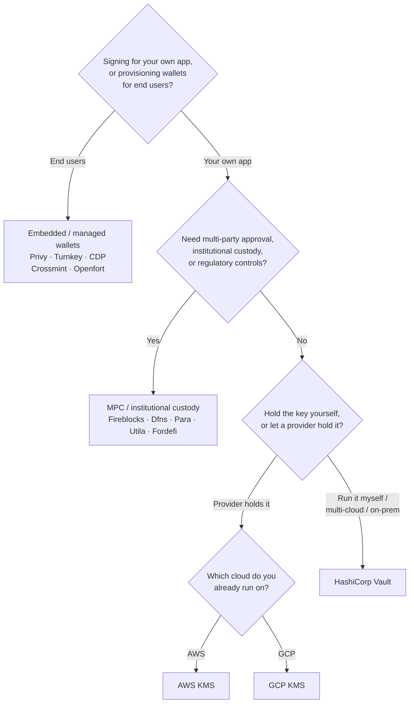

Keychain надає єдиний базовий інтерфейс `SolanaSigner` для кожного бекенду, тому для
більшості бекендів вибір є операційним, а не архітектурним: ви можете змінити його
пізніше через конфігурацію. Виняток — формат транзакції. Crossmint
і Fordefi у нативному автоматичному режимі підписують і транслюють транзакції на стороні сервера, а Fordefi у нативному
ручному режимі перезаписує транзакцію перед підписанням, тому перехід до будь-якого
з них або від нього змінює спосіб виклику підписувача. Тому **починайте з ваших
вимог, а не з продукту.** Два питання вирішують більшість: _де зберігається
приватний ключ і хто має право авторизувати підпис з його допомогою?_

Кожен бекенд, окрім Ledger, доступний усіма чотирма мовами (Rust, TypeScript,
Python і Go). Ledger підтримується лише в Rust, за опціональною функцією `ledger`.

Єдиного найкращого бекенду не існує. Кожен із них краще підходить для певного набору
обмежень: хмара, якою ви вже користуєтеся, бажання самостійно керувати ключовою
інфраструктурою, а також вимоги до зберігання та контролю підтверджень.
Схема нижче зіставляє ці обмеження з бекендом.

<Callout type="info">
  Цей посібник стосується підписання на стороні бекенду (сервера). Якщо кінцеві користувачі підписують
  власні транзакції в браузері, використовуйте гаманець через Wallet Standard.
  Див. [Підписання в
  продакшні](/docs/core/transactions/signing-in-production).
</Callout>

## Схема прийняття рішень

<Callout type="info">
  Локальна розробка й тести не потребують нічого з цього: використовуйте бекенд **Memory**
  для прототипування, а потім перейдіть на один із продакшн-бекендів вище через
  конфігурацію.
</Callout>

## Розгляд питань

<Steps>

<Step>

### Ви підписуєте для власного застосунку чи для кінцевих користувачів?

Якщо ви надаєте гаманці, якими **кінцеві користувачі** володіють і керують (споживчі застосунки,
процеси онбордингу), використовуйте бекенд **вбудованого / керованого гаманця**: Privy, Turnkey,
CDP, Crossmint або Openfort. Вони керують гаманцями окремих користувачів та автентифікацією
від вашого імені.

Якщо ви підписуєте як **власний застосунок** (платник комісії, казна, автоматизація
бекенду), перейдіть до наступного кроку.

</Step>

<Step>

### Чи потрібні вам багатосторонні підтвердження, інституційне зберігання або регуляторний контроль?

Якщо підписи мають пройти політику підтвердження, ліміт витрат або процес комплаєнсу
перед створенням, або вам потрібен регульований кастодіан, що зберігає
ключі, використовуйте бекенд **MPC / інституційного зберігання**: Fireblocks, Dfns, Para,
Utila або Fordefi. Вони розділяють ключ або зберігають його та співпідписують відповідно до вашої
політики.

Якщо вам потрібен лише ключ, що підписує на запит, перейдіть до наступного кроку.

</Step>

<Step>

### Ви хочете зберігати ключ самостійно чи довірити його провайдеру?

Якщо хмарний провайдер має зберігати ключ в апаратно захищеній інфраструктурі, а
ваша політика IAM контролює, хто може підписувати, використовуйте KMS цієї хмари:

- **Робота на AWS** → AWS KMS
- **Робота на GCP** → GCP KMS

Якщо ви хочете самостійно керувати ключовою інфраструктурою або використовуєте кілька хмар чи
власні сервери (on-prem), скористайтеся **HashiCorp Vault**. Ви керуєте ним і проводите його аудит; ключ залишається всередині
рушія Transit і підписує на запит.

</Step>

</Steps>

## Моделі зберігання

Бекенди поділяються на шість моделей зберігання. Схема вище приводить вас до однієї
з них.

- **Самостійне зберігання (у процесі)**: ваш застосунок зберігає необроблений приватний ключ.
  Зручно для розробки, але непридатно для продакшну. Бекенд:
  **Memory**.
- **Самостійне зберігання (апаратний гаманець)**: ключ ніколи не залишає пристрій Ledger, а
  людина підтверджує кожен підпис на його екрані. Підходить для інтерактивного
  підписання оператором, а не для автономних сервісів. Лише Rust, опціонально, без
  аудиту. Бекенд: **Ledger**.
- **Власна інфраструктура ключів**: ви керуєте ключовою інфраструктурою; ключ
  залишається всередині неї та підписує на запит. Бекенд: **HashiCorp Vault**.
- **Хмарний KMS / HSM**: хмарний провайдер зберігає ключ в апаратно захищеній
  інфраструктурі; ключ ніколи не залишає сервіс, а ваша політика IAM контролює,
  хто може підписувати. Бекенди: **AWS KMS**, **GCP KMS**.
- **MPC та інституційне зберігання**: ключ розділяється або зберігається у
  провайдера, який співпідписує відповідно до вашої політики (підтвердження, ліміти).
  Бекенди: **Fireblocks**, **Dfns**, **Para**, **Utila**, **Fordefi**.
- **Вбудовані та керовані гаманці**: провайдер керує гаманцями від вашого імені,
  часто для онбордингу кінцевих користувачів. Бекенди: **Privy**, **Turnkey**, **CDP**,
  **Crossmint**, **Openfort**.

## Порівняння бекендів

| Бекенд         | Модель зберігання                  | Найкраще для                                     | Примітки                                                                                                              |
| --------------- | ------------------------------ | -------------------------------------------- | ------------------------------------------------------------------------------------------------------------------ |
| Memory          | Самостійне зберігання (у процесі)      | Локальна розробка, тести, CI                 | Необроблений ключ у процесі; не використовуйте в продакшні                                                                       |
| Ledger          | Самостійне зберігання (апаратний гаманець) | Інтерактивне підписання оператором з інструментів на Rust | Лише Rust, опціональна функція `ledger`, без аудиту; кожен підпис підтверджується на пристрої                                 |
| HashiCorp Vault | Власна інфраструктура ключів     | Команди з власною інфраструктурою ключів   | Transit engine; ви самостійно керуєте та аудитуєте                                                                           |
| AWS KMS         | Хмарний KMS / HSM                | Бекенди, що працюють на AWS                      | Ключ ніколи не покидає KMS; IAM контролює підписання                                                                         |
| GCP KMS         | Хмарний KMS / HSM                | Бекенди, що працюють на GCP                      | Ключ ніколи не покидає KMS; IAM контролює підписання                                                                         |
| Fireblocks      | MPC / інституційне зберігання    | Трежері, біржі, регульоване зберігання     | Рушій політик та робочі процеси затвердження                                                                               |
| Dfns            | MPC-інфраструктура гаманців      | Програмні гаманці з керуванням політиками    | Підписання Ed25519                                                                                                    |
| Para            | MPC-гаманці                    | Застосунки з MPC-гаманцями            | API ключ + ID гаманця                                                                                                |
| Utila           | MPC-зберігання + co-signer        | Наявні Solana-гаманці під управлінням Utila        | `signMessage` не підтримується; ви транслюєте транзакцію                                                                    |
| Fordefi         | MPC / інституційне зберігання    | Інституційне зберігання з засобами контролю політик   | Чорний ящик: надсилаєте ви. Нативний авто: Fordefi перезаписує й надсилає. Нативний ручний: Fordefi перезаписує, результат надсилаєте ви |
| Privy           | Вбудовані гаманці               | Споживчі застосунки для онбордингу користувачів    | Вбудовані гаманці під управлінням застосунку                                                                                       |
| Turnkey         | Некастодіальне управління ключами   | Програмне підписання з контролем політик           | Некастодіальне управління ключами                                                                                       |
| CDP             | Керований гаманець (Coinbase)      | Застосунки на Coinbase Developer Platform      | `signMessage` приймає лише UTF-8 payload                                                                          |
| Crossmint       | Керовані гаманці                | Маркетплейси та застосунки з керованими гаманцями         | Лише надсилання: транслює на стороні сервера, може перезаписувати для спонсорування газу; `signMessage` не підтримується                   |
| Openfort        | Вбудовані бекенд-гаманці       | Серверні гаманці                          | Ключі зберігаються в TEE                                                                                                    |

## Модель можливостей

Окрім зберігання, кожен бекенд має один формат транзакції, і він визначає, як ви
викликаєте підписувач:

- **Підписання**: провайдер підписує байти, які ви сформували, а ви їх транслюєте. Більшість
  бекендів, зокрема Ledger і Fordefi у режимі чорного ящика.
- **Перезапис і підписання**: провайдер перезаписує транзакцію, а потім підписує її
  без трансляції. Продовжуйте з транзакції, яку він повертає. Fordefi у нативному
  ручному режимі.
- **Підписання й трансляція**: провайдер підписує й транслює на стороні сервера, тому
  збій не означає, що нічого не потрапило в мережу. Crossmint і Fordefi у нативному автоматичному режимі.

Таблиця можливостей підписувачів у README кожної мови описує формат кожного
бекенду; у
[моделі безпеки](https://github.com/solana-foundation/solana-keychain/blob/main/docs/SECURITY_MODEL.md)
пояснюється, що гарантує кожен формат.

## Корпоративні сценарії

Одному застосунку часто потрібно кілька таких бекендів одночасно. Оскільки
інтерфейс спільний, ви можете використовувати різні бекенди для різних ролей без зміни
місць виклику, доки бекенди мають однаковий формат можливостей.

- **Операції зі скарбницею** — розділіть операційний «гарячий» підписант від
  «холодного» підписанта скарбниці. Підкріпіть скарбницю за допомогою
  MPC-зберігання або хмарного HSM та вимагайте політик затвердження перед
  виконанням підписів великої вартості.
- **Процеси затвердження** — бекенди MPC та зберігання (наприклад, Fireblocks)
  забезпечують багатостороннє затвердження перед формуванням підпису.
- **Відповідність нормативним вимогам та аудит** — хмарні KMS (AWS/GCP) і Vault
  формують журнали аудиту підписів; інституційні кастодіани додають виконання
  політик та звітність.
- **Регульовані середовища** — зберігайте ключовий матеріал в HSM, KMS або
  інституційному кастодіані, щоб необроблені ключі ніколи не торкалися вашого
  застосунку.

Дивіться
[Найкращі практики для виробничого середовища](/docs/tools/keychain/production-best-practices)
для безпечної роботи з цими бекендами.

<Cards>
  <Card title="Посібник Rust" href="/docs/tools/keychain/getting-started/rust">
    Налаштуйте кожен бекенд у Rust.
  </Card>
  <Card
    title="Посібник TypeScript"
    href="/docs/tools/keychain/getting-started/typescript"
  >
    Налаштуйте кожен бекенд у TypeScript.
  </Card>
</Cards>
