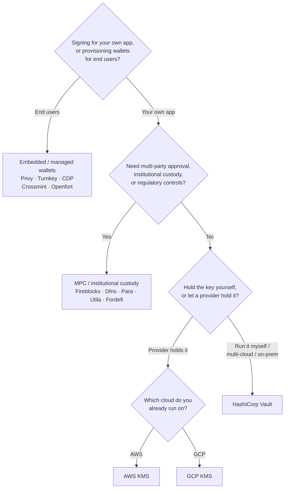

Keychain надає один базовий інтерфейс `SolanaSigner` для всіх бекендів, тому для
більшості з них вибір є операційним, а не архітектурним: ви зможете змінити його
пізніше через конфігурацію. Виняток — формат транзакції. Crossmint
і нативний авторежим Fordefi підписують і транслюють транзакції на стороні сервера, а нативний
ручний режим Fordefi переписує транзакцію перед підписанням, тож перехід на будь-який
із них або з них змінює спосіб виклику підписанта. Тому **виходьте з власних
вимог, а не з продукту.** Більшість рішення визначають два запитання: _де
зберігається приватний ключ і хто може авторизувати підпис за його допомогою?_

Кожен бекенд, окрім Ledger, доступний усіма чотирма мовами (Rust, TypeScript,
Python і Go). Ledger працює лише з Rust і підключається за допомогою опційної функції `ledger`.

Найкращого бекенду на всі випадки не існує. Кожен із них краще підходить для певного
набору обмежень: хмара, якою ви вже користуєтеся, бажання самостійно обслуговувати інфраструктуру
ключів, а також вимоги до зберігання та контролю погоджень.
Схема нижче зіставляє ці обмеження з бекендом.

<Callout type="info">
  Цей посібник описує підписання на стороні бекенду (сервера). Якщо ваші кінцеві користувачі підписують
  власні транзакції в браузері, скористайтеся натомість гаманцем через Wallet Standard.
  Див. [Підписання в
  продакшені](/docs/core/transactions/signing-in-production).
</Callout>

## Схема прийняття рішень

<Callout type="info">
  Для локальної розробки й тестів нічого з цього не потрібно: використовуйте бекенд **Memory**
  для прототипування, а потім перейдіть на один із продакшен-бекендів, наведених вище, через
  конфігурацію.
</Callout>

## Розгляд питань

<Steps>

<Step>

### Ви підписуєте для власного застосунку чи для кінцевих користувачів?

Якщо ви створюєте гаманці, якими володіють і користуються **кінцеві користувачі** (споживчі застосунки,
процеси онбордингу), використовуйте бекенд **вбудованого / керованого гаманця**: Privy, Turnkey,
CDP, Crossmint або Openfort. Вони керують гаманцями й автентифікацією кожного користувача
від вашого імені.

Якщо ви підписуєте як **власний застосунок** (платник комісії, казначейство, автоматизація на бекенді),
переходьте до наступного кроку.

</Step>

<Step>

### Чи потрібне вам багатосторонє погодження, інституційне зберігання або регуляторний контроль?

Якщо підписи мають пройти політику погодження, ліміт витрат або процес комплаєнсу
ще до створення, або вам потрібен регульований кастодіан, який зберігає
ключі, використовуйте бекенд **MPC / інституційного зберігання**: Fireblocks, Dfns, Para,
Utila або Fordefi. Вони розділяють ключ або зберігають його та співпідписують відповідно до вашої
політики.

Якщо вам потрібен лише ключ, що підписує на запит, переходьте до наступного кроку.

</Step>

<Step>

### Ви хочете зберігати ключ самостійно чи довірити його провайдеру?

Якщо хмарний провайдер має зберігати ключ в апаратно захищеній інфраструктурі, а
ваша політика IAM визначає, хто може підписувати, використовуйте KMS цієї хмари:

- **Працюєте на AWS** → AWS KMS
- **Працюєте на GCP** → GCP KMS

Якщо ви хочете самостійно обслуговувати інфраструктуру ключів або працюєте в кількох хмарах чи
на власних серверах (on-prem), використовуйте **HashiCorp Vault**. Ви самі його запускаєте й аудитуєте; ключ залишається всередині
рушія Transit і підписує на запит.

</Step>

</Steps>

## Моделі зберігання

Бекенди поділяються на шість моделей зберігання ключів. Схема вище підводить вас до однієї
з них.

- **Самостійне зберігання (в процесі)**: ваш застосунок зберігає необроблений приватний ключ.
  Зручно для розробки, але непридатно для продакшену. Бекенд:
  **Memory**.
- **Самостійне зберігання (апаратний гаманець)**: ключ ніколи не залишає пристрій Ledger, а
  людина підтверджує кожен підпис на його екрані. Підходить для інтерактивного
  підписання оператором, а не для автономних сервісів. Лише Rust, опційно, і не охоплено
  аудитом. Бекенд: **Ledger**.
- **Самостійно розгорнуте керування ключами**: ви самі обслуговуєте інфраструктуру ключів; ключ
  залишається всередині неї та підписує на запит. Бекенд: **HashiCorp Vault**.
- **Хмарний KMS / HSM**: хмарний провайдер зберігає ключ в апаратно захищеній
  інфраструктурі; ключ ніколи не залишає сервіс, а ваша політика IAM визначає,
  хто може підписувати. Бекенди: **AWS KMS**, **GCP KMS**.
- **MPC та інституційне зберігання**: ключ розділено або зберігається у
  провайдера, який співпідписує згідно з вашою політикою (погодження, ліміти).
  Бекенди: **Fireblocks**, **Dfns**, **Para**, **Utila**, **Fordefi**.
- **Вбудовані та керовані гаманці**: провайдер керує гаманцями від вашого імені,
  зазвичай для онбордингу кінцевих користувачів. Бекенди: **Privy**, **Turnkey**, **CDP**,
  **Crossmint**, **Openfort**.

## Порівняння бекендів

| Бекенд         | Модель зберігання                  | Найкраще для                                     | Примітки                                                                                                              |
| --------------- | ------------------------------ | -------------------------------------------- | ------------------------------------------------------------------------------------------------------------------ |
| Memory          | Самостійне зберігання (у процесі)      | Локальна розробка, тести, CI                 | Необроблений ключ у процесі; не використовуйте в продакшені                                                                       |
| Ledger          | Самостійне зберігання (апаратний гаманець) | Інтерактивне підписання оператором з інструментів на Rust | Лише Rust, опційна функція `ledger`, без аудиту; кожен підпис підтверджується на пристрої                                 |
| HashiCorp Vault | Власна інфраструктура ключів     | Команди з власною інфраструктурою ключів   | Transit engine; ви самостійно керуєте та аудитуєте                                                                           |
| AWS KMS         | Хмарний KMS / HSM                | Бекенди, що працюють на AWS                      | Ключ ніколи не покидає KMS; IAM контролює підписання                                                                         |
| GCP KMS         | Хмарний KMS / HSM                | Бекенди, що працюють на GCP                      | Ключ ніколи не покидає KMS; IAM контролює підписання                                                                         |
| Fireblocks      | MPC / інституційне зберігання    | Трежері, біржі, регульоване зберігання     | Рушій політик та робочі процеси затвердження                                                                               |
| Dfns            | MPC-інфраструктура гаманців      | Програмні гаманці з керуванням політиками    | Підписання Ed25519                                                                                                    |
| Para            | MPC-гаманці                    | Застосунки з MPC-гаманцями            | API ключ + ID гаманця                                                                                                |
| Utila           | MPC-зберігання + co-signer        | Наявні Solana-гаманці під управлінням Utila        | `signMessage` не підтримується; ви транслюєте транзакцію                                                                    |
| Fordefi         | MPC / інституційне зберігання    | Інституційне зберігання з засобами контролю політик   | Чорна скринька: надсилаєте ви. Нативний авторежим: Fordefi переписує й надсилає. Нативний ручний режим: Fordefi переписує, результат надсилаєте ви |
| Privy           | Вбудовані гаманці               | Споживчі застосунки для онбордингу користувачів    | Вбудовані гаманці під управлінням застосунку                                                                                       |
| Turnkey         | Некастодіальне управління ключами   | Програмне підписання з контролем політик           | Некастодіальне управління ключами                                                                                       |
| CDP             | Керований гаманець (Coinbase)      | Застосунки на Coinbase Developer Platform      | `signMessage` приймає лише UTF-8 payload                                                                          |
| Crossmint       | Керовані гаманці                | Маркетплейси та застосунки з керованими гаманцями         | Лише надсилання: транслює на стороні сервера, може переписувати для спонсорування газу; `signMessage` не підтримується                   |
| Openfort        | Вбудовані бекенд-гаманці       | Серверні гаманці                          | Ключі зберігаються в TEE                                                                                                    |

## Можливості та формат транзакції

Окрім типу зберігання, кожен бекенд має один формат транзакції, який визначає, як ви
викликаєте підписанта:

- **Підписання**: провайдер підписує створені вами байти, а ви їх транслюєте. Більшість
  бекендів, зокрема Ledger і режим «чорної скриньки» Fordefi.
- **Переписування й підписання**: провайдер переписує транзакцію, а потім підписує її
  без трансляції. Далі працюйте з поверненою транзакцією. Нативний
  ручний режим Fordefi.
- **Підписання й трансляція**: провайдер підписує й транслює на стороні сервера, тож
  помилка не означає, що нічого не потрапило в мережу. Crossmint і нативний авторежим Fordefi.

У таблиці можливостей підписантів у README кожної мови наведено формат кожного
бекенду; у
[моделі безпеки](https://github.com/solana-foundation/solana-keychain/blob/main/docs/SECURITY_MODEL.md)
пояснено, що гарантує кожен формат.

## Корпоративні сценарії

Одному застосунку часто потрібно кілька таких бекендів одночасно. Оскільки
інтерфейс спільний, ви можете запускати різні бекенди для різних ролей без зміни
місць виклику, доки бекенди мають однаковий формат можливостей.

- **Операції зі скарбницею** — розділіть операційний «гарячий» підписант від
  «холодного» підписанта скарбниці. Підкріпіть скарбницю за допомогою
  MPC-зберігання або хмарного HSM та вимагайте політик затвердження перед
  виконанням підписів великої вартості.
- **Процеси затвердження** — бекенди MPC та зберігання (наприклад, Fireblocks)
  забезпечують багатостороннє затвердження перед формуванням підпису.
- **Відповідність нормативним вимогам та аудит** — хмарні KMS (AWS/GCP) і Vault
  формують журнали аудиту підписів; інституційні кастодіани додають виконання
  політик та звітність.
- **Регульовані середовища** — зберігайте ключовий матеріал в HSM, KMS або
  інституційному кастодіані, щоб необроблені ключі ніколи не торкалися вашого
  застосунку.

Дивіться
[Найкращі практики для виробничого середовища](/docs/tools/keychain/production-best-practices)
для безпечної роботи з цими бекендами.

<Cards>
  <Card title="Посібник Rust" href="/docs/tools/keychain/getting-started/rust">
    Налаштуйте кожен бекенд у Rust.
  </Card>
  <Card
    title="Посібник TypeScript"
    href="/docs/tools/keychain/getting-started/typescript"
  >
    Налаштуйте кожен бекенд у TypeScript.
  </Card>
</Cards>
