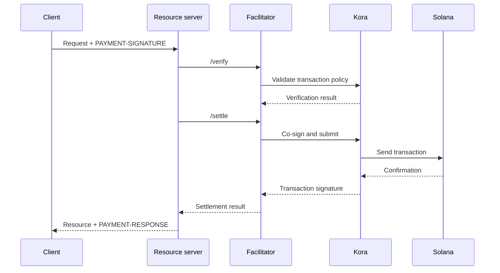

Фасилітатор x402 виконує верифікацію платежів і розрахунки для одного або кількох
ресурсних серверів. Він дає змогу API приймати ончейн-платежі, не вбудовуючи логіку
RPC, надсилання транзакцій і платника комісії в кожен процес застосунку.

Фасилітатор — це архітектурна роль, а не обов’язкова третя сторона. Ви можете
використовувати керований сервіс, запустити окремий фасилітатор або виконувати
фасилітацію самостійно всередині вашого ресурсного сервера.

## Інтерфейс фасилітатора

x402 V2 визначає три HTTP-операції:

| Кінцева точка     | Призначення                                                                       |
| ------------ | ----------------------------------------------------------------------------- |
| `/supported` | Перелічує підтримувані версії протоколу, схеми, мережі, розширення та підписувачі |
| `/verify`    | Перевіряє платіжний payload на відповідність вимогам без його розрахунку         |
| `/settle`    | Надсилає або завершує платіж і повертає результат розрахунку            |

Ваш ресурсний сервер має перевіряти `/supported` під час запуску або розгортання.
Не пропонуйте варіант оплати, доки обраний фасилітатор не підтвердить підтримку
саме цієї версії x402, схеми та мережі Solana.

```bash
curl https://facilitator.example/supported
```

## Верифікація перед наданням ресурсу

Безпечний порядок обробки запиту такий:

1. Розберіть payload `PAYMENT-SIGNATURE` за допомогою бібліотеки протоколу.
2. Зіставте його з точними `PaymentRequirements`, які були запропоновані спочатку.
3. Верифікуйте payload локально або через `/verify`.
4. Виконуйте операцію з ресурсом, лише якщо обраний платіжний потік допускає
   розрахунок після надання ресурсу.
5. Викличте `/settle` і поверніть `PAYMENT-RESPONSE` з результатом.

Різні схеми можуть визначати різний порядок надання ресурсу. Наприклад, потік
з авторизацією може верифікувати платіж до операції з ресурсом і виконувати
розрахунок після неї, тоді як інша схема може вимагати розрахунку до надання
ресурсу. Дотримуйтеся потоку, визначеного обраною схемою, а не припускайте один
порядок для всіх платежів.

<Callout type="warn" title="Сприймайте відповіді фасилітатора як рішення щодо платежу">
  Автентифікуйте трафік фасилітатора, перевіряйте кожну відповідь, використовуйте
  суворі тайм-аути та завершуйте роботу відмовою за замовчуванням (fail closed).
  Помилка мережі або некоректна відповідь не є доказом оплати.
</Callout>

## Оберіть модель розгортання

| Модель                   | Коли використовувати                                                        | Основна відповідальність                                                    |
| ----------------------- | --------------------------------------------------------------- | ---------------------------------------------------------------------- |
| Керований фасилітатор     | Вам потрібна мінімальна операційна поверхня                       | Перегляньте підтримувані мережі, модель довіри, доступність і політику щодо даних  |
| Окремий власний хостинг   | Кілька API спільно використовують інфраструктуру підпису та розрахунків        | Захист ключів, RPC, сховища, масштабування та оновлення                      |
| Фасилітація в межах процесу | Одному сервісу потрібен повний контроль, і він може керувати ланцюговими компонентами | Ізолюйте платіжний код і не допускайте його виснаження навантаженням від запитів |

Не обирайте фасилітатор лише через те, що його URL відповідає на `/supported`.
Перевірте, як він захищає ключі платника комісії, запобігає replay-атакам,
підтверджує транзакції, обробляє часткові збої та повідомляє про інциденти.

## Kora як інфраструктура підпису для Solana

[Kora](/docs/tools/kora) — це вузол-підписувач Solana з політиками перевірки транзакцій
і спонсорування комісій. Фасилітатор x402 може використовувати Kora як свій
бекенд для підпису та надсилання:



Kora не замінює x402. Ресурсний сервер і фасилітатор, як і раніше, реалізують
об’єкти та кінцеві точки x402 V2; Kora забезпечує дотримання політики транзакцій
Solana та захищає підписувач платника комісії за своїм RPC-інтерфейсом.

Дотримуйтеся [посібника Kora x402](/docs/tools/kora/guides/x402) для актуальної
демонстрації та конфігурації.

## Чекліст для production

### Ключі та політика транзакцій

- Зберігайте ключі фасилітатора та платника комісії в апаратному або віддаленому
  бекенді підпису.
- Додавайте до allowlist програми System, Compute Budget, Token, Token-2022 та
  Associated Token Program лише тією мірою, якою їх потребує підтримувана схема.
- Перед підписанням відхиляйте неочікувані акаунти з правом запису, повноваження
  на переказ, одержувачів, mint-акаунти, інструкції та ціни обчислень.
- Тримайте акаунти для отримання платежів окремо від операційних акаунтів платника комісії.

### Replay-атаки та ідемпотентність

- Зберігайте використані ідентифікатори платежів і підписи транзакцій у спільному
  надійному сховищі.
- Робіть верифікацію та споживання атомарними, щоб два екземпляри сервера не могли
  одночасно прийняти ту саму авторизацію.
- Вимагайте ключ ідемпотентності для операцій із ресурсом, що мають побічні ефекти.
- У разі легітимного повторного запиту повертайте початковий результат замість повторного списання коштів.

### Доступність і обробка збоїв

- Встановіть обмежені тайм-аути для `/verify`, `/settle`, надсилання через RPC і
  підтвердження.
- Розрізняйте відхилені, прострочені, очікувані, підтверджені та невдалі розрахунки.
- Не перебудовуйте й не підписуйте транзакцію повторно після завершення дії blockhash,
  не попросивши платника авторизувати нову транзакцію.
- Використовуйте більше ніж одну кінцеву точку RPC і відстежуйте актуальність
  blockhash, затримку підтвердження та баланс платника комісії.

### Спостережуваність

Записуйте ресурс, ідентифікатор виклику, обрану схему та мережу, суму, актив,
одержувача, адресу платника, підпис транзакції, рівень підтвердження, затримку
та фінальний статус. Ніколи не логуйте закодовані платіжні облікові дані,
bearer-токени, приватні ключі або необроблені відповіді підписувача.

Налаштуйте сповіщення про збої розрахунків, спроби replay, відхилення за політикою,
неочікувані активи або одержувачів, вичерпання коштів платника комісії та розбіжності
між верифікованими платежами та наданими ресурсами.

## Пов’язані ресурси

- [Специфікація фасилітатора x402](https://github.com/x402-foundation/x402/blob/main/specs/x402-specification-v2.md#7-facilitator-interface)
- [x402 у Solana](/docs/payments/agentic-payments/x402)
- [Посібник оператора Kora](/docs/tools/kora/operators)
- [Готовність до production](/docs/tools/transaction-landing#rpc-infrastructure)
