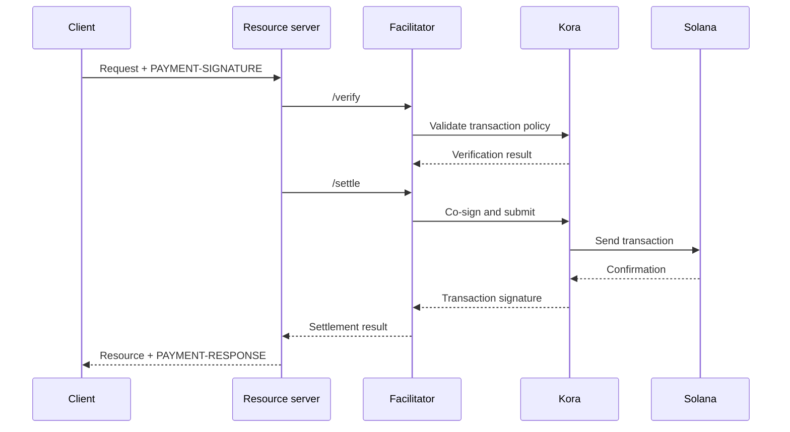

Фасилітатор x402 виконує перевірку платежів і розрахунки для одного або кількох
серверів ресурсів. Він дає змогу API приймати ончейн-платежі, не вбудовуючи логіку RPC,
відправлення транзакцій і платника комісій у кожен процес застосунку.

Фасилітатор — це архітектурна роль, а не обов’язково сторонній сервіс. Ви можете
скористатися керованим сервісом, запустити окремий фасилітатор або виконувати роль фасилітатора
безпосередньо всередині власного сервера ресурсів.

## Інтерфейс фасилітатора

x402 V2 визначає три HTTP-операції:

| Ендпоінт     | Призначення                                                                       |
| ------------ | ----------------------------------------------------------------------------- |
| `/supported` | Повертає список підтримуваних версій протоколу, схем, мереж, розширень і підписантів |
| `/verify`    | Перевіряє платіжні дані на відповідність вимогам без проведення розрахунку         |
| `/settle`    | Надсилає або завершує платіж і повертає результат розрахунку            |

Ваш сервер ресурсів має перевіряти `/supported` під час запуску або розгортання. Не
пропонуйте варіант оплати, доки обраний фасилітатор не підтвердить підтримку
саме цієї версії x402, схеми та мережі Solana.

```bash
curl https://facilitator.example/supported
```

## Перевірка перед виконанням запиту

Безпечний порядок обробки запиту такий:

1. Розберіть payload `PAYMENT-SIGNATURE` за допомогою бібліотеки протоколу.
2. Зіставте його з тими самими `PaymentRequirements`, які були запропоновані спочатку.
3. Перевірте payload локально або через `/verify`.
4. Виконуйте операцію з ресурсом, лише якщо обраний платіжний потік дозволяє
   розрахунок після виконання.
5. Викличте `/settle` і поверніть `PAYMENT-RESPONSE` з результатом.

Різні схеми можуть визначати різний порядок виконання. Наприклад,
потік з авторизацією може виконувати перевірку до операції з ресурсом, а розрахунок — після неї,
тоді як інша схема може вимагати розрахунку до надання ресурсу. Дотримуйтеся потоку,
визначеного обраною схемою, і не припускайте єдиного порядку для кожного
платежу.

<Callout type="warn" title="Сприймайте відповіді фасилітатора як рішення щодо платежу">
  Автентифікуйте трафік фасилітатора, перевіряйте кожну відповідь, використовуйте суворі
  тайм-аути та блокуйте доступ у разі збою (fail closed). Помилка мережі або некоректна відповідь не є доказом
  оплати.
</Callout>

## Оберіть модель розгортання

| Модель                   | Коли використовувати                                                        | Основна відповідальність                                                    |
| ----------------------- | --------------------------------------------------------------- | ---------------------------------------------------------------------- |
| Керований фасилітатор     | Вам потрібна мінімальна операційна поверхня                       | Перегляньте підтримувані мережі, модель довіри, доступність і політику щодо даних  |
| Окремий власний хостинг   | Кілька API спільно використовують інфраструктуру підпису та розрахунків        | Захист ключів, RPC, сховище, масштабування та оновлення                      |
| Фасилітація в межах процесу | Одному сервісу потрібен повний контроль, і він може керувати ончейн-компонентами | Ізолюйте платіжний код і не допускайте його вичерпання через навантаження запитами |

Не обирайте фасилітатор лише через те, що його URL відповідає на `/supported`.
Перевірте, як він захищає ключі платника комісій, запобігає повторному використанню платежів, підтверджує транзакції,
обробляє часткові збої та повідомляє про інциденти.

## Kora як інфраструктура підпису Solana

[Kora](/docs/tools/kora) — це вузол-підписант Solana з політиками валідації транзакцій і
спонсорування комісій. Фасилітатор x402 може використовувати Kora як бекенд
для підпису та надсилання транзакцій:



Kora не замінює x402. Сервер ресурсів і фасилітатор, як і раніше, реалізують
об’єкти та ендпоінти x402 V2; Kora забезпечує дотримання політики транзакцій Solana і
захищає підписанта платника комісій за своїм RPC-інтерфейсом.

Скористайтеся [посібником Kora x402](/docs/tools/kora/guides/x402), щоб ознайомитися з актуальними
демо та конфігурацією.

## Чекліст для продакшену

### Ключі та політика транзакцій

- Зберігайте ключі фасилітатора та платника комісій в апаратному або віддаленому бекенді
  підпису.
- Додавайте до списку дозволених лише програми System, Compute Budget, Token, Token-2022 та Associated Token
  і лише в тому обсязі, якого потребує підтримувана схема.
- Перед підписанням відхиляйте неочікувані акаунти з правом запису, авторитети переказу, одержувачів, мінти,
  інструкції та ціни обчислень.
- Тримайте акаунти для отримання платежів окремо від операційних акаунтів платника комісій.

### Повторне використання та ідемпотентність

- Зберігайте використані ідентифікатори платежів і підписи транзакцій у спільному
  надійному сховищі.
- Зробіть перевірку та споживання атомарними, щоб два екземпляри сервера не могли одночасно прийняти
  одну й ту саму авторизацію.
- Вимагайте ключ ідемпотентності для операцій з ресурсами, що мають побічні ефекти.
- У разі легітимного повторного запиту повертайте початковий результат замість повторного списання коштів.

### Доступність і обробка збоїв

- Установіть обмежені тайм-аути для `/verify`, `/settle`, надсилання через RPC та
  підтвердження.
- Розрізняйте відхилені, прострочені, очікувані, підтверджені та невдалі розрахунки.
- Не перебудовуйте й не підписуйте повторно транзакцію після завершення дії blockhash, не попросивши
  платника авторизувати нову транзакцію.
- Використовуйте більше ніж один RPC-ендпоінт і відстежуйте актуальність blockhash, затримку
  підтвердження та баланс платника комісій.

### Спостережуваність

Записуйте ресурс, ідентифікатор виклику, обрану схему та мережу, суму, актив,
одержувача, адресу платника, підпис транзакції, рівень підтвердження, затримку
та кінцевий статус. Ніколи не логуйте закодовані платіжні облікові дані, bearer-токени, приватні
ключі або необроблені відповіді підписанта.

Налаштуйте сповіщення про збої розрахунків, спроби повторного використання, відхилення за політикою, неочікувані
активи або одержувачів, вичерпання коштів платника комісій і розбіжності між перевіреними
платежами та наданими ресурсами.

## Пов’язані ресурси

- [Специфікація фасилітатора x402](https://github.com/x402-foundation/x402/blob/main/specs/x402-specification-v2.md#7-facilitator-interface)
- [x402 у Solana](/docs/payments/agentic-payments/x402)
- [Посібник оператора Kora](/docs/tools/kora/operators)
- [Готовність до продакшену](/docs/tools/transaction-landing#rpc-infrastructure)
