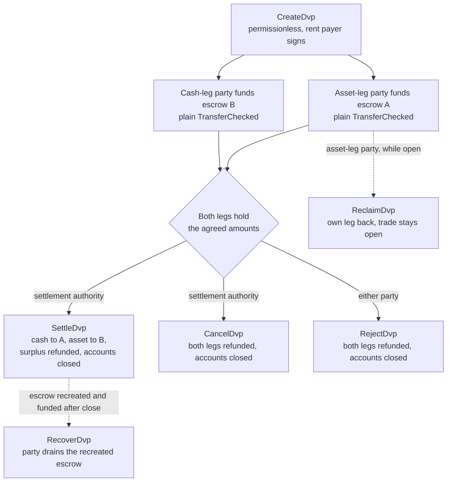
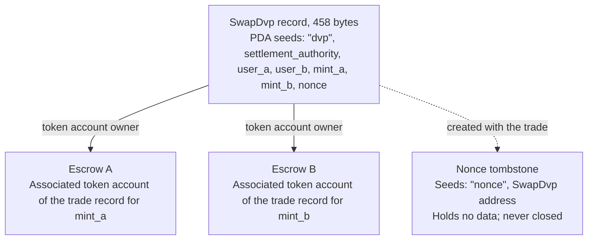

Chương trình DvP là chương trình tiêu chuẩn cho delivery versus payment (giao tài sản đồng thời thanh toán) trên Solana,
được Solana Foundation duy trì và được Cantina kiểm toán. Hai bên thỏa thuận
một thương vụ, mỗi bên gửi vế của mình vào một tài khoản escrow bằng một lệnh
chuyển token thông thường, và một bên quyết toán sẽ quyết toán cả hai vế trong một giao dịch, nên
hoặc cả hai cùng được chuyển, hoặc không vế nào được chuyển. Bên quyết toán là một địa chỉ thứ ba
được nêu trong thương vụ, chẳng hạn như sàn giao dịch hoặc đại lý đã sắp xếp thương vụ. Không bên nào
phải viết hay triển khai chương trình, và bất kỳ ví hoặc đơn vị lưu ký nào có thể gửi lệnh chuyển
token tiêu chuẩn (`TransferChecked`) đều có thể nạp một vế mà không cần tích hợp riêng cho DvP. Cho đến khi quyết toán, mỗi bên đều có thể rút lại vế của mình hoặc hoàn tác
thương vụ.

<Callout type="warn" title="Hãy đọc bản ghi trước khi hành động dựa trên nó">

Việc tạo bản ghi thương vụ không cần cấp quyền, nên một bản ghi không phải là bằng chứng của
sự đồng thuận. Mỗi bên cần đọc các điều khoản đã lưu trước khi nạp vế, và bên quyết toán
cần đọc trước khi quyết toán (xem
[xác minh](#verification-before-funding-and-settlement)).

</Callout>

## Cách hoạt động

Mỗi thương vụ có một bản ghi do chương trình sở hữu và hai tài khoản escrow, mỗi vế một tài khoản. Bên
vế tài sản (`user_a`) và bên vế tiền mặt (`user_b`) mỗi bên nạp một vế bằng cách
chuyển token vào tài khoản escrow của vế đó. Bên quyết toán là
người ký duy nhất có thể quyết toán. Quyết toán sẽ chuyển số lượng đã thỏa thuận của mỗi vế sang phía bên kia, trả lại phần dư cho bên sở hữu
vế đó, và đóng bản ghi cùng cả hai escrow. Tính nguyên tử đến từ các [giao dịch](/docs/core/transactions) Solana: cả hai lệnh chuyển nằm trong một giao dịch,
nên hoặc cả hai có hiệu lực, hoặc không lệnh nào có hiệu lực.

Mọi khoản hoàn tiền, thu hồi và trả phần dư đều chuyển về associated token account của chính bên đó: tài khoản của `user_a` cho `mint_a`, của `user_b` cho `mint_b`. Một
đơn vị lưu ký hoặc hệ thống ngân quỹ có thể nạp một vế từ tài khoản của mình, nhưng mọi khoản
trả lại đều vào tài khoản của bên đó, không quay về đơn vị lưu ký. Mỗi thương vụ
còn để lại một tài khoản đánh dấu vĩnh viễn (xem [Trạng thái](#state)).

## Hướng dẫn

Các trang từng bước đưa một thương vụ từ lúc tạo đến khi quyết toán, kèm TypeScript và
Rust cho từng instruction.

<Cards>
  <Card title="Tạo thương vụ" href="/docs/defi/dvp-program/create-a-trade">
    Cài đặt các client và ghi lại điều khoản của thương vụ bằng CreateDvp
  </Card>
  <Card title="Nạp các vế" href="/docs/defi/dvp-program/fund-the-legs">
    Xác minh các điều khoản đã lưu, rồi nạp từng vế bằng một lệnh chuyển thông thường
  </Card>
  <Card title="Quyết toán thương vụ" href="/docs/defi/dvp-program/settle-the-trade">
    Quyết toán cả hai vế trong một giao dịch với tư cách bên quyết toán
  </Card>
  <Card title="Hoàn tác thương vụ" href="/docs/defi/dvp-program/unwind-a-trade">
    Rút lại một vế, hủy hoặc từ chối thương vụ, và thu hồi các khoản nạp muộn
  </Card>
</Cards>

Một [bản demo trên devnet](https://solana.com/delivery-vs-payment/demo) chạy một thương vụ từ
đầu đến cuối: tạo thương vụ, nạp cả hai escrow bằng các lệnh chuyển token tiêu chuẩn, và
quyết toán cả hai vế trong một giao dịch.

## Lựa chọn giữa chương trình và ủy quyền

[Delivery vs Payment (DvP) sử dụng ủy quyền](/docs/tokenization/dvp) thực hiện
cùng kiểu trao đổi mà không cần chương trình: mỗi bên ủy quyền vị thế của mình cho một
đại lý quyết toán, và đại lý này chuyển cả hai vế trong một giao dịch.

- **Chương trình** không cần ủy quyền, nên giới hạn một delegate cho mỗi token
  account không áp dụng, và bên quyết toán không thể chuyển hướng tiền thu được.
  Mỗi thương vụ phụ thuộc vào một chương trình có thể nâng cấp và upgrade authority của nó.
- **Mẫu ủy quyền** không phụ thuộc vào chương trình và hoạt động với các mint
  có Scaled UI Amount. Chương trình từ chối các mint đó, nghĩa là loại trừ mọi
  mint được tạo từ mẫu `tokenized-security` của Mosaic (xem
  [ràng buộc cấu hình mint](#mint-configuration-constraints)).

## Vai trò

Chương trình có tính đối xứng. Trong giao diện của nó, hai bên là `user_a`, người giao
`mint_a`, và `user_b`, người giao `mint_b`. README và các client được tạo tự động
gọi `mint_a` là vế tài sản và `mint_b` là vế tiền mặt, và các trang này theo
quy ước đó, nhưng chương trình không yêu cầu vế tiền mặt phải là một công cụ tiền mặt.
Hai tài sản, hoặc hai stablecoin, đều được quyết toán theo cách tương tự.

| Vai trò                 | Ai                               | Ký                                              | Ghi chú                                                                                                                                                                                                     |
| -------------------- | --------------------------------- | -------------------------------------------------- | --------------------------------------------------------------------------------------------------------------------------------------------------------------------------------------------------------- |
| Bên vế tài sản      | `user_a`, giao `mint_a`       | Lệnh chuyển nạp vế của chính mình; Reclaim, Reject, Recover | Ví keypair, hoặc ví thông minh dựa trên PDA như multisig vault. Tài khoản multisig của SPL Token hoặc program account không thể là một bên: Create sẽ thất bại với `PartyNotSignerCapable`                   |
| Bên vế tiền mặt       | `user_b`, giao `mint_b`       | Lệnh chuyển nạp vế của chính mình; Reclaim, Reject, Recover | Cùng yêu cầu                                                                                                                                                                                          |
| Bên quyết toán | Một địa chỉ thứ ba được nêu khi tạo | Settle, Cancel                                     | Người ký duy nhất có thể quyết toán. Không thể chuyển hướng tiền thu được, vốn đã được cố định khi tạo. Nhận rent của các tài khoản bị đóng khi quyết toán hoặc hủy                                         |
| Bên trả rent           | Bất kỳ ai ký `CreateDvp`         | Create                                             | Chi trả rent (khoản SOL đặt cọc để giữ tài khoản luôn mở) cho bản ghi, nonce tombstone và cả hai escrow. Không được ghi nhận là bên nhận rent: rent của tài khoản bị đóng thuộc về người đóng thương vụ |

## Program ID

```text
dvp34bdbcEm4f4FCUjGV4mDAkDshaQR4LkK8fdcsyZq
```

| Cluster      | Chương trình                                       | Upgrade authority                              | Slot triển khai gần nhất |
| ------------ | --------------------------------------------- | ---------------------------------------------- | ------------------ |
| mainnet-beta | `dvp34bdbcEm4f4FCUjGV4mDAkDshaQR4LkK8fdcsyZq` | `DXtFpbPjcn2hxPnw79x1Pfoj35vXh5AsWBkS37YnXMVv` | 452,058,374        |
| devnet       | `dvp34bdbcEm4f4FCUjGV4mDAkDshaQR4LkK8fdcsyZq` | `5EX1zFeJWj4rGYZv432WnYw8CbaSUeTdxPx4r573UgYU` | 479,376,863        |

Chương trình có thể nâng cấp trên cả hai cluster. Các số liệu trên là kết quả
`solana program show` trả về vào ngày 2 tháng 10 năm 2026; hãy chạy cùng lệnh để xem
giá trị hiện tại. Bản build trên devnet cũ hơn commit mà các trang từng bước được
viết dựa trên (xem [Cài đặt](/docs/defi/dvp-program/create-a-trade#install)),
với cùng bộ instruction và lỗi.

## Vòng đời



Một thương vụ ở trạng thái mở từ `CreateDvp` cho đến khi một trong các lệnh Settle, Cancel hoặc Reject đóng
nó. Việc nạp vế không có instruction riêng: một vế được coi là đã nạp khi tài khoản
escrow của nó chứa ít nhất số lượng đã thỏa thuận. Reclaim áp dụng theo từng vế và giữ
thương vụ ở trạng thái mở, nên vấn đề ở một vế không buộc bên kia phải hủy
toàn bộ thương vụ.

## Trạng thái

Mỗi thương vụ có một tài khoản `SwapDvp` dài 458 byte, do chương trình sở hữu. Địa chỉ
của nó được suy ra từ bên quyết toán, hai bên, hai mint và một nonce (các seed
`["dvp", settlement_authority, user_a, user_b, mint_a, mint_b, nonce]`). Các
số lượng và thời gian được lưu bên trong tài khoản và không ảnh hưởng đến địa chỉ,
vì vậy phải đọc chúng chứ không thể suy đoán. Một tài khoản đánh dấu nhỏ,
nonce tombstone tại `["nonce", swap_dvp]`, được tạo cùng thương vụ và
không bao giờ bị đóng, nên mỗi tổ hợp gồm các bên, mint, authority và nonce chỉ có thể
được dùng cho một thương vụ duy nhất.



| Trường                                  | Kiểu          | Ý nghĩa                                                                                                 |
| -------------------------------------- | ------------- | ------------------------------------------------------------------------------------------------------- |
| `bump`                                 | `u8`          | PDA bump                                                                                                |
| `user_a`, `user_b`                     | `Pubkey`      | Hai bên tham gia                                                                                         |
| `mint_a`, `mint_b`                     | `Pubkey`      | Các mint của vế tài sản và vế tiền mặt                                                                        |
| `settlement_authority`                 | `Pubkey`      | Người ký duy nhất có thể quyết toán hoặc hủy                                                               |
| `token_program_a`, `token_program_b`   | `Pubkey`      | Token program sở hữu mỗi mint; một thương vụ có thể kết hợp các vế SPL Token và Token-2022                    |
| `amount_a`, `amount_b`                 | `u64`         | Số lượng đã thỏa thuận của mỗi vế, tính theo đơn vị nhỏ nhất của mint (base unit)                                 |
| `expiry_timestamp`                     | `i64`         | Sau thời điểm mạng này (đồng hồ onchain), Settle bị từ chối. Reclaim, Cancel và Reject vẫn hoạt động |
| `nonce`                                | `u64`         | Phân biệt các thương vụ có chung các seed còn lại. Chỉ dùng một lần                                             |
| `ref_string`                           | `[u8; 64]`    | Một tham chiếu mờ của client, đệm số không; chương trình không bao giờ đọc nó                                     |
| `user_a_settlement_destination`        | `Pubkey`      | Nhận vế tiền mặt khi Settle; mặc định là `user_a`                                                   |
| `user_b_settlement_destination`        | `Pubkey`      | Nhận vế tài sản khi Settle; mặc định là `user_b`                                                  |
| `mint_a_authority`, `mint_b_authority` | `Pubkey`      | Các mint authority được ghi lại khi tạo; Settle thất bại nếu một trong hai đã thay đổi                           |
| `earliest_settlement_timestamp`        | `Option<i64>` | Nếu được đặt, Settle bị từ chối trước thời điểm mạng này                                                     |

Danh sách trường được lấy từ IDL của chương trình tại commit được nêu trong
[Tạo thương vụ](/docs/defi/dvp-program/create-a-trade#install).

## Các instruction

| Instruction  | Người ký               | Tác dụng                                                                                                                                                              |
| ------------ | -------------------- | ------------------------------------------------------------------------------------------------------------------------------------------------------------------- |
| `CreateDvp`  | Bất kỳ bên trả phí nào            | Tạo bản ghi `SwapDvp`, nonce tombstone của nó và cả hai tài khoản escrow. Không chuyển token nào                                                                        |
| `ReclaimDvp` | `user_a` hoặc `user_b` | Trả lại vế của chính người ký từ escrow. Thương vụ vẫn mở và vế đó có thể được nạp lại                                                                      |
| `SettleDvp`  | Bên quyết toán | Chuyển `amount_a` đến địa chỉ nhận của `user_b` và `amount_b` đến địa chỉ nhận của `user_a`, trả phần dư cho bên của vế đó, đóng bản ghi và cả hai escrow |
| `CancelDvp`  | Bên quyết toán | Hoàn lại toàn bộ số dư trong escrow A cho `user_a` và escrow B cho `user_b`, đóng bản ghi và cả hai escrow                                                            |
| `RejectDvp`  | `user_a` hoặc `user_b` | Tác dụng giống Cancel, nhưng do một bên ký                                                                                                                            |
| `RecoverDvp` | `user_a` hoặc `user_b` | Sau khi thương vụ đã đóng: rút sạch một escrow được tạo lại về token account của chính người ký và đóng nó. Xử lý khoản nạp đến sau Settle, Cancel hoặc Reject  |

Mọi khoản hoàn tiền đều chuyển về associated token account của chính bên đó cho
mint của vế ấy, bất kể ai đã nạp escrow.

Các account và đối số của từng instruction nằm trên trang của bước đó.

## Lỗi

| Mã | Lỗi                            | Khi nào                                                                                                   |
| ---- | -------------------------------- | ------------------------------------------------------------------------------------------------------ |
| 0    | `SignerNotParty`                 | Reclaim, Reject hoặc Recover được ký bởi một địa chỉ không phải `user_a` hay `user_b`                      |
| 1    | `DvpExpired`                     | Settle sau `expiry_timestamp`                                                                        |
| 2    | `SettlementAuthorityMismatch`    | Settle hoặc Cancel được ký bởi một địa chỉ khác với bên quyết toán                              |
| 3    | `SettlementTooEarly`             | Settle trước `earliest_settlement_timestamp`                                                          |
| 4    | `LegNotFunded`                   | Settle khi một escrow chứa ít hơn số lượng đã thỏa thuận                                               |
| 5    | `ExpiryNotInFuture`              | Create với thời điểm hết hạn bằng hoặc trước thời gian mạng hiện tại                                            |
| 6    | `EarliestAfterExpiry`            | Create với thời điểm quyết toán sớm nhất sau thời điểm hết hạn                                               |
| 7    | `SelfDvp`                        | Create với `user_a` bằng `user_b`                                                                 |
| 8    | `SameMint`                       | Create với `mint_a` bằng `mint_b`                                                                 |
| 9    | `ZeroAmount`                     | Create với số lượng bằng không ở một trong hai vế                                                                |
| 10   | `BlockedMintExtension`           | Create hoặc Settle với mint có TransferFee, InterestBearing, ScaledUiAmount hoặc NonTransferable |
| 11   | `SettlementAuthorityIsParty`     | Create với bên quyết toán trùng với một trong các bên                                                  |
| 12   | `SettlementAuthorityExecutable`  | Create với bên quyết toán là executable                                                         |
| 13   | `NonceAlreadyUsed`               | Create dùng lại một `(seeds, nonce)` đã có tombstone                                         |
| 14   | `ExpiryTooFarInFuture`           | Create với thời điểm hết hạn xa hơn một năm                                                         |
| 15   | `RefStringTooLong`               | Create với tham chiếu dài hơn 64 byte                                                           |
| 16   | `DvpStillOpen`                   | Recover khi thương vụ vẫn còn mở; hãy dùng Reclaim                                                     |
| 17   | `DvpNeverCreated`                | Recover với các seed không có tombstone                                                              |
| 18   | `EscrowPreloadedWithLamports`    | Create khi một escrow không phải native chứa lamport vượt quá mức tối thiểu để được miễn rent                           |
| 19   | `SettlementDestinationIsSwapDvp` | Create với đích thanh toán trùng với bản ghi thương vụ                                         |
| 20   | `SwapDvpPreloadedWithLamports`   | Create khi địa chỉ bản ghi chứa lamport vượt quá mức dự trữ rent                                   |
| 21   | `RecipientAtaMismatch`           | Một token account của người nhận hoặc token account hoàn tiền không còn thuộc về ví và mint như dự kiến                  |
| 22   | `PartyNotSignerCapable`          | Create với một bên không phải là tài khoản thuộc sở hữu của system và không thể thực thi                                 |
| 23   | `MintAuthorityChanged`           | Settle khi mint authority của một leg khác với giá trị đã ghi nhận lúc tạo                         |

## Sự kiện và lập chỉ mục

Chương trình không phát ra sự kiện onchain nào. Một indexer hoặc hệ thống đối soát đọc
trạng thái tài khoản `SwapDvp` và số dư token của hai escrow, đồng thời dùng
`ref_string` để đối chiếu một thương vụ với lệnh off-chain của nó. Vì bản ghi
bị đóng khi thanh toán, hệ thống cần xem lại các điều khoản sau đó phải lưu
chúng ngay khi đọc, hoặc tái dựng từ giao dịch đã tạo ra
thương vụ.

## Token được hỗ trợ

Một thương vụ có thể ghép một leg SPL Token với một leg Token-2022; mỗi leg mang
token program riêng. Các leg Wrapped SOL được hỗ trợ.

| Extension Token-2022 trên mint của một leg                                                     | Hành vi của chương trình                                                  |
| ---------------------------------------------------------------------------------------- | ----------------------------------------------------------------- |
| TransferFee, InterestBearing, ScaledUiAmount, NonTransferable                            | Bị từ chối tại Create và Settle với lỗi `BlockedMintExtension`         |
| PermanentDelegate, Pausable, DefaultAccountState, freeze authority, MintCloseAuthority | Được chấp nhận; mỗi authority có thể tác động lên số token đang ký quỹ           |
| ConfidentialTransfer                                                                     | Được chấp nhận; số lượng trên leg đó là công khai                          |
| TransferHook                                                                             | Được hỗ trợ, tối đa 32 tài khoản bổ sung cho mỗi leg                        |
| MemoTransfer trên tài khoản đích hoặc tài khoản hoàn tiền                                          | Được chấp nhận; chương trình phát memo bắt buộc trước khi chuyển |

Phí chuyển khoản sẽ khiến bên nhận nhận thiếu so với số lượng đã thỏa thuận.
Interest Bearing và Scaled UI Amount không thay đổi số lượng thô, nhưng lãi suất
hoặc hệ số nhân của chúng có thể thay đổi giữa lúc tạo và lúc thanh toán thương vụ, làm thay đổi
cách hiển thị các số lượng đã thỏa thuận. NonTransferable sẽ khiến cả hai leg bị kẹt.

Các authority được chấp nhận có thể di chuyển, đóng băng hoặc tạm dừng số token đang ký quỹ trong
suốt vòng đời của thương vụ (xem bên dưới). Escrow không thể được cấu hình để nhận
các giao dịch chuyển khoản bảo mật, nên số lượng ký quỹ và số lượng đã thanh toán trên một leg
bảo mật là công khai.

Với mint có hook, client phân giải các tài khoản bổ sung của hook và nối chúng
vào Settle, Cancel, Reject, Reclaim và Recover. Giới hạn 32 tài khoản cho mỗi leg
tính cả chương trình hook và tài khoản xác thực của nó. Nếu hook authority
mở rộng danh sách tài khoản của hook vượt quá giới hạn đó, mọi lần chuyển trên leg ấy
đều thất bại, kể cả Reclaim, Cancel, Reject và Recover, cho đến khi authority
hoàn tác thay đổi. Giới hạn tài khoản của giao dịch có thể chạm trước giới hạn theo từng leg khi
cả hai leg đều có hook.

Khi một tài khoản đích hoặc tài khoản hoàn tiền yêu cầu memo, chương trình gọi chương trình Memo
trước khi chuyển, đó là lý do mọi instruction chuyển token
ra khỏi escrow đều nhận một tài khoản `memo_program`.

### Ràng buộc cấu hình mint

**Scaled UI Amount.** Template `tokenized-security` trong
[Mosaic](https://github.com/solana-foundation/mosaic), bộ công cụ phát hành của Solana Foundation,
luôn thêm Scaled UI Amount, vì vậy chương trình không chấp nhận một
mint được tạo từ template đó làm leg. Một mint dành cho chương trình này có thể
được tạo mà không có extension đó (xem
[Token Extensions](/docs/tokens/extensions));
[DvP sử dụng ủy quyền](/docs/tokenization/dvp) thanh toán thông qua quyền
được ủy quyền và không áp dụng kiểm tra này.

**Mint bị đóng băng theo mặc định.** Escrow của mỗi thương vụ là một associated token account
thuộc sở hữu của một program-derived address mới cho thương vụ đó. Với mint có
Default Account State đặt là frozen, escrow được tạo ở trạng thái bị đóng băng, và giao dịch
chuyển tiền nạp vào đó sẽ thất bại cho đến khi được mở băng. Với
[Token ACL](/docs/tokenization/token-acl), điều đó có nghĩa là bên phát hành hoặc transfer
agent của họ phải duyệt escrow của thương vụ trước khi nạp tiền: bằng cách thêm địa chỉ
của bản ghi thương vụ (chủ sở hữu của escrow) vào allowlist, để bất kỳ ai cũng có thể mở băng
escrow nếu cấu hình Token ACL của mint bật permissionless thaw, hoặc bằng cách
để freeze authority mở băng trực tiếp. Một escrow bị đóng băng cũng chặn
Settle, Reclaim, Cancel, Reject và Recover trên leg đó, do đó freeze
authority, và với mint có hook thì cả hook authority, là bên được tin cậy trong suốt
vòng đời của thương vụ. Trường hợp escrow bị đóng băng được mô tả ở đây và không được thực thi
trong các đoạn mã devnet.

## Giới hạn

- Không có khớp lệnh, khám phá giá hay sổ lệnh. Các bên thỏa thuận điều khoản ngoài
  sổ cái và một trong hai bên ghi lại chúng.
- Không bù trừ, và chỉ song phương: một bản ghi là một thương vụ giữa hai bên.
- Không khớp từng phần. Settle chuyển đúng số lượng đã thỏa thuận của mỗi leg và
  trả phần dư (nếu có) cho bên của leg đó.
- Không có leg ngoài sổ cái. Cả hai leg đều là token account trên Solana; một leg tiền mặt trên
  hạ tầng hiện có được thanh toán riêng và đối soát.
- Không kiểm tra điều kiện đủ tư cách, allowlist hay KYC. Cơ chế kiểm soát của chính mint sẽ áp dụng
  điều kiện đủ tư cách của người nắm giữ.
- Không thanh toán tự động. Settlement authority phải ký.
- Không có sự kiện, và không có phí giao thức ngoài phí giao dịch và rent.

Chương trình loại bỏ rủi ro gốc giữa hai bên: không leg nào được chuyển
trừ khi cả hai cùng được chuyển. Nó không loại bỏ rủi ro tín dụng của bên phát hành hoặc rủi ro mua lại trên mỗi
token, khả năng freeze, pause hoặc permanent delegate authority của một mint
tác động lên token đang ký quỹ (xem [token được hỗ trợ](#supported-tokens)), cũng như
sự phụ thuộc vào việc settlement authority sẵn sàng để ký.

## Xác minh trước khi nạp tiền và thanh toán

`CreateDvp` không cần cấp quyền: chỉ payer ký, còn các bên và
settlement authority thì không. Do đó bất kỳ ai cũng có thể tạo một bản ghi nêu tên bất kỳ
bên nào với bất kỳ điều khoản nào. Trước khi nạp tiền, và một lần nữa trước khi thanh toán, hãy đọc tài khoản
`SwapDvp` và xác nhận:

1. Tài khoản thuộc sở hữu của chương trình DvP và có kích thước đúng 458 byte. Một tài khoản
   không thuộc sở hữu của chương trình có thể được điền các byte giải mã giống như một
   bản ghi thật.
2. `user_a`, `user_b`, `mint_a`, `mint_b` và `settlement_authority` khớp với
   thương vụ đã thỏa thuận.
3. `amount_a`, `amount_b`, `expiry_timestamp` và
   `earliest_settlement_timestamp` khớp với các điều khoản đã thỏa thuận.
4. Cả hai đích thanh toán là các địa chỉ đã thỏa thuận. Một bản ghi giả mạo có thể
   chuyển hướng tiền thu được.

[Nạp tiền cho các leg](/docs/defi/dvp-program/fund-the-legs#verify-the-terms) liệt kê các
hàm đọc có kiểm tra của client được tạo sinh và trình bày cách kiểm tra bằng mã.

Hãy coi một thương vụ là đã thanh toán khi giao dịch Settle đạt mức
[`finalized`](/docs/rpc#configuring-state-commitment). Đó là một mức
commitment của mạng; việc nó có đồng thời đánh dấu tính chung thẩm của thanh toán về mặt pháp lý hay không
phụ thuộc vào các thỏa thuận của các bên và chế độ pháp lý được áp dụng.

## Phiên bản

Tài khoản `SwapDvp` không có trường phiên bản. Bố cục của nó được cố định ở 458 byte
(`SwapDvp::LEN`), và các hàm đọc có kiểm tra sẽ từ chối tài khoản có độ dài khác.
IDL có phiên bản riêng, `0.1.0` tính đến ngày 2 tháng 10 năm 2026.

Chương trình có thể nâng cấp trên cả hai cluster (xem [Program ID](#program-id)). Bản ghi
thương vụ chỉ tồn tại cho đến khi được thanh toán, hủy hoặc từ chối, vì vậy hãy kiểm tra
repository để biết một lần nâng cấp xử lý các thương vụ đang mở như thế nào, và tạo lại các client
từ IDL của bản build đã triển khai.

## Repository và kiểm toán

Mã nguồn, IDL, các client được tạo sinh và test nằm trong
[`solana-foundation/dvp`](https://github.com/solana-foundation/dvp) theo giấy phép
MIT. Chương trình là một chương trình Pinocchio `no_std`; các client được
tạo sinh từ IDL bằng Codama. Báo cáo lỗ hổng được gửi qua liên kết security advisory
của repository, theo `SECURITY.md`.

Chương trình đã được
[Cantina](https://cantina.xyz/portfolio/fe870bb4-d96d-4902-8aec-9dfcfa2d6a79) kiểm toán.

## Liên quan

- [Giao hàng đồng thời thanh toán (DvP) sử dụng ủy quyền](/docs/tokenization/dvp): mô hình
  ủy quyền không cần chương trình
- [Token ACL](/docs/tokenization/token-acl): cách một mint bị hạn chế tương tác với các
  tài khoản escrow
